<div align="center">


# Plethora

### **Read anything. Learn everything.**

*The local-first incremental reading, spaced repetition, and adaptive learning workstation for desktop & mobile.*

[](CHANGELOG.md)
[](LICENSE)
[](#%EF%B8%8F-installation--builds)
[](https://tauri.app/)
[](https://react.dev/)
[](https://www.rust-lang.org/)

[**✨ Features**](#-feature-matrix) •
[**🧬 What's New in 3.x**](#-whats-new-in-plethora-3x) •
[**📱 Mobile**](#-native-mobile--e-ink-experience) •
[**🔒 Privacy**](#-local-first-privacy--security-architecture) •
[**🚀 Quick Start**](#-quick-start) •
[**🛠️ Build & Install**](#%EF%B8%8F-installation--builds) •
[**📖 Docs**](#-documentation--handbooks)

</div>

---

<div align="center">
  <a href="assets/PlethoraPromo.mp4">
    
  </a>
  <br>
  <sub>▶ Watch the 49-second tour — <a href="assets/PlethoraPromo.mp4">download the MP4</a></sub>
</div>

---

## 🌟 Overview

**Plethora** combines **incremental reading**, **scientific spaced repetition (FSRS-7)**, **adaptive study curricula**, **grounded AI synthesis**, and **circadian learning analytics** into a single cohesive environment.

Instead of drowning in open tabs, unread PDFs, 3-hour podcasts, and disconnected flashcard decks, Plethora lets you ingest your entire information diet into one local SQLite-backed library—breaking dense material into atomic extracts, scheduling reviews at the exact moment before forgetting, and mapping how your knowledge (and even your sleep) evolves over time.

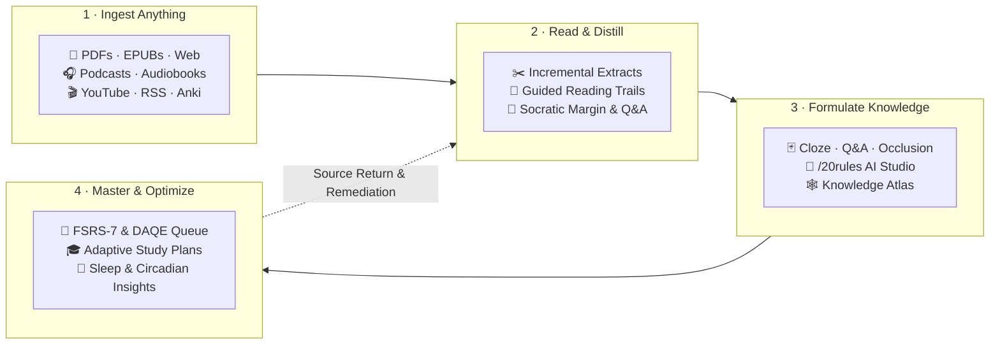

### Core Pillars

| Pillar | What It Means in Practice |
| :--- | :--- |
| 📖 **Incremental Reading** | Read massive books, papers, and feeds in interleaved priority chunks. Extract key passages inline without losing flow, and jump from any flashcard straight back to its exact source paragraph. |
| 🧠 **FSRS-7 & DAQE Scheduling** | Powered by production **FSRS-7**, plus **SM-18**, **SM-20**, and **Classic SM-2**. The **Dynamic Adaptive Queue Engine (DAQE)** balances cognitive load, urgency, retention targets, and available timebox minutes. |
| 🎓 **Adaptive Study Plans & Trails** | Generate diagnostic-driven curricula with structured lessons, interactive dependency graphs, **Guided Reading Trails** with inline comprehension checks, and source-grounded remediation. |
| 🤖 **On-Device & Cloud AI** | Run **100% offline** via Apple Intelligence, Android Gemini Nano (AICore), Windows Phi Silica, Ollama, EmbeddingGemma 2, and Cactus Mirage vision—or connect your own cloud keys with strict per-document consent gates. |
| 🎧 **Unified Audio & Media Studio** | Global persistent mini-player, **Audio Editions** (turn any PDF/article into a narrated audiobook via local Chatterbox/Pocket-TTS or Fal.ai), and **local-first podcast sponsor skipping** with a 120ms lookahead guard. |
| 🌙 **Sleep & Circadian Intelligence** | Correlate your real FSRS-7 memory residuals against sleep stages, HRV, and Borbély two-process circadian alertness in a physically isolated, zero-egress on-device **Health Vault** (`health.db`). |

---

## 🧬 What's New in Plethora 3.x

Plethora 3.x represents a massive leap forward across learning intelligence, media processing, theming, and cross-platform polish:

<table>
  <tr>
    <td width="50%" valign="top">
      <h4>🌙 Sleep Tracking & Learning Insights <sub><code>v3.12</code></sub></h4>
      <ul>
        <li><b>Circadian Alertness & SRI</b>: Borbély two-process homeostatic/circadian modeling, Sleep Regularity Index (SRI), and overnight HRV (RMSSD/SDNN) recovery tracking.</li>
        <li><b>FSRS-7 Recall Residuals</b>: Quantifies how sleep duration and Deep/REM architecture shift actual recall vs. FSRS-7 predictions using day-clustered bootstrap CIs and Benjamini-Hochberg FDR control.</li>
        <li><b>Wearables & Isolated Health Vault</b>: Native Apple HealthKit & Android Health Connect bridges, OAuth 2.0 PKCE for Oura Ring, WHOOP, and Google Health (Fitbit/Pixel Watch), stored in an isolated on-device <code>health.db</code>.</li>
      </ul>
    </td>
    <td width="50%" valign="top">
      <h4>📡 AI Smart RSS & Transcript Studio <sub><code>v3.12+</code></sub></h4>
      <ul>
        <li><b>AI Smart RSS Feeds</b>: Topic-defined curated feeds with <i>Local</i> (lexical + on-device embeddings), <i>Hybrid</i>, or <i>Cloud</i> semantic ranking and cluster deduplication.</li>
        <li><b>Interactive Transcript Blocks</b>: Multi-format transcript export, block-level actions (extract, flashcard, citation, timed video slice), and persistent transcript chat across reloads.</li>
        <li><b>Dashboard Quick Review</b>: Jump straight into due flashcard bursts from the Dashboard, plus Command Palette YouTube playlist selective import.</li>
      </ul>
    </td>
  </tr>
  <tr>
    <td width="50%" valign="top">
      <h4>🎨 OKLCH Image Themes, Animated GIFs & Atlas <sub><code>v3.10–3.12</code></sub></h4>
      <ul>
        <li><b>Custom Theme Engine</b>: Generate accessible OKLCH palettes from any uploaded image, or import <b>animated GIF backgrounds</b> with WASM frame decoding and photosensitive flash-risk protection.</li>
        <li><b>Knowledge Atlas & Context Inspector</b>: Explore your library via an interactive 2D/3D Graph, hierarchical Directory View, mastery heatmaps, lasso multi-selection, and live Context Inspector.</li>
        <li><b>SumatraPDF-Style PDF Engine</b>: Character-level geometric selection, column-gap-aware triple-click paragraph selection, embedded figure detection with one-click image extraction, and Rust PDF Reflow.</li>
      </ul>
    </td>
    <td width="50%" valign="top">
      <h4>⚡ Session Flow, DAQE & Podcast Ad-Skip <sub><code>v3.7–3.9</code></sub></h4>
      <ul>
        <li><b>High-Velocity Review Ergonomics</b>: Queue Provenance Pills, Ghost Context Peek, Subway Minimap, Timebox Session Playlists, Triage Compost Sweep, and the inline Leech Refactor Wizard.</li>
        <li><b>Local Podcast Ad Removal</b>: Automated sponsor detection with preemptive 120ms lookahead audio skipping, amber seekbar markers, waveform interval editor, and one-click undo toast—without re-encoding files.</li>
        <li><b>Breakout View & Socratic Margin</b>: Pop dense documents out into focused overlays and converse with an inline Socratic Margin thread anchored beside your reading passage.</li>
      </ul>
    </td>
  </tr>
</table>

---

## ✨ Feature Matrix

### 📚 Universal Ingestion & Document Reader

- **Books & Papers**: Native high-speed **PDF** (with character-level geometric selection, figure region detection/save overlay, and Rust multi-column **PDF Reflow**) and **EPUB** (served via local loopback with instant chapter loading), plus **Markdown**, **HTML**, and **TXT**.
- **Ingestion Airlock & Heading Splitter**: Stage incoming documents in the Ingestion Airlock to preview structure and automatically split books or long articles by heading hierarchy before committing to your queue.
- **Web, Threads & Academic Literature**:
  - One-click **ArXiv** paper import with figure preservation.
  - Native **X / Twitter Thread Reader** that unrolls threads, quoted posts, and cached inline videos with transcripts.
  - **Plethora Capture (v1.16+)** browser extension for capturing articles, persisted highlights, smart-tag extracts, and image occlusions directly from Chrome/Firefox/Edge.
- **Document-Native Vim Mode**: Press `Esc` in EPUB or PDF to enter normal mode. Navigate with `h/j/k/l`, `w/b/e`, `{`/`}`, `gg`/`G`, and count prefixes; use `v` or `V` for cross-page visual selection, then extract (`Enter`), edit (`E`), copy (`y`), highlight (`H`), or formulate a card (`F`) with live feedback in the Reading Rail (`?` for help).
- **Subway Minimap & Breakout View**: Visualize your progress and extract density across long texts with the Subway Minimap, or launch Breakout View for distraction-free deep reading.

---

### 🧠 Spaced Repetition, Queue Intelligence & Flashcard Studio

- **Multi-Algorithm Scheduling**:
  - **FSRS-7** (default production memory model with stability, difficulty, and desired-retention targeting)
  - **SM-18** & **SM-20** (SuperMemo's next-generation scheduling algorithms)
  - **Classic SM-2** (plus legacy SM-5 / SM-8 / SM-15 variants)
- **Dynamic Adaptive Queue Engine (DAQE) & Saved Queues**:
  - Create and pin **Saved Queues** with custom filters, tags, sorting, and session targets (accessible via toolbar or `Ctrl+K` / `Cmd+K`).
  - **Timebox Session Launcher**: Enter how many minutes you have (e.g., 15 min) to build a balanced playlist of due reviews, extracts, and reading chapters.
  - **Strict Manual Ordering & Priority Presets**: Lock deliberate reading sequences or adjust priorities (`Alt+P` on desktop, thumb-friendly preset sheet on mobile).
- **Rich Card Creation & Inline Editing**:
  - Dedicated **Q&A Creator**, **Chained Cloze Creator** (`{{c1::...}}`), **Basic**, **Multiple Choice**, and **Image Occlusion** (opaque masks, aspect-preserved frames, and Cactus Mirage vision assistance).
  - **`/20rules` Knowledge Formulation**: Invoke Dr. Piotr Wozniak's *20 Rules of Knowledge Formulation* across the Assistant or Flashcard Studio to turn raw extracts into atomic, minimum-information cards.
  - **Edit During Review (`Ctrl+E` / `Cmd+E`)**: Fix typos, rewrite clozes with live preview, or update tags mid-review without resetting scheduling history.
- **Queue Hygiene**:
  - **Ghost Context Peek**: Peek at the surrounding source paragraph inline during review without leaving the card.
  - **Leech Refactor Wizard & Triage Compost Sweep**: Automatically diagnose cards you repeatedly miss and split/rewrite them inline, or batch-compost stale postponed items.

---

### 🎓 Adaptive Study Plans, Guided Trails & Language Learning

- **Adaptive Study Plans**: Build structured learning curricula from your documents and topics—complete with diagnostic pre-assessments, generated lessons, interactive **Study Plan Dependency Graphs**, practice handoffs, and mastery evidence tracking.
- **Guided Reading Trails**: Follow step-by-step reading paths through complex material with an anchored `GuidedReadingPanel` and inline multiple-choice comprehension checks.
- **Language Learning Mode**: Dedicated vocabulary & phrase tracking, sentence mining, lexicon management, interactive tutoring, and synchronized audio/video language study integrated directly with FSRS-7.

---

### 🤖 Grounded AI Assistant & On-Device Intelligence

<div align="center">
  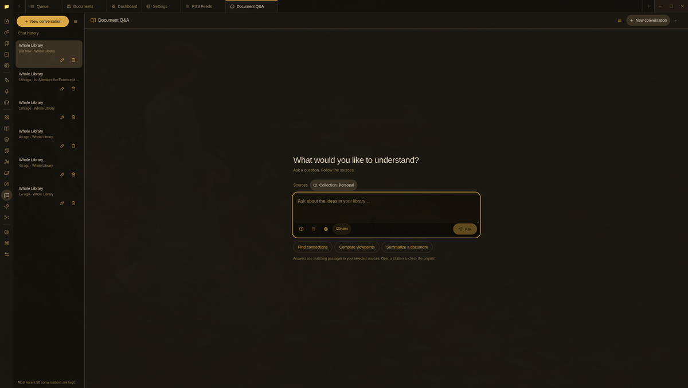
</div>

- **Dual Mode: Chat & Learning Agent**:
  - Switch seamlessly between conversational **Chat** and autonomous **Learning Agent** mode (with frozen scope, prerequisite analysis, reader worthiness badges, and structured flashcard batch proposals).
  - **Explicit Grounding Picker**: Choose *General Knowledge*, *This Document Only*, or *My Library* with an interactive source & section mention picker (`@`).
  - **Streaming Stages & Reasoning Disclosure**: Live generation stage indicators and expandable model thinking/reasoning chains.
- **First-Class On-Device AI Stack**:
  - 🍎 **Apple Intelligence / Foundation Models** (macOS & iOS)
  - 🤖 **Android ML Kit GenAI / Gemini Nano** via system AICore (offline summarization, Q&A, card generation, and image study on supported Pixel & Galaxy devices)
  - 🪟 **Windows Intelligence / Phi Silica** & Foundry Local
  - 🦙 **Local Providers**: Ollama, LM Studio, llama.cpp, plus **EmbeddingGemma 2** (with Matryoshka Representation Learning dimension slicing) and **Cactus Compute Mirage** vision engine.
  - ☁️ **Cloud Providers**: OpenAI, Anthropic Claude, Google Gemini, Groq, OpenRouter, Cloudflare Workers AI—protected by finite, revocable device-local consent allowances.

---

### 🎧 Audio Editions, Podcasts, Video & Speech

- **Global Persistent Audio Dock**: Single application-lifetime playback owner with checkpoint persistence, focus leases (automatically pauses background audio when TTS, video, or voice capture starts), OS media keys (MPRIS / SMTC / macOS Now Playing / Android ExoPlayer MediaSession), and suspend-aware desktop wake handling.
- **Audio Editions**: Convert long-form articles, EPUB chapters, and PDFs into multi-part narrated Audio Editions in your review queue—powered locally by **Chatterbox** (with zero-shot voice cloning) and **Pocket-TTS** (auto-provisioned via `uv`), or via **Fal.ai** neural voices.
- **Podcast Client with Local Ad Skipping**:
  - Subscribe to podcast feeds, parse Podcasting 2.0 JSON chapters, Podlove Simple Chapters, and ID3v2/MP4 CHAP metadata.
  - **Local-First Sponsor Skipping**: Detects ad segments locally and skips them with a **120ms lookahead guard**, visual amber striped scrubber bars, a waveform interval editor, dual transcript modes (*Clean* vs. *Verbatim*), and an instant floating *Undo* toast.
- **Video & YouTube Workstation**:
  - Local video playback with **HTTP Live Streaming (HLS)** and dynamic codec compatibility (on-the-fly hardware-accelerated transcoding for HEVC/H.265, AV1, VP9, MKV, AVI).
  - **YouTube Video & Playlist Import** with canonical timed transcripts, **Transcript Video Slicing**, and role-voice TTS picture-in-picture.
- **On-Device & Cloud Transcription**:
  - Local **Whisper.cpp**, **Cactus Whistle (`Needle`)**, and Android **sherpa-onnx** (SenseVoice int8 multilingual / Parakeet TDT_CTC 110M), plus GPU acceleration and cloud fallbacks (Groq, OpenAI).
  - Mobile battery & thermal awareness defers heavy background transcription until charging.

---

### 📡 AI Smart RSS Reader & Knowledge Capture

- **AI Smart RSS Feeds**: Define natural-language topics and let Plethora score, cluster, and curate incoming articles across your feeds using fast local lexical + embedding pipelines or opt-in hybrid/cloud models.
- **Full-Article Reader Mode**: Powered by Mozilla Readability and Defuddle with offline image caching, dark-theme adaptation, and full extract/highlight/card creation parity.
- **Capture Activity Dashboard**: Track everything entering your library across the browser extension, native mobile share sheets, RSS feeds, and manual imports.

---

### 🌙 Sleep Intelligence & Learning Analytics

- **Sleep Chart & Biological Wake-Date Anchoring**: Multi-month interactive sleep architecture visualizer (Deep, REM, Light, Awake) overlaid directly with your flashcard review sessions and reading blocks.
- **Circadian & Memory Modeling**:
  - **Borbély Two-Process Model**: Simulates homeostatic sleep pressure ($S$) and circadian alertness ($C$) to surface your peak cognitive learning windows.
  - **FSRS-7 Recall Residuals**: Measures whether your recall on any given day beat or trailed FSRS-7 expectations after controlling for card difficulty, workload, and time of day.
  - **Evidence Inspector**: Displays statistical confidence intervals, sample sizes ($n$), and limitations for every personal insight, feeding readiness cards directly into your Study Plans.
- **Wearables & Portable Encrypted Backups**:
  - Connect **Apple HealthKit** (iOS), **Android Health Connect**, **Oura Ring**, **WHOOP**, or **Google Health (Fitbit / Pixel Watch)** with configurable multi-device priority resolution.
  - Log sleep manually, explore with a synthetic demo dataset, or import/export via Apple Health XML, CSV, JSON, and passphrase-encrypted `.plethora-health.enc` (PBKDF2-HMAC-SHA256 + AES-256-GCM) bundles.

---

### 🎨 Material 3 Interface, 175+ Themes & Command Hub

<div align="center">
  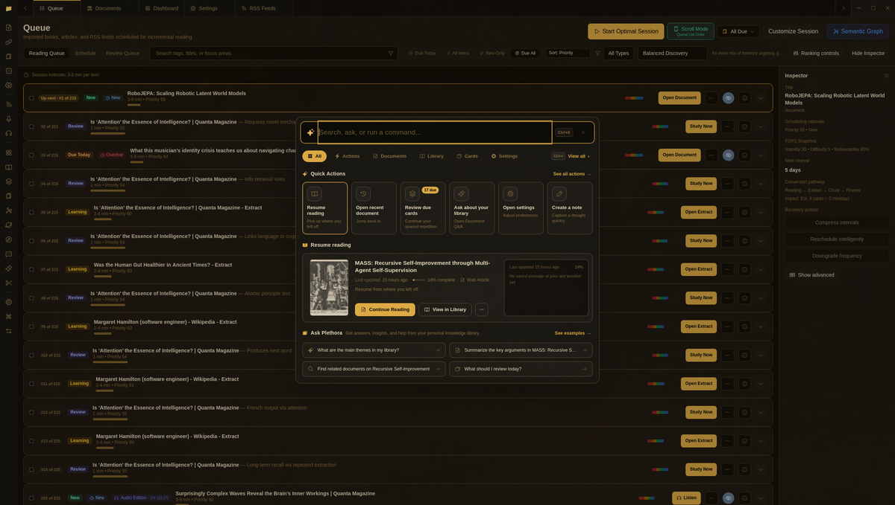
</div>

- **175+ Built-in Themes & Paper Materials**: Includes **Obsidian Noir** (default), **Legal Pad** textured paper, **Biolume Abyss** jellyfish palettes, **E-Ink Mode** for Boox/e-paper displays, plus 65 bundled open-source fonts (`@fontsource`).
- **OKLCH Image-to-Theme & Animated GIFs**: Drop any static image to synthesize a contrast-checked OKLCH theme, or import an animated GIF background with automatic flash-risk validation.
- **Unified Command Palette (`Ctrl+K` / `Cmd+K`)**: Search documents, switch saved queues, import YouTube playlists, trigger AI workflows, or jump directly to any setting with typo-tolerant **Settings Search**.
- **Whole-Interface Zoom & Density Modes**: Scale the entire desktop UI (`70%–150%`) independently of document zoom, and toggle progressive-disclosure UI density modes.
- **6 Localized Handbooks & UI**: Full documentation and localized experiences across **English, German, Spanish, French, Japanese, and Simplified Chinese**.

---

## 📱 Native Mobile & E-Ink Experience

Plethora runs natively on **Android** and **iOS** (via Tauri 2 Mobile + custom Rust/Kotlin/Swift plugins) as well as a **Progressive Web App (PWA)**, engineered for phones, tablets, and e-paper devices like the **Boox Palma 2**:

- **Thumb-Arc Ergonomics & Native Haptics**: One-handed thumb-arc review controls, double-tap paragraph actions, pull-to-refresh gestures, coordinated multi-layer Android back navigation, and a native haptic feedback engine.
- **Deep Platform Integration**: iOS & Android share-sheet targets, camera document/photo scanning straight to flashcards, Android foreground ExoPlayer media service with lock-screen transport controls, and native folder import via Android Storage Access Framework (SAF) & iOS Document Picker.

<div align="center">
  <table style="width: 100%; border-collapse: collapse;">
    <tr>
      <td width="20%" align="center">
        <p><b>Dashboard</b></p>
        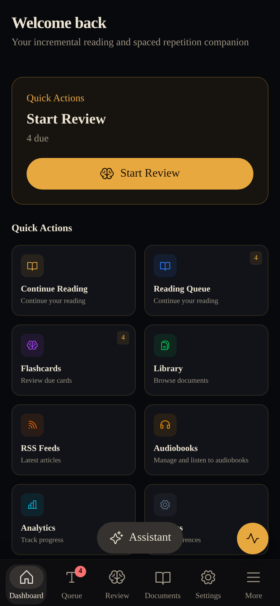
      </td>
      <td width="20%" align="center">
        <p><b>Queue</b></p>
        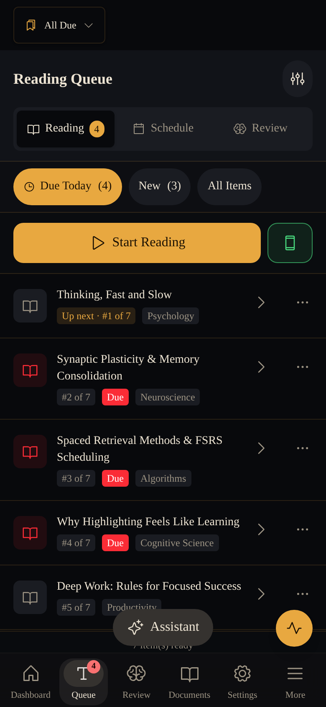
      </td>
      <td width="20%" align="center">
        <p><b>Review</b></p>
        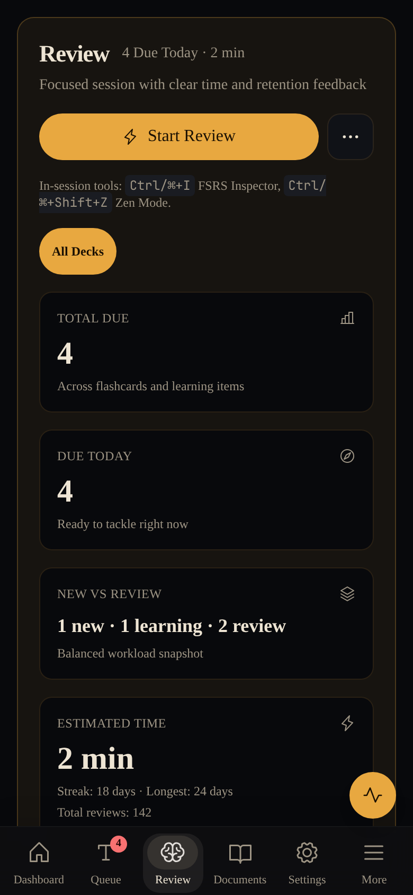
      </td>
      <td width="20%" align="center">
        <p><b>Documents</b></p>
        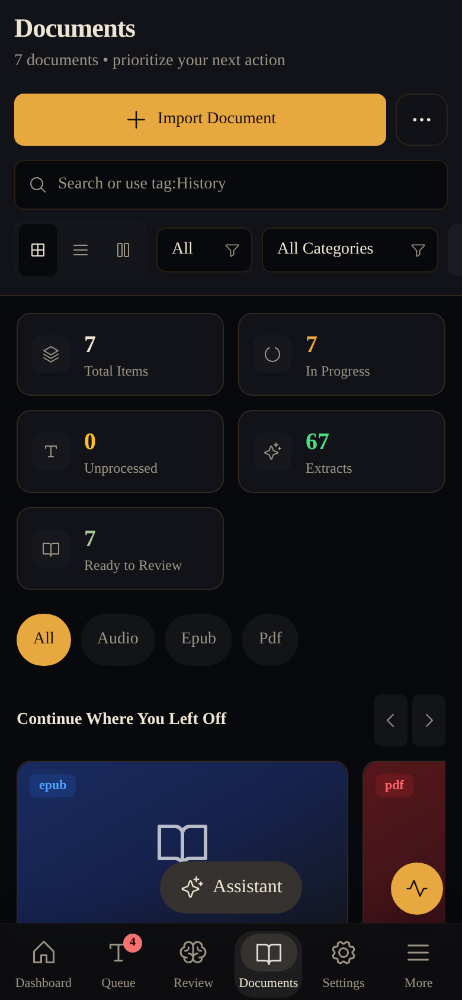
      </td>
      <td width="20%" align="center">
        <p><b>AI Assistant</b></p>
        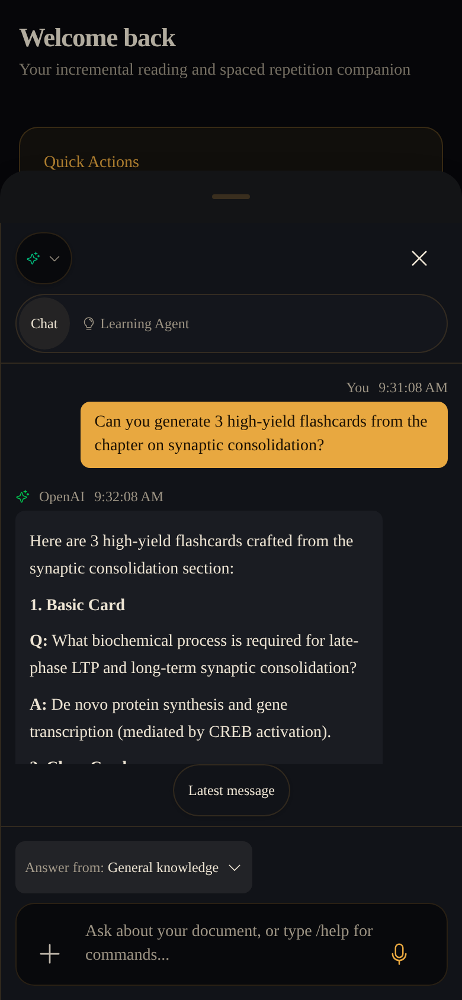
      </td>
    </tr>
    <tr>
      <td width="20%" align="center">
        <p><b>Statistics</b></p>
        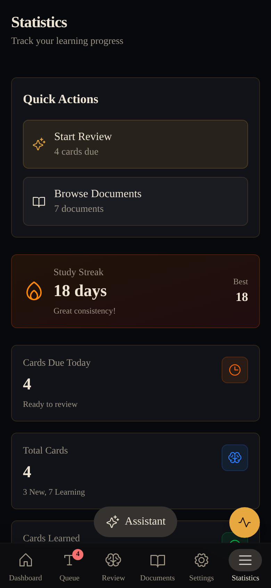
      </td>
      <td width="20%" align="center">
        <p><b>RSS Reader</b></p>
        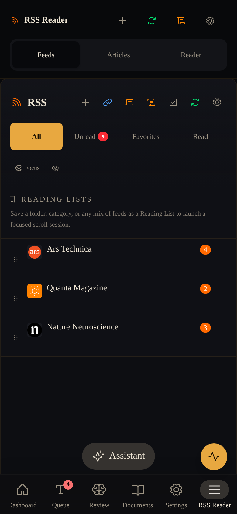
      </td>
      <td width="20%" align="center">
        <p><b>Podcasts</b></p>
        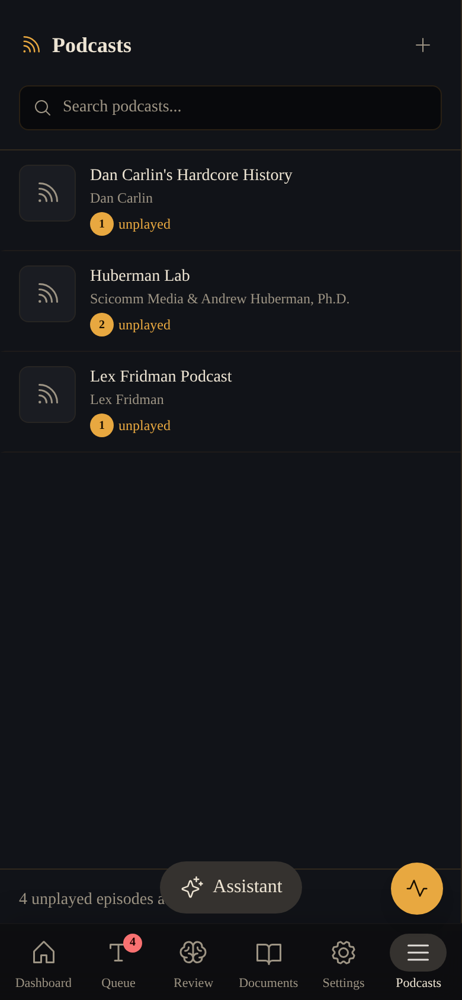
      </td>
      <td width="20%" align="center">
        <p><b>Audiobooks</b></p>
        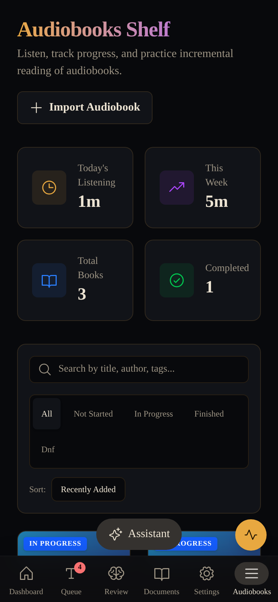
      </td>
      <td width="20%" align="center">
        <p><b>Settings</b></p>
        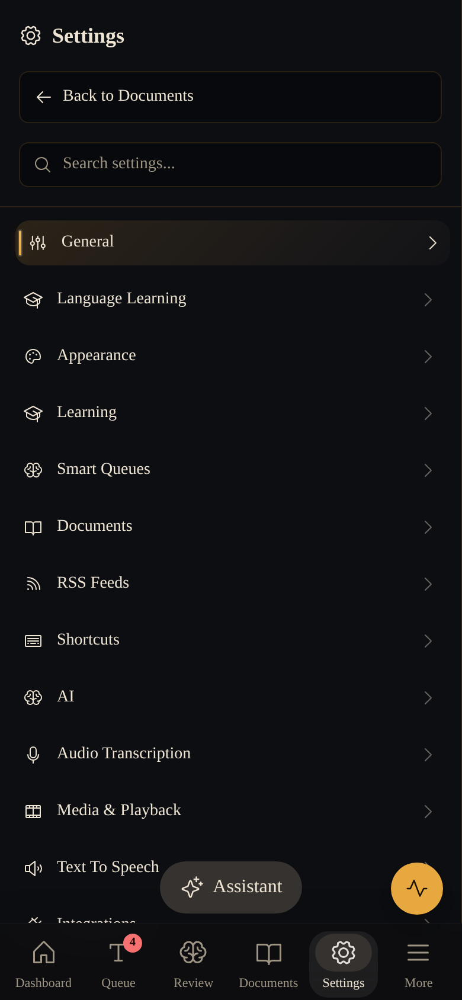
      </td>
    </tr>
  </table>
</div>

---

## 🔒 Local-First Privacy & Security Architecture

Reading, thinking, and health tracking are deeply personal. Plethora is architected around **verifiable local ownership**:

| Guarantee | How It Works |
| :--- | :--- |
| 🏠 **100% Offline Default** | No account required. Your documents, extracts, FSRS review logs, and knowledge graphs live in a local SQLite database (`plethora.db`) on your device. |
| 🛡️ **Per-Document `isLocalOnly` Shield** | Flip the **Local-Only Shield** on any sensitive PDF or note: Plethora globally blocks it from cloud sync, cloud AI/RAG, cloud TTS, and cloud OCR, routing all operations strictly to on-device engines. |
| 🏥 **Physically Isolated Health Vault** | Sleep and physiological metrics reside in a separate on-device SQLite database (`health/health.db`). Health records never enter library backups, E2EE library sync, semantic indexes, or AI prompts. |
| 🔐 **Zero-Knowledge E2EE Sync** | Optional multi-device sync encrypts your data client-side (`AES-256-GCM` / `X25519` / `HKDF`). Cloud relays store only opaque ciphertext. |
| 🚫 **Zero Native Telemetry SDKs** | Native desktop, Android, and iOS builds ship **no third-party crash or telemetry SDKs**. Full data portability is always available via `.plethora` archives, Anki `.apkg`, Markdown trees, or raw SQLite. |

> Read the complete data-flow disclosure in [`docs/PRIVACY_ARCHITECTURE.md`](docs/PRIVACY_ARCHITECTURE.md).

---

## 🚀 Quick Start

### 1. Ingest Your Material

Open **Documents → Import** (or press `Ctrl+K` / `Cmd+K`) and pull content from anywhere:

| Source | Supported Formats & Capabilities |
| :--- | :--- |
| 📁 **Local Files & Folders** | **PDF**, **EPUB**, **Markdown**, **HTML**, **TXT** — single files or recursive folder trees (entire book libraries via native pickers, Android SAF, or iOS Document Picker). |
| 🎧 **Audiobooks & Podcasts** | **M4B, MP3, M4A, FLAC, OGG, OPUS, WAV** — multi-file chapter assembly, embedded cover extraction, RSS podcast feeds, local ad skipping, and synchronized word highlighting. |
| 🎬 **Video & YouTube** | **MP4, WebM, MOV, MKV, AVI, M4V** + **YouTube URLs & Playlists** — HLS streaming, dynamic codec transcoding, timed transcripts, and video slice extracts. |
| 🌐 **Web, X Threads & ArXiv** | Clean article extraction, native **X/Twitter thread unrolling**, **ArXiv** paper ingestion, **Substack**, and **RSS/Atom** feeds with AI Smart Feed curation. |
| 🃏 **Decks & Archives** | **Anki (`.apkg`)**, **JSON decks**, **Obsidian** vaults, and `.plethora` / legacy `.incrementum` archives with full scheduling preservation. |

### 2. Read, Extract & Formulate

1. **Read Incrementally**: Open any book, article, or video from your **Queue** or **Library**.
2. **Create Extracts**: Highlight a passage (or use Vim visual mode `v` → `Enter`, or batch **Segmentation**) to save an atomic extract into your learning queue.
3. **Generate Cards**: Click **Create Card** on an extract, invoke **`/20rules`** in the Assistant, or use **Q&A / Chained Cloze / Image Occlusion** popups to craft high-retention flashcards.

### 3. Review on Schedule

Head to **Review** (or launch a **Timebox Session Playlist**) and grade your recall from `1` to `4`:

| Key | Rating | Meaning | Typical Next Interval |
| :-: | :--- | :--- | :--- |
| `1` | 🔴 **Again** | Lapsed / forgot | ~10 minutes (relearning step) |
| `2` | 🟡 **Hard** | Recalled with significant effort | ~1–2 days |
| `3` | 🟢 **Good** | Recalled at target effort | ~5–7 days |
| `4` | 🔵 **Easy** | Instant, effortless recall | ~10–14+ days |

---

## 🛠️ Installation & Builds

### Download Pre-Built Releases

Grab the latest installers (`.dmg`, `.msi` / NSIS `.exe`, `.AppImage`, `.deb`, `.rpm`, and Android `.apk`) from the [**GitHub Releases**](https://github.com/melpomenex/Plethora/releases) page.

<details>
<summary><b>🍎 macOS First-Launch Note (Self-Signed Builds)</b></summary>

If macOS Gatekeeper warns that `Plethora.app` is from an unidentified developer:
1. Locate `Plethora.app` in **Finder**.
2. **Right-click (or Control-click)** the app → select **Open**, then confirm **Open** in the dialog (or allow it via **System Settings → Privacy & Security → Open Anyway**).
</details>

### Build from Source

#### Prerequisites

- **Node.js** 18+ and **npm**
- **Rust** stable toolchain (1.75+)
- **Socket Firewall (`sfw`)** for dependency installation security (`npm i -g sfw`)
- **Platform system libraries**:
  - **Ubuntu / Debian**:
    ```bash
    sudo apt update && sudo apt install -y \
      libwebkit2gtk-4.1-dev build-essential curl wget file \
      libxdo-dev libssl-dev libayatana-appindicator3-dev librsvg2-dev cmake
    ```
  - **macOS**: `xcode-select --install`
  - **Windows**: Visual Studio C++ Build Tools & WebView2 Runtime (pre-installed on Windows 10/11)

#### Clone & Run

```bash
# 1. Clone with submodules (includes whisper.cpp and vendored crates)
git clone --recurse-submodules https://github.com/melpomenex/Plethora.git
cd Plethora

# 2. Install frontend dependencies (via Socket Firewall)
sfw npm install

# 3. Start the desktop development environment
npm run tauri:dev

# 4. Build a production desktop bundle
npm run tauri:build
```

### Key NPM Scripts

| Command | Description |
| :--- | :--- |
| `npm run tauri:dev` | Start full Tauri desktop app in development mode |
| `npm run dev` / `npm run dev:pwa` | Start web / PWA frontend dev server |
| `npm run tauri:build` | Build production desktop application bundle |
| `npm run build:check` | Validate docs, build help index, run `tsc`, Vite build, and check bundle budgets |
| `npm run test:run` | Run the Vitest unit & integration test suite |
| `npm run test:visual` | Run Playwright visual & end-to-end tests |
| `npm run bench:check` | Run `vitest bench` against `scripts/perf-baselines.json` + bundle budgets |
| `npm run bench:memory:check` | Run memory benchmark suite and enforce memory budgets |
| `npm run tauri:android:dev` / `build` | Run or build the Android ARM64 APK (`src-tauri/tauri.android.conf.json`) |
| `npm run tauri:ios:dev:sim` / `build:device` | Run in iOS Simulator or build for physical iOS devices (macOS) |

---

## 🏗️ Architecture & Tech Stack

```
Plethora/
├── src/                        # React 19 + TypeScript Frontend
│   ├── api/                    # Typed Tauri IPC command bridges
│   ├── components/             # UI domains (reader, review, queue, assistant, health, study-plans, audio, graph…)
│   ├── pages/                  # Top-level views (QueueScrollPage, KnowledgeGraphPage, NotebookLMPage…)
│   ├── stores/                 # Zustand state stores
│   ├── themes/                 # 175+ themes, OKLCH extractor, paper materials & WASM GIF decoder
│   └── utils/                  # Scheduling, geometric PDF layout, semantic grading & helpers
├── src-tauri/                  # Rust Backend (Tauri 2.11)
│   ├── src/
│   │   ├── commands/           # 700+ Tauri command handlers (FSRS, DAQE, LLM, RAG, PDF reflow, health, podcast…)
│   │   ├── algorithms/         # FSRS-7, SM-18/20, SM-2/5/8/15 schedulers
│   │   ├── database/           # SQLite + SQLx migrations & isolated Health Vault (health.db)
│   │   └── processor/          # PDF, EPUB, audio, video, OCR & transcript pipelines
│   └── plugins/                # 14 in-repo native mobile/desktop plugins (HealthKit, HealthConnect, Apple/Windows/Android AI, TTS, STT, Haptics, StoreKit, PlayBilling, SAF Folder Import)
├── browser_extension/          # Plethora Capture WebExtension (Chrome / Firefox / Edge)
└── docs/                       # Architecture guides, privacy specs & User Handbooks in 6 languages
```

<details>
<summary><b>📦 Full Technology Breakdown</b></summary>

- **Frontend**: React 19, TypeScript 5.8, Zustand 5, TanStack Query 5 & Virtual 3, Tailwind CSS 4, Vite 7, Three.js (3D Knowledge Graph), Recharts, PDF.js 5, EPUB.js, HLS.js, KaTeX, Tesseract.js, HuggingFace Transformers.js.
- **Backend**: Tauri 2.11, Rust (2021 Edition), Tokio async runtime, SQLite (`sqlx` + bundled `rusqlite`), Axum (local loopback servers for EPUB, HLS streaming, and browser extension sync), `fsrs-rs` (FSRS-7), `lopdf` / `pdf-extract`, `lofty` (pure-Rust audio metadata), `souvlaki` (cross-platform OS media controls), `aes-gcm` / `x25519-dalek` / `hkdf` / `pbkdf2` / `keyring`.
- **Native Plugins & Sidecars**: `whisper.cpp`, `sherpa-onnx` (KittenTTS / Kokoro-82M / SenseVoice / Parakeet), Cactus Whistle & Mirage, Chatterbox, Pocket-TTS (`uv`), Apple Foundation Models / Vision / Speech / HealthKit, Android ML Kit GenAI (Gemini Nano) / ExoPlayer / Health Connect, Windows Phi Silica.
</details>

---

## 📖 Documentation & Handbooks

### 🌍 Multilingual User Handbooks

Plethora ships with a comprehensive, continuously updated User Handbook in **6 languages**:

- 🇺🇸 [**English User Handbook**](docs/USER_HANDBOOK.md)
- 🇩🇪 [**Deutsches Benutzerhandbuch**](docs/USER_HANDBOOK.de.md)
- 🇪🇸 [**Manual de Usuario en Español**](docs/USER_HANDBOOK.es.md)
- 🇫🇷 [**Manuel d'Utilisation en Français**](docs/USER_HANDBOOK.fr.md)
- 🇯🇵 [**日本語ユーザーハンドブック**](docs/USER_HANDBOOK.ja.md)
- 🇨🇳 [**简体中文用户手册**](docs/USER_HANDBOOK.zh.md)

### 🔧 Technical & Architectural Guides

| Document | Description |
| :--- | :--- |
| [**Privacy & Security Architecture**](docs/PRIVACY_ARCHITECTURE.md) | Canonical data-flow registry, `isLocalOnly` shield semantics, E2EE sync, and Health Vault isolation |
| [**Feature Overview**](docs/FEATURES_IMPLEMENTED.md) | End-to-end catalog of implemented subsystems |
| [**Design System**](docs/design-system.md) | Material 3 surface tokens, theming roles, and responsive layout primitives |
| [**Podcasts & Ad-Skip Engine**](docs/podcasts.md) | Chapter ingestion, 120ms lookahead sponsor skipping, and thermal/battery policies |
| [**OCR & Vision Pipeline**](docs/OCR_FEATURES.md) | Local and cloud OCR, math recognition, and Cactus Mirage vision |
| [**Memory Profile & Benchmarks**](docs/memory-profile.md) | Runtime memory map, dimensionless benchmark anchors, and budget gates |
| [**Settings Search Coverage**](docs/settings-search.md) | Catalog architecture and coverage invariants for instant settings discovery |

---

## 🤝 Contributing

Contributions, bug reports, and feature proposals are welcome! Please read [`CONTRIBUTING.md`](CONTRIBUTING.md) and check [`openspec/`](openspec/AGENTS.md) for our specification-driven workflow.

- **Code Quality**: Run `npm run lint`, `npm run build:check`, and `npm run test:run` before submitting changes.
- **Performance Gate**: Intentional performance changes must pass `npm run bench:check` against `scripts/perf-baselines.json`.
- **Settings Search Gate**: Any new user-configurable setting must include a catalog entry in `src/components/settings/search/settingsSearchCatalog.ts`.

---

## 📝 License & Acknowledgments

Licensed under the [**Apache License 2.0**](LICENSE).

Built on the shoulders of open-source pioneers:
- [**FSRS & Open Spaced Repetition**](https://github.com/open-spaced-repetition) for modern memory scheduling research
- [**Tauri**](https://tauri.app/) for cross-platform Rust + WebView engineering
- [**SuperMemo & Dr. Piotr Wozniak**](https://supermemo.guru/) for pioneering Incremental Reading and the 20 Rules of Knowledge Formulation

---

<div align="center">

### **Built with ❤️ using Tauri + React + Rust**

[](docs/USER_HANDBOOK.md)
[](docs/PRIVACY_ARCHITECTURE.md)
[](CHANGELOG.md)
[](https://github.com/melpomenex/Plethora/issues)

**[⬆ Back to Top](#plethora)**

</div>
