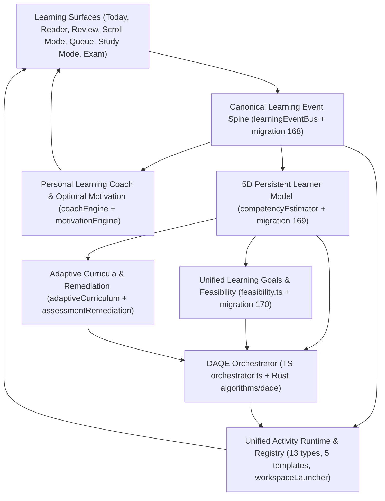

# Unified Personal Learning Operating System

Plethora's Unified Personal Learning Operating System connects incremental reading, FSRS-7 spaced repetition, Study Plans, guided reading, assessments, and Knowledge Atlas concepts through a single local-first domain architecture.

This document describes **only what is currently implemented** in the repository, covering the product philosophy, core domain models, runtime engines, SQLite migrations (`168`–`170`), privacy/security boundaries, and verification commands.

---

## 1. Overview & Product Philosophy

Plethora is built around five architectural principles:

1. **Coexistence of Free Learning and Structured Learning** — Casual reading, exploratory feeds, and SuperMemo-style incremental reading remain first-class workflows alongside structured Learning Goals, Study Plans, and exams. Opening a document from the Library never requires creating a goal, study plan, or flashcard.
2. **Progressive Disclosure** — Goals, Study Plans, Personal Learning Coach suggestions, and Motivation cues stay out of the way when unused. An exploration goal requires only a title (no deadline, no study plan) and can evolve in place into a mastery or deadline goal later.
3. **Local-First & AI-Optional** — Every core engine (`learningEventBus`, `competencyEstimator`, `evaluateGoalFeasibility`, `orchestrateLearningSession`, `adaptiveCurriculum`, `assessmentRemediation`, `coachEngine`, and `motivationEngine`) is pure, deterministic, and runs 100% locally with zero AI providers or network access required.
4. **Evidence Over Arbitrary Scores** — Competency is modeled across 5 explicit dimensions backed by verifiable evidence records. Absence of evidence is surfaced honestly as `unknown` or `insufficient_evidence`—never fabricated as `0` or inflated by passive reading or self-declarations. Activity effort (minutes, XP) is strictly separated from verified mastery outcomes.
5. **User Agency** — Recommendations, overload advisories, remediation plans, and coach actions are non-coercive and previewable (`requiresConfirmation: true`, `mutatesDirectly: false`). FSRS-7 scheduling state is never mutated by DAQE orchestration, goal feasibility, or overload advisories, and `StrictManual` ordering is preserved verbatim.



---

## 2. Domain Model & Core Interfaces

### 2.1 Canonical Learning Events

- **TypeScript:** `src/types/learningEvent.ts`, `src/lib/learning-events/learningEventBus.ts`, `src/api/learning-events.ts`
- **Rust:** `src-tauri/src/models/learning_event.rs`, `src-tauri/src/database/learning_event_repository.rs`, `src-tauri/src/commands/learning_events.rs`
- **Migration:** `168_unify_learning_state_events` (`src-tauri/src/database/migrations.rs`)

The append-only `learning_events` table and `learningEventBus` form the canonical event spine (`LEARNING_EVENT_SCHEMA_VERSION = 1`).

- **20 Canonical Event Types (`VALID_LEARNING_EVENT_TYPES`):** `review_committed`, `review_undone`, `reading_progressed`, `reading_completed`, `extract_created`, `card_created`, `guided_check_completed`, `practice_attempted`, `assessment_submitted`, `assessment_graded`, `assessment_grade_invalidated`, `concept_mastery_declared`, `goal_created`, `goal_updated`, `goal_completed`, `session_started`, `session_paused`, `session_resumed`, `session_completed`, `remediation_completed`.
- **15 Surfaces (`VALID_LEARNING_SURFACES`):** `review`, `scroll_mode`, `quick_review`, `zen_review`, `queue`, `reader`, `study_mode`, `guided_trail`, `exam`, `unified_session`, `knowledge_atlas`, `today_dashboard`, `background`, `sync`, `unknown`.
- **12 Entity Kinds (`VALID_LEARNING_ENTITY_KINDS`):** `learning_item`, `extract`, `document`, `concept`, `study_plan`, `study_plan_node`, `assessment_attempt`, `exam_grade`, `guided_trail`, `learning_goal`, `learning_session`, `remediation`.
- **Idempotency & Retraction:** Every event carries a unique `idempotencyKey` and monotonic `seq`. Retracting an event appends a compensating event (e.g., `review_undone`) and sets `retractedByEventId` on the target without mutating historical payloads.
- **Checkpoints & Stale-Fetch Guard:** `learning_event_checkpoints` tracks per-consumer `last_seq` and `policy_version`. On the frontend, `isStaleRelativeTo(entityKind, entityId, startedAtSeq)` prevents in-flight queries from resurrecting stale due state.
- **Cross-Surface Review Reconciliation:** `emitAndReconcileReviewCommitted`, `emitAndReconcileReviewUndone`, and `initTauriLearningEventBridge` (listening on `learning-event:committed`) bridge committed review events into `src/lib/reviewSync.ts` so Review, Scroll Mode, Queue, and Unified Sessions remain synchronized.
- **Tauri Commands:** `append_learning_event`, `retract_learning_event`, `list_learning_events`, `get_learning_event_checkpoint`, `advance_learning_event_checkpoint`.

### 2.2 Persistent 5D Learner Model

- **TypeScript:** `src/types/learnerModel.ts`, `src/lib/learner-model/competencyEstimator.ts`, `src/api/learner-model.ts`, `src/stores/learnerModelStore.ts`
- **Rust:** `src-tauri/src/models/learner_model.rs`, `src-tauri/src/database/learner_model_repository.rs`, `src-tauri/src/commands/learner_model.rs`
- **Migration:** `169_persistent_learner_model` (`competency_evidence`, `competency_projections`, `learner_competency_declarations`)

Competency is estimated deterministically per `(conceptId, dimension)` under policy `COMPETENCY_POLICY_VERSION = "competency-v1"`.

- **5 Dimensions (`ALL_COMPETENCY_DIMENSIONS`) & Recency Half-Lives (`DIMENSION_HALF_LIFE_DAYS`):**
  - `exposure` (90 days) — Reading progress, extracts, media encounters.
  - `comprehension` (120 days) — Guided checks, explanations, diagnostic/assessment understanding.
  - `retention` (45 days) — Spaced recall over time.
  - `application` (120 days) — Structured problem solving and applied practice.
  - `transfer` (180 days) — Novel context generalization and synthesis.
- **9 Evidence Source Kinds (`ALL_COMPETENCY_EVIDENCE_SOURCE_KINDS`):** `reading_progress`, `extract_created`, `guided_check`, `fsrs_review`, `socratic_practice`, `practice_attempt`, `exam_grade`, `diagnostic_grade`, `language_practice`. Passive sources (`reading_progress`, `extract_created`) are strictly restricted to `exposure`.
- **Observation Weighting & Correlated-Card Damping:**
  - Unverified (`isVerified === false`), invalidated (`isInvalidated === true`), null-score, and (when `excludeAiExcluded: true`) AI-excluded records are filtered out.
  - Raw weight combines `baseWeight` (clamped to `(0, 2.0]`), hint discount `max(0.25, 1.0 - 0.25 * hintLevel)`, short-term cramming discount for `retention` FSRS reviews with `elapsedDays < 1.0` (`0.20 + 0.80 * max(0, elapsedDays)`), and recency decay `max(0.15, 2^(-ageDays / halfLifeDays))`.
  - Records sharing a `cardFamilyId` or `evidenceGroupId` are sorted newest-first and damped harmonically by `w / (k + 1)^0.85` (`CORRELATION_DAMPING_EXPONENT = 0.85`), with the group's total effective weight capped at `1.5 * max_k(w_raw)` (`GROUP_WEIGHT_CAP_MULTIPLIER = 1.5`).
- **Epistemic Honesty (`ALL_COMPETENCY_STATUSES`):** `unknown`, `insufficient_evidence`, `needs_attention`, `developing`, `demonstrated`. Non-exposure confidence scales by both independent group count (`min(1, independentGroups / 2)`) and distinct UTC days (`min(1, distinctDays / 2)`), emitting explicit `uncertaintyReasons` (`no_evidence`, `low_effective_weight`, `single_evidence_group`, `single_day_only`, `stale_evidence`).
- **Separation from Self-Declarations and FSRS-7:** `learner_competency_declarations` (`unfamiliar`, `familiar`, `confident`, `needs_refresh`) are stored and projected separately on `ConceptCompetencyProfile.selfDeclaration` and never merged into verified estimates. FSRS-7 card states remain authoritative in their own tables; `competency_evidence` only consumes FSRS review outcomes without modifying intervals or stability.
- **Tauri Commands:** `record_competency_evidence`, `invalidate_competency_evidence`, `recompute_concept_competency`, `get_concept_competency_profile`, `list_concept_competency_profiles`, `set_learner_competency_declaration`, `get_concept_evidence_history`.

### 2.3 Unified Learning Goals

- **TypeScript:** `src/types/learningGoal.ts`, `src/lib/learning-goals/feasibility.ts`, `src/api/learning-goals.ts`, `src/stores/learningGoalsStore.ts`
- **Rust:** `src-tauri/src/models/learning_goal.rs`, `src-tauri/src/database/learning_goal_repository.rs`, `src-tauri/src/commands/learning_goals.rs`
- **Migration:** `170_unified_learning_goals` (`learning_goals`, `learning_goal_sources`, `learning_goal_milestones`)

Learning Goals provide a composable intent layer above documents, collections, saved queues, study plans, smart feeds, concepts, and tags (`GoalSourceKind`) with zero content duplication.

- **7 Goal Kinds (`LearningGoalKind`) & Default Policies (`getDefaultGoalPolicy`):**

| Kind | Default Dimensions | Mastery Threshold | Expects Deadline | Expects Study Plan | Default Daily Budget |
| :--- | :--- | :---: | :---: | :---: | :---: |
| `exploration` | `exposure`, `comprehension` | `0.65` | No | No | `null` |
| `retention` | `retention` | `0.85` | No | No | `20m` |
| `mastery` | `comprehension`, `retention`, `application` | `0.85` | No | Yes | `45m` |
| `deadline` | `comprehension`, `retention`, `application` | `0.80` | Yes | Yes | `45m` |
| `skill` | `comprehension`, `application`, `transfer` | `0.80` | No | No | `30m` |
| `continuous` | `exposure`, `comprehension` | `0.70` | No | No | `15m` |
| `language` | `comprehension`, `retention`, `application` | `0.80` | No | No | `30m` |

- **In-Place Goal Evolution:** `evolveLearningGoal` (`useLearningGoalsStore.evolveGoal`) upgrades or changes a goal's `kind`, `studyPlanId`, `targetDate`, `dailyMinutesBudget`, `targetDimensions`, or `targetMasteryThreshold` in place while preserving its identity, linked sources, and milestones.
- **Smart Feed Exploration Boundary:** Both SQLite (`CHECK (source_kind != 'smart_feed' OR source_role = 'exploration_candidate')`) and `validateGoalSourceLink` enforce that `smart_feed` sources must always use `sourceRole: "exploration_candidate"` and never auto-create SRS review obligations.
- **Deterministic Deadline Feasibility (`evaluateGoalFeasibility`):** Computes remaining concept effort (accounting for prior demonstrated competency), uncompleted reading minutes, and projected due review minutes against `daysRemaining * dailyBudget`, classifying into `unbounded`, `insufficient_data`, `on_track` (utilization <= 0.80), `tight` (<= 1.05), `at_risk` (<= 1.40), or `infeasible` (> 1.40). For `at_risk` and `infeasible` goals, it emits non-mutating `GoalAdjustmentSuggestion` options (`increase_daily_budget`, `extend_deadline`, `narrow_scope`, `focus_weakest_dimensions`).
- **Tauri Commands:** `create_learning_goal`, `list_learning_goals`, `get_learning_goal_detail`, `update_learning_goal`, `evolve_learning_goal`, `delete_learning_goal`, `link_learning_goal_source`, `unlink_learning_goal_source`, `upsert_learning_goal_milestone`, `get_learning_goal_feasibility`, `list_goals_for_source`.

### 2.4 Unified Learning Activity Runtime & Extensible Registry

- **TypeScript:** `src/types/learningActivity.ts`, `src/lib/learning-runtime/activityRegistry.ts`, `src/lib/learning-runtime/sessionRuntime.ts`, `src/lib/learning-runtime/workspaceLauncher.ts`, `src/stores/learningSessionStore.ts`

The activity runtime unifies heterogeneous learning steps inside a single `LearningSession` persisted in `localStorage` under `plethora.learningSession.v1` (with up to 50 `sessionHistory` summaries).

- **13 First-Party Activity Types (`LEARNING_ACTIVITY_TYPES`):** `source_reading`, `media_consumption`, `flashcard_review`, `extract_review`, `guided_reading`, `comprehension_check`, `socratic_tutoring`, `free_response_practice`, `objective_question_practice`, `structured_problem_solving`, `rubric_assessment`, `reflection_formulation`, `targeted_remediation`.
- **5 Declarative Subject Templates (`SUBJECT_TEMPLATES`):** `mathematics`, `computer_science`, `philosophy`, `language_learning`, `history_literature` — each defining `recommendedMix`, `competencyWeights`, `defaultSessionBlueprint`, and `promptScaffolds`.
- **Capability Negotiation (`LearningActivityRegistry.negotiateCapabilities`):** Evaluates each activity's required/optional capabilities (`ai`, `network`, `audio`, `speech`, `renderer`, `external`, `verification`) against `RuntimeCapabilities` and privacy flags (`strictLocalOnly`, `isLocalOnly`, `isAiExcluded`), returning `supported` or `degraded` with concrete local fallback reasons.
- **Duplicate-Work Prevention:** `deduplicateActivities` collapses activities sharing the same `dedupeKey`, retaining the highest-priority descriptor while merging `goalReferences`, `conceptReferences`, `sourceReferences`, prerequisites, and strictest privacy/exam flags. `attachSessionEventReconciler` automatically reconciles completions from other surfaces via `learningEventBus` and records `CrossSurfaceCompletionNotice` entries.
- **Canonical Workspace Launching (`buildWorkspaceLaunchPlan`):** Routes document-backed reading and study activities into the single canonical `DocumentViewerWrapper` host (`reuseExistingReaderTab: true`) with mutually exclusive `"read" | "study"` presentation mode, preserved `ReadingLocation`, `ReturnOriginRoute`, and automatic assistant suppression (`exam_isolated`, `ai_excluded`, `local_only`).
- **Exam-Mode Isolation:** `assertExamIsolationAllows` throws `ExamIsolationViolationError` if `show_hint`, `reveal_answer`, `open_tutor`, `coaching_intervention`, `peek_source`, `switch_to_study_mode`, or `jump_to_other_activity` is invoked during an `exam_isolated` session or active exam-isolated activity.
- **Sandbox Extension Boundary:** `SANDBOX_EXTENSION_BOUNDARY` and `validateSandboxExtensionEnvelope` enforce zero native execution (`allowTauriIpc: false`, `allowFilesystem: false`, `allowNetwork: false`, `allowShellExecution: false`, `allowSameOriginIframe: false`), resource caps (`maxExecutionMs: 2000`, `maxMemoryMb: 64`, `maxPayloadBytes: 256 KiB`, `maxMessagesPerSecond: 20`), redaction of `isLocalOnly` / `isAiExcluded` documents, and a strict event allowlist (`practice_attempted`, `guided_check_completed` only; `assessment_graded`, `assessment_grade_invalidated`, `review_committed`, `review_undone` forbidden).

### 2.5 DAQE Learning Orchestration

- **TypeScript:** `src/lib/daqe/orchestrator.ts` (heterogeneous session orchestrator) and `src/lib/daqe/orchestrator.bench.ts`
- **Rust:** `src-tauri/src/algorithms/daqe/` (`mod.rs`, `ranker.rs`, `terms.rs`, `goal_alignment.rs`, `learning.rs`, `decision_model/`)

The Dynamic Adaptive Queue Engine combines pure Rust composite queue ranking with the TypeScript heterogeneous learning session orchestrator:

- **8 Candidate Providers (`CANDIDATE_PROVIDER_KINDS`):** `srs_due_pool`, `learning_goals`, `guided_trails`, `remediation`, `exam_prep`, `smart_feeds`, `pinned`, `continue_reading`.
- **8 Normalized `[0, 1]` Scoring Factors (`SCORING_FACTOR_KEYS`) + Penalties:** `srsUrgency`, `goalAlignment`, `deadlinePressure`, `knowledgeGap`, `prerequisiteReadiness`, `userPriority`, `interest`, `durationFit`, plus optional `interleavePenalty` and `frictionPenalty`. Absent signals (`null`/`undefined`) are marked `"unavailable"` and renormalized out rather than fabricated as `0`.
- **6 Session Focus Profiles (`FOCUS_PROFILE_WEIGHTS`):** `balanced`, `free_exploration`, `memory_retention`, `exam_prep`, `deep_study`, and `custom` (merges user overrides over `balanced` and normalizes to sum to `1.0`).
- **Time Budgets & Diversity Packing:** Supports `5 | 15 | 30 | 60 | 120 | number | "unlimited"` minutes, enforcing a configurable single-goal share cap (default `0.65`) when multiple goals compete, a critical due-retention reserve share (default `0.30`), and topic interleaving lookahead.
- **Overload Advisor (`OverloadAdvisorReport`):** Detects `srs_backlog_overload`, `deadline_crunch`, and `budget_mismatch`, offering opt-in suggestions (`pause_new_material`, `defer_low_priority`, `focus_retention_triage`, `focus_single_deadline`, `keep_as_is`) with `mutatedSrsState: false` and `coercive: false`.
- **Deterministic Explainability:** Every `RankedActivityItem` includes a `RecommendationExplanation` (`llmGenerated: false`) derived solely from actual `FactorContribution` values.
- **`StrictManual` Preservation:** Both Rust (`QueueOrderingMode::StrictManual` via `rank_with_mode` / `rank_strict_manual` in `src-tauri/src/algorithms/daqe/ranker.rs`) and TypeScript (`orderingMode: "strict_manual"`) preserve explicit manual ordering without adaptive weight overrides.

### 2.6 Today Learning Workspace & Navigation

- **Today Workspace Components:**
  - `src/components/today/StartLearningHero.tsx` — Focus profile selector (`balanced`, `free_exploration`, `memory_retention`, `exam_prep`, `deep_study`), time budget presets (`5m`, `15m`, `30m`, `60m`, `120m`, `Unlimited`), DAQE session launch, and active session resume.
  - `src/components/today/UnifiedSessionRunnerBar.tsx` — In-session step progression, complete/skip/postpone controls, live budget adjustment, pause/resume/abandon, "Why?" explanation popover, and completion summary.
  - `src/components/today/LearningGoalsSection.tsx` & `src/components/today/LearningGoalWizardModal.tsx` — Progressive-disclosure goals shelf (optional when empty, supports pause/resume/in-place evolution) and 4-step creation wizard (`intent`, `sources`, `schedule`, `review`).
  - Integrated into `src/components/tabs/DashboardTab.tsx`.
- **Primary Navigation Destinations (`src/navigation/tabDestinations.ts`):** Consolidates app navigation into 7 canonical destinations (`PRIMARY_LEARNING_DESTINATION_ORDER`): `today` (`dashboard`), `library` (`documents`), `learn` (`study-plans`), `review` (`review`), `discover` (`rss`), `knowledge` (`knowledge-sphere`), and `insights` (`learning-insights`), mapping secondary tabs and path aliases via `resolvePrimaryLearningDestination` and `resolveTabType`.
- **Competency Evidence Inspector (`src/components/graph/CompetencyEvidenceInspector.tsx`):** Accessible 5-dimension inspector for Knowledge Atlas and Study Plans. Renders `unknown` and `insufficient_evidence` as `"Not established"`, displays provenance counts (`rawEvidenceCount`, `independentGroups`, `distinctDays`), recency, explicit `uncertaintyReasons`, privacy badges (`Local-only`, `AI-excluded`), and a visually separated `"Self-declared level"` block.

### 2.7 Competency-Based Adaptive Curricula & Remediation

- **Adaptive Curricula (`src/lib/study-plans/adaptiveCurriculum.ts`):**
  - **7 Conceptual Relationship Types (`ALL_CONCEPT_RELATIONSHIP_TYPES`):** `requires` (hard DAG invariant + prerequisite gating), `builds_upon` (soft ordering hint), and 5 associative types (`related_to`, `example_of`, `contrasts_with`, `applies`, `alternative_explanation_of`).
  - **Graph Validation (`validateCurriculumGraph`):** Detects `CYCLE_DETECTED` strictly on the active `requires` subgraph (allowing cycles in associative links), `DUPLICATE_EDGE`, `UNKNOWN_NODE`, `SELF_LOOP`, and `FRONT_MATTER_PREREQUISITE` (via `isLikelyFrontMatterHeading`).
  - **Adaptive Progression (`computeAdaptiveProgression`) & Source Grounding (`verifySourceGrounding`):** Non-destructive progression overlay classifying nodes (`demonstrated_prior`, `ready`, `advisory_blocked`, `completed`, `needs_grounding_repair`) using verified 5D competency profiles while honoring manual skips, unskips, and pins.
- **Assessment Evidence Policy & Remediation (`src/lib/study-plans/assessmentRemediation.ts`):**
  - **8-Purpose Assessment Taxonomy (`ALL_ASSESSMENT_PURPOSES`):** `diagnostic`, `formative`, `retrieval_practice`, `mastery`, `mock_exam`, `summative_exam`, `practical_skill`, `self_assessment`. `getAssessmentPurposePolicy` enforces `examIsolated: true`, `hintsAllowed: false`, `coachingAllowed: false` on `mastery`, `mock_exam`, and `summative_exam`; `canAssessmentContributeToMastery` strictly excludes `self_assessment` and `model-only` blueprints.
  - **Dimension-Targeted Remediation (`planDimensionTargetedRemediation`):** Maps each failing dimension to tailored activities (e.g., `application` -> `structured_problem_solving` / `worked_example`, never definition flashcards when retention is already established) and guarantees the same failed activity is never repeated back-to-back.
  - **4-Stage Anti-Loop Escalation Ladder:**
    1. `targeted_practice`
    2. `worked_example_or_socratic`
    3. `prerequisite_check_and_alternative_source`
    4. `user_override_or_defer` (after `DEFAULT_MAX_REMEDIATION_ATTEMPTS = 4`, pauses auto-requeue with a 24-hour cooldown and offers `pause_24h`, `defer_for_later`, `edit_source_or_question`, `dismiss_remediation`).
  - **Transactional Grade Invalidation (`computeInvalidationImpact`):** Invalidates only the target grade's `competency_evidence` records, recomputes affected `(conceptId, dimension)` projections via `estimateDimensionCompetency`, and leaves unrelated concepts and `fsrs_review` records untouched.

### 2.8 Personal Learning Coach & Optional Motivation

- **Personal Learning Coach (`src/lib/learning-coach/coachEngine.ts`, `src/stores/learningCoachStore.ts`):**
  - **12 Deterministic Signals (`COACHING_SIGNAL_TYPES`):** `approaching_exam`, `deadline_infeasible`, `repeatedly_failed_cards`, `misunderstood_concept`, `review_backlog`, `stalled_goal`, `cross_document_connection`, `demonstrated_prerequisite`, `formulation_opportunity`, `relevant_smart_feed`, `schedule_adjustment`, `transfer_opportunity`.
  - **5 Proactivity Levels (`COACH_PROACTIVITY_LEVELS`) & Caps (`PROACTIVITY_MAX_RECOMMENDATIONS`):** `disabled` (0), `minimal` (1), `balanced` (3, default), `proactive` (6), `on_demand` (12).
  - Returns `[]` immediately when `proactivity === "disabled"` or `examIsolationActive === true`, honors quiet hours, per-category toggles, and dismissals/snoozes. Every recommendation carries a `CoachProposedAction` with `requiresConfirmation: true` and `mutatesDirectly: false`.
  - Persists preferences and dismissals in `localStorage` under `plethora.learningCoach.v1`.
- **Optional Motivation Engine (`src/lib/motivation/motivationEngine.ts`, `src/stores/motivationStore.ts`):**
  - **Activity vs. Outcome Separation:** Tracks `ActivityMetricsSummary` (`minutesStudied`, `pagesRead`, `reviewsCompleted`, `exercisesCompleted`, `xpEarned`, `examsTaken`) separately from `OutcomeMetricsSummary` (`competenciesDemonstrated`, `conceptsUnderstood`, `memoryRetainedRatio`, `skillsDemonstrated`, `learningGapsResolved`, `proficiencyDemonstrated`).
  - **Idempotent XP Ledger (`awardXpIdempotent`):** Keyed by `${sourceEventId}:${ruleId}` (`MAX_XP_PER_EVENT = 100`). Replayed events yield `xpDelta: 0` (`duplicate_event`); incomplete, retracted, spam, or sub-3-second timed actions award `0` XP (`zero_effort_or_spam`). XP is opt-in (`xpEnabled: false` by default) and never alters competency outcomes.
  - **Rest-Day-Safe Streaks:** Uses a 7-bit `restDaysMask` (bit 0 = Sunday .. bit 6 = Saturday) and `streakGraceDaysPerWeek` (default `1`) to bridge planned rest days and weekly grace days with neutral, non-shaming status labels.
  - Persists preferences and ledger state in `localStorage` under `plethora.motivation.v1`.
- **Settings Integration (`src/components/settings/LearningSettings.tsx`, `src/components/settings/search/settingsSearchCatalog.ts`):** Exposes `learning.coach`, `learning.coachProactivity`, and `learning.optionalMotivation` with full Settings Search coverage.

---

## 3. Security, Privacy & Isolation Boundaries

| Boundary | Enforcement Mechanism | Scope |
| :--- | :--- | :--- |
| **`is_local_only` / `isLocalOnly`** | Persisted on `learning_events` and `competency_evidence`; propagated through `LearningActivity`, `LearningSession`, `DaqeActivityCandidate`, and `CoachEvidenceRef`. | Items stay strictly on-device; `workspaceLauncher` suppresses cloud assistants (`assistantSuppressionReason: "local_only"`); `orchestrator` sets `cloudAiAllowed: false`; `coachEngine` sets `cloudExplanationAllowed: false`; `validateSandboxExtensionEnvelope` blocks transmission to extensions. |
| **`is_ai_excluded` / `isAiExcluded`** | Persisted on `learning_events` and `competency_evidence`; filterable via `excludeAiExcluded` in `learningEventBus` and `estimateDimensionCompetency`. | Excluded from cloud AI context and coach cloud explanations; `negotiateCapabilities` forces AI capability off and degrades cleanly to local fallbacks; `workspaceLauncher` suppresses assistants (`"ai_excluded"`). |
| **Health Vault Isolation** | `assertLearningEventBoundary` (`HealthVaultBoundaryError`) recursively scans `entityKind`, `eventType`, `surface`, and nested `payload` keys; `orchestrateLearningSession` rejects `isHealthVault: true` / `sourceDomain: "health_vault"` candidates and records `rejectedHealthVaultIds`; `coachEngine` guards against forbidden health keys. | Guarantees wearable/biometric Health Vault data (`health.db`) cannot leak into `learning_events`, DAQE scoring, or coaching signals. |
| **Zero Surveillance** | All orchestration, competency estimation, coaching, and motivation run locally with no background telemetry, no coerced streaks, and zero background coach work when `proactivity === "disabled"`. | Preserves learner autonomy and offline operation. |
| **Sandbox Extension Boundary** | `SANDBOX_EXTENSION_BOUNDARY` & `validateSandboxExtensionEnvelope` in `src/lib/learning-runtime/activityRegistry.ts`. | Zero Tauri IPC, filesystem, network, shell execution, or same-origin iframe access; strict payload/CPU/memory/rate caps and event-type allowlist. |

---

## 4. Migrations, Compatibility & Synchronization

### SQLite Migrations (`168`–`170`)

All three schema migrations live in `src-tauri/src/database/migrations.rs` and are strictly additive (`CREATE TABLE IF NOT EXISTS` / `CREATE INDEX IF NOT EXISTS`), preserving existing pre-upgrade user tables (`review_results`, FSRS-7 states, `study_plans`, `exam_grades`, `concepts`, `documents`) without destructive alterations:

1. **`168_unify_learning_state_events`** — Creates `learning_events` (with `CHECK` constraints on `event_type`, `actor`, `surface`, `entity_kind`, `is_local_only`, `is_ai_excluded`, unique `idempotency_key`, self-referencing `retracted_by_event_id`, and 5 indexes) and `learning_event_checkpoints`.
2. **`169_persistent_learner_model`** — Creates `competency_evidence` (unique `(concept_id, dimension, source_kind, source_record_id)`), `competency_projections` (primary key `(concept_id, dimension)`), and `learner_competency_declarations` (unique `concept_id`).
3. **`170_unified_learning_goals`** — Creates `learning_goals`, `learning_goal_sources` (with Smart Feed `CHECK` constraint and unique `(goal_id, source_kind, source_id)`), and `learning_goal_milestones`.

### Persistence & Cross-Surface Synchronization

- **SQLite (via Tauri IPC) + Frontend Fallback:** `learning_events`, `competency_evidence`, `competency_projections`, `learner_competency_declarations`, and `learning_goals` persist in SQLite on Tauri desktop/mobile via the Rust repositories (`src-tauri/src/database/{learning_event,learner_model,learning_goal}_repository.rs`). In non-Tauri/PWA environments, `learningEventBus` buffers up to `2,000` events in `localStorage` (`plethora.learning_events.bus_v1`).
- **Frontend `localStorage` Stores:**
  - Active/paused `LearningSession` & history: `plethora.learningSession.v1` (`src/stores/learningSessionStore.ts`)
  - Coach preferences & dismissals: `plethora.learningCoach.v1` (`src/stores/learningCoachStore.ts`)
  - Motivation preferences & XP ledger: `plethora.motivation.v1` (`src/stores/motivationStore.ts`)
- **Cross-Surface Sync:** Tauri emits committed events on `"learning-event:committed"`. `initTauriLearningEventBridge` deduplicates by `idempotencyKey`, publishes to `learningEventBus`, reconciles `reviewSync.ts`, and triggers `learningSessionStore` cross-surface completion matching.

---

## 5. Testing & Verification Commands

### Unit & Integration Tests (Vitest)

Run all Unified Learning OS frontend unit and component tests:

```bash
npx vitest run \
  src/lib/learning-events/__tests__/learningEventBus.test.ts \
  src/lib/learner-model/__tests__/competencyEstimator.test.ts \
  src/lib/learning-goals/__tests__/feasibility.test.ts \
  src/stores/__tests__/learningGoalsStore.test.ts \
  src/lib/learning-runtime/__tests__/activityRegistry.test.ts \
  src/lib/learning-runtime/__tests__/sessionRuntime.test.ts \
  src/lib/learning-runtime/__tests__/workspaceLauncher.test.ts \
  src/lib/daqe/__tests__/orchestrator.test.ts \
  src/lib/study-plans/__tests__/adaptiveCurriculum.test.ts \
  src/lib/study-plans/__tests__/assessmentRemediation.test.ts \
  src/lib/learning-coach/__tests__/coachEngine.test.ts \
  src/lib/motivation/__tests__/motivationEngine.test.ts \
  src/components/today/__tests__/TodayWorkspace.test.tsx \
  src/components/graph/__tests__/CompetencyEvidenceInspector.test.tsx \
  src/navigation/__tests__/tabDestinations.test.ts
```

Run the full frontend test suite:

```bash
npm run test:run
```

### Settings Search & Coverage Gate

```bash
npx vitest run src/components/settings/search/__tests__/
```

### E2E Scenarios A–O Specification

The 15 end-to-end validation scenarios (Scenarios A–O covering casual reading, SuperMemo FSRS-7 parity, deadline pacing, multi-goal interleaving, exploration-to-mastery promotion, failed assessment remediation, cross-view review sync, single-surface Study Mode, no-AI offline mode, privacy/Health-Vault isolation, crash recovery, v3.14.1 migration, large-library performance, disabled-mode zero overhead, and evidence invalidation) are specified in `openspec/changes/validate-unified-learning-experience-end-to-end/specs/unified-learning-e2e-validation/spec.md`. Core invariants are currently exercised across the unit/integration suites above and Rust tests; full browser E2E tests can be run via:

```bash
npm run test:visual
```

### Performance Benchmarks & Bundle Budgets

```bash
# Run all benchmarks (includes src/lib/daqe/orchestrator.bench.ts)
npm run bench

# Run benchmarks + regression check against scripts/perf-baselines.json + bundle budget check
npm run bench:check
```

### Rust Backend Tests

```bash
cd src-tauri && cargo test learning_event learner_model learning_goal daqe
```

### Documentation, Build & OpenSpec Validation

```bash
# Typecheck, docs validation, help index, production build, and bundle budget
npm run build:check

# Validate OpenSpec change specs (requires openspec CLI)
openspec validate --all
```
