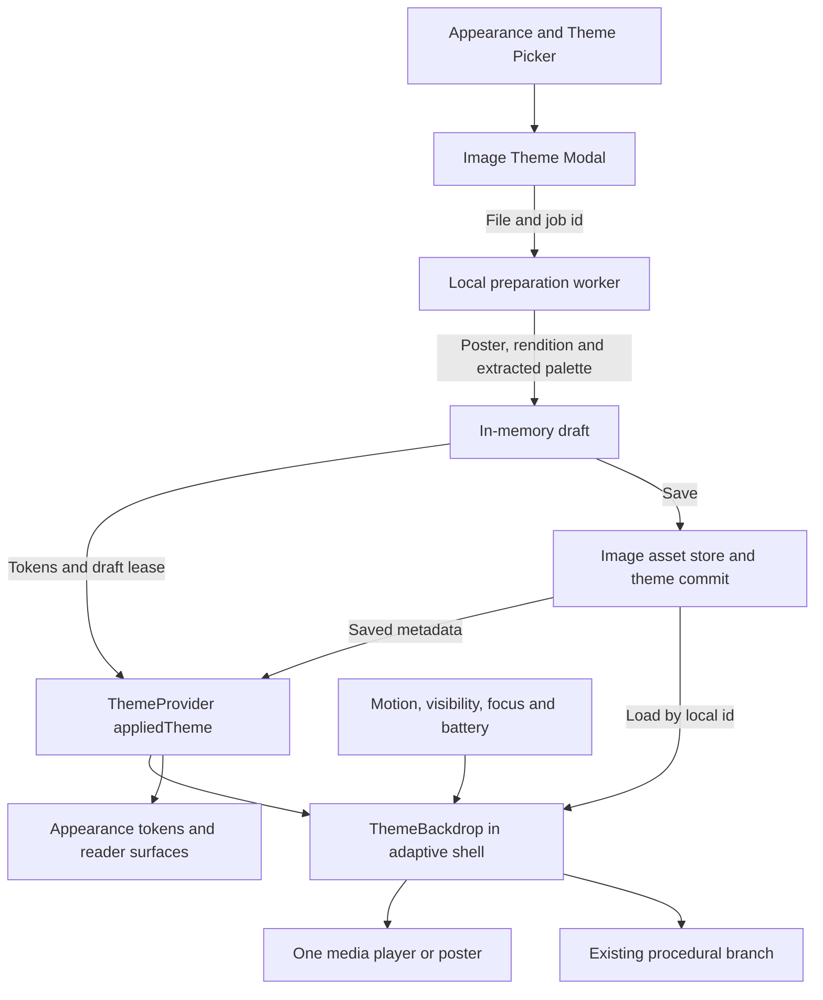
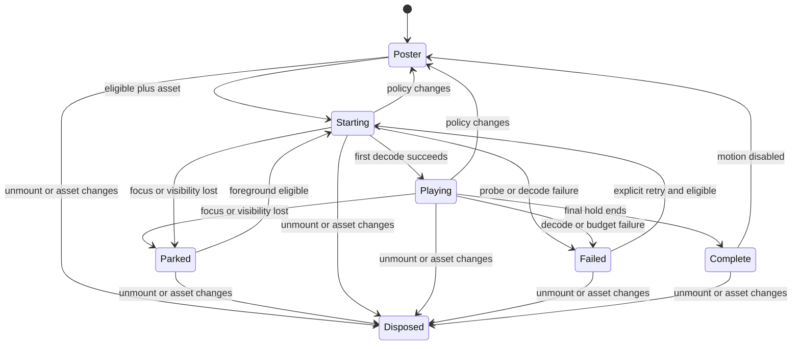

## Context

See [proposal.md](./proposal.md) for the user-facing scope. The following findings describe the current checkout. The historical [restore-animated-themes](../restore-animated-themes/design.md) change explains the idle-pause and mobile-default decisions. Its description of the old monolithic Canvas2D component predates the current code.

### Repository investigation

| Area | Observed behavior and implementation implication |
| --- | --- |
| Entry and formats | `SettingsPage.tsx` (`appearance.theme`) mounts `ThemePicker`. `ThemePicker.tsx` (`showImageModal`) opens `ImageThemeModal` from **From Image**. `ImageThemeModal.tsx:129` handles both file selection (`accept="image/*"`) and drag/drop. Known image extensions are PNG, JPG/JPEG, WebP, GIF, AVIF, BMP, HEIC and HEIF. Any image MIME, absent MIME or generic binary MIME can reach native decode. Actual still-image support depends on the WebView. Use content preflight to dispatch GIFs before decoding. |
| One-frame loss | `src/themes/imageStorage.ts` (`loadImageFromBlob`, `prepareBackdropImage` at lines 154–229) creates an `Image` from a Blob URL, then uses FileReader as a fallback, including for Android SAF. It draws once to a canvas with a 1,920 px longest edge, draws separately for a 48 px thumbnail and 96 px palette readback, then encodes the backdrop to still WebP or JPEG. The backdrop draw at line 191 and the still encode at line 192 discard the GIF timeline. Canvas specifies the default/first frame for an animated image source. [HTML Canvas Standard](https://html.spec.whatwg.org/multipage/canvas.html#dom-context-2d-drawimage) |
| Palette and synthesis | `src/themes/imageThemeExtractor.ts` (`extractPaletteFromPixels` at line 92) ignores alpha below 128, accumulates OKLCH hue/lightness/chroma bins and a lightness histogram, ranks chromatic swatches, and recommends light when median lightness exceeds 0.62. `synthesizeThemeFromPalette` (line 339) uses mood parameters, variant, hue overrides and contrast checks for solid theme colors. The modal renders Vibrant, Editorial, Deep Glass and High Contrast with shared typography, spacing, radius and shadow tokens. Reuse histogram finalization and synthesis, then check effective surfaces for animated themes. |
| Preview and commit | `ImageThemeModal.tsx` (`synthesizedTheme`, live preview effect, `handleSave`) applies real app colors and shows an image sample in the dialog. `ResponsiveDialogSheet.tsx` chooses desktop dialog or mobile sheet. `ThemeContext.tsx` (`appliedTheme`, `previewTheme`, `previewCustomTheme`, `commitPreview`) selects live draft, picker preview, then committed theme. Picker hover/keyboard focus is reversible. `applyThemeToDOM` writes CSS tokens, and the last selected ID is saved only outside preview. The modal currently calls the durable image write on selection, preview changes and save. An unguarded earlier import can win a later one. `handleSave` calls `addCustomTheme` then `setTheme` against the previous render's theme list. Use a scoped draft and a single commit operation. |
| Storage and sharing | `imageStorage.ts` (`openImageDb`, `saveBackdropImage`, `loadBackdropImage`, `deleteBackdropImage`) uses IndexedDB `plethora-theme-images` v1, object store `images`, string values and an in-memory Map. Writes can appear to succeed after IDB errors. `ThemeContext.tsx` (`loadCustomThemes`, `saveCustomThemes`, `removeCustomTheme`) stores metadata in `plethora-custom-themes` and deletes by image ID without checking all references. `exportTheme` serializes theme JSON, including the local ID and optional thumbnail, with no full-size image bytes. `importTheme` accepts basic structure and upserts by ID. Another installation generally gets at most the tiny thumbnail. The picker uses native dialog/read/write commands for JSON. |
| Shell and settings | `AdaptiveAppScaffold.tsx` mounts one `ThemeBackdrop`. `ThemeBackdrop.tsx` gives the image branch priority, draws a CSS cover image with blur, local brightness, saturation and overscan, and overlays a theme tint scrim and vignette. Its loaded URL is unkeyed and can briefly belong to the previous theme. `ThemeContext.tsx:199` sets `data-theme-image-backdrop` and theme surface variables. `src/index.css:1003` makes the shell transparent and adds translucent card/sidebar/toolbar surfaces with backdrop filters. Its broad `.bg-background` and `aside` selectors can expose reading areas. The e-ink rules at line 2696 hide the layer visually. |
| Procedural animation | `ThemeBackdrop.tsx` uses `findEffect` from `ambient/renderer/effects` and `createBackdropRenderer` in `createThemeRenderer.ts`. The registry selects WebGL2 or Canvas2D and optionally renders a static frame. The controller owns start/suspend/resume/dispose and progressive backend fallback. Canvas2D uses its historical 30 fps and battery density scaling. `qualityPolicy.ts` sets WebGL2 tiers, backing caps and adaptive steps. Backends own frame scheduling and release canvas/GL resources. `diagnostics.ts` exposes dev or `plethora.ambientDiagnostics` opt-in snapshots. Reuse the environment and diagnostics convention. |
| Lifecycle and power | `ThemeBackdrop.tsx:48–101` observes global enable, an OS media query, `visibilitychange`, Tauri focus and `plethora-theme-backdrop-suspend` (emitted by `HandbookSettings.tsx`). Focus and visibility currently write one flag independently. Its async focus registration can resolve after cleanup. `PresentationContext.tsx` (`readPresentationState`, `PresentationProvider`) also accounts for e-ink and exposes forced reduced motion through the root dataset. `settingsStore.ts:1264,1817,2195` uses desktop-on and native mobile default-off with persistence of later opt-ins. `isNativeMobile` in `src/lib/tauri.ts` uses the Tauri Android/iOS platform. `BatteryContext.tsx` polls `get_battery_state` every 30 s, derives `onBattery` and exposes a narrower type than the Rust result. `src-tauri/src/battery.rs` supplies thermal state, iOS bridge data, desktop charging without OS power saver, and Android placeholder charging/low-power fields despite an existing Kotlin query. `lifecycleCheckpoint.ts` consumes a native event, but verified Rust emission in `external_open.rs` is resume only. Verify actual packaged background signals. |
| Reading and chrome | `EPUBViewer.tsx` consumes the applied theme and paints a reader iframe background. `PDFViewer.tsx` has fixed page and reflow paths, the latter with its own theme preference. `MarkdownViewer.tsx` has local document and popup wrappers. HTML/article uses `DocumentViewer`, `htmlReader/readerThemeTokens.ts` and the generated iframe styles. Assistant UI, `StudyPlansTab.tsx`, guided trails under study plans, assessments, queue and navigation surfaces share shell tokens and utility backgrounds, so a CSS selector applied broadly can reach all of them. Reuse reader-specific paper and color semantics, then audit visible wrappers and ports on narrow and wide shells. |

The authoritative procedural contracts are in [gpu-theme-rendering](../../specs/gpu-theme-rendering/spec.md). [Animated-themes visibility](../../specs/animated-themes-visibility/spec.md) applies to Liquid Glass CSS animations, and [jellyfish ambient themes](../../specs/jellyfish-ambient-themes/spec.md) applies to the registered jellyfish effect. Existing image extractor, modal, picker and backdrop tests are starting points. Neither asset durability nor packaged WebView performance is established by these tests.

## Goals / Non-Goals

**Goals**

- Keep one applied-theme pipeline and one backdrop owner. Bound analysis and decoding independently of window resolution, refresh rate and source frame count.
- Keep GIF interpretation, prepared playback assets, style, and theme metadata independently versionable. Reuse the existing live theme and appearance tokens.
- Keep a functional theme through disabled motion, unavailable media backends, reload, or asset loss.

**Non-goals**

- New procedural renderer backends, custom WebGL shaders, browser-native animated image playback, globally adaptive theme colors, or changes to the built-in theme catalog.
- Frame-accurate high-FPS editing, speed or loop controls, runtime transcoding, source file retention, and cross-device media export.

## Decisions

### 1. Prepared playback format and conversion

The MVP decodes GIF once in a lazy, local worker and saves a bounded pack of independently decodable **still frames** with a normalized timeline. Present those frames in a Canvas2D layer. Use PNG for the independent poster, with a tiny PNG thumbnail. For the pack, prefer still WebP at a fixed quality initially 0.86 when the packaged encode and decode probes pass, otherwise JPEG at the same starting quality for opaque frames and PNG for frames with transparency. Check actual encoder output types, preserve alpha, and use one chosen rendition per import. An unsupported encoder can fall back per frame to its allowed format. A saved pack with unsupported or damaged frames falls back to the independently decodable poster. The user sees when the source is resized or its high-frequency detail is reduced. This is a local conversion during import with no system video codec dependency.

The following are relative expectations, subject to the packaged-device measurements in [performance-plan.md](./performance-plan.md).

| Strategy | Runtime CPU, GPU, RAM, battery | Preparation, control and fidelity | Packaging, failure and maintenance |
| --- | --- | --- | --- |
| Original GIF in an image element | Native GIF decode and composition plus CSS filtering. Decoded cache is engine-owned. Power use is hard to bound. | Lowest preparation cost. Alpha and normal loop semantics are broadly available. No reliable pause, seek or frame cap API. Removing the source restarts on remount and leaves in-flight work engine-owned. | No converter or codec add-on. Simple first-frame fallback, weak lifecycle guarantees. Reject as live fallback. |
| Animated WebP in an image element | Can reduce bytes on disk. Animated decode throughput, filtering and cache behavior remain WebView-dependent. | Encoding consumes import time. Container supports duration, blending, disposal, alpha and loops. An image element still exposes limited control. | A cross-platform animated encoder adds build and dependency work. Probe engine support if a future import adapter uses it. [WebP container specification](https://developers.google.com/speed/webp/docs/riff_container#animation) |
| Muted H.264 MP4 or WebM video | Often the strongest sustained playback candidate with hardware decoding. Software decode, native surfaces and CSS blur can erase the advantage. Decode buffers are engine-owned. | High import conversion cost. `play()`, `pause()`, seeking and inline playback are useful. Encode at the desired cap because playback rate changes speed as well as frame cadence. MP4/H.264 baseline lacks a general interoperable alpha path. WebM alpha support needs separate proof. Track finite loops explicitly. | System codec and autoplay variability, conversion packaging, codec licensing review and more fallback paths. A capability string is insufficient. A future spike must play actual muted, audio-free bytes inline and observe `play()` rejection and hardware/software paths. [WebKit inline video policy](https://webkit.org/blog/6784/new-video-policies-for-ios/) |
| Prepared still frames and controlled Canvas2D | Decode individual bounded frames on demand. Compositor can accelerate the final layer, with a CPU decode/upload cost at each change. Peak app-owned decoded residency is bounded. Disk size and sustained CPU may be worse than native video. | One bounded decode and encode pass at import. Accurate pause, frame cap and finite loop behavior. Composition before resizing preserves transparent/disposed areas. Timing changes limited to declared short-delay normalization and capped temporal sampling. | One worker decoder, standard still-image APIs, one player. Probe behavior at runtime. Poster has an independent read path, and color fallback survives even if assets are missing. Profile the serial frame path before enabling on each target. |

A worker provides isolation and cancellation, not a codec. Candidate decoder order is a small, reviewed JS decoder with a strict single-frame interface, then a thin WASM build using the Rust `gif` decoder if the JS candidate fails the gate. `omggif` (MIT) offers single-frame blit but logs some malformed-length conditions. `gifuct-js` (MIT) exposes one-frame decompression but its LZW code fills missing output. A structural preflight alone cannot catch such a stream. The result contract rejects invalid LZW codes and bounds output, input consumption and data structures. For compatibility, a missing explicit LZW end code is accepted only when structural preflight finds a complete sub-block chain and trailer and the bounded decoder fills the frame buffer; invalid codes and incomplete frames still fail. Compare this exception against independent reference decoders. Use neither upstream tolerant path as-is for validation. P0 compares a reviewed strict wrapper or narrowly patched primitive against the WASM alternative, verifies deterministic disposal, fuzzes malformed paths, checks compressed chunk size, licenses and notices, and records the winner. Do not implement an unreviewed LZW decoder as a schedule shortcut. [omggif source](https://github.com/deanm/omggif/blob/master/omggif.js), [gifuct-js decoder](https://github.com/matt-way/gifuct-js/blob/master/src/lzw.js), [GIF89a format](https://giflib.sourceforge.net/gifstandard/GIF89a.html)

Rust already includes `image = "0.24"` and resolves a `gif` crate in `Cargo.lock`. Native conversion through Tauri alone would introduce a second web/PWA pipeline and binary IPC costs. A tiny WASM decoder accepts those build costs only if it passes the worker/CSP, artifact size and release tooling gates. Keep WebCodecs `ImageDecoder` off the required path. Its specification leaves codec support optional and a WebKit landing gives no guarantee for older installed WebViews. Native frameworks such as Apple AVFoundation, Windows Media Foundation and Android MediaCodec, or GStreamer on Linux, would require separate encoding and packaging work. The existing Debian FFmpeg/GStreamer dependencies and AppImage plugin setup support other media use cases. A universal FFmpeg sidecar or heavy WASM transcoder needs a separate decision on download size, build targets, sandbox/filesystem access, mobile distribution, GPL/LGPL configuration, codec rights and upkeep. [WebCodecs specification](https://w3c.github.io/webcodecs/#imagedecoder-interface), [WebKit ImageDecoder implementation](https://bugs.webkit.org/show_bug.cgi?id=315546)

### 2. Backdrop ownership and dispatch

| Option | Consequence |
| --- | --- |
| Put GIF/video into `ambient/renderer` | Reuses controller names but couples imported asset handling and decoder lifetime to the effect registry, shader inputs and procedural canvas assumptions. |
| Dedicated media backdrop with shared policy | Lets the media player own its pixels, clock and decode cleanup. `ThemeBackdrop` continues to own shell placement and may host either branch. Preferred for the MVP. |
| General backdrop controller for every backdrop | Could unify lifecycle after several media backends exist. It would change stable still-image and procedural dispatch now and add a second abstraction before there is a shared contract beyond lifecycle. |

Choose a single branch in `ThemeBackdrop`: animated image with valid poster/descriptor, legacy still image, or existing procedural path. Apply style effects and protection in the shared image-backdrop wrapper. Start a branch only after the previous owner is disposed. Extract a small environment hook around existing visibility/focus/suspension sources, keeping procedural behavior and backend selection intact. Use one media session per applied asset identity (`mediaId + renditionVersion`) and one preview owner token. A style change may update CSS and tint with zero player recreation. An ID change atomically swaps the visible poster or theme fill before any async lookup can commit. The existing procedural spec delta narrows renderer routing to registered effects. The media contract lives in [animated-image-themes](./specs/animated-image-themes/spec.md).



### 3. GIF validation, composition and rendition

1. Check `File.size` before reading GIF bytes. Read a bounded prefix. A GIF87a/89a signature is authoritative, including with a generic MIME or extension. A file advertised as GIF by MIME or extension with another signature gets a format error. Other still formats follow the current path. A worker walks descriptors and sub-blocks to detect animation from image count, validate lengths and budgets, and build offset/timing metadata before allocating decode buffers. Validate the compressed stream for a single-frame GIF too, then route it through the still workflow. Reject zero-frame input.
2. Validate positive logical screen and frame dimensions, checked arithmetic, in-bounds patch rectangles, tables, palettes, permitted disposal values, data extents, LZW output length, terminators and trailer. Consume unknown non-rendering extensions with bounded skipping. Plain Text rendering or other unsupported rendering constructs yield a clear unsupported error. Ignore unused metadata. Respect interlace, transparency index, local/global palettes, disposal 0/1 (keep), 2 (restore the affected rectangle to the logical background, clear for transparent canvas), and 3 (restore the previous region). Define browser-compatible background initialization for common transparent GIFs using fixtures with and without a global background. Treat conflicting loop extensions as invalid. Keep nonzero delays of 20 ms or more, and normalize missing, zero and 10 ms delays to 100 ms as an explicit compatibility rule. No repeat extension means one play, zero repeats means infinite, and positive repeat counts denote repeats after the first play.
3. Decode one patch at a time into a bounded composited logical canvas. Keep up to one saved disposal rectangle. Compute downsampled pixels only for selected palette frames, and resample selected playback frames while the compositor owns their pixels. Encode in a worker Canvas2D where available. If worker 2D/encode is unavailable, transfer one bounded rendition-sized RGBA buffer at a time to a single main-thread scratch canvas with yielding and asynchronous `toBlob`. Decoder work stays in the worker. Abort the fallback on a measured budget failure or missing Canvas2D. Release buffers and close scratch resources on every result.
4. For the rendition retain the first presentation frame, then the first source frame on or after one tier interval since the previous retained start. Keep original start times on the normalized source timeline. Earlier frame content stays on screen across dropped transitions. Merge a too-short tail into the preceding hold and ensure the last-to-first seam meets the same minimum hold. Preserve unrolled cycle duration and loop count. If fewer than two frames survive, offer the still outcome. Use aspect-preserving resizing without upscaling. Reserve the first composited frame with meaningful visible content for the poster (at least 5% alpha coverage at 96 px), otherwise use the first frame. Record the original dimensions, effective dimensions and whether the rendition dropped transitions.
5. Keep only the most recent preparation job with a monotonic token. On replace, cancel, modal unmount or import watchdog, terminate the worker and reject later messages or encodes. For application backgrounding during import, cancel the work and allow explicit retry on return. A replacement clears its old live preview before preparing. Use status announcements for validating, analyzing, preparing preview and still-image fallback. Reuse the prepared pack and palette for preview changes, Save and retry after a transient write error. No source retention, per-frame readback at runtime, cross-theme fingerprint cache or remote work.

| Budget | Initial hard ceiling and rationale |
| --- | --- |
| Source | 16 MiB input, longest logical edge 2,048 px, at most 2,073,600 logical pixels, 450 source images, 30 s per normalized cycle, at most 150,000,000 summed decoded patch pixels and at most 150,000,000 logical pixels across all frames. The logical-work ceiling prevents small patches on a very large repeatedly sampled canvas from hiding excess composition cost. The edge/pixel caps bound a full RGBA surface to about 7.9 MiB. |
| Rendition | Desktop 960 px on longest axis, 518,400 pixels, max 20 changes/s and max 24 MiB for pack and poster. Native mobile / mobile web shell at import 640 px, 230,400 pixels, max 12 changes/s and max 12 MiB. A desktop pack opened in a mobile web shell exceeding mobile limits shows the poster until full desktop eligibility returns. These are upper bounds, so 720p/1080p sources downscale and 4K rejects. Browser viewport resize does not regenerate a pack. |
| Job | One worker job, up to 10 s wall-clock watchdog in the foreground, 4,000 ms preflight and analysis budget for the reference fixture targets described separately, one encoding operation outstanding, explicit byte accounting before retaining each encoded frame. Abort and release on cap breach. Once the pack byte ceiling is reached, abandon it and complete valid palette/poster preparation in the same job when possible. |
| Decode and failure | Corrupt, malformed, oversized and unvalidated input get actionable errors and cannot auto-preview. After validated analysis, if the rendition exceeds budget or all supported encode paths fail, offer **Use still image** with the derived palette and poster. If no usable poster is available, keep the committed theme and report a retryable or terminal error. A missing worker yields a platform error for animated import. |

720p at 24 fps and 1080p at 30 fps would carry about 2.1× and 6× the desktop pixel throughput of the chosen ceiling before full-window filtering. A widescreen 480p rendition would use about 1.8× the mobile pixel budget at the same cadence. Start below those candidates to leave room for reader scrolling and browser copies, then use device traces to judge visual quality and headroom.

### 4. Duration-weighted palette and stable theme

Compare first-frame analysis (cheap, biased), equal frame weighting (overrepresents rapid edits), all-frame analysis (accurate but expensive), scene-change clustering (more work and tuning), and bounded time-weighted samples with one perceptual histogram. Use the last option.

- For up to 12 frames, give every composited frame its normalized duration in the histogram. For longer timelines select the presentation frame at each of 12 equal-time-stratum midpoints, merging duplicate frame indices and assigning each its accumulated sampled time. A long hold can therefore dominate, while short transients have limited influence. Run the same sequence for portrait and landscape inputs. Downsample each selected frame to at most 96 px on its longest edge without upscaling, for at most 110,592 sampled pixels. Keep a single grid and a fixed-size weighted histogram. Ignore fully transparent pixels, weight semitransparent pixels by alpha, and exclude near-zero coverage. Avoid compositing black or white behind alpha during palette extraction. Use the existing neutral fallback if total weight is zero.
- Refactor `extractPaletteFromPixels` so the existing still wrapper retains its pixel stride, alpha threshold and ranking. A weighted accumulator can use float counts and a deterministic tie order for the animation path. Reuse deduplication, saliency, accent choice, median lightness, synthesis and mood defaults. Where a single brief flash would win by chroma alone, let it join candidate swatches only when it reaches 2% of weighted visible population. Dark/neutral dominant colors still contribute to the variant and atmosphere.
- The modal receives one analysis result. User controls may resynthesize the derived theme and contrast bounds. Save stores the resolved tokens. Frames advance on a private clock without palette state, React rerenders or CSS variable invalidations driven by playback.

### 5. Effective contrast, visual treatment and motion controls

- Apply one cover layer with the existing position, mild overscan, brightness, saturation, bounded blur and theme-tinted scrim. Keep the vignette decorative. Apply brightness in the image theme's existing local slider. Global `animationFrequency` and `animationBrightness` describe procedural particle density/glow. Keep their use there to avoid retiming the GIF or multiplying brightness twice. Avoid re-encoding blur on slider moves. Start at a 12 CSS px animation blur cap with an 8 px mobile cap, with communicated bounds where needed. Profile CSS filter vs fixed static backing and compositor scaling. The backdrop canvas allocation uses rendition pixels, independent of CSS size and DPR.
- Use a variant-colored opaque base below alpha pixels. For shell surfaces that show the image, calculate conservative effective sRGB channel bounds for the source from black through white after filter/clamp, local brightness, scrim, and surface alpha. For each text/control role choose contrast-safe tokens and search constrained scrim/surface alpha in 0.01 steps, favoring the requested values. Check the luminance range including its interior if it crosses the foreground luminance. Treat blur/vignette as aesthetic effects and give them zero contrast credit. Require 4.5:1 for normal text and links, 3:1 for qualifying large text, control indicators and visible focus against adjacent colors. If bounds still fail, use an opaque protected surface and select a compliant role color. Clamp the effective value and explain it near the existing inputs. Verify composited pixels with contrasting source fixtures as well as pure token tests. [WCAG 2.2 contrast and non-text contrast](https://www.w3.org/TR/WCAG22/#contrast-minimum)
- Keep document and long-form reading surfaces opaque under the protected image flag, including EPUB and HTML iframe bodies, fixed and reflowed PDF, and Markdown text. Audit the assistant transcript, Study Plans, guided reading trails, assessments, queue rows with text, navigation labels, dialogs and popovers. Use scoped semantic classes to override the broad still-image CSS on the animated path. On narrow screens and software paths favor opaque content chrome and disable animated `backdrop-filter`. Scenery remains visible in the shell and eligible chrome. The global and per-theme motion controls cover focus-friendly reading.
- For potential flashing, inspect consecutive *presentation* frames on the prepared timeline, including eligible loop seams, before any live preview. Start with a conservative WCAG-inspired full-rendition test: evaluate composited pixels against dark and light bases, flag general and saturated-red transitions in each direction with tool-validated thresholds and use a rolling one-second opposing-transition count. Give no minimum-area exemption because cover may enlarge the source region. Verify known flashing fixtures with a reference tool and retain a safety margin for JPEG/filter quantization and resampling. If an asset crosses the threshold or cannot be classified reliably, mark it still-only with a concise explanation. This screen is a safeguard for the provided feature. Packaged acceptance validates the behavior rather than certifying arbitrary user media. [W3C three flashes guidance](https://www.w3.org/WAI/WCAG22/Understanding/three-flashes-or-below-threshold.html)
- Add **Play animation** in the image creator after successful eligible preparation, enabled initially as per-theme intent. Expose the same preference for the active saved image theme in the Appearance theme controls. Global preferences always take precedence. The preview thumbnail and swatches are posters, while the app backdrop is live. Show an inline reason for a poster due to paused settings, power or unsupported playback. During pointer/focus browsing of the picker, show saved poster and colors for each candidate, and start motion only on explicit selection. Preserve existing hover/focus preview and commit semantics. Classify a saved multi-frame asset as animated in the existing filter/badge even when playback is temporarily blocked. Saving a still-only outcome produces an image theme with protected surfaces and no animation descriptor.
- Provide **Replace image** for the active saved GIF-derived theme through the same creator. Seed name, variant, appearance sliders, and play intent from the saved theme. Use the new palette for accent and mood defaults, allow editing the draft before saving, and retain the prior theme and assets on cancellation or failure. Saving preserves the theme ID and swaps its asset identity. A motion preference or token-only edit keeps the existing asset references. The MVP does not need to keep source pixels or a resynthesis recipe for a saved palette.
- Keep Automatic as policy, with zero separate high-quality or battery-saver presets. Use the existing global toggle, forced motion preference, OS motion, e-ink and power inputs. Settings Search uses stable `appearance.imageThemeAnimation` for the saved-theme control, with availability and reveal to the Themes section or the existing image-creator entry point when the saved-theme prerequisite is missing. Document the draft control as the duplicate of the registered destination in coverage. Follow `docs/settings-search.md` for catalog, localized labels, coverage and navigation tests. Search activation does not change settings or create a draft.

### 6. Playback lifecycle and power

Track visibility, focus, page active/frozen state, and app/widget suspension independently. Seed focus from `document.hasFocus()` on desktop, use native focus events when the platform emits them, and DOM focus/blur as browser/desktop fallback. Mobile shells use visibility plus page/native background signals and only trust a focus signal where the platform spike verifies it. Include pagehide/pageshow and freeze/resume where available. A visibility event alone cannot clear a focus or native-background block. Dispose late async listeners as soon as registration resolves. Preserve the Handbook event semantics, and gate e-ink on presentation state rather than its CSS visibility.

| Eligibility | Effect |
| --- | --- |
| Explicit backdrop suspension or e-ink | No imagery or playback as required by the existing shell override. Retain theme selection. |
| Global or per-theme off, OS/forced reduced motion, detected battery/OS power saver, severe thermal pressure, unsafe media, failed capability check, preview browse or diagnostic step-down | Display saved poster over the theme color, with zero new frame decodes or scheduling. Battery Saver means poster in the MVP. |
| Hidden, minimized, unfocused desktop, or backgrounded/suspended | Park the player, display the poster when the backdrop is still visible, stop new frame work and hold only elapsed presentation time and repeat index. On eligible foreground return, resume from the saved time, with hidden wall time excluded. |
| Eligible native/mobile-web session | Up to 12 changes/s, capped mobile rendition and blur. Native mobile remains default-off. During qualification, Android uses actual charging and power saver from the existing Kotlin bridge or treats unknown power as poster. |
| Eligible desktop or desktop web session | Up to 20 changes/s within the prepared limits. A browser with unobservable battery state may use the desktop tier subject to capability and performance qualification. |

Extend the existing BatteryContext type for optional native `isPowerSave` and `thermalStatus` using its current poller. Use Android's existing native battery/low-power query in the one existing command if the spike confirms it works. Desktop low-power detection is currently absent. Unplugged devices still use the poster, and desktop adapters with missing OS flags report that limitation. Refresh known power state on app foreground, without stacking polls. Keep app power awareness separate from procedural density. Hard policy disable, theme selection or replacement restarts at the first presentation frame on a later enable. Temporary foreground/focus loss resumes. A completed finite loop holds the last frame with no scheduled work until explicit re-enable or re-selection.

Use a monotonic clock, one next-boundary timer, and at most one paint RAF on a ready frame. Decode only the requested frame or the next imminent one. Start from `createImageBitmap(Blob)` and close each bitmap after copy. A detached, single-use still image with a Blob URL is the bounded fallback when the bitmap API is unavailable or fails the fixture probe. Validate decoded dimensions. Keep one canvas and at most two app-owned decoded frames (current/next), plus one poster. Clear and redraw for alpha. If a deadline is missed, seek the timeline forward and skip stale draws, preserving speed and loop accounting. Delay any next paint so actual draws still meet the minimum interval. Frames with long holds require a single deadline, with no idle polling. On pause, invalidate the generation, clear timer/RAF, detach image loads and revoke their URLs. A per-backdrop decode slot remains occupied across owner switches until abort or settlement, including on watchdog expiry of an unabortable browser decode. Release a late result immediately without painting it. If decode stalls, latch poster fallback while the slot is occupied. Use a failure latch keyed by asset and capability generation, with retry only after explicit re-selection/retry or a genuinely changed backend capability.



The branch can lower effective presentation cadence once under sustained missed deadlines, while preserving timeline duration. Use deterministic thresholds in [performance-plan.md](./performance-plan.md). If it misses the lower tier or frame encoding/blur proves too costly on a target, show the poster without oscillation. Keep runtime diagnostics local under the existing development/opt-in gate. Use a distinct media snapshot so ambient diagnostics callers keep their procedural schema. Report format, source/effective dimensions, nominal/observed presentation rate and drops, app-owned estimated bytes, eligibility/power/lifecycle state, and sanitized failure codes. App callback times do not measure GPU or browser decoder memory. Exclude source names, paths, bytes and remote telemetry.

### 7. Persistence, preview ownership and portability

Reuse `ThemeBackgroundImage` for poster reference and existing styling. Add a separate optional descriptor on `ThemeEffects` so legacy image fields retain their meanings. The reference is opaque and generated locally. The same generated asset identity ties the poster and pack together.

```ts
interface ThemeImageAnimation {
  version: 1;
  mediaId: string;
  sourceFormat: "gif";
  enabled: boolean;
}

// ThemeEffects.backgroundImage.imageId points to the poster.
// ThemeBackgroundImage.protectedSurfaces?: true for GIF-derived imagery
// ThemeEffects.imageAnimation?: ThemeImageAnimation
// IDB record keys: media:v1:<id>:poster and media:v1:<id>:pack
// Pack record: version, source dimensions, rendition dimensions, byte budget,
// duration, plays (finite or infinite), and ordered { startMs, still: Blob } frames.
```

- New binary values use namespaced keys in the existing v1 object store. The poster reference can point to a Blob for new imports, while existing string records and their readers remain supported. A poster-only save may use the same Blob poster key and no animation descriptor. Validate the pack version, expected dimensions, finite monotonic timing, loop and byte limits, allowed Blob MIME/signature and generated key pairing before creating a resource. Ignore unknown versions and fall back. Keep raw or prepared binary bytes out of localStorage and avoid an animated media memory cache beyond the currently owned draft/session. The 48 px poster thumbnail remains metadata for existing swatches and downgrade.
- Use a single provider-owned, tokenized draft lease and style updates keyed to its asset identity. Keep draft poster/pack in memory until Save. A stale cleanup cannot clear a newer preview. Make file replacement and cancellation invalidate the token before freeing buffers, and keep the picker preview separate. Save checks that the draft generation is current, rejects duplicate submits, commits an IDB transaction for poster and pack, waits for transaction completion, then persists updated metadata and selection and publishes the committed theme in one provider operation. Keep the draft lease through handoff so the committed backdrop can reuse the same prepared identity.
- Cross-store commits use an operation journal at `plethora-image-theme-mutation-v1` and retain the existing registry and selection keys. Under the registry write gate, journal the prior theme entry and selection, intended affected ID and asset generation, then write the next registry and selection. Mark the journal committed after both writes succeed and only then publish. An unfinished operation restores the previous entry and selection and compensates the new asset write. A committed journal only needs cleanup. Recover before provider hydration or a new mutation. If rollback is interrupted or a storage error prevents verification, preserve both generations and retry before confirming another mutation. Apply the journal to save, replacement and active-theme deletion. Guard the shorter commit section from dismissal. Retry from the validated draft with a fresh generation after failure.
- On delete/replacement, persist metadata first, invalidate the applicable preview and player, then delete verified unreferenced keys. Legacy shared references count. New IDs are unique per commit and never adopted by JSON import. Use a short IndexedDB read/write transaction on the existing object store as the per-origin registry write and cleanup gate. Perform the synchronous journal/registry sequence in its request callback after verifying the staged keys with key-only reads, keeping encoding and Blob reads outside this section. Coordinate any metadata operation that can add, replace or remove these references through the same gate. Refresh provider snapshots on storage events after the journal reaches a settled state. If the gate is unavailable, fail durable GIF mutations explicitly and keep existing selections and media. For orphan recovery, check the saved registry and journal under the same gate, then sweep only known namespaced generations older than a grace period. If a never-committed generation is reclaimed before a late writer arrives, the key check fails the save and the draft can be retried. Treat storage snapshots that cannot be read or parsed as unknown ownership. Keep cleanup bookkeeping bounded. An ended render session drops Blob references and object URLs even if durable deletion is deferred.
- Export animated themes as explicitly labeled **Colors only** JSON, stripping local poster/animation references and thumbnail. Warn about full-image loss in the existing still-image JSON export flow, which retains its legacy structure. Tolerate legacy JSON and the optional old thumbnail, but restrict backdrop thumbnails to capped validated still-raster data URLs, reject arbitrary asset schemes, and ignore externally supplied animated handles/records. Assign a fresh custom ID when a JSON ID collides with a saved GIF-derived theme. Import the sanitized theme and select it atomically, preserving colors and normal theme options. Existing legacy themes already stored locally keep their references. Embedding base64 assets would exceed the current metadata/JSON boundary and add validation and quota work. A future versioned media package can carry binary assets explicitly.

### 8. Extensibility and release boundary

Keep signature dispatch, source decoding, and pack playback separate. GIF is the sole animated format in the first release. A later WebP or APNG adapter must supply the same presentation-frame and timeline contract with its own bounds and reference fixtures. Existing still-format behavior continues through the legacy path. A generic codec registry and broad import picker would add support claims and test requirements before a second animated source is ready. Roll out the bounded pack first, keep poster-only cohorts where necessary, and evaluate optimized video against this measured baseline.

### 9. Testing and qualification architecture

Use deterministic unit fixtures for the strict parser, compositor, weighted palette and rendition timing. Inject a fake clock and tracked decoder into player tests so each pause, replacement and failure can be tested with a pending result. Exercise provider and modal interactions with transaction aborts, storage recovery and legacy records. Run real browser checks for wide and narrow shells and web reader surfaces, including contrast measurements against captured composites. The pure TypeScript benchmark gate covers the algorithm and startup bundle checks. It does not measure a host WebView's compositor, decode cost or energy use.

Apply the [platform matrix and budgets](./performance-plan.md) to real Linux WebKitGTK, macOS WKWebView, Windows WebView2, Android System WebView, iOS WKWebView where supported, and web/PWA targets. Capability probes run against actual local Worker, Canvas2D, storage and still-format operations. A probe or async decode failure selects the independent poster and then theme fill. A packaged target qualifies for animated playback only after lifecycle and sustained performance checks on that platform.

## Risks / Trade-offs

- **Large packs or repeated still decode costs** → Bound bytes, resolution and cadence. Verify sustained performance and fall back to the poster if the selected target or rendition cannot meet budgets. A video optimization later may improve file size and CPU.
- **GIF/browser fidelity discrepancies** → Compare interlaced, partial, restore-previous, transparent, timed and finite-loop fixtures against reference outputs in the decoder gate. Stable playback should preserve aspect ratio, alpha and duration within the stated normalization and cadence.
- **Software compositors and full-window filters** → Profile real blur plus glass overlays. Prefer a single filtered moving layer with lightweight CSS surfaces and fall back to a static backing or poster when needed.
- **Old or restricted WebViews** → Exercise packaged Worker, Blob, IndexedDB, Canvas and decode probes. A valid poster remains available for runtime failures. Report a bounded import error if preparation cannot run on the target.
- **Legacy race conditions and storage loss** → Use ID-scoped preview and load results, commit after durable acknowledgement, and include quota, abort, stale result and concurrent reference tests. Leave missing/corrupt assets visibly usable through theme colors.
- **Flashing-screen false positives** → Precision is secondary to reliably blocking unsafe previews. Verify a typical motion corpus as well as red, bright and loop-seam flash cases. If unknown, keep the still outcome and explain it.

## Migration Plan

1. Ship additive type and reader support plus the still fallback before animation activation. The IDB schema stays at v1 without rewriting existing assets. Unknown descriptor versions degrade to poster or theme fill. Older binaries can read previous theme metadata and legacy strings. New Blob-backed themes fall back to the embedded tiny thumbnail or colors in those binaries.
2. Enable animated import/playback for each qualified release target after the gates in [performance-plan.md](./performance-plan.md). Keep internal fallback switches for pilot or rollback. When a target misses the gate, keep its still path, state the reason, and rerun the packaged check before enabling motion. The existing global setting stays authoritative.
3. Roll back to the poster path while retaining new media metadata and bytes for later re-enable. Preserve legacy image themes and procedural settings. Cleanup retries remain scoped to confirmed locally owned, unreferenced assets.

## Open Questions

- P0 proves one strict worker GIF decoder, legal notices, CSP/module bundling, still encoders and round-trip fixture probes. If the JS candidate fails, evaluate the bounded Rust/WASM alternative. A target lacking both viable paths cannot ship animated import. This does not block work on the theme contract or golden fixtures.
- Native background events, battery accuracy on Android and compositor behavior in Linux software mode need packaged validation. If visibility/focus cannot be observed reliably on a target, the release path there is still-only. The performance plan specifies the evidence and promotion gates.
- Playback format efficiency remains measured per packaged target. The release median/p95 import, frame pacing and energy comparisons determine whether the WebP encode branch, main-thread canvas encode fallback and optional blur effects qualify. The stored format stays versioned for a later codec without adding an MVP requirement.
