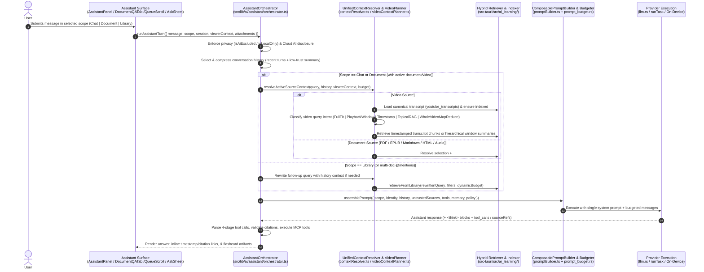

## Context

See `proposal.md` for motivation and capability scope.

### Verified Codebase Diagnosis & Root Causes

A full code-level audit of the TypeScript frontend and Rust/Tauri backend identified two sets of interlocking root causes:

#### Part I: Restrictive & Fragmented Assistant Architecture
1. **Hardcoded Restrictive Rust System Prompt (`src-tauri/src/ai/prompt_budget.rs:234-315`)**:
   - `build_context_prompt` hardcodes `let instructions = "Use the provided context to answer the user's request. If the user asks for a summary, summarize the relevant context. If the answer is not in the provided context, say so.";` (lines 243–247) and injects it into every `context_type` branch (`"document"`, `"web"`, `"video"`, `"selection"`, and even `"general"` at lines 310–313).
2. **Contradictory Multi-System-Message Stacking (`AssistantPanel.tsx:1703-1706`, `DocumentQATab.tsx:1633-1688`, `src/api/llm/index.ts:169-171`, `src-tauri/src/commands/llm.rs:483-513`)**:
   - Up to three separate `role: "system"` messages are sent in a single request: (1) Rust `assembled.system_prompt` (restrictive context-only instruction + excerpt + `MEMORY.md`), (2) `provider.systemPrompt` prepended by `chatWithContext`, and (3) the frontend's `toolInstruction` or `DocumentQATab` `systemPrompt` (which may tell the model to answer from general knowledge or expand beyond the document).
3. **Anthropic Silently Drops All System Messages (`src-tauri/src/commands/llm.rs:838-850, 1655-1667`)**:
   - Both `stream_anthropic` and `call_anthropic_with_key` partition `messages` on `m.role == "system"` into `system_message` and never include it in `AnthropicRequest` (`llm.rs:220-227`), silently discarding all system instructions, `MEMORY.md`, and Rust-assembled source context for Anthropic models.
4. **Ollama History Trimming Evicts Frontend System/Tool Instructions First (`src-tauri/src/commands/llm.rs:485`, `src-tauri/src/ai/prompt_budget.rs:91-101, 433-447`)**:
   - `llm_chat_with_context` slices `history_src = &messages[..last_user_idx]`, which includes the frontend's leading `role: "system"` message (`toolInstruction`). When `drop_oldest_history` (`prompt_budget.rs:91-101`) trims `kept.remove(0)` to fit Ollama's `num_ctx`, the first message removed is the frontend system/tool prompt rather than old conversation turns.
5. **Hard Source-Content Blocking (`src/components/assistant/AssistantPanel.tsx:1633-1640`, `src/api/llm/index.ts:164-166`)**:
   - `AssistantPanel` throws `"Document context is unavailable for this request."` or `"No source content available for this request."` whenever `contextContent` is empty, blocking general conversation on non-document tabs or when PDF/video extraction is unavailable.
6. **Inconsistent & Stateless Conversation History**:
   - `AssistantPanel` (standard path, `L1243-1246`): sends last 10 messages (5 turns).
   - `AssistantPanel` (whole-library toggle, `L1200-1240`): calls `askLibrary` with **0 history messages** and no tool support.
   - `DocumentQATab` Path 1 (default RAG path when no `#section`, chapter ref, tool keyword, or web search is active, `L1532-1538`): calls `askQaKnowledge` -> `askLibrary` with **0 history messages**, making a multi-turn chat UI stateless on follow-up turns.
   - `DocumentQATab` Path 2 (`#section`, chapter ref, tool intent, or web search, `L1539-1787`): sends last 6 messages (3 turns), duplicates `contextContent` in both `userPrompt` (`createDocumentQaRequestContent`) and `context.content`, and when `mentionedDocumentIds.length === 0` (`buildMultiDocumentContext`, `L941-947`), passes a dummy placeholder string `"User is asking about their documents..."` with zero retrieved content.
7. **Fragile Keyword Expansion (`src/utils/assistantExpansion.ts:7-17`, `AssistantPanel.tsx:1608-1632`)**:
   - `EXPANSION_PATTERNS` includes `/chapter/i` (line 16), causing any prompt containing the word `"chapter"` (e.g., `"Summarize chapter 2"`) to trigger external expansion and a live Brave web search. Furthermore, when a selection is active (`AssistantPanel.tsx:1613`), `lookupQuery` passes the raw selected text (`pinnedSelection?.excerpt || llmContext?.selection`) instead of the user's question to Brave Search.
8. **Strict RAG Quote Validation & Single-Document Filter Leak (`src/lib/ai/schemas/libraryAnswer.ts:127-149`, `src-tauri/src/ai_learning/retrieval.rs:103-118`)**:
   - `validateLibraryAnswer` rejects citations to `"selection-context"` (not registered in `buildSourceLookup`, `libraryTask.ts:144-150`) and drops any citation whose quote fails exact normalized substring containment (`quoteIsGroundedIn`), forcibly downgrading `evidenceLevel` to `"none"`.
   - In `src-tauri/src/ai_learning/retrieval.rs:103-118`, when `filters.document_ids` is `Some(explicit)` and `fts_document_prefilter` returns `Some(fts)`, the match arm `(Some(explicit), Some(fts))` **unions** `fts` into `explicit` instead of restricting to `explicit`, leaking chunks from unrelated documents into single-document semantic retrieval.

#### Part II: Incomplete YouTube Transcript Context & Multi-Stage Truncation
1. **Desktop Viewer Bypasses SQLite Cache (`src-tauri/src/youtube.rs:1225-1240`)**:
   - `YouTubeViewer.tsx:580` invokes `get_youtube_transcript_by_id`. Step 1 calls `innertube::fetch_youtube_transcript_on_device_internal` **without checking `youtube_transcripts` first**, and when `Ok(segments)` is returned, immediately returns `Ok(segments)` (line 1237) **without calling `repo.upsert_youtube_transcript`**.
2. **`documents.content` Never Updated by On-Device / Viewer / Browser Transcript Fetches**:
   - Only `import_youtube_video` (`youtube.rs:1559-1596`, using `yt-dlp`) populates `documents.content`. Transcripts fetched via `fetch_youtube_transcript_on_device`, `get_youtube_transcript_by_id`, `YouTubeViewer`, or `sourceChain.ts` never update `documents.content` (and in web mode `browser-backend.ts:3842`, `documents.content` is set to the video description). Consequently, `DocumentQATab`, FTS5 `document_search`, and backend `llm_chat_with_context` DB fallbacks (`commands/llm.rs:344-366`) see `NULL` content for those videos.
3. **2,000-Token (~10-Minute) Hard Frontend Head Truncation (`src/components/viewer/DocumentViewerWrapper.tsx:169, 359-369`, `src/utils/tokenizer.ts:33-86`)**:
   - `DocumentViewerWrapper` sets `maxTokens = settings.ai.maxTokens || 2000` and calls `trimToTokenWindow(videoText, maxTokens, aiModel, selection)` without `scrollPercent` or `currentTime`. When no text is highlighted, `trimToTokenWindow` (`tokenizer.ts:77`) executes `tokenizer.decode(tokens.slice(0, 2000))`, silently discarding everything after the first ~10 minutes of the video.
4. **Provider Context Budget Clamped to `settings.ai.maxTokens` (`src/components/assistant/AssistantPanel.tsx:253, 1494-1503`, `src/api/llm/policy.ts:121-124`)**:
   - `AssistantPanel` passes `contextWindowTokens` (`settings.ai.maxTokens` = `2000`) as `promptBudgetHint` to `resolveRequestPolicy()`, which clamps `promptBudgetTokens` down to `Math.min(hint, promptBudget)` even when the user's provider is configured for 16k–64k tokens.
5. **High Main-Thread Re-Tokenization Churn (`src/components/viewer/DocumentViewer.tsx:8446-8455`, `DocumentViewerWrapper.tsx:357-429`)**:
   - Every playback `onTimeUpdate` tick creates a new `videoContext` object, re-triggering `DocumentViewerWrapper`'s `useEffect` and running a full `@dqbd/tiktoken` encode/decode of the entire transcript on the main thread.
6. **Line-Break Destruction (`src/utils/assistantContext.ts:56-60, 181-219`)**:
   - `resolveGenericAssistantContext` runs `normalizeWhitespace` (`str.replace(/\s+/g, " ")`), collapsing multi-line `[M:SS] segment` transcripts into a single line and breaking paragraph-level chunking in `prompt_budget.rs`.
7. **Unindexed Transcript Segments (`src-tauri/src/ai_learning/indexer.rs:464-521`)**:
   - `build_document_chunks` treats `FileType::Youtube`, `FileType::Video`, and `FileType::Audio` as flat `ChunkInput::Plain` text with `location.timestamp_ms = None`, never reading `youtube_transcripts` or `video_transcripts` to create `source_type = "transcript"` chunks with millisecond timestamps.
8. **Misleading `"Transcript attached"` UI & Surface Drift (`DocumentViewerWrapper.tsx:361-375`, `AssistantPanel.tsx:3276-3280`, `QueueScrollPage.tsx:2367-2465`, `VideoFeatures.tsx:469-484`)**:
   - `DocumentViewerWrapper` sets `assistantContent = "Video: ...\n\nTranscript: unavailable."` and `status = "ready"`, causing `AssistantPanel` (`context.type === "video" && context.content`) to display `"Transcript attached"` when no transcript exists.
   - `QueueScrollPage` omits `onVideoContextChange`, `onPdfContextChange`, and `SELECTION_ASK_EVENT` handling, and strips timestamps from its in-memory transcript fetch.
   - `VideoFeatures.tsx` queries `video_transcripts` (local Whisper table) instead of `youtube_transcripts` when opened inside `YouTubeViewer`.

---

## Goals / Non-Goals

**Goals:**
- Unify Assistant execution behind a single conversation orchestrator supporting three explicit scopes: `Chat` (default), `Document` (strict grounding), and `Library` (cross-source retrieval).
- Establish a single composable prompt assembly and provider-aware token budgeting pipeline across TypeScript and Rust with strict untrusted-input containment.
- Persist canonical YouTube transcripts across all ingestion paths, index timestamped transcript chunks into `semantic_chunks`, and implement query-aware video retrieval and hierarchical full-video synthesis.
- Guarantee consistent context resolution, multi-turn history continuity, tool execution, and privacy/consent enforcement across `AssistantPanel`, `DocumentQATab`, `QueueScrollPage`, `AskSheet`, and mobile/PWA surfaces.

**Non-Goals:**
- Introducing a second parallel LLM/provider store or replacing the existing `ai_learning` SQLite vector/FTS5 tables.
- Expensive automatic multimodal video frame extraction or OCR ingestion on every video import (documented as a future follow-up; this change focuses on complete transcript intelligence while clearly distinguishing transcript-grounded vs. visual-only video content).
- Breaking or discarding existing persisted conversations in `localStorage` (`assistant-panel-conversations-v1` and `document-qa-sessions-v1`).

---

## Architecture & Request Lifecycle

---

## Decisions

### D1: Unify All Assistant Request Paths Behind One Conversation Orchestrator
- **Decision**: Introduce `src/lib/ai/assistant/orchestrator.ts` (`runAssistantTurn`) as the single orchestration layer shared by `AssistantPanel.tsx`, `DocumentQATab.tsx`, `QueueScrollPage.tsx`, `AskSheet.tsx`, and `PwaAssistantButton.tsx`.
- **Rationale**: Today, `AssistantPanel` and `DocumentQATab` each maintain two internal branches (`chatWithContext` vs. `askLibrary` / `askQaKnowledge`), causing features like conversation history, MCP tools, 4-stage tool parsing, `isAiExcluded`/`isLocalOnly` checks, and `ensureCloudAiDisclosure` to work in one path and silently fail in another. A single orchestrator parameterizes behavior strictly by `scope: "chat" | "document" | "library"` and capabilities, eliminating dual-pipeline drift.
- **Alternatives Considered**:
  - *Patching `AssistantPanel` and `DocumentQATab` independently*: Rejected because any future change to tool execution, history summarization, or video retrieval would have to be duplicated across 4+ call sites.

### D2: Explicit Three-Scope Grounding Policy (`Chat | Document | Library`)
- **Decision**: Define `AssistantScope = "chat" | "document" | "library"` in `src/lib/ai/assistant/scopes.ts`:
  - **`Chat` (default for general & reader Assistant threads)**: Source context (active document, selection, `#section`, or video transcript) is supplied inside `<untrusted_source>` blocks as a high-value reference asset. The scope policy explicitly authorizes the model to answer any question (including unrelated first-turn questions or cross-domain follow-ups), cite the source when making source-specific claims, never fabricate quotes/timestamps, and continue smoothly when no source is open or extraction fails.
  - **`Document` (strict single-source grounding)**: Answers must derive strictly from the active source (or explicitly `@`-scoped documents/sections). Unsupported claims from outside knowledge are forbidden; when evidence is missing, the Assistant states what is absent and renders a one-click **"Continue in Chat"** action chip.
  - **`Library` (cross-source retrieval)**: Uses hybrid vector + FTS5 retrieval across eligible library items (`documents`, `extracts`, `annotations`, `cards`, `transcripts`), with multi-turn follow-up resolution and strict citation validation.
- **Rationale**: Makes grounding deterministic and user-controlled rather than dependent on hidden regex triggers (`assistantExpansion.ts`) or whether a document happens to be open.
- **Alternatives Considered**:
  - *LLM classifier auto-switching between strict and open modes*: Rejected because silent mode switching is unpredictable and violates the requirement that scope selection be explicit and deterministic.

### D3: Composable Prompt Assembly & TypeScript/Rust Responsibility Boundary
- **Decision**:
  - **TypeScript (`src/lib/ai/assistant/promptBuilder.ts`)** owns semantic prompt composition across 8 ordered, independently unit-testable components:
    1. *Core Identity*: Conversational learning partner identity.
    2. *Scope Policy*: Grounding rules for `Chat`, `Document`, or `Library`.
    3. *Untrusted-Input Security Boundary*: `UNTRUSTED_CONTAINMENT_CLAUSE` (`src/lib/ai/tasks/containment.ts`).
    4. *Tool Schema & Execution Rules*: Unified MCP tool definitions (`create_qa_card`, `create_cloze_card`, `batch_create_cards`, `create_extract`) and `/20rules` formulation rules.
    5. *User Long-Term Memory*: Optional `MEMORY.md` section, included **only** when `settings.ai.memoryEnabled === true`.
    6. *Source Context & Provenance*: Active selection (`id="selection-context"`), `#section` excerpts, or retrieved document/transcript chunks wrapped once via `wrapUntrustedBlock` with metadata headers (title, author, duration, playback time, transcript status).
    7. *Conversation Memory*: Rolling summary of older evicted turns (marked as lower-trust conversational context that cannot override scope or system rules) + recent verbatim `user`/`assistant` turns.
    8. *Provider Budget Hints*: Resolved `LlmRequestPolicy` (`configuredContextTokens`, `promptBudgetTokens`, `outputReserveTokens`).
  - **Rust (`src-tauri/src/ai/prompt_budget.rs` & `src-tauri/src/commands/llm.rs`)** acts as the **token budget enforcer and provider transport adapter**, not a competing prompt author:
    - Remove the hardcoded `"If the answer is not in the provided context, say so"` from `prompt_budget.rs:243-247`; accept `scope: AssistantScope` (defaulting to `"chat"` for general/chat requests and `"document"` only when explicitly requested) and assemble a **single** `role: "system"` message (`assembled.system_prompt`) that merges the system instruction layers cleanly.
    - Strip any incoming `role == "system"` messages from `history_src` (`llm.rs:485`) into the protected `system_prompt` before calling `drop_oldest_history`, so Ollama budget trimming only drops `user`/`assistant` turns.
    - Fix `AnthropicRequest` (`llm.rs:220-227, 838-850, 1655-1667`) to include `#[serde(skip_serializing_if = "Option::is_none")] system: Option<String>`, joining all `role == "system"` messages with `"\n\n"`.
    - Stop duplicating `contextContent` in both `userPrompt` and `context.content` (`createDocumentQaRequestContent`), and fix `AssistantPanel.tsx:1735-1760` so attaching images wraps `resolvedUserPrompt` rather than raw `prompt`.
- **Rationale**: Eliminates multi-system-message contradictions, fixes Anthropic and Ollama bugs at the root, and avoids introducing a second AI stack.
- **Alternatives Considered**:
  - *Moving all prompt assembly exclusively into Rust*: Rejected because web/PWA (`browser-backend.ts`) and on-device providers (`AppleFoundationProvider`, `GeminiNano`) execute in TypeScript without invoking `llm_chat_with_context`. Keeping semantic composition in TypeScript with Rust enforcing token budgets and provider transport works uniformly across all runtimes.

### D4: Reuse & Fix `ai_learning` Retrieval for Both Library and Current-Document / Video Search
- **Decision**:
  1. Fix the filter bug in `src-tauri/src/ai_learning/retrieval.rs:103-118`: when `filters.document_ids` is `Some(explicit)`, `candidate_docs` MUST restrict strictly to `explicit` (or the intersection of `explicit` and `fts` when prefiltering, falling back to `explicit` if FTS has 0 matches on that document so pure semantic matches within `explicit` still succeed).
  2. Replace hardcoded `ASK_LIBRARY_CONTEXT_TOKEN_BUDGET = 2_400` and `ASK_LIBRARY_K = 8` (`src/lib/ai/tasks/definitions/libraryTask.ts:56-63`) with dynamic budget scaling derived from `resolveRequestPolicy`:
     - On-device (4k window): `budget = 2,400`, `k = 8`.
     - 8k–16k window: `budget = min(6,000, floor(promptBudgetTokens * 0.55))`, `k = 12`.
     - 32k+ window: `budget = min(14,000, floor(promptBudgetTokens * 0.60))`, `k = 18`.
  3. Register `"selection-context"` in `buildSourceLookup` (`libraryTask.ts:144-150`) and enhance `quoteIsGroundedIn` (`src/lib/ai/schemas/libraryAnswer.ts:70-74`) to support multi-clause ellipsis (`...` / `…`) matching and typographic punctuation folding (`TYPOGRAPHY_FOLDS` from `resolveCitationLocation.ts`), preventing valid citations from being stripped and downgraded to `evidenceLevel: "none"`.
- **Rationale**: Allows `retrieveFromLibrary` with `filters: { documentIds: [activeDocId] }` to serve both `Library` scope and single-document / single-video chunk retrieval in `Chat` and `Document` scopes using one unified index.

### D5: Canonical YouTube Transcript Persistence & Timestamped Semantic Chunking
- **Decision**:
  1. **Unified Persistence Helper (`persist_canonical_youtube_transcript` in `src-tauri/src/youtube.rs`)**:
     - Update `get_youtube_transcript_by_id` (`youtube.rs:1225-1251`) to:
       a. Check `repo.get_youtube_transcript_by_video_id_with_version(&video_id)` first; if a non-empty fresh transcript exists, return it immediately (and if `document_id` is provided and `documents.content` is empty, backfill `documents.content`).
       b. When `innertube::fetch_youtube_transcript_on_device_internal` succeeds, call `persist_canonical_youtube_transcript(&repo, document_id.as_deref(), &video_id, &language, &segments)` which:
          - Upserts `youtube_transcripts` (adding a nullable `language TEXT` column via a new SQLite migration and storing `word_timings_version`).
          - Formats timestamped transcript lines (`[M:SS] text`) and updates `documents.content` for any document matching `document_id` or `youtube_id = video_id` (triggering the existing FTS5 `document_search_update` trigger automatically).
          - Enqueues the document on `IndexerQueue` (`ai_learning::indexer::IndexerQueue::enqueue_document`) so transcript chunks are indexed asynchronously in the background.
     - Add a Tauri command `save_youtube_transcript_segments(video_id, document_id, language, segments)` so client-side/browser fallback fetches in `sourceChain.ts` / `YouTubeViewer.tsx` also persist to SQLite and `documents.content` when running in Tauri, and update `browser-backend.ts` in web/PWA mode to store the transcript in IndexedDB/`localStorage` and `documents.content`.
     - Add a TTL/force-refresh parameter (`force_refresh: Option<bool>`) so negative cache rows (`segments_json == "[]"`) older than 24 hours or explicit user "Retry" clicks bypass the empty cache row.
  2. **Timestamp-Aware Transcript Chunker (`src-tauri/src/ai_learning/chunker.rs` & `indexer.rs`)**:
     - Add `ChunkInput::Transcript { segments: Vec<TranscriptChunkSegment>, chapters: Vec<TranscriptChapter> }` in `chunker.rs`.
     - Group consecutive transcript segments into overlapping windows of `target_min = 700` to `target_max = 1,000` characters (~45–90 seconds of speech) with a 1–2 segment overlap, flushing at chapter boundaries when chapters exist.
     - Format each chunk's text with leading segment timestamps (`[MM:SS] ...`) so quotes carry readable context, and populate `SemanticChunk`:
       - `source_type = SemanticSourceType::Transcript` (`"transcript"`)
       - `location = ChunkLocation { source_type: "transcript", timestamp_ms: Some((first_seg.start * 1000.0) as i64), end_timestamp_ms: Some((last_seg_end * 1000.0) as i64), .. }`
       - `heading_path = vec![chapter_title]` (if inside a chapter) or `vec![format_time_range(start, end)]`.
     - Update `build_document_chunks` in `src-tauri/src/ai_learning/indexer.rs:464-521` so `FileType::Youtube` reads `youtube_transcripts` (falling back to `video_transcripts`) and `FileType::Video | FileType::Audio` reads `video_transcripts`, using `ChunkInput::Transcript`. Because `apply_chunk_diff` (`indexer.rs:694-768`) diffs by `content_hash`, unchanged transcripts are never re-embedded.

### D6: Preserving Timestamps Through Retrieval, Citations, and Inline Links
- **Decision**:
  1. When `SemanticChunk.location.timestamp_ms` is present on a cited `AskLibraryCitedSource` / `RagHit`, `resolveCitationLocation` (`src/utils/resolveCitationLocation.ts:344-403`) uses `timestamp_ms / 1000` directly in $O(1)$ without needing to re-fetch and substring-search the entire transcript (keeping substring search only as a fallback for legacy chunks).
  2. Fix `src/utils/assistantContext.ts:56-60` (`normalizeWhitespace`) to preserve single line breaks (`\n`) in transcript and structured contexts (`normalizeLineWhitespace` collapsing horizontal `[ \t]+` while keeping `\n`).
  3. Extend `AssistantResponseContent.tsx` (`src/components/common/AssistantResponseContent.tsx`) with an optional `onTimestampClick?: (seconds: number) => void` prop that transforms `[MM:SS]` and `[HH:MM:SS]` patterns in rendered Assistant prose into clickable `<button class="assistant-timestamp-link" data-seconds="...">` elements that seek the active `YouTubeViewer` or media player directly.

### D7: Query-Aware Video Retrieval Planner & Full-Video Map-Reduce Synthesis
- **Decision**: Create `src/lib/ai/assistant/videoContextPlanner.ts` (`planVideoContext`), replacing the 2,000-token head cut in `DocumentViewerWrapper.tsx:359-369`.
  - Given `{ segments, duration, currentTime, selection, query, conversationHistory, sourceBudgetTokens }`:
    1. **Mode 1 — Full-Transcript Fit (`totalTranscriptTokens <= sourceBudgetTokens`)**:
       - Formats all segments with `[MM:SS]` markers and sends the complete transcript (`coverage: "full"`). With `promptBudgetHint: 2000` removed, a 16k–64k cloud/Ollama model can fit 30–120+ minutes of transcript directly when configured.
    2. **Mode 2 — Explicit Timestamp Target**:
       - Detects timestamp references in `query` (e.g., `42:00`, `1:15:30`, `around 42 minutes`, `at minute 15` via deterministic timestamp parser `parseTimestampReferences`). Extracts a window of `±180` seconds around each referenced timestamp, leaving remaining budget for top semantic/lexical chunks.
    3. **Mode 3 — Active Playback Window**:
       - When `currentTime != null` and the query references the immediate playback moment (deictic references like `"what did they just say"`, `"explain this part"`, `"what does the speaker mean here"`, or an active transcript selection), centers a primary window (`-90s` to `+45s` around `currentTime`) and allocates the remaining budget to topically relevant chunks across the video.
    4. **Mode 4 — Topical Hybrid Retrieval**:
       - For specific topical queries on long videos exceeding `sourceBudgetTokens`, retrieves top-$k$ chunks from `semantic_chunks` (`source_type = "transcript"`, `document_id`) via `retrieveFromLibrary` (or synchronous in-memory BM25 + temporal-neighbor expansion over `segments` if background indexing is still in progress), sorted chronologically with `[MM:SS - MM:SS]` headers and +/- 1 adjacent chunk expansion.
    5. **Mode 5 — Whole-Video Hierarchical Synthesis (Map-Reduce)**:
       - When the query asks for whole-video comprehension (e.g., global summary, main arguments, key takeaways, full outline, or conclusion of the video) and `totalTranscriptTokens > sourceBudgetTokens`:
         - Partitions `segments` into $N$ contiguous time windows (or video chapters, ~2,500–3,500 tokens per window).
         - Checks an in-memory + `localStorage`/SQLite cache keyed by `${videoId}:window-summaries:${contentHash}` so window summaries are computed at most once per video.
         - Summarizes each window (extracting key claims, entities, and `[MM:SS]` anchor timestamps) using bounded concurrency, then provides the complete chronological map of window summaries + sampled opening/closing/high-salience passages to the final synthesis prompt (`coverage: "hierarchical-full"`).
         - Never claims full-video coverage if only a partial slice was analyzed (`coverage` metadata is explicitly included in the source header).

### D8: Provider Portability, Privacy Guarantees, and Mobile/Linux Performance
- **Decision**:
  1. **Unified Privacy & Consent Gate**: Before any LLM or cloud embedding call in `runAssistantTurn`, run a single `enforceAssistantPrivacyAndConsent({ documents, provider, settings })` check that enforces:
     - `doc.isAiExcluded` (blocks sending excluded document content in `AssistantPanel` just like `runTask` and `DocumentQATab`).
     - `doc.isLocalOnly` and `settings.ai.strictLocalOnly` (blocks cloud providers and routes to Ollama/on-device or surfaces a clear local-only notice).
     - `ensureCloudAiDisclosure` (`src/lib/privacy/cloudAiDisclosure.ts`) and `ensurePaidCloudAiConsent` (`src/utils/aiBillingConsent.ts`).
  2. **Eliminate Main-Thread Tiktoken Churn**:
     - Remove `videoContext` (`currentTime`) from the `DocumentViewerWrapper.tsx:429` `useEffect` that pre-computes `assistantContent`. Store `currentTime` in a lightweight ref/state used only at prompt submission time (`resolveContextForPrompt`) and throttled badge display (`5s`).
     - Replace synchronous full-document `@dqbd/tiktoken` encoding during render/scroll with fast `O(1)` character-based token estimation (`Math.ceil(chars / 4)`) during live UI updates, reserving exact tokenization or chunk selection for prompt submission time.

### D9: Backward-Compatible Session Migration & Conversation Memory Architecture
- **Decision**:
  - Extend persisted conversation records in `assistant-panel-conversations-v1` and `document-qa-sessions-v1` with optional fields:
    - `scope?: "chat" | "document" | "library"` (defaults to `"chat"` for `AssistantPanel` conversations and `"library"` or `"document"` for existing `DocumentQATab` sessions based on their existing `scope` field).
    - `rollingSummary?: { text: string; upToMessageId: string; updatedAt: number }` for older turns evicted beyond the verbatim history window (default verbatim window: up to **12 messages / 6 turns**, dynamically bounded by `prompt_budget.rs`).
    - Per-message `scope?: AssistantScope`, `sourceContextRef?: { documentId?: string; videoId?: string; title?: string; timestamp?: number; coverage?: string }`.
  - When a user switches from Document A to Document B mid-thread (or detaches a source chip), prior messages keep their historical `sourceContextRef`, while the new turn's `<untrusted_source>` block contains **only** Document B's context with an explicit provenance transition header (`Active source switched to: <Document B>`).
  - Any `rollingSummary` generated from older turns is injected inside `<untrusted_conversation_summary>` so it can never override system instructions or scope policy.

### D10: Safe Request Instrumentation & Diagnostics
- **Decision**:
  - Add a structured, non-sensitive diagnostic snapshot `AssistantRequestDiagnostics` attached in-memory to the last turn (inspectable in dev tools or via an optional collapsible "Request details" debug inspector when `settings.developerMode` is enabled):
    - `scope`: `"chat" | "document" | "library"`
    - `provider` & `model`
    - `policy`: `{ configuredContextTokens, promptBudgetTokens, outputReserveTokens }`
    - `tokenBreakdown`: `{ systemTokens, historyTokens, memoryTokens, sourceTokens, userTokens }`
    - `sourceStatus`: `{ type, status, coverage, chunkCount, timeRangeCovered }`
    - `historyCount`: `{ verbatimMessages, summarizedMessages }`
  - Never log API keys or raw private document text to external telemetry.

---

## UX Specifications & Surface Integration

### 1. Scope Selector (`Chat | Document | Library`)
- **Component**: New reusable `<AssistantScopeSelector>` (`src/components/assistant/AssistantScopeSelector.tsx`) rendered in the header/composer bar of `AssistantPanel.tsx`, `DocumentQATab.tsx`, and `AskSheet.tsx`.
- **Visual Design**: Segmented 3-pill control (`Chat` | `Document` | `Library`) with concise tooltip/sub-label:
  - `Chat`: *"Uses current source as context + general knowledge"* (Default in `AssistantPanel` and general conversations).
  - `Document`: *"Strictly grounded in current source only"* (Disables or shows `"No active source"` hint if no document/video is open).
  - `Library`: *"Searches and cites across your library"*.
- **Replaces**: The binary `"This document" / "Whole library"` toggle button in `AssistantPanel.tsx:3085-3099`.

### 2. Source Context & Honest Transcript Status Indicator
- **Component**: Reuse and update context status badge in `AssistantPanel.tsx:3250-3290` and `DocumentQATab.tsx`:
  - **Video states**:
    - `loading`: Spinner + `"Loading transcript..."`
    - `ready` (full fit): `"Transcript ready (Full • 18:42)"` + current playback chip `@ 04:12`
    - `ready` (indexed / chunked): `"Transcript indexed (1h 54m)"` + current playback chip `@ 42:10`
    - `partial`: `"Partial transcript available"`
    - `unavailable`: `"No transcript available"` (never `"Transcript attached"`)
    - `failed`: `"Transcript failed"` + inline `Retry` button (`forceRefresh: true`)
  - **Source Attribution in Responses**:
    - When `Chat` scope combines document/video evidence with broader model knowledge, the prompt instructs the model to cite source-backed claims with `[N]` or `[MM:SS]` markers and clearly distinguish broader background knowledge.
    - When `Document` scope lacks evidence in the source, the response renders an inline action chip: **[Switch to Chat to answer with general knowledge]**.

### 3. Surface Consolidation Matrix
| Surface | Existing Component(s) Reused | Key Unification Changes |
| :--- | :--- | :--- |
| **Reader Assistant Panel** | `AssistantPanel.tsx`, `ChatFlashcardCollection.tsx`, `CollapsedSectionCards.tsx` | Replace binary library toggle with `Chat \| Document \| Library` selector (default `Chat`); route through `runAssistantTurn`; remove empty-context throw in `Chat` scope; add clickable `[MM:SS]` timestamps. |
| **Document Q&A Workspace** | `DocumentQATab.tsx`, `DocumentQaSourcePicker.tsx`, `DocumentQaEvidenceFooter.tsx`, `DocumentQASources.tsx` | Add `Chat \| Document \| Library` scope selector; pass multi-turn conversation history to `askQaKnowledge`/`askLibrary`; use unified 4-stage `parseToolCalls`; resolve YouTube transcripts from `youtube_transcripts` when `doc.content` was previously empty. |
| **YouTube Viewer & Wrapper** | `YouTubeViewer.tsx`, `DocumentViewer.tsx`, `DocumentViewerWrapper.tsx`, `VideoFeatures.tsx` | Persist InnerTube transcripts to SQLite + `documents.content`; remove 2,000-token head cut in `DocumentViewerWrapper`; stop playback-tick tiktoken re-encoding; connect `VideoFeatures.tsx` to `youtube_transcripts`. |
| **Queue Scroll Mode** | `QueueScrollPage.tsx` | Wire `onVideoContextChange` (including live `currentTime` and `duration`), `onPdfContextChange`, and `SELECTION_ASK_EVENT` to embedded `DocumentViewer` and `AssistantPanel`; use canonical timestamped transcript. |
| **Mobile Ask Sheet & PWA** | `AskSheet.tsx`, `SelectionActionsSheet.tsx`, `PwaAssistantButton.tsx` | Align `AskSheet` scopes with unified `Chat \| Document \| Library` orchestrator; support multi-turn follow-up history in `AskSheet`; share context resolver in `PwaAssistantButton`. |

---

## Risks / Trade-offs

- **[Risk] Whole-video map-reduce summarization on a 2-hour video could incur high latency or token usage** → **Mitigation**: Only trigger map-reduce when (a) the transcript exceeds the model's single-pass `sourceBudgetTokens` AND (b) the query is classified as a whole-video synthesis request (specific topical or timestamp questions use fast $O(\log N)$ chunk retrieval instead). Cache window-level summaries by `${videoId}:${contentHash}` so subsequent whole-video questions reuse them instantaneously.
- **[Risk] Background transcript embedding could lag when a user immediately asks a question after opening a new 2-hour video** → **Mitigation**: `planVideoContext` includes a synchronous in-memory lexical BM25 + timestamp window scorer over the already-loaded `TranscriptSegment[]` array when `semantic_chunks` indexing for that video is still in progress (`state != "indexed"`), guaranteeing immediate full-video retrieval on the very first turn without waiting for embeddings.
- **[Risk] Conversational history in `Document` or `Library` scope could carry over external claims from an earlier `Chat` turn** → **Mitigation**: Tag each stored message with its generating `scope`. When executing a strict `Document` or `Library` turn, the prompt builder instructs the model to use prior conversation history only to resolve coreferences (e.g., pronouns, "that topic", "the second paper") while requiring all factual claims in the new answer to be grounded in the current turn's `<untrusted_source>` blocks.

---

## Migration Plan

1. **Database Migration**: Add a forward-only SQLite migration in `src-tauri/src/database/migrations.rs` adding `language TEXT` to `youtube_transcripts` and backfilling `documents.content` from existing non-empty `youtube_transcripts.transcript` rows where `documents.content IS NULL OR documents.content = ''`.
2. **LocalStorage Session Compatibility**: Session loaders in `AssistantPanel.tsx` and `documentQaSessions.ts` treat missing `scope` fields on existing saved conversations as `"chat"` (in `AssistantPanel`) and `"library"` / `"document"` (in `DocumentQATab`), preserving all existing messages, drafts, and flashcard artifacts without data loss.
3. **Rollback Strategy**: All schema additions are additive (`ALTER TABLE youtube_transcripts ADD COLUMN language TEXT`), and session JSON fields are optional, allowing safe binary rollback without corrupting SQLite or `localStorage`.
