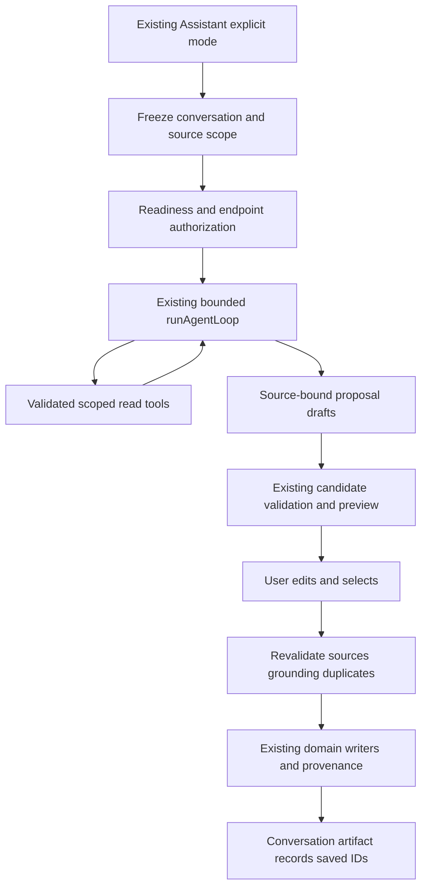

## Context

See proposal and audit. `runAgentLoop` already accepts injected environment/provider/signal/events. `AssistantPanel` owns conversation-aware requests and tool artifacts; `assistant/conversations/types.ts` already defines source/selection/locator/versioned persistence. `LearnThisProposalSheet` supports static validated candidates. These are the integration boundaries, not reasons to create another chat.

## Goals / Non-Goals

**Goals:** explicit agent invocation, verifiable sources, bounded progress, editable approval and reliable save recovery. **Non-goals:** sending agent responses into legacy Assistant write-tool parsing, arbitrary MCP access, implicit autonomous execution, graph CRUD before the knowledge adapter exists, or scheduler changes.

## Decisions

### Existing conversation is the run owner

Add explicit Learning Agent mode to the existing Assistant composer and a localized palette action in `src/commandPalette/registry.tsx` / existing palette events. Palette opens the existing Assistant and selects mode; it does not send a request until the user submits. Example intents cover chapter cards, clozes, missing prerequisite concepts, related library material and three explicitly attached papers. Do not silently route ordinary chat into agent mode.

Present this as a secondary explicit learning action within the existing attachment-driven Assistant; do not reintroduce a mandatory top-level Chat/Document/Library selector contrary to `unify-assistant-experience`. Reuse its current turn/conversation ownership rather than building a competing lifecycle controller.

Proposed run envelope: `{runId, conversationId, ownerRevision, intent, scope, sources: SourceReference[], selection?: SelectionSnapshot, controller}`. Freeze existing Assistant attachments/context at submit; `AgentEnvironment` is injected from that snapshot, never reads the subsequently active global document. For a chapter request, include resolved bounded section context; if a section cannot be identified ask for selection/section instead of pretending the entire chapter was analyzed. For multiple papers use the existing authorized document set and retrieval filters; report missing/partial sources. A plain prerequisite intent can produce suggested concepts with explicit evidence limitations until the knowledge adapter exists.

Run state is ephemeral within existing conversation state. Add a versioned optional agent artifact payload to existing conversation serialization for draft content, source references, candidate status and accepted IDs, following existing export/sync privacy policy for that conversation; never persist an AbortController, live owner token or raw tool transcript. Restored runs are stopped drafts requiring fresh source validation, never auto-resumed. Removing an attachment revokes its capability for later tool use/approval.

### Source-bound environment and proposal schema

Extend `AgentSourceRef` with the already-existing source locator/revision representation or an equivalent validated reference, preserving older records. `AgentProposal` carries `{proposalId, sourceRefs[], sourceRevision, ...existing kind fields}`; IDs are assigned by the application. Proposal tools may reference only source handles returned by validated tools. Resolve handles through a per-run evidence map containing exact source text, record ID and location; model strings cannot manufacture authority. Do not attach the current document to a card generated from another paper. Unsaved RSS/web content uses the existing ephemeral source capability; offer explicit import before durable source linkage, or retain an honest ephemeral origin if that existing workflow allows it. Never fabricate a library ID.

`createDefaultAgentEnvironment` currently fetches all learning items/extracts before filtering. Replace that path for production agent runs with existing bounded retrieval plus bounded record hydration; paginate any necessary existing-card query and stop within the run budget. Keep injected test environments. Retrieval must receive the same embedding config/consent and document filters as the frozen plan. Do not create a second index. Validate source existence/revision again at approval and before backend writes.

### Provider, privacy and bounded execution

Use F0 readiness and existing provider/task router. Resolve generation and embedding destinations before retrieving private queries or sending source content; reuse disclosure/billing controls and pin the authorized provider/config revision for this run. Direct `runTask` is not proof that `runAiAction` disclosure occurred. If a native failure would change destination, stop and request the existing explicit retry authorization; cancellation never retries remotely. A local Ollama endpoint is classified by destination, not `kind`.

Keep existing 8-call, 20-proposal, 60s and 2-chained-retrieval-hop bounds and loop-repeat limit. Add a single run deadline AbortController linked to user/source/conversation/unmount/flag changes, including slow retrieval/API calls and the final partial-answer turn. Pass remaining deadline into each `runTask`; no turn gets a fresh 60s allowance. Native non-cancellable operations have late-result suppression and no writes. Override `targetId` with run+source hash identity so existing prefix-based task coalescing cannot merge different conversations or cancelled runs. Progress uses existing `AgentRunEvent` turn/tool/proposal events; structured agent turns are not token-streamed. Coalesce announcements, show source references and bound reason, and keep Stop available on mobile and desktop.

### Preview and approval handoff

Adapt cards/clozes to `LearningCardCandidate` and `learnThisValidation.ts`; split source groups so the existing 8-cards/2-per-concept preview cap remains true even though the agent's overall proposal cap is 20. Use `LearnThisProposalSheet` static path after validation, and revalidate on edits/approval; do not rely on editing clearing duplicate flags. At duplicate-service failure show “duplicate check unavailable” and require explicit retry/check before acceptance rather than interpreting failure as evidence of uniqueness. Re-check existing cards at save to handle concurrent creation.

Extracts route to the current extract editor/confirmation; clozes to existing source-linked cloze creation; image proposals open `ImageOcclusionComposer` and its own approval flow; tags require a visible edit confirmation. Relationship tools remain typed unavailable until knowledge supplies validated staging. Do not change legacy chat tools as part of this connection. Agent drafts cannot be parsed as legacy `tool_calls` or execute Assistant MCP mutations.

### Persistence and recovery

Reuse `acceptLearnThisCandidates`, `createLearningItemsBatch`, `createClozeFromExtract`, learning-item/extract APIs and provenance recording. For extract-less cards populate the existing `source_reference` using `serializeCardSourceReference` / `utils/cardSourceAnchor.ts`; its existing jump locator and ≤300-character excerpt are the primary navigation anchor. Extract-linked cards retain authoritative extract selection context. A multi-source candidate picks an explicitly validated primary source and keeps all supporting source references in existing AI provenance metadata, not a second source-reference schema. Generalize acceptance context to correct originating task/run and per-candidate source, preserving Learn-this callers.

Test/fix numbered cloze-marker conversion and the existing duplicate bypass before using this adapter. The batch writer intentionally skips duplicate detection for occlusion, so add scoped text-proposal duplicate enforcement without changing occlusion behavior globally. Maintain per-proposal states `draft | validating | saving | saved | failed | rejected` with saved IDs. Retry only failed/uncommitted proposals. Backend uniqueness/idempotency must protect `(acceptanceId, proposalId)` on existing create paths; add narrow optional idempotency metadata to the existing domain command/transaction, with an additive migration and tests. Do not implement another learning-object writer. Include post-commit daily-note failure in ambiguous-result reconciliation.

Mixed source/cloze batches can partially save. Record each returned durable ID before the next group; on an ambiguous transport failure query by acceptance key before retry. Link provenance in the same existing transaction where feasible; if provenance is a separate failure, keep the already-created ID, show “saved; source metadata needs repair” and repair that metadata without recreating the card. Never report total success if required source associations are missing. Cancel during a committed save cannot roll back reality: reconcile IDs and show exactly what saved.

## Relevant modules and interfaces

Existing: `AssistantPanel.tsx`, `assistant/conversations/{types,serialize,store}.ts`, `assistant/{orchestrator,toolArtifacts}.ts`, `agent/{loop,sessionContext,bounds,trace}.ts`, `agent/tools/`, `schemas/agentTurn.ts`, `components/learn/`, `api/{learning-items,extracts,ai-provenance}.ts`, Rust `commands/learning_item.rs`. Proposed: a small Assistant agent adapter under `src/lib/ai/assistant/` and a proposal handoff component near the existing Assistant artifacts. Reuse source navigation from existing Assistant citations and card-source flows.

## Risks / Trade-offs

- Scope crossing after navigation → frozen injected environment plus revision validation at every external boundary.
- Untrusted prompt directives → existing containment/schema/allowlist plus source-handle validation independent of model output.
- Deadline vs useful partial answer → synthesize local partial summary when no time remains; never overrun for another model turn.
- Per-item approval across several sources → group previews by source, preserve accepted IDs and source disclosure in each group.
- Persisted draft contains private text → honor current conversation persistence/export policy; never put it in diagnostics.

## Migration Plan

Add optional backward-readable conversation artifact fields; hydrate old records without agent metadata. Any acceptance-id migration is additive in the existing migration registry, not executed by this planning task. Disable agent entry for rollback; saved learning objects/source associations remain valid and drafts never auto-execute. Coordinate new Assistant and palette fields with active Assistant changes before editing.

## Platform variations and alternatives

Both mobile and desktop use the same run envelope in the existing Assistant presentation. Native model/schema availability is resolved by the current Android/Apple/Windows providers; Linux/configured local and authorized external endpoints use the same task validation, with strict JSON fallback where required. Native cancellation support varies, so late suppression and save authority do not depend on immediate backend abort.

A separate AgentSheet/chat store was rejected because it would split conversation/source authority. Sending agent output through legacy Assistant mutation tools was rejected because it bypasses staged approval. A new source-provenance schema was rejected in favor of existing `CardSourceReference` and AI provenance. Unbounded “fetch all cards then filter” was rejected for large/mobile libraries.

## Validation strategy

Unit: scope/evidence map, proposal adaptation, caps, cloze parsing, duplicate failure and idempotent retry. Component: both Assistant presentations, progress/stop, source groups/edit/subset and conversation switch. Integration: production Assistant submit → fake provider → real validation/handoff → test domain API, including two/three document sources. Backend: acceptance-key races, exact linkage/provenance and ambiguous retry. E2E: all six example intent families, no-save until approval, reopen saved cards. Privacy/security: malicious sources/tools, absent model, unauthorized source handles, endpoint/consent changes and no legacy tool dispatch. Platform: local/configured routes and native deadline/cancel in the release protocol.
