## Context

Existing prerequisite inference and relational concept lifecycle work independently. `ConceptRepository` normalizes names, enforces relation types/confidence and daily cap (200 AI proposals), and remembers dismissed fingerprints. It does not by itself complete source authority, per-analysis thresholds, coverage or graph UI. See the audit for exact entry points.

## Goals / Non-Goals

**Goals:** evidence-backed prerequisites, typed inspectable links and navigable cross-document support. **Non-goals:** mastery prediction, embedding-score-as-knowledge, automatic synonym merging, graph replacement or background relationship creation.

## Decisions

### Existing command adapter and bounded analysis owner

Proposed `src/api/concept-links.ts` mirrors existing concept/link commands and typed outcomes. Proposed `src/lib/ai/concepts/{coverage,relationships}.ts` owns deterministic coverage and proposal orchestration, using `retrieveFromLibrary`, actual document/extract/card records and index status. The documented missing coverage path becomes the implementation home, not a renamed duplicate service.

`SelectionActionsSheet.startPrerequisites` delegates to one cancellable analysis owner with `{analysisId, passageHash, sourceRevision, signal, authorizedDestinations}`. Gate `aiPrerequisites` independently from `aiConceptLinks`. Inference uses existing `runPrerequisiteAnalysis`; override prefix target ID with full source hash/owner revision. Validate/dedupe up to existing `MAX_PREREQUISITES=12` candidates by the same case/whitespace normalization as Rust; do not silently merge synonyms or equal-looking concepts in different domains. A user-confirmed alias/same-as link can be used later, but the model cannot invent one.

Coverage-only inspection does not persist concepts or links. Resolve existing normalized names read-only and assign local draft handles for missing concepts. Upsert new concepts only inside explicit suggestion-save/accept transactions. Empty prerequisites render “No prerequisites suggested for this passage”, not a claim that no knowledge is missing.

Index completeness must account for every source kind included in the declared search scope. A document-only aggregate cannot establish that cards/annotations are fully indexed; if their freshness is not provable through existing metadata, retain partial/unavailable completeness and unknown on zero hits. Add only a metadata status projection to existing index APIs if needed, not a second inventory/index.

### Deterministic coverage contract

```ts
type EvidenceCoverage = 'unknown' | 'not-covered' | 'partial' | 'supported';
type Activity = 'none' | 'encountered' | 'studied' | 'reviewed';
// Proposed result; model output never supplies these fields.
interface ConceptCoverage {
  conceptKey: string;
  evidenceCoverage: EvidenceCoverage;
  activity: Activity;
  indexCompleteness: 'complete' | 'partial' | 'unavailable';
  evidenceRefs: Array<{
    kind: 'chunk' | 'extract' | 'card' | 'annotation';
    id: string; documentId?: string; sourceRevision: string;
    locator: unknown; strength: 'mention' | 'direct';
  }>;
  limitations: string[];
}
```

Use current library scope and index status, not a full library fetch. For each normalized concept query shared retrieval with k=6 and a bounded existing-record lookup; global query concurrency=2, max 12 concepts and 72 evidence candidates. Validate every hit exists, is within authorized library scope, has a current revision and navigable locator before counting it. Related text without resolvable origin can be displayed as an unverified limitation but not counted. Any query failure or incomplete index marks completeness accordingly; provider/embedding disclosure is checked before sending even the concept query remotely.

Deterministic evidence rules, versioned `coverage-v1`:

1. Normalize case and whitespace exactly as the existing Rust `normalize_concept_name` helper and use token boundaries. Preserve other Unicode distinctions for canonical identity; do not silently introduce an NFC/alias merge migration. A **mention** requires the canonical concept phrase or an explicitly user-confirmed alias in verified source text. Similarity ranking chooses candidates but cannot by itself count evidence.
2. **Direct** evidence is a current verified mention in a card front/answer, or an extract/chunk/annotation containing a definition cue for that exact phrase (`X is`, `X means`, `X refers to`, or a heading exactly naming X followed by substantive content of ≥60 characters), or a user-confirmed definition/support relationship resolving to actual text. English cues are an initial deterministic ruleset; unsupported languages without a confirmed source link remain mention/partial, with a limitation. Never infer direct support from an AI-written rationale.
3. At least one direct reference → supported; otherwise at least one mention → partial; zero references with incomplete/unavailable evidence/index scan → unknown; zero references with the relevant searchable collection fully indexed and successfully queried → not-covered **by indexed evidence**. Supported/partial can still carry partial index completeness; never claim exhaustive coverage.
4. Activity is independent: a validated review-history event for the supporting card → reviewed; existing supporting card/extract → studied; actual source reading event → encountered; otherwise none. A document merely existing is not encountered. Missing history stays none/unknown limitation; activity is not mastery and never changes scheduling.

This conservative rule is auditable and testable; it will miss synonyms/definitions rather than fabricate understanding. Display evidence references and the ruleset/limitations so future calibrated improvements can be compared. An optional model summary can explain verified references but cannot alter level, IDs or counts. No such summary is required for v1.

### Relationship proposals and lifecycle

```mermaid
flowchart LR
    S[Explicit passage analysis] --> P[Existing prerequisite task]
    P --> C[Canonical read-only resolution]
    C --> E[Shared retrieval and source verification]
    E --> V[Deterministic coverage and evidence UI]
    V --> T[Bounded typed relationship drafts]
    T --> U[User edits / saves suggestions / accepts]
    U --> R[Existing ConceptRepository transaction]
    R --> B[Backlinks and existing graph projection]
```



For non-prerequisite relation suggestions add a small proposed task definition/schema under existing `tasks/definitions/` / `schemas/`, **using `runTask`**. Input contains only bounded verified source handles; output `{sourceHandle,targetHandle,relationType,confidence,rationale}`. Validate finite confidence [0,1], allowed types, handle membership and no self-edge. A prerequisite inference without an analyzed target concept yields coverage only; do not fabricate the target from a document title. Ask the user to select the target concept or resolve it from an explicit existing concept attachment.

Initial proposed minimum confidence: same-as/contradicts=0.90; prerequisite-of=0.85; all other existing relation types=0.80. These are conservative policy defaults, not measured model calibration. Cap visible/saved AI link proposals at 5 per analysis (backend-enforced as well as UI); existing 200/day hard cap remains. Do not allow prompt-generated thresholds or unlimited pagination around caps.

Drafts stay ephemeral until explicit “Save suggestions” or Accept. Save suggestions persists pending AI links; Accept records endorsement. UI shows AI-suggested vs user-confirmed, confidence, rationale, current/stale source references and analysis/model/task origin. Persist original `origin=ai` in validated provenance before accept changes `created_by` to user. Existing accepted historical rows without origin remain “origin unknown”, never retroactively AI or user-authored by guess.

Fingerprint: normalized canonical endpoint kinds/IDs + relation type + source evidence content revisions + proposal-policy version, generated by app/backend, not model. Sort endpoints only for symmetric `same-as`, `analogous-to`, `related-to`; preserve direction for prerequisite/support/example/etc. Canonical concept IDs resolve before persistent fingerprinting. Unique fingerprint + transaction protects concurrent save. Dismissal retains its fingerprint across restart; removal is distinct from dismissal. Editing a pending/accepted relation uses a proposed narrow `update_concept_link` command/repository transaction preserving origin, validating endpoints/recomputing uniqueness and exposing conflicts without dropping the original. A material edit resets endorsement until confirmed; dismissed fingerprint history is retained. Avoid generic graph rewrite.

Backend validates endpoint kind, existence, source identity/revision, finite confidence, source-handle provenance and caps at the command boundary. Do not trust arbitrary `provenance_json` or model-supplied IDs. A proposed batch lifecycle wrapper composes existing repository methods in a transaction to enforce analysis cap and avoid orphan concepts on failed save; it is not a new graph service. Count the daily AI quota by immutable origin/creation, so accepting links cannot release quota by changing `created_by`. Existing single-link commands remain compatible but must enforce applicable validation consistently. Scope ownership is the local repository; do not invent multi-tenant accounts absent from current domain.

### UI, navigation and stale links

Extend the existing prerequisite sheet with coverage/activity labels, evidence count, source rows and per-link draft actions. Add a concept detail/backlink projection to `src/pages/KnowledgeGraphPage.tsx` / existing graph data layer and renderer; map confirmed concept entities to the existing element-tree concept reference seam where appropriate. Pending edges are inspectable suggestions and excluded from authoritative graph/coverage counts until confirmed. Do not replace graph layout or equate tags with concepts.

Use existing source navigation and locator discriminants for PDF/EPUB/HTML/text/card references; verify source revision before jumping. Deleted/edited evidence becomes stale and no longer counts in current coverage; preserve inspectable original provenance, show repair/reanalyze/remove. A lazy on-read validation plus document-change invalidation suffices; no full-library background graph scan. Removing an edge updates backlinks immediately; failure leaves original visible with Retry. Empty/partial retrieval and index-building states explain unknown evidence.

### Optional agent adapter

After this workflow passes independently, replace `agent/tools/proposals.ts`'s `propose_link` stub with a validated draft adapter accepting only evidence handles already returned during the run. It does not call durable commands. Agent invocation/approval remains owned by the agent change; do not make knowledge coverage depend on Assistant availability.

## Risks / Trade-offs

- Conservative phrase/definition rules miss relevant material → explicit partial/unknown labels and linked evidence; no unsupported mastery claim.
- `created_by` loses origin on acceptance → preserve immutable provenance and label old unknown origins accurately.
- Free-form source/target kinds admit dangling links → command-boundary existence validation, typed adapters and migration tests.
- Edit/dismiss races or normalized concepts create duplicate edges → canonical IDs, database uniqueness and transactional lifecycle tests.

## Migration Plan

Reuse `concepts`/`concept_links` from migration 085. Add only uniqueness/lifecycle metadata required by inspected schema, via existing migration registry; reconcile duplicate legacy fingerprints deterministically while preserving endorsed rows and dismissal history. Do not backfill claimed source evidence or activity. Coverage is derived and versioned; recompute after index changes. Rollback disables projection while retaining user-confirmed links and original provenance.

## Platform variations and alternatives

Generation, embeddings and source navigation each use their current platform routes. Coverage works with verified lexical results even without embeddings and records incomplete evidence explicitly. Native Windows/Apple/Android model availability does not affect read-only access to saved links. Mobile uses the existing selection sheet; desktop/graph detail reuses current graph navigation.

A second graph database/index was rejected because the relational lifecycle and shared retrieval already exist. Model-assigned evidence or vector-score mastery was rejected because neither proves source coverage or understanding. Automatic synonym merging was rejected because ambiguous concepts need user confirmation. Persisting suggestions during every analysis was rejected because explicit save/accept should own durable changes.

## Validation strategy

Unit: canonicalization parity, all four coverage states, exact evidence predicates, non-English limitation, activity independence, direction/symmetric fingerprints and thresholds. Component: production selection submit, evidence navigation, unknown/incomplete states and full lifecycle controls. Integration: real coverage orchestration with fixed library/index/card/history fixtures, no model evidence IDs. Backend: endpoint validation, cap/uniqueness/edit/accept/dismiss races and upgrade compatibility. E2E: two documents → prerequisite evidence → Save/Accept → reopen/backlink → dismiss/edit/remove; stale/deleted evidence. Security: injected handles/rationales, remote-query denial and content-free diagnostics. Native/provider variations exercise lexical vs semantic evidence without asserting mastery.
