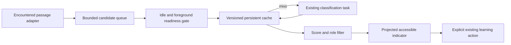

## Context

See audit and proposal. Reuse `runPassageClassification`, task/schema validators, `passage_scores`, selection-action registry, source locators and iframe geometry. The current recall sampler reads a full container and estimates read text by scroll fraction: reuse eligibility ideas, not that sampler as a source of exact anchors.

## Goals / Non-Goals

**Goals:** recently encountered readable passages, bounded idle work, persistent scoring cache, stable accessible actions. **Non-goals:** bulk document/library inference, automatic OCR, classification on scroll events, creation without approval or one universal paragraph model.

## Decisions

### Passage adapter and state ownership

Proposed reader `PassageAdapter` supplies `subscribeEncountered(callback)`, `snapshot(passageId)`, `resolveLocator`, `projectRects` and `dispose`. Each snapshot has `{ownerToken, documentId?, sourceRevision, passageId, contentHash, locator, text}` compatible with `SourceLocator` / `ChunkLocation`. Use a discriminated locator (PDF page+text offsets/normalized rectangles; EPUB spine+CFI; HTML/Markdown source anchor+text quote offsets). IDs survive resize/reflow within the same revision. Screen rectangles are recomputed for mounted content and never act as the durable identity. Use source revision plus normalized text digest; do not use paragraph index alone.

The active reader host owns one controller, queue and AbortController. Adapter registration is capability-based and only for the visible active surface. The reader retains selection/scroll state; controller state never enters the source DOM or rewrites reader markup. Proposed files under `src/components/viewer/passageScoring/` are new integration code, not a second reader framework. Reuse registration/transforms from `selectionInteraction/adapters.ts`, `htmlSelectionBridge.ts`, `geometry.ts` and existing reader lifecycle callbacks.

| Reading surface | Eligibility / stable anchor / projection | Limit and degradation |
|---|---|---|
| Fixed PDF (`PDFViewer` through DocumentViewer) | Mounted page text-layer runs grouped into contiguous readable blocks; page number + normalized text offsets/quote + page-normalized geometry | Score only mounted encountered pages. Scans without text: no work until user-authorized OCR; zoom/virtualization reprojects or hides geometry. |
| PDF reflow / OCR-HTML | Existing reflow/source page mappings and rendered text blocks; preserve canonical PDF page/offset mapping | If mapping is unavailable do not show a misplaced margin mark; explicit selection actions remain. No new OCR job. |
| EPUB | Register each rendition spine content document; bounded visible blocks, spine identity + CFI range and quote; iframe offset transform | Unregister on rendition removal; retain score cache, discard geometry. No top-document query into unregistered frames. |
| HTML / imported HTML | Existing controlled content iframe or rendered root; stable source anchor + quote range in revision | Exclude scripts, controls, nav and hidden text; cross-origin/inaccessible roots unavailable. |
| Markdown / plain text | Rendered blocks mapped to source offsets + quote hash, not generated DOM child number | Long blocks split deterministically with offset preservation; remount invalidates geometry only. |
| Saved RSS | Article reader/full-content registered root; real document ID only if imported, article revision + stable quote locator | Reader mode switch creates a new owner revision; no auto-import. |
| Unsaved RSS / live article | Existing ephemeral capability + article ID/revision + quote anchor | Session cache/dismissal only until real library identity exists; action explicitly imports when durable association needs it. No fake document ID. |
| Audio/video/YouTube, unsupported readers | No automatic scoring on playback surfaces | Visible transcript scoring is deferred until a genuine text adapter is qualified; ordinary manual selection actions still work. |

### Scheduling and resource envelope

Initial **proposed guardrails**, not measured results: observe a passage for ≥1s while visible, score only after it has been encountered and scrolling/selection/reflow has been idle ≥750ms; queue ≤8 passages, concurrency=1, ≤12 new classifications per document visit and ≤60 per local foreground hour. Remote automatic quota defaults to zero. A separate explicit remote-scoring grant includes provider/source scope and finite quota no larger than the local visit/hour caps; exhaustion pauses with a visible explanation. No grant renewal or prompt on each idle tick. Re-read cache hits do not consume inference quota.

Use `IntersectionObserver`/reader visibility events for candidate metadata, not inference in scroll callbacks. Require foreground active tab, no selection/drag/reflow, no battery-saver or thermal suspension where detectable. Unknown mobile power state defaults to conservative foreground single-flight operation. Coordinate with index/model services so scoring waits rather than competing with foreground generation/model loading. Suspend on app backgrounding; never warm/download a model to score. Resume only if feature, source and authorization are still valid. Bound text to 60–2,400 characters per anchored block; split longer blocks while preserving offsets rather than truncating their identity.

DOM reads are limited to mounted eligible blocks; hash asynchronously off the scroll handler using existing hashing support/WebCrypto. Cooperative work slices target ≤4ms; defer when no idle budget is available. No full-document `innerText` scan and no library fetch. Global mounted controller leases prevent two tabs from racing the same native model; foreground explicit AI work has priority. Platform-specific resource qualification is in the release change.

### Cache, revision and dismissal persistence

Add proposed `src/api/passage-scores.ts` around existing registered commands. Cache key is SHA-256 of normalization version + normalized passage text + classifier prompt/schema version + actual provider/model revision, stored in existing `chunk_hash`; no raw passage is stored. Resolve provider identity before lookup; if actual serving model differs, store under its real identity. Existing legacy keys are misses, not upgraded by guessing. Score cache can be shared across identical text, while source anchor and dismissal remain per-source.

Extend existing score commands/model/table through an additive migration only as needed to retain `reason` and classifier/model revision metadata. Keep old rows readable, reject invalid enum/NaN/range values at the Rust boundary rather than silently accepting arbitrary model fields. Existing comments claiming staleness impossible must be corrected because classifier policy can change. Do not store source geometry in this table. Score cache reset/eviction is derived data, never user content deletion; cap in-memory recent results to 128 and persistent score cache to a documented initial 10,000-row LRU budget, with incremental cleanup outside interaction handlers.

Proposed narrow dismissal storage keys `(documentId, sourceRevision, passageId, classifierVersion)` with timestamp, no text, unique constraint and document cascade; reuse an existing source-dismissal store if audit at implementation finds an equivalent. Ephemeral content uses bounded session-only dismissal. Dismissal survives reopen of the same revision; changed text/classifier can be reconsidered. User-created highlights/cards are never deleted with cache cleanup. Recompute identity on edits/OCR/regeneration, detach stale indicator and suppress pending old-revision results/writes.

`runTask` already coalesces task+target, but its wrapper uses only a passage prefix. Override with full cache/source owner key. Controller coalesces before the cache request; no cross-owner sharing with incompatible cancellation. Pass signal into classifier and cache/action lifetime gates; no late indicator after disable/navigation. A result already computed for an obsolete source can be discarded safely.

### Indicators and working actions

Only `extractWorthiness > 0.75` and a meaningful action/role can show an indicator. Bibliography, transition, low-value and suggestedAction=none stay quiet even with an inconsistent high score. There is no separate calibrated confidence field in the existing schema; do not mislabel score as confidence. Reason is plain untrusted text, never HTML.

Absolute-position overlay in existing reader chrome reserves no new document space. Keyboard focusable button with localized label, source snippet/score reason and focus return; touch target at least 44×44 CSS px where available. On narrow/e-ink/mobile readers show a compact edge marker opening an existing-style bottom sheet; avoid covering text, selection handles or safe-area controls. Reproject on zoom/font/resize using bounded animation-frame geometry updates; hide while detached, do not rerender source text.

Context actions: Create extract opens the current extract editor with exact source selection; Make flashcard/Create cloze opens the existing Learn-this/cloze preview and approval; Highlight uses existing explicit highlight workflow; Dismiss records dismissal only. Extend `selectionActionRegistry.ts` via a validated source snapshot, not synthetic selection DOM events. Display source failures as stale/unavailable; do not create unlinked objects silently. Flashcard/cloze generation is a distinct explicit operation with its own provider/consent check, not authorized by passive score visibility.

## Risks / Trade-offs

- Exact PDF/EPUB anchors are harder than scroll heuristics → ship an adapter only after source round-trip tests pass; show unavailable for unsupported modes.
- Persistent cache growth → bounded LRU cleanup and cache-miss fallback; never block reading on cleanup.
- Background cost surprises with default-true flag → local-only automatic default plus separate scoped remote authorization.
- Native cancellation may be delayed → stop queue immediately, suppress output and wait for outstanding request before another starts.

## Migration Plan

Add optional cache metadata/dismissal schema through existing migration registry; old cache misses are safe. Feature disable detaches adapter/controller and indicators immediately. Rollback can ignore additive cache columns; no document/card data is migrated or deleted. Coordinate shared reader/selection edits with the knowledge owner.

## Alternatives considered and rejected

Reusing recall's full-container text/scroll heuristic for anchors was rejected because it cannot roundtrip PDF/EPUB locations. Whole-document preclassification and scroll-event inference were rejected for privacy, cost and responsiveness. A separate semantic index was rejected because scoring only needs mounted passage snapshots and the existing cache. Injecting indicator markup into document text was rejected because it shifts layout and breaks selection/reflow.

## Validation strategy

Unit: queue/idle/dwell/quota, complete hash keys, cache revision, strict 0.75 boundary, role exclusion and dismissal. Component: mounted adapter → indicator → keyboard/touch actions, no layout shift or selection loss. Integration: real reader host and classifier/cache adapters with fake providers, same-prefix different passages, content edits/reopen, iframe/virtualized page teardown. Backend: score metadata roundtrip, invalid input, bounded cleanup and dismissal cascade/uniqueness. E2E: PDF/EPUB/HTML/Markdown/RSS action provenance and cache reuse; disabled zero requests; stale geometry hidden. Privacy: remote default zero, revocation before generation/embedding, no private logs. Native mobile: power/background/model contention and reader response measured by release protocol.
