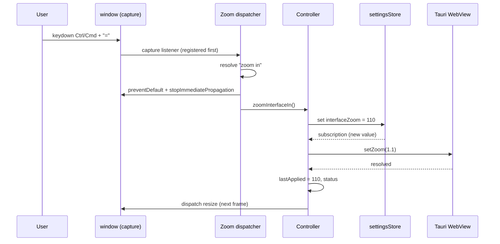

## Context

See `proposal.md` for motivation and `specs/desktop-interface-zoom/spec.md` for the behavior contract. The following current-state facts were verified on this branch; line numbers are evidence anchors and may drift during implementation.

| Area | Verified current state |
| --- | --- |
| Shortcut declarations | `DEFAULT_SHORTCUTS` declares `view.zoom-in` at `src/components/common/KeyboardShortcuts.tsx:135-140` and `view.zoom-out` at `:141-147`, both with the primary-modifier convention `{ ctrl: true, meta: true }`. There is no `view.zoom-reset`. |
| Shortcut dispatch | `useShortcutStore` persists `currentCombo` overrides (`:535-607`). `getShortcutCombo` (`:612-616`) exposes the active combo. `eventMatchesCombo` (`:647-677`) interprets `ctrl && meta` as “primary modifier” (Cmd on macOS, Ctrl elsewhere) but requires an exact Shift match. `useShortcut` (`:739-757`) is a bubble-phase listener and does not stop later window listeners or guard editable targets. |
| Existing zoom registration | `MainLayout` registers `gen.help`, `gen.settings`, `review.start`, `edit.new-document`, `doc.import`, `edit.new-flashcard`, and `gen.quit` via `useShortcut` (`src/components/layout/MainLayout.tsx:172-197`), but no `view.zoom-*` handler. Nothing calls `getCurrentWebview().setZoom(...)`; `rg "setZoom|set_webview_zoom"` finds no application call site. |
| Settings display | `KeyboardShortcutSettings.tsx:74-81` maps the two declared zoom IDs to labels and descriptions, so Settings advertises a feature that currently does nothing. |
| Document zoom handlers | `DocumentViewer.tsx:4890-4905` handles Ctrl/Cmd + `+`, `-`, `0` for the viewer regardless of document type. `DocumentViewer.tsx:6845-6882` additionally handles the same chords for HTML font size. `EPUBViewer.tsx:3372-3386` handles the same chords for EPUB font size and is also forwarded from the EPUB iframe (`:2083-2090`). These handlers can fire on the same event, causing double or conflicting behavior. |
| Preserved document controls | PDF toolbar zoom exists in `DocumentViewer.tsx` (`:7581-7596`, `:8043-8063`); PDF Ctrl/Cmd + wheel zoom is at `PDFViewer.tsx:951-973`. EPUB A+/A−/reset controls are at `EPUBViewer.tsx:3585-3608` and `:3829-3843`; HTML controls at `DocumentViewer.tsx:8228-8238` and `:8694-8717`. HTML/EPUB Ctrl/Cmd + wheel remains. |
| Document palette actions | `contextualActions.ts:181-204` defines `doc.zoomIn`, `doc.zoomOut`, and `doc.zoomReset` titled “Zoom In”, “Zoom Out”, “Reset Zoom” with `⌘+`, `⌘-`, `⌘0` hints. Those titles/hints would collide with app zoom and become false. `DocumentViewer.tsx:5770-5772` routes them to its existing handlers. |
| Settings state | UI preferences live in the Zustand `plethora-settings` store (`src/stores/settingsStore.ts`). `InterfaceSettings` is at `:343-...`, defaults at `:1198-1214`, and hydration normalizes `interface` at `:1912-1920`. The store is local-only; backend sync operates on a separate Rust SQLite `settings` table (`src-tauri/src/sync/settings.rs`) and does not carry this localStorage object. |
| Settings UI primitives | `SettingsSection` / `SettingsRow` are exported from `SettingsPage.tsx:1021-1080`. Appearance begins at `:1437`; the Display section is at `:1769`. Settings search catalog entries for Appearance are in `settingsSearchCatalog.ts:480-545`; the Appearance coverage row is in `settingsSearchCoverage.ts:45-56`. |
| Tauri API | `@tauri-apps/api` is installed at `2.11.1` (package.json:176); `node_modules/@tauri-apps/api/webview.d.ts:342-347` declares `setZoom(scaleFactor: number): Promise<void>`; the JS implementation invokes `plugin:webview|set_webview_zoom` (`webview.js:462-470`). The Rust crate is pinned to `tauri = "=2.11.5"` (`src-tauri/Cargo.toml:22`). |
| Permission | The generated schema contains `core:webview:allow-set-webview-zoom` (`src-tauri/gen/schemas/desktop-schema.json:13854`), but it is not in the webview default permission set and is not in `src-tauri/capabilities/default.json`. Without it, the invoke rejects. |
| Native behavior | Wry 0.55.1 maps `set_zoom` to WebKitGTK `set_zoom_level` (`wry-0.55.1/src/webkitgtk/mod.rs:763`), WebView2 `SetZoomFactor` (`.../webview2/mod.rs:1393`), and WKWebView `pageZoom` (`.../wkwebview/mod.rs:933-940`). Tauri documents macOS 11+ for this API and Android as unsupported. |
| Built-in zoom hotkeys | `zoomHotkeysEnabled` defaults to `false` (`tauri-utils-2.10.1/src/config.rs:2446`) and is absent from `src-tauri/tauri.conf.json`. WebView2 gates user zoom/pinch on the same flag; the default-off state is what we want because the app owns zoom. |
| Window/layout | `src-tauri/tauri.conf.json` sets `width: 1280`, `height: 800`, `minWidth: 900`, `minHeight: 600`. `presentation.ts` classifies Tauri widths below 1024 as `compact-desktop` (not mobile). `PresentationContext.tsx` recomputes `window.innerWidth` on `resize`. |
| Mobile/browser gate | `isTauri()` is at `src/lib/tauri.ts:160`; `isNativeMobile()` at `:250`. Browser/PWA and native mobile must not receive this capability. |
| Stale shortcut spec | The older `native-shortcut-registration` spec describes a Rust `global-shortcut` path. That path is not present on this branch: `tauri-plugin-global-shortcut` is not a dependency and no `global-shortcut` listener exists. Do not add native shortcut registration for zoom; the main-window DOM capture listener is the complete routing layer. |

## Goals / Non-Goals

**Goals:**

- One persisted preference and one native application path for desktop interface zoom.
- Browser-like shortcut semantics with one owner per key event.
- A deterministic document-zoom boundary: app zoom on reserved chords, document zoom on its existing controls/gestures/palette actions.
- Startup restoration before the interactive shell, with an explicit failure fallback.
- A Settings control and Command Palette commands that are thin clients of the same controller.
- Concrete, testable layout and accessibility outcomes at 70–150%.

**Non-Goals:**

- Replacing document zoom, reader typography, image zoom, or graph zoom.
- Adding a CSS-transform/zoom wrapper, a new global state library, a new Tauri plugin, a Rust command, or a new dependency.
- Per-window zoom, per-document interface zoom, or automatic zoom based on hardware.
- Adding 125% as a normal selectable step. The fixed product steps are multiples of 10. 125% is only an optional internal manual-test value applied directly through the native layer.
- Mobile interface scaling or mobile pinch-to-zoom.
- Cross-window live broadcast. Plethora has one main application webview; auxiliary webviews are intentionally excluded.

## Decisions

### D1. Use native WebView page zoom, not CSS scaling

Call `getCurrentWebview().setZoom(percent / 100)` from the main webview. Native page zoom is the browser-equivalent operation: it scales text, icons, spacing, fixed-position overlays, dialogs, portals, canvases, and iframes as one surface, and it changes the effective CSS viewport so existing media queries/compact layouts can reflow. Native OS chrome (the macOS menu bar, the Windows/Linux title bar/window controls, and the system tray) is outside the WebView and is not scaled; “menus” in this change means in-app menus/popovers.

Rejected:

- **CSS `transform: scale()` on the app root.** It creates a containing block for `position: fixed`, breaks overlay/portal coordinates and `getBoundingClientRect`/pointer mapping, clips menus/tooltips, produces artificial scrollbars, and requires inverse transforms for every fixed surface.
- **CSS `zoom` property.** Inconsistent engine behavior, fractional layout/pointer issues, and not a desktop-page-zoom equivalent across WebKitGTK, WebView2, and WKWebView.
- **Increasing `appearance.fontSize` / CSS font-size tokens.** This scales text only, not icons, control heights, spacing, or dialogs, and would duplicate an existing preference.

### D2. One preference in the existing Settings store

Add `interfaceZoom: number` to `InterfaceSettings` in `src/stores/settingsStore.ts`, default `100`, normalized through a pure helper. Persist it in the existing `plethora-settings` localStorage object. Do not create a second persisted store.

Why `interface` rather than `appearance`: the field controls layout/scale of the application shell, sits beside `sidebarWidth`, `toolbarPosition`, and `compactMode`, and is already read by the Appearance panel through `settings.interface`. The label still lives in Settings → Appearance.

Why device-local: `plethora-settings` is localStorage in the user's app data directory and is not part of the Rust sync `settings` table or the cloud sync payloads. This matches the product requirement: a 130% choice on a 13-inch laptop must not force 130% on a large desktop. A future cross-device preference would be a separate product decision.

Why not per-window: the desktop app has one main application webview (`main`) with tabbed content. The screenshot overlay, external YouTube popouts, and hidden capture webviews are not the app shell and must remain unscaled. If first-party app windows are added later, each can mount the same bridge and read the same device preference; live cross-window propagation is not required now.

No persistence version bump is needed: `onRehydrateStorage` merges `interface` over `defaultSettings.interface`, so a missing field receives 100 while every other field survives. Normalize on hydration and clamp in `updateSettingsCategory` (mirroring the existing `sidebarWidth` clamp) so no caller can write an out-of-range value. Still normalize explicitly on hydration:

```ts
interface: {
  ...defaultSettings.interface,
  ...persisted.interface,
  sidebarWidth: clampSidebarWidth(persisted.interface?.sidebarWidth),
  interfaceZoom: normalizeInterfaceZoom(persisted.interface?.interfaceZoom),
  companion: { ...DEFAULT_COMPANION_SETTINGS, ...(persisted.interface?.companion ?? {}) },
}
```

### D3. A single controller owns queueing, status, and rollback

New module layout:

```text
src/lib/interfaceZoom/
  constants.ts    // pure range/step/normalization helpers
  native.ts       // platform capability probe + getCurrentWebview().setZoom
  startup.ts      // tiny raw-storage bootstrap; deliberately no store import
  controller.ts   // actions, queue, status, bootstrap reconciliation, rollback
  shortcuts.ts    // pure key matching + one capture-phase handler
src/hooks/useInterfaceZoom.ts   // bridge hook + read-only state hook
src/components/settings/InterfaceZoomControl.tsx
```

The persisted preference remains the single source of truth for the desired value. The controller owns a small non-persisted external status object for `supported`, `applying`, `appliedPercent`, `error`, and an `errorNonce`. `useSyncExternalStore` consumes it. Do not persist status.

Queue pseudocode (the implementation must preserve these properties):

```ts
let lastApplied = 100;
let latestRequested = 100;
let applying = false;
let requestSeq = 0;

function schedule(target: number) {
  latestRequested = target;
  if (applying) return;          // the loop will pick up the newest value
  applying = true;
  void drain();
}

async function drain() {
  try {
    while (latestRequested !== lastApplied) {
      const seq = ++requestSeq;
      const target = latestRequested;
      setStatus({ applying: true, error: null });
      try {
        await withTimeout(applyNativeInterfaceZoom(target), 5000);
        lastApplied = target;
        setStatus({ applying: false, appliedPercent: target, error: null });
        notifyViewportChanged();
      } catch (error) {
        // Only the newest request may roll back. A superseded failure is
        // irrelevant because a newer target is already pending.
        if (seq === requestSeq && target === latestRequested) {
          const fallback = lastApplied;
          latestRequested = fallback;
          setStatus({ applying: false, appliedPercent: fallback, error: message(error), errorNonce: nextErrorNonce() });
          useSettingsStore.getState().updateSettingsCategory("interface", { interfaceZoom: fallback });
          return;
        }
      }
    }
  } finally {
    applying = false;
    if (latestRequested !== lastApplied) schedule(latestRequested);
  }
}
```

The exact loop can be simplified, but the acceptance properties are non-negotiable: latest value wins, no stale rollback, one native call per settled state where possible, and no duplicate listeners. Use a bounded await (for example 5000 ms) so a wedged native invoke becomes a recoverable failure instead of leaving `applying` true forever. A late native success after a timeout is an unavoidable IPC edge; the next user action re-applies the store's value, and the failure path's best-effort reset reduces the window. Re-check `target === latestRequested` after the best-effort reset (it awaits IPC); if a newer request arrived, continue the loop instead of rolling back the newer value. If startup is still pending, `startInterfaceZoomSync` MUST NOT enqueue a second apply for the same value; it waits for `getBootstrapPromise()` and reconciles once as described in D4.

Actions `zoomInterfaceIn()`, `zoomInterfaceOut()`, `resetInterfaceZoom()`, and `setInterfaceZoomPercent(value)` update `settings.interface.interfaceZoom`; a single `useSettingsStore.subscribe` callback compares the previous/new value and schedules. `startInterfaceZoomSync()` is idempotent. Do not schedule from both the action and the subscription in a way that applies twice.

After a successful apply, dispatch a window `resize` event on the next animation frame. This ensures `PresentationContext` and other JavaScript consumers of `window.innerWidth` refresh even if the WebView does not emit a resize itself:

```ts
requestAnimationFrame(() => window.dispatchEvent(new Event("resize")));
```

This is not a visual animation; it is a layout-state notification.

### D4. Startup reads raw persisted state in a tiny module, then reconciles in React

`src/main-bootstrap.ts` is the earliest application JavaScript entry (`index.html:227`) and is intentionally tiny. Do **not** import the full `settingsStore` there. Add a separate `src/lib/interfaceZoom/startup.ts` that depends only on `migratedGetItem` from `src/lib/brandMigration.ts`, the pure constants, and `native.ts`:

```ts
const interfaceZoomReady = import("./lib/interfaceZoom/startup")
  .then(({ bootstrapInterfaceZoom }) => bootstrapInterfaceZoom())
  .catch((error) => console.warn("[interfaceZoom] bootstrap failed", error));

const loadMain = () => interfaceZoomReady.then(() => import("./main"));
```

`startup.ts` exports `bootstrapInterfaceZoom(): Promise<BootstrapResult>`, `getBootstrapResult()`, and `getBootstrapPromise()`, where:

```ts
type BootstrapResult = {
  supported: boolean;
  appliedPercent: number; // 100 when unsupported or failed
  error: string | null;
};
```

`bootstrapInterfaceZoom`:

1. Return `{ supported: false, appliedPercent: 100, error: null }` immediately on non-desktop/unsupported runtimes or when `window.location.hash` starts with `#/screenshot-overlay` (the utility route must never be zoomed).
2. Parse `migratedGetItem("plethora-settings")` and read `parsed.state?.settings?.interface?.interfaceZoom` with fallbacks to `parsed.settings?.interface?.interfaceZoom` and `parsed.interface?.interfaceZoom`; if parsing fails or the field is absent, use 100. Normalize with the pure helper. This is the same persisted shape the store will hydrate; it is a read-only startup shortcut, not a second source of truth.
3. Call `applyNativeInterfaceZoom(target)` even for 100%, so a WebView reload cannot leave a stale native zoom. Bound the await (for example 1200 ms) so a wedged IPC call cannot hold startup forever; a timeout is treated as a failure.
4. On success return `{ supported: true, appliedPercent: target, error: null }`; on failure or timeout make one best-effort `applyNativeInterfaceZoom(100)` reset with a shorter bound (for example 300 ms), then return `{ supported: true, appliedPercent: 100, error: message }` (the native default is 100).
5. Never write the Settings store or localStorage. `main-bootstrap` continues to import `./main` after the promise settles (or after the bounded safety race).

After React mounts, `useInterfaceZoomBridge()` reconciles the startup result exactly once, preferably in a `useLayoutEffect` so a restored Settings tab cannot paint a stale percentage:

- If `getBootstrapPromise()` is still pending, record the store's requested value but do not issue a duplicate native call. Race the wait with a 2500 ms fallback so a wedged startup promise cannot permanently disable the bridge; if the fallback wins, proceed with `lastApplied = 100` and attach a later reconciliation.
- On resolve, set `lastApplied = result.appliedPercent`.
- If `result.error` is non-null, set `status.error`/`errorNonce`, set `latestRequested` to `result.appliedPercent`, and update the store to the same value (rollback). This is the only startup failure write.
- If there is no error and the store value differs from `result.appliedPercent` (for example the raw parse and store normalization disagreed), schedule the store value once.
- Then start the normal store subscription.

The branded static boot frame is already painted by `index.html` before modules execute and cannot be native-zoomed by JavaScript. That splash may therefore be at the platform default; the **interactive application shell** is gated on the startup promise and must not first render at 100% and then jump. `main-bootstrap` uses a bounded safety race (2000 ms, deliberately longer than the 1200+300 ms startup budget) so a pathological native call cannot block startup forever; if it fires, log the timeout, import the app, and let the bridge reconcile the eventually-settled result. Do not silently reset the preference merely because the safety race expired.

Do not run this bootstrap for `#/screenshot-overlay`; the native layer checks `getCurrentWebview().label === "main"` and the bridge is only mounted by `MainLayout`.

### D5. One capture-phase shortcut dispatcher, registered before other global shortcuts

`useInterfaceZoomBridge()` is mounted once in `MainLayout`, **before** `useGlobalShortcuts()` so its `window` capture listener is registered first. It:

- calls `startInterfaceZoomSync()`;
- installs exactly one `window.addEventListener("keydown", handler, true)`;
- removes it on unmount;
- reacts to `status.errorNonce` with one toast per failure (the Settings control also shows a persistent inline error).

The handler resolves a command and, on match, calls:

```ts
event.preventDefault();
event.stopPropagation();
event.stopImmediatePropagation();
runInterfaceZoomCommand(command);
```

Capture phase plus `stopImmediatePropagation()` is what prevents `DocumentViewer`, `EPUBViewer`, the HTML reader, the RSS `KeyboardShortcutProvider` (document capture, `KeyboardShortcutProvider.tsx:96`), and any bubble-phase `useShortcut` listener from seeing the same event. `useShortcut` is not used for zoom: it is bubble-phase, does not stop later window listeners, and does not guard editable targets.

Default resolution (when no `currentCombo` override exists):

- primary = `metaKey` on macOS, `ctrlKey` on Linux/Windows. Reject `altKey` and reject the non-platform primary modifier (Ctrl on macOS; Meta on Linux/Windows), so accidental combinations such as Ctrl+Cmd do not match.
- zoom in: `event.key === "+"`, `event.key === "="` (with or without Shift), or `event.code === "NumpadAdd"`.
- zoom out: `event.key === "-"`, `event.key === "_"`, or `event.code === "NumpadSubtract"`.
- reset: `event.key === "0"` with no Shift (a numeric-keypad 0 with NumLock on also reports `"0"`); do not match `event.code === "Numpad0"` when the key is `Insert`, so Ctrl+Insert is not stolen.
- ignore `event.isComposing` and `event.defaultPrevented`.

When `view.zoom-in/out/reset` has a `currentCombo`, use the existing `eventMatchesCombo` semantics instead of the default chord. This preserves user customization. If the custom combo does not use the platform's primary modifier (Meta on macOS; Ctrl on Linux/Windows), suppress it in inputs/textarea/contentEditable/select and while `useUIStore.getState().commandPaletteOpen`; default primary chords remain allowed in text fields because they are browser-style commands, not text input. A custom combo using Ctrl on macOS is therefore not treated as safe inside text fields.

`view.zoom-reset` is added to `DEFAULT_SHORTCUTS` with `{ key: "0", ctrl: true, meta: true }`, to `keyboardShortcutSettings.shortcutLabels`, and to all locale dictionaries. `formatKeyCombo` should render the `=` key as `+` so the Settings row reads like a browser zoom shortcut; the matcher continues to compare the original `=` key. Both `KeyboardShortcutsSettings` and `KeyboardShortcutsHelp` filter the three zoom rows out when `isDesktopInterfaceZoomSupported()` is false, so unsupported runtimes do not advertise dead bindings.

### D6. Shortcut ownership and document conflict resolution

**Chosen model:** on desktop, primary + `+`/`-`/`0` belongs to the application. Document zoom is not removed; it moves to controls that are already present and to distinct document-scoped actions.

Handlers to remove or change:

| File | Current behavior | Required change |
| --- | --- | --- |
| `src/components/viewer/DocumentViewer.tsx:4890-4905` | Ctrl/Cmd + `+`/`-`/`0` calls `handleZoomIn/Out/ResetZoom` for any viewer | Delete this block. Keep the surrounding Ctrl/Cmd + E/H, search, priority, rating, J/K, arrows, Escape logic. |
| `src/components/viewer/DocumentViewer.tsx:6845-6882` | HTML font size keydown plus Ctrl/Cmd wheel | Delete only the keydown branch and its `window.addEventListener("keydown", ...)`; keep `handleWheel`, the container wheel listener, and the font-size callbacks. |
| `src/components/viewer/EPUBViewer.tsx:3372-3386` | EPUB font size keydown | Delete the three Ctrl/Cmd branches. The following `else if (lowerKey === "j")` must become a plain `if`, and the J/K chain must remain intact. Keep `increaseFontSize`/`decreaseFontSize`/`resetFontSize` for visible controls and wheel. |
| `src/components/viewer/EPUBViewer.tsx:2083-2090` | EPUB iframe forwards keys to `handleEPUBKeyDown` | Keep existing forwarding for command palette/extract/priority/J/K. Add a separate capture listener for interface zoom before the `handleEPUBKeyDownRef` listener, using the shared handler. |
| `src/components/viewer/DocumentViewer.tsx` HTML iframe | iframe keydown does not bubble to the parent | Add a same-origin `contentWindow` keydown capture listener that uses the shared handler; clean it up when the iframe/document changes. Wrap access in `try/catch` because cross-origin frames are outside the HTML-reader contract. |

Preserved document zoom paths:

- PDF: toolbar zoom buttons and reset; Ctrl/Cmd + wheel over the PDF (`PDFViewer.tsx:951-973`); `doc.zoomIn/Out/Reset` palette actions.
- EPUB: visible A+/A−/reset; Ctrl/Cmd + wheel over the reader; theme/typography settings.
- HTML: visible A+/A−/reset; Ctrl/Cmd + wheel over the reader.
- Image viewer: its existing buttons/wheel.
- Knowledge Graph/Sphere/Universe: existing wheel/drag/buttons.
- `PdfAssetZoomModal` (`PdfCanonicalReflowRenderer.tsx:127-143`): its unmodified `+`/`-`/`0` keys are not intercepted by the primary-modifier handler and continue to work.

Rename the document palette actions to avoid false equivalence:

```ts
{ id: "doc.zoomIn", title: "Zoom Document In", ... }   // remove "⌘+" hint
{ id: "doc.zoomOut", title: "Zoom Document Out", ... } // remove "⌘-" hint
{ id: "doc.zoomReset", title: "Reset Document Zoom", ... } // remove "⌘0" hint
```

Trade-off: document zoom loses its old Ctrl/Cmd keyboard ad-hoc trigger. This is intentional and unavoidable if one chord must have one meaning. The visible controls, wheel gestures, and palette actions preserve reading functionality; the Command Palette remains the keyboard-accessible document path. Do not invent a second document chord that would conflict with browser zoom semantics.

### D7. Same-origin iframe and browser-content boundaries

Native page zoom scales the entire main webview, including iframes. The dispatcher is a JavaScript listener on the main document, so it cannot see key events whose focus is inside a cross-origin iframe. Handle this explicitly:

- **EPUB iframe:** same-origin; attach the shared interface-zoom handler in the existing `contents.window` listener setup, capture phase, before the `handleEPUBKeyDown` forwarder. This makes primary + `+`/`-`/`0` zoom the app while reading EPUB content. Because the EPUB `rendered` event can run repeatedly, mark the iframe window with a private flag (for example `__plethoraInterfaceZoomHandler`) and attach only once per window, or remove it on the rendition's `unloaded` event. Do not rely on the existing handlers being registered once.
- **HTML reader iframe:** same-origin by contract; attach to `iframeRef.current.contentWindow` in a `useEffect` keyed by `isHtmlViewer` and document id, guarded with `try/catch`. Remove the listener on cleanup.
- **WebBrowserTab proxied external pages and YouTube/embedded players:** cross-origin; do not inject script or rely on a parent listener. Primary zoom chords pressed while focus is inside that content are outside the app's event path. The visible app toolbar, Settings, and Command Palette remain available. Document this limitation in the manual acceptance notes; do not claim universal capture.
- **Modal dialogs:** the main-document capture listener still runs while a dialog is open. Escape and dialog-local bare keys are unaffected because the zoom handler only matches primary-modifier chords (or a user's explicit custom binding).
- **Fullscreen reading:** the listener stays on `window`; no special case is needed. Verify document controls remain reachable at 150%.
- **Command Palette:** primary chords are handled even while the palette is open; custom non-primary bindings are suppressed while it is open to avoid stealing typed characters.

### D8. Settings, search, and Command Palette are thin clients

**Settings:** add `src/components/settings/InterfaceZoomControl.tsx` and render it as the first row of the existing Display `SettingsSection` in `AppearanceSettings` (`SettingsPage.tsx:1769`). The new module renders only the inner control group; `SettingsPage` owns the `SettingsRow` wrapper. This avoids a static circular import (`InterfaceZoomControl` must not import `SettingsPage`, while `KeyboardShortcutSettings` can because it is lazily imported). The control reads `useInterfaceZoomState()` and calls the controller actions; it does not write the store directly.

Layout contract:

```tsx
<SettingsRow
  label={t("settings.interfaceZoom")}
  description={t("settings.interfaceZoomDesc")}
  searchId="appearance.interfaceZoom"
>
  <InterfaceZoomControl />
</SettingsRow>
```

- Minus/plus are 44px-minimum square icon buttons with `aria-label`, `title`, visible focus ring, and `disabled` at bounds.
- Range input: `min={70} max={150} step={10}`, `value={percent}`, `aria-label`, `aria-valuetext={`${percent}%`}`, theme-colored accent and focus ring.
- Output/readout: `<output aria-live="polite" aria-atomic="true">{percent}%</output>`, tabular numerals.
- Reset button: localized “Reset to 100%”, disabled at 100 or unsupported.
- Helper copy explains “Scales the whole Plethora interface, including toolbars, menus, and dialogs. This is separate from document zoom and reader font size.”
- Unsupported: render a localized non-interactive explanation instead of enabled controls.
- Error: render a localized inline error plus a retry path; the toast is supplementary, not the only feedback.
- No `onChange`/save-bar dependency: zoom persists immediately.

Exact English source copy (translate naturally in the other five locales):

| Key | English value |
| --- | --- |
| `settings.interfaceZoom` | Interface Zoom |
| `settings.interfaceZoomDesc` | Scales the whole Plethora interface, including text, icons, toolbars, menus, and dialogs. This is separate from document zoom and reader font size. |
| `settings.interfaceZoomReset` | Reset to 100% |
| `settings.interfaceZoomDecrease` | Decrease interface zoom |
| `settings.interfaceZoomIncrease` | Increase interface zoom |
| `settings.interfaceZoomUnsupported` | Interface zoom is available only in the desktop app on a supported OS. |
| `settings.interfaceZoomError` | Could not change interface zoom. Your previous setting was restored. |
| `settings.shortcuts.view.zoomIn.name` | Zoom Interface In |
| `settings.shortcuts.view.zoomIn.description` | Increase the whole interface scale |
| `settings.shortcuts.view.zoomOut.name` | Zoom Interface Out |
| `settings.shortcuts.view.zoomOut.description` | Decrease the whole interface scale |
| `settings.shortcuts.view.zoomReset.name` | Reset Interface Zoom |
| `settings.shortcuts.view.zoomReset.description` | Reset interface zoom to 100% |
| `commandPalette.interfaceZoomIn` | Zoom In |
| `commandPalette.interfaceZoomInDesc` | Increase the whole interface scale |
| `commandPalette.interfaceZoomOut` | Zoom Out |
| `commandPalette.interfaceZoomOutDesc` | Decrease the whole interface scale |
| `commandPalette.interfaceZoomReset` | Reset Zoom |
| `commandPalette.interfaceZoomResetDesc` | Reset the interface scale to 100% |

**Settings search:** add a catalog entry:

```ts
{
  id: "appearance.interfaceZoom",
  kind: "setting",
  section: SettingsTab.Appearance,
  label: k("settings.interfaceZoom"),
  description: k("settings.interfaceZoomDesc"),
  groupPath: [k("settings.display")],
  aliases: [lit("ui zoom"), lit("app zoom"), lit("zoom in"), lit("zoom out"), lit("reset zoom"), lit("scale interface"), lit("interface size"), lit("larger interface"), lit("smaller interface"), lit("make interface bigger"), lit("make interface smaller")],
  keywords: ["zoom", "scale", "interface", "ui", "larger", "smaller", "accessibility"],
  targetId: "appearance.interfaceZoom",
  availability: "desktop",
}
```

Update `settingsSearchCoverage.ts` Appearance `sources` to include `InterfaceZoomControl.tsx`; the existing `appearance.` prefix covers the new entry. Add a search test that queries `interface zoom`, `ui zoom`, and `larger interface` and reaches the real `data-settings-search-target="appearance.interfaceZoom"` without changing its value. This is required by the repository's Settings-search rule.

**Command Palette:** add `src/commandPalette/interfaceZoomCommands.tsx` exporting `buildInterfaceZoomCommands(translate): Command[]`, spread into `buildCommandRegistry` (`registry.tsx:275-306`). Commands:

- `interface-zoom-in`, intent `action:interface-zoom-in`, label `commandPalette.interfaceZoomIn`, description `...Desc`, icon `MagnifyingGlassPlus`, category `General`, keywords `["zoom","interface","ui","app","scale","larger","bigger"]`, aliases `["interface zoom in","ui zoom in","app zoom in","increase interface size"]`, action `zoomInterfaceIn()`.
- `interface-zoom-out`, intent `action:interface-zoom-out`, `MagnifyingGlassMinus`, `...smaller`, aliases `["interface zoom out","ui zoom out","app zoom out","decrease interface size"]`.
- `interface-zoom-reset`, intent `action:interface-zoom-reset`, `ArrowsInSimple`, `...reset, 100`, aliases `["reset interface zoom","ui zoom reset","app zoom reset"]`.

Return `[]` when `isDesktopInterfaceZoomSupported()` is false. Use the active shortcut combo for the displayed `shortcut` string via `getShortcutCombo`/`formatKeyCombo` so it reflects customization and platform. Do not duplicate the actions in the contextual document set.

### D9. Platform capability and security

Add a new capability file rather than broadening `default.json`:

```json
{
  "$schema": "../gen/schemas/desktop-schema.json",
  "identifier": "interface-zoom",
  "description": "Allows the main application webview to apply the persisted interface zoom.",
  "remote": {
    "urls": [
      "http://localhost:9527/*",
      "http://127.0.0.1:9527/*",
      "http://localhost:15173/*",
      "http://127.0.0.1:15173/*"
    ]
  },
  "windows": ["main"],
  "webviews": ["main"],
  "permissions": ["core:webview:allow-set-webview-zoom"]
}
```

This grants only the zoom setter and only to the main window/webview. It intentionally does not grant it to `screenshot-overlay`, YouTube popouts, or hidden capture windows.

The `remote` block is required and mirrors `default.json`. Desktop release builds navigate the main webview to the `tauri-plugin-localhost` server (`http://localhost:9527`), so Tauri classifies the page as a remote origin and ignores capabilities that only declare the local context. Without it, the native zoom command is rejected in packaged builds even though `tauri dev` (whose `devUrl` is local) works — the exact failure the controller reports as "Could not change interface zoom. Your previous setting was restored."

Leave `zoomHotkeysEnabled` absent/false. Enabling it would install Tauri's own polyfill/WebView2 zoom control with 20% steps, its own in-memory level, no persistence, and a second owner for Ctrl/Cmd + `-`/`=`; that would directly violate the single-owner requirement. Do not add `core:webview:default` or unrelated webview permissions.

Platform gates:

- `isTauri() && !isNativeMobile()` is required.
- On macOS, read the OS major version from `@tauri-apps/plugin-os` `version()` inside a `try/catch`; require major ≥ 11. If the version cannot be read, report unsupported rather than risking a `pageZoom` call on an older WKWebView.
- Linux and Windows do not need an OS-version gate; `setZoom` rejections are caught and rolled back.
- Browser/PWA return unsupported before any Tauri import or storage write.

Compatibility strategy is per platform, all-or-nothing: if manual verification shows that a platform's native page zoom cannot scale the full main webview (including overlays/iframes) or cannot reflow the CSS viewport acceptably, gate that platform as unsupported and hide the feature there. Do **not** ship a CSS-transform/CSS-zoom fallback for one platform; that would violate the geometry/pointer/overlay requirements and produce a second behavior model. Document the failing platform and the evidence in `verification.md`.

### D10. Failure and fallback behavior

A native rejection is a real failure, not a silent no-op. The controller:

1. logs `[interfaceZoom]` with the target and error;
2. makes one best-effort native reset to `lastApplied` with a short bound (for example 300 ms; ignore a second failure) so a partially applied native state is less likely to survive;
3. sets `status.error` and increments `errorNonce`;
4. restores the last successfully applied value in the Settings store;
5. lets the subscription observe the restored value without scheduling a redundant apply;
6. shows one toast in `useInterfaceZoomBridge` for the new `errorNonce`;
7. leaves controls enabled so the user can retry.

Unsupported platform is not an error: no toast, no store rollback, no interception. If startup fails, the native default is 100, so the controller rolls the preference to 100 and records the error. This keeps preference, readout, and native scale consistent.

### D11. Responsive layout is verified, not assumed

Native page zoom is expected to change the CSS viewport (the browser-zoom model). This must be verified on WebKitGTK/AppImage first; WebView2 and WKWebView behavior is specified but not runtime-verified here. The implementation must not “fix” a zoom-induced narrow layout by clamping zoom based on window width; it must make the existing compact layout work or document a concrete, minimal fix.

Expected effective CSS viewport at 150%:

| Window (at 100%) | Effective CSS viewport at 150% |
| --- | --- |
| 900×600 (minimum) | 600×400 |
| 1280×800 | ~853×533 |
| 1366×768 | ~911×512 |
| 1440×900 | 960×600 |
| 1920×1080 | 1280×720 |

At 600×400 CSS px, the Tauri presentation remains `compact-desktop` (not mobile), the Settings sidebar is still `w-64`, and most `sm:` rows stack. That is the highest-risk layout. Audit the shell, tab strip, Settings, RSS, library, reader/assistant split, flashcards, dialogs, and palette; only fix concrete clipping/overflow/unreachable controls. Do not redesign unrelated surfaces.

At 70%, the effective viewport grows (for example 1280×800 becomes ~1829×1143). Verify the shell uses the space and does not keep a fixed-width content island or introduce an artificial horizontal scrollbar.

After every successful apply, dispatch the `resize` notification described in D3 so `PresentationContext`, `useVisualViewport`, graph/canvas resizers, and tooltip/menu positioning code see the new CSS viewport.

### D12. Accessibility and visual stability

- Keyboard: native range input + real buttons; logical tab order; visible `focus-visible` ring; `aria-label` on every icon-only control; `aria-valuetext` on the slider; `aria-live="polite"` only on the value/status, not on every keystroke of unrelated UI.
- Screen reader: group label “Interface Zoom”, current percentage, min/max; error/unsupported text via `role="status"`.
- Touch targets: at least 44×44 CSS px for minus/plus/reset in the Settings control, matching existing Settings conventions.
- Motion: no scaling animation, no transition on the app root, no cross-fade. Native zoom itself is immediate. Existing reduced-motion/E-Ink CSS remains authoritative.
- Themes: only theme tokens; no hardcoded colors. Verify light/dark/high-contrast/E-Ink.
- High-DPI: native zoom multiplies with `devicePixelRatio`. Verify PDF canvases, the Knowledge Sphere/Universe canvas, and ambient backdrops are not blurry or clipped at 150%. If a canvas is visibly wrong, prefer re-measuring it on the resize notification; do not add a separate scaling system.
- Dialogs/overlays: verify `Modal`, `ContextMenu`, `md3` menus/tooltips, `ShortcutTooltip`, and Command Palette remain within the viewport at 150% near edges.
- Scroll: rely on the WebView's native scroll anchoring and existing reader position persistence. Do not implement a second scroll-restoration system. Verify PDF page, EPUB CFI, and settings scroll do not jump to the start.

## Architecture

```mermaid
flowchart LR
  subgraph Inputs
    KB[Keyboard capture dispatcher]
    ST[Settings → Appearance control]
    CP[Command Palette commands]
  end

  KB --> C[Interface zoom controller]
  ST --> C
  CP --> C

  C -->|updates desired value| SS[settingsStore\ninterface.interfaceZoom\npersisted, device-local]
  SS -->|single subscription| C
  C -->|serialized/coalesced queue| N[native.ts\ngetCurrentWebview().setZoom]
  N --> WV[Main WebView page zoom]
  WV --> L[CSS viewport reflow\n+ resize notification]
  N -->|success| OK[status.appliedPercent]
  N -->|failure| RB[rollback preference\nerror status + toast]
  RB --> SS
```



```mermaid
sequenceDiagram
  participant B as main-bootstrap
  participant U as startup.ts
  participant L as localStorage (plethora-settings)
  participant T as Tauri WebView
  participant C as Controller (after React)
  participant S as settingsStore
  participant R as React main.tsx

  B->>U: bootstrapInterfaceZoom()
  U->>L: read raw persisted 130
  U->>T: setZoom(1.3)
  T-->>U: resolved (or error → applied 100)
  U-->>B: BootstrapResult
  B->>R: import("./main")
  R->>C: useInterfaceZoomBridge()
  C->>U: getBootstrapResult() once
  C->>S: reconcile store (no error: skip; error: 100)
  R->>R: first interactive shell at applied scale
```

## Interfaces and pseudocode

### `constants.ts`

```ts
export const INTERFACE_ZOOM_DEFAULT = 100;
export const INTERFACE_ZOOM_MIN = 70;
export const INTERFACE_ZOOM_MAX = 150;
export const INTERFACE_ZOOM_STEP = 10;

export function normalizeInterfaceZoom(value: unknown): number;
export function stepInterfaceZoom(current: number, direction: "in" | "out"): number;
export function interfaceZoomToScale(percent: number): number; // percent / 100
```

`normalizeInterfaceZoom`: non-finite/non-number → 100; round to the nearest 10; clamp to 70–150. `stepInterfaceZoom`: normalize, add/subtract 10, clamp. Unit tests cover 69→70, 74→70, 76→80, 149→150, 151→150, `NaN`→100, `undefined`→100, `125`→130 (internal normalization only; 125 is not user-selectable).

### `native.ts`

```ts
export function isDesktopInterfaceZoomSupported(): boolean;
export async function applyNativeInterfaceZoom(percent: number): Promise<void>;
```

`isDesktopInterfaceZoomSupported` must be synchronous and safe at module load: false for browser/PWA, false for native mobile, false for macOS < 11, true otherwise. `applyNativeInterfaceZoom` dynamically imports `@tauri-apps/api/webview`, obtains `getCurrentWebview()`, verifies `label === "main"`, and awaits `setZoom(percent / 100)`. It must throw on rejection so the controller can roll back; it must not swallow errors.

### `startup.ts`

Exports:

```ts
export type BootstrapResult = {
  supported: boolean;
  appliedPercent: number;
  error: string | null;
};

export function bootstrapInterfaceZoom(): Promise<BootstrapResult>;
export function getBootstrapResult(): BootstrapResult | null;
export function getBootstrapPromise(): Promise<BootstrapResult>;
```

This module must not import `useSettingsStore`, React, or any component. It reads `migratedGetItem("plethora-settings")`, parses `state.settings.interface.interfaceZoom` with the fallbacks described in D4, normalizes it, applies the native zoom once, and records the result. A malformed/missing/blocked store falls back to 100. It never writes storage; the controller owns rollback. The promise is memoized so `main-bootstrap` and the React bridge share one native call. If `getBootstrapPromise()` is called when `bootstrapInterfaceZoom()` was never started (for example a Settings-only test), it resolves to a default `{ supported: isDesktopInterfaceZoomSupported(), appliedPercent: 100, error: null }` **without** starting a native call.

### `controller.ts`

Exports:

```ts
export type InterfaceZoomStatus = {
  supported: boolean;
  applying: boolean;
  appliedPercent: number;
  error: string | null;
  errorNonce: number;
};

export function getInterfaceZoomStatus(): InterfaceZoomStatus;
export function subscribeInterfaceZoomStatus(listener: () => void): () => void;

export function startInterfaceZoomSync(): void;       // idempotent
export function zoomInterfaceIn(): void;
export function zoomInterfaceOut(): void;
export function resetInterfaceZoom(): void;
export function setInterfaceZoomPercent(percent: number): void;
export function __resetInterfaceZoomForTests(): void; // test-only
```

`startInterfaceZoomSync` first consumes `getBootstrapPromise()` from `startup.ts`: it sets `lastApplied` to the bootstrap result, performs the one-time failure rollback if needed, and only then subscribes once to the Settings store and sets `latestRequested` from the current hydrated state. It must not enqueue a duplicate native call for a value the bootstrap already applied. Actions call `startInterfaceZoomSync()` defensively so a Settings/Command Palette test without the bridge still updates state. If the value is unchanged, do not schedule a native call.

`useInterfaceZoomBridge()` (in `src/hooks/useInterfaceZoom.ts`):

- `useLayoutEffect(() => startInterfaceZoomSync(), [])` so startup reconciliation happens before paint where possible.
- `useEffect` installs the capture listener and removes it on cleanup.
- `useEffect` watches `errorNonce` and shows one toast with `t("settings.interfaceZoomError")`; the technical error is in `status.error`/console, not the toast body.
- Called once in `MainLayout`, before `useGlobalShortcuts()`.

`useInterfaceZoomState()` is read-only: selector for the persisted percent, `useSyncExternalStore` for status, and derived `canIncrease`/`canDecrease`/`canReset`. It must return stable object references between changes to avoid render loops.

### `shortcuts.ts`

```ts
export type InterfaceZoomCommand = "in" | "out" | "reset";

export function matchInterfaceZoomShortcut(
  event: Pick<KeyboardEvent, "key" | "code" | "ctrlKey" | "metaKey" | "altKey" | "shiftKey" | "target" | "isComposing" | "defaultPrevented">,
  combos: { in: KeyCombo | null; out: KeyCombo | null; reset: KeyCombo | null },
  options: { isMac: boolean; paletteOpen: boolean },
): InterfaceZoomCommand | null;

export function handleInterfaceZoomKeyDown(event: KeyboardEvent): boolean;
```

Keep the pure matcher separate from the store lookup so tests can drive all platform/key variants without a DOM listener. `handleInterfaceZoomKeyDown` is the only place that calls `preventDefault`/`stopImmediatePropagation` and the controller action. Do not register it through `useShortcut`, `useKeyboardShortcuts`, or the RSS provider.

### Settings control

`InterfaceZoomControl.tsx` imports `useInterfaceZoomState` from the hook, `useI18n`, and Phosphor `Minus`, `Plus`, `ArrowCounterClockwise` (or `ArrowsInSimple`). It MUST NOT import `SettingsPage`; `SettingsPage` wraps it in `SettingsRow`. It renders only the controls described in D8. Do not add a new generic slider/button component; use native `input type="range"` and `<button>` with existing Tailwind tokens.

## Document/application zoom ownership matrix

| Surface / event | Before | After | Retained document path |
| --- | --- | --- | --- |
| PDF, primary + `+`/`-`/`0` | PDF scale changed | Application zoom only | PDF toolbar zoom/reset; Ctrl/Cmd + wheel; palette “Zoom Document …” |
| EPUB, primary + `+`/`-`/`0` | EPUB font size changed | Application zoom only | A+/A−/reset; Ctrl/Cmd + wheel |
| HTML, primary + `+`/`-`/`0` | HTML font size changed (and viewer scale) | Application zoom only | A+/A−/reset; Ctrl/Cmd + wheel |
| Image viewer | Buttons/wheel only | Unchanged | Buttons/wheel |
| Knowledge graph/sphere/universe | Wheel/buttons/gestures | Unchanged | Wheel/buttons/gestures |
| Asset zoom modal, unmodified `+`/`-`/`0` | Modal scale | Unchanged | Modal keys |
| Text inputs | No document zoom | App primary chords work; custom bare bindings do not | Normal typing |
| Command Palette | No app zoom | App commands work; document actions renamed | Document actions |
| RSS reader | No zoom chords | App zoom; RSS shortcuts unaffected unless a custom binding collides | Existing RSS shortcuts |
| Screenshot overlay | N/A | Stays 100% | N/A |

## Testing and acceptance plan

| Layer | Coverage | Command / method |
| --- | --- | --- |
| Pure contracts | clamp/step/normalization, 125 internal value, scale conversion | `npx vitest run src/lib/interfaceZoom/__tests__/constants.test.ts` |
| Native layer | browser/mobile/old-macOS gates, main-label check, `setZoom(0.8)`, rejection propagation | `native.test.ts` |
| Startup | raw persisted 130, malformed/missing storage, memoization, failed apply → 100 | `startup.test.ts` |
| Controller | rapid presses, deferred 110→120, latest failure rollback, superseded failure, resize, bootstrap reconciliation | `controller.test.ts` |
| Shortcuts | Ctrl/Cmd variants, Shift+=, numpad, input/palette guards, custom binding, Ctrl+Insert not reset | `shortcuts.test.ts` |
| Bridge | one listener, cleanup/remount, one toast per errorNonce | `useInterfaceZoomBridge.test.tsx` |
| Settings | labels/valuetext, slider/buttons/reset, bounds, unsupported/error states | `InterfaceZoomControl.test.tsx` |
| Settings search | `interface zoom`/`ui zoom`/`larger interface`, desktop availability, real target focus | `interfaceZoomSearch.test.ts`, `settingsSearchCoverage.test.ts` |
| Command Palette | three commands on desktop, absent browser/mobile, actions, unique ids, document-action rename | `interfaceZoomCommands.test.tsx`, `registry.test.tsx`, `contextualActions.test.ts` |
| Persistence | default/missing/invalid values, unrelated settings preserved, clamp through update | `interfaceZoomSettings.test.ts` |
| Config | main-only capability, exact permission, no built-in zoom hotkeys | `interfaceZoomConfig.test.ts` |
| Document ownership | legacy reserved-chord snippets absent; visible controls/palette routes retained | `documentShortcutOwnership.test.ts` + task 7.2 |
| Linux integration | 70–150% at 1280×800/1366×768/1440×900/1920×1080/900×600; views, dialogs, palette, iframes, fullscreen | AppImage / `tauri:dev`, task 7.1 |
| Accessibility/high-DPI | keyboard, focus, screen reader, 44px, reduced motion, themes, canvas/PDF | Linux manual, task 7.3 |
| Windows/macOS | same matrix; macOS 11+ and old-macOS gate | manual only; mark not verified unless run |

Automated gates: `npx tsc --noEmit`, `npm run lint -- <changed files>`, `npm run build:check`, focused `vitest` suites, `npx openspec validate desktop-global-interface-zoom --strict`. No benchmark is added because the change has no hot-path algorithm; do not modify `scripts/perf-baselines.json`.

## Requirement-to-task verification map

| Spec requirement | Primary implementation tasks | Verification |
| --- | --- | --- |
| Desktop-only capability | 2.1, 2.3, 5.1, 6.2 | `native.test.ts`, `interfaceZoomConfig.test.ts`, `interfaceZoomCommands.test.tsx`, browser/Vite manual check |
| Range, steps, reset, no auto-zoom | 1.1, 1.2, 2.2 | `constants.test.ts`, `interfaceZoomSettings.test.ts`, `controller.test.ts` |
| Device-local persistence | 1.2, 2.4 | `interfaceZoomSettings.test.ts`, `startup.test.ts`, restart/reinstall manual check |
| Startup restoration | 2.4, 3.3, 8.2 | `startup.test.ts`, `useInterfaceZoomBridge.test.tsx`, AppImage cold-start check |
| Immediate whole-interface application | 2.2, 3.3, D1 | `controller.test.ts`, `useInterfaceZoomBridge.test.tsx`, task 7.1 manual |
| Keyboard shortcuts | 3.1, 3.2, 3.3 | `KeyboardShortcuts.test.ts`, `shortcuts.test.ts`, `useInterfaceZoomBridge.test.tsx` |
| Shortcut ownership / document isolation | 3.4, 3.5, 3.6, 3.7, 3.8, 5.3, 7.2 | static ownership guard, viewer suites, task 7.2 manual |
| Appearance Settings control | 4.1, 4.2, 4.3 | `InterfaceZoomControl.test.tsx`, search integration test, task 7.3 |
| Command Palette | 5.1, 5.2, 5.3, 5.4 | `interfaceZoomCommands.test.tsx`, `registry.test.tsx`, `contextualActions.test.ts` |
| Failure consistency | 2.2, 6.1 | `controller.test.ts`, `useInterfaceZoomBridge.test.tsx`, `InterfaceZoomControl.test.tsx` |
| Serialization / listener uniqueness | 2.2, 3.3 | `controller.test.ts`, `useInterfaceZoomBridge.test.tsx` |
| Responsive layout | 7.1, 7.3; `tauri-desktop-interface` delta | Linux manual matrix at 70–150%, minimum window, split panes |
| Accessibility / visual stability | 4.1, 7.3 | component accessibility assertions + Linux manual keyboard/screen-reader/theme/high-DPI pass |

## Risks / Trade-offs

- **macOS < 11:** `WKWebView.pageZoom` is unavailable and a native call could crash rather than reject. → Gate on `version()` major ≥ 11; if unknown, mark unsupported. Do not call `setZoom` on older macOS.
- **WebKitGTK reflow differences:** Native page zoom may not re-evaluate media queries exactly like Chromium. → Verify on the Linux AppImage first; if WebKitGTK does not reflow, document the limitation and use the existing compact layout thresholds rather than applying a CSS transform. Do not claim cross-platform equivalence without evidence.
- **High-DPI/canvas cost:** Page zoom changes effective `devicePixelRatio`; PDF/Three.js canvases may become blurry or more expensive. → Dispatch `resize` after apply, verify PDF and Knowledge Sphere at 150%, and only add a canvas re-measure if visibly broken. Expect ~2.25× pixels at 150% on a 1.5× display.
- **Layout at 600×400 CSS px:** The minimum 900×600 window at 150% yields a very small effective viewport; the existing 760×560 compact target is below it. → Modify the `tauri-desktop-interface` compact requirement as specified, audit the matrix, and fix concrete overflow. Do not raise the minimum window or clamp zoom.
- **Shortcut customization conflicts:** `findConflicts` covers the primary `useShortcutStore`, not every legacy listener. → Register the zoom capture listener before `useGlobalShortcuts`; use `stopImmediatePropagation`; test custom bindings; document that a custom binding colliding with a legacy listener may still be claimed first only if the listener was registered earlier (the bridge is first in `MainLayout`).
- **Cross-origin iframes:** Global shortcuts cannot be captured while focus is in external web content. → Explicitly document; keep the app toolbar/Settings/Palette paths available. Do not inject scripts into third-party pages.
- **Startup splash:** The static boot frame may be at 100% before native zoom applies. → Gate the interactive shell on the bootstrap promise; document that the branded splash is not the application UI. A safety timeout may allow a brief 100% shell on pathological failures; report it.
- **Rollback overwrites a preference after a transient failure:** The user may need to reselect 130% after a failed startup. → This is the honest consistency choice; log the original value in the error message and allow immediate retry. Do not leave the UI claiming a scale the WebView is not using.
- **No benchmark:** The change adds no hot-path computation. Do not add a benchmark or alter `scripts/perf-baselines.json`; the only performance-sensitive work is one native call per settled zoom change and a resize notification.
- **Generated help index:** `src/features/help/generated/helpIndexData.ts` contains stale examples mentioning “Zoom In” for document actions. It is generated; do not hand-edit it. If the source docs (`docs/product/features/search/contextual-actions.md`, `website/src/content/docs/contextual-actions.md`) are updated to “Zoom Document In”, regenerate with the existing docs pipeline only if the task explicitly includes it.

## Migration Plan

1. Add the `interfaceZoom` field with default 100 and hydration normalization. Existing settings objects load unchanged; no version bump, no data rewrite.
2. Add the capability file and native/controller modules. Until `MainLayout` mounts the bridge, the app behaves exactly as before (100%) even if a preference exists.
3. Wire startup, shortcuts, Settings, search, and palette in that order. The feature is inert on browser/mobile at every step.
4. Rollback: remove the bridge/startup/commands and capability file; the persisted unknown field is ignored by the older build and the WebView returns to 100% on next launch. No database migration to reverse.
5. Do not add the preference to sync allowlists or server payloads. It is intentionally absent.

## Open Questions

None that change the specs, approach, or task breakdown. Remaining unknowns are runtime verification items (Linux reflow, Windows/macOS behavior, exact layout defects at 600×400 CSS px) and are captured as explicit manual verification tasks rather than architectural decisions.
