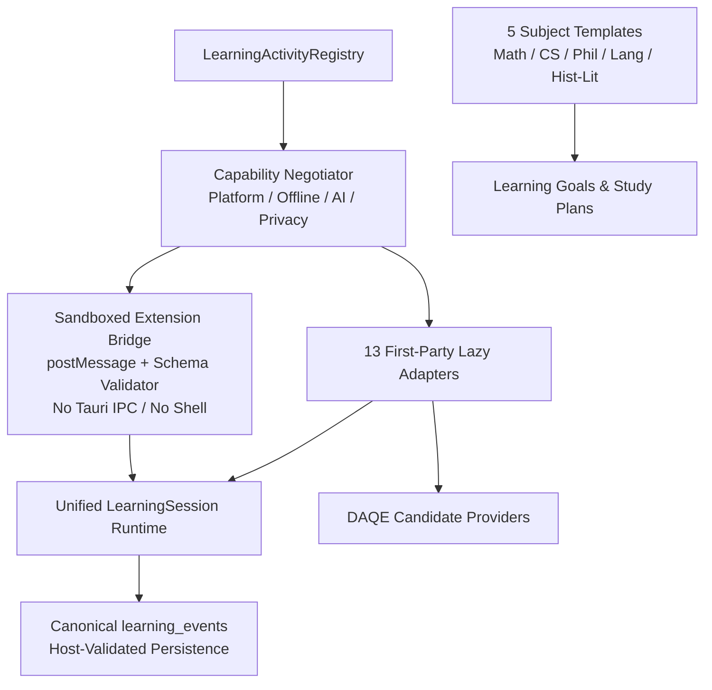

# Design: Extend Learning Activity Types

## Context

To operate as a unified Personal Learning Operating System across mathematics, computer science, philosophy, languages, history, and general reading, Plethora needs a single extensible contract for heterogeneous learning activities. Existing vertical features (incremental reading, FSRS-7 flashcards, guided reading trails, Socratic tutor, examinations, language shadowing/dictation/translation) currently expose bespoke launch paths and emit inconsistent telemetry. This design introduces `LearningActivityRegistry`, capability negotiation, 13 initial activity types, 5 declarative subject templates, and an explicit security boundary that prevents arbitrary native code execution.

## Goals / Non-Goals

### Goals
- Provide a single typed `LearningActivityRegistry` with runtime capability negotiation (`offline`, `ai_optional`, `audio`, `latex`, `speech_input`, `canvas`, `desktop`/`mobile`/`pwa`, document privacy flags).
- Register 13 initial first-party activity types that reuse existing canonical Plethora surfaces (including the single-instance `DocumentViewerWrapper`) and emit canonical `learning_events`.
- Provide 5 declarative subject templates (Mathematics, Computer Science, Philosophy, Languages, History & Literature).
- Define a strict zero-arbitrary-native-execution security boundary for coding activities and future extensions.

### Non-Goals
- Spawning host OS shells, compilers, or interpreters via Tauri commands.
- Replacing existing domain engines (FSRS-7, Study Mode reader, Exam engine, Language engines).

## Architecture Overview



## `LearningActivityRegistry` & Capability Negotiation

Every activity adapter registers a static, side-effect-free `ActivityTypeManifest`:

```ts
export type ActivityCapability =
  | "offline"
  | "ai_optional"
  | "ai_enhanced"
  | "audio_playback"
  | "speech_input"
  | "latex_rendering"
  | "canvas_input"
  | "canonical_reader_host"
  | "sandboxed_readonly_code";

export type CompetencyDimension =
  | "exposure"
  | "comprehension"
  | "retention"
  | "application"
  | "transfer";

export interface ActivityTypeManifest {
  id: string; // e.g., "worked_example_study"
  version: string;
  category: "reading" | "recall" | "practice" | "assessment" | "synthesis" | "discovery";
  supportedPlatforms: ReadonlyArray<"desktop" | "mobile" | "pwa">;
  requiredCapabilities: ReadonlyArray<ActivityCapability>;
  optionalCapabilities: ReadonlyArray<ActivityCapability>;
  evidenceDimensions: ReadonlyArray<CompetencyDimension>;
  privacyPolicy: {
    supportsLocalOnlyDocs: boolean;
    supportsAiExcludedDocs: boolean;
    requiresCloudAi: false; // MUST always be false; zero mandatory cloud AI
  };
  lazyComponent: () => Promise<{ default: React.ComponentType<ActivitySurfaceProps> }>;
}
```

### Capability Negotiation Rules
Given a `RuntimeEnvironment` (`platform`, `isOnline`, `hasLocalAi`, `hasCloudAi`, `strictLocalOnly`, `hasMicrophone`, `documentPrivacy`), `negotiateActivity(manifest, env)` returns:
- `status: "available"` — all `requiredCapabilities` satisfied and privacy policy compatible.
- `status: "degraded"` — runnable without optional capabilities (e.g., `socratic_dialogue` without AI falls back to structured self-prompting rubric cards; `language_production_practice` without microphone falls back to typed dictation/translation).
- `status: "unavailable"` — missing a required capability (e.g., desktop-only layout on narrow mobile) with a deterministic `fallbackActivityId` (e.g., `incremental_reading` or `formative_check`) and localized reason string.

## 13 Initial Activity Types

| # | Activity ID | Category | Primary Reuse / Host | Target Dimensions | No-AI / Local-Only Behavior |
|---|---|---|---|---|---|
| 1 | `incremental_reading` | `reading` | Canonical `DocumentViewerWrapper` (`study-canonical-reader-host`) | `exposure` | 100% deterministic local |
| 2 | `flashcard_review` | `recall` | FSRS-7 Review engine (`reviewStore`, `review.rs`) | `retention` | 100% deterministic local |
| 3 | `extract_processing` | `synthesis` | Canonical reader + Extract/Cloze creator | `comprehension`, `retention` | 100% deterministic local |
| 4 | `guided_reading_trail` | `reading` | `study_trail` segment planner + canonical reader | `exposure`, `comprehension` | 100% deterministic local |
| 5 | `socratic_dialogue` | `practice` | Socratic Tutor (`src/lib/ai/tutor`) + `privacyGate` | `comprehension`, `transfer` | Degrades to structured Socratic self-questioning deck |
| 6 | `formative_check` | `assessment` | Study Mode inline check / low-stakes quiz | `comprehension` | Uses local item bank / deterministic rubric |
| 7 | `formal_examination` | `assessment` | Resumable Exam engine (`exam_session_repository.rs`) | `comprehension`, `application`, `transfer` | Local deterministic grading + rubric self-grade |
| 8 | `worked_example_study` | `practice` | Step-reveal annotated solution + self-explanation prompt | `comprehension`, `application` | 100% deterministic local (LaTeX/Markdown steps) |
| 9 | `problem_solving_drill` | `practice` | Multi-step calculation/proof/logic prompt with staged hints & rubric | `application`, `transfer` | 100% deterministic local rubric/answer check |
| 10 | `code_tracing_and_synthesis` | `practice` | Static trace table, output prediction, complexity & pseudocode rubric | `comprehension`, `application` | Read-only static/AST/rubric check — zero OS exec |
| 11 | `language_production_practice` | `practice` | Existing dictation, shadowing, translation, writing practice modules | `retention`, `application`, `transfer` | Local audio/text; degrades cleanly without mic/AI |
| 12 | `synthesis_and_concept_mapping` | `synthesis` | Free-recall summary + Knowledge Atlas concept-link authoring | `comprehension`, `transfer` | 100% deterministic local |
| 13 | `exploratory_feed_digest` | `discovery` | Smart Feeds reader (zero automatic SRS obligation) | `exposure` | 100% deterministic local |

## 5 Declarative Subject Templates

Subject templates are pure JSON/TS descriptors selectable when creating a Learning Goal or Study Plan (and customizable afterward):

| Template ID | Subject Domain | Recommended Activity Mix | Competency Dimension Weights | Default Session Blueprint |
|---|---|---|---|---|
| `mathematics` | Mathematics | `worked_example_study` (30%), `problem_solving_drill` (35%), `flashcard_review` (20%), `formative_check` (15%) | `exposure`: 0.10, `comprehension`: 0.25, `retention`: 0.20, `application`: 0.30, `transfer`: 0.15 | 5m FSRS definitions → 10m worked example → 15m problem drill |
| `computer_science` | Computer Science | `code_tracing_and_synthesis` (35%), `incremental_reading` (20%), `synthesis_and_concept_mapping` (20%), `flashcard_review` (15%), `formative_check` (10%) | `exposure`: 0.10, `comprehension`: 0.25, `retention`: 0.15, `application`: 0.30, `transfer`: 0.20 | 5m recall → 10m doc/RFC read → 15m code tracing & synthesis |
| `philosophy` | Philosophy | `guided_reading_trail` (30%), `socratic_dialogue` (25%), `synthesis_and_concept_mapping` (25%), `formative_check` (10%), `extract_processing` (10%) | `exposure`: 0.15, `comprehension`: 0.30, `retention`: 0.10, `application`: 0.15, `transfer`: 0.30 | 15m primary text trail → 10m Socratic / argument mapping |
| `languages` | Languages | `language_production_practice` (35%), `flashcard_review` (30%), `incremental_reading` (20%), `extract_processing` (15%) | `exposure`: 0.15, `comprehension`: 0.20, `retention`: 0.25, `application`: 0.25, `transfer`: 0.15 | 10m FSRS vocab/sentences → 10m graded reading/mining → 10m dictation/shadowing |
| `history_literature` | History & Literature | `incremental_reading` (30%), `guided_reading_trail` (25%), `synthesis_and_concept_mapping` (25%), `formative_check` (10%), `flashcard_review` (10%) | `exposure`: 0.20, `comprehension`: 0.30, `retention`: 0.15, `application`: 0.10, `transfer`: 0.25 | 15m source reading → 10m timeline/theme synthesis → 5m key dates/terms recall |

## Security Extension Boundary

To ensure future third-party or user-authored activity types can never compromise user security or local-first privacy:

1. **Zero Privileged Native Execution:**
   - No Tauri command may execute shell commands, spawn interpreters (`sh`, `bash`, `python`, `node`, `rustc`), or write arbitrary files on behalf of any activity adapter or extension.
   - `code_tracing_and_synthesis` uses deterministic state-table verification, static rubric comparison, and read-only syntax highlighting.
2. **Strict Sandbox Isolation for External Extensions:**
   - External activity plugins MUST run in either a dedicated Web Worker (no DOM, no `window.__TAURI__`) or an isolated `<iframe>` with `sandbox="allow-scripts"` (explicitly omitting `allow-same-origin`, `allow-top-navigation`, and Tauri IPC bindings).
   - Communication passes solely through `SandboxActivityBridge` using structured `postMessage` envelopes validated by Zod/TypeScript schemas (`maxPayloadBytes = 256 KB`, `maxMessagesPerSecond = 20`).
3. **Capability & Privacy Enforcement by Host:**
   - Host rejects any extension request for capabilities not declared in its manifest and granted by the user.
   - Documents with `isLocalOnly = true` or `isAiExcluded = true` are NEVER transmitted to untrusted extensions.
   - Extensions may only emit `activity_completed` / `formative_observation` proposals; the host validates and caps evidence weight (extensions cannot emit `formal_exam_grade` or mutate FSRS-7 scheduling parameters).

## Verification Strategy

- **Registry & Capability Tests:** Verify all 13 built-in adapters register cleanly, negotiate correctly across desktop/mobile/PWA/offline/no-AI/local-only matrices, and lazy-load without inflating initial bundle budgets.
- **Subject Template Tests:** Verify all 5 templates validate against the schema, sum competency weights to `1.0`, and reference only registered activity IDs.
- **Security Boundary Tests:** Verify `SandboxActivityBridge` rejects oversized payloads, undeclared capability requests, forged `formal_exam_grade` events, and `isLocalOnly`/`isAiExcluded` document payloads; static audit asserting zero shell/process execution in activity modules.
