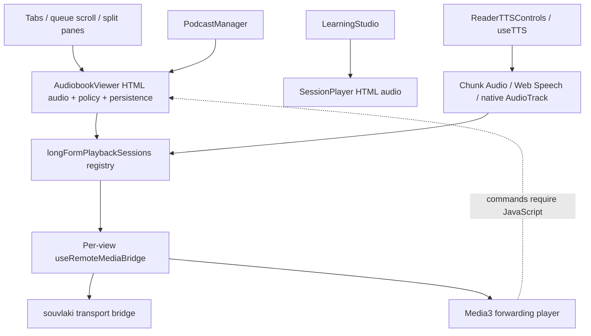
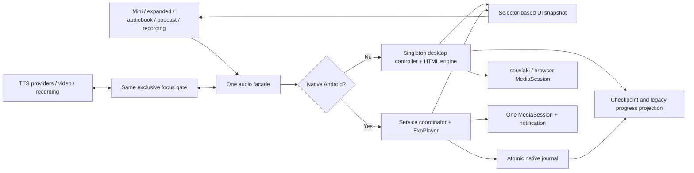
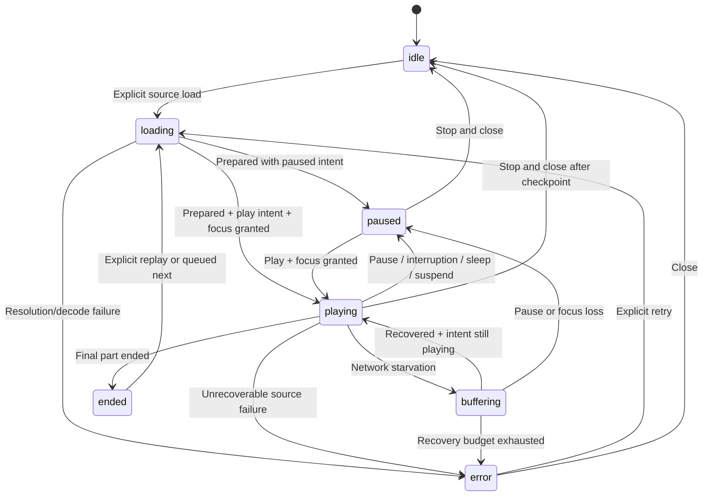

## Context

See [proposal.md](proposal.md) for motivation and [audit.md](audit.md) for verified source evidence. This is a specification-only change. Names explicitly marked **new** below are proposed integration points; no application modules have been created. The source audit covers `71d59859`; source wins over historical OpenSpec completion labels.

Current ownership:



The registry replacing a reference does not silence an engine. Tab retention sometimes preserves playback, but cannot guarantee it on close, eviction, responsive reparenting, queue-item replacement, or activity loss.

## Goals / Non-Goals

**Goals:** exactly one authoritative runtime owner per platform; views are subscribers; reuse media preparation, anchors, saved progress and rich UI; Android transport/decoding/checkpointing work without JavaScript; readers/reviews never subscribe to audio ticks.

**Non-Goals:** a new playback engine for desktop, a new TTS provider or transcription stack, uninterrupted execution after process death/force-stop/system suspend, remote-device playback control, persistent video, or holding complete reader/transcript trees alive. Cold restore is paused. Existing Android service reconnection is not cold restore and must preserve its live state.

## Decisions

### 1. Ownership and module boundaries

Use a platform-selected runtime behind one frontend facade. There is one authority, not synchronized peer controllers:

| Layer | Desktop/browser | Android |
| --- | --- | --- |
| Engine | One application-lifetime HTMLAudioElement, optional existing WebAudio processing | One ExoPlayer inside existing RemoteMediaSessionService for ordinary audio |
| Controller authority | **new** `src/services/audio/globalAudioController.ts`, module singleton outside React | **new** `PlaybackCoordinator.kt` in existing android-tts plugin, owned by service, serialized on service main looper |
| Frontend projection | **new** `src/stores/audioPlaybackStore.ts`, narrow selectors; never owns an engine | Same read-only projection of native snapshots, commands are RPCs to service |
| Source resolution | **new** `src/services/audio/audioSourceResolver.ts` extracts audited viewer resolution/multipart policy | Rust resolves persisted identities into authorized native files/remote URLs; service owns resolved manifest |
| Progress/checkpoints | **new** `audioPlaybackPersistence.ts` -> existing APIs / consolidated Rust command | Native atomic journal, Rust checkpoint/progress reconciliation when available |
| Platform bridge | One owner-level `useRemoteMediaBridge`; existing dispatcher/study context and souvlaki | Existing MediaSessionService; ordinary transport executes natively, JS receives observation receipts |
| Presentation | **new** `GlobalAudioHost.tsx`, `MiniAudioPlayer.tsx`, `ExpandedAudioPlayer.tsx` under `src/components/audio/`; existing viewers become controls | Same presentation, no HTML media decoder for native ordinary-audio sources |

`GlobalAudioHost` initializes the singleton once in `src/main.tsx`, inside shared providers but above HashRouter/Routes and their Suspense fallback, gated to the primary `main` application window. It owns browser engine lifetime/bridge registration and lazy expanded-player host, not shell geometry. Do not put engine in AdaptiveAppScaffold, MobileLayoutWrapper, a tab, queue card, dialog, or keyed `documentId` subtree. Shell mini-player slots may unmount/reparent on responsive changes without touching runtime ownership. Idempotent initialize/dispose handles StrictMode/test double mounts without two audio elements/listeners. Dispose only at real owner/window shutdown; Android frontend disconnect never calls service stop.

Extend `LongFormPlaybackStateSnapshot`, `LongFormPlaybackSession`, and `RemoteMediaCommandEnvelope` in `src/types/audioEdition.ts`; retire registry attach/detach as an ownership mechanism. Keep `longFormPlaybackSessions.getActive()` as a compatibility read facade over the real owner during migration. No second mutable registry. Existing per-view `useRemoteMediaBridge` calls are removed as their sources migrate.

Alternatives rejected: pinning the viewer bypasses tab memory caps and retains heavy UI; a permanently hidden AudiobookViewer still performs transcript/layout/timer work; a new Rust decoder duplicates desktop/WebKit support; a second Android plugin/service duplicates focus/notification owners; WebView-only playback with a forwarding service cannot establish activity-independent decoding. Native Android ExoPlayer is the minimum additional engine justified by the audit and the [Media3 service model](https://developer.android.com/media/media3/session/background-playback).



### 2. Identity, source manifest and commands

Separate library identity from runtime incarnation:

- `sourceKey = {profileKey, kind, sourceId}`; kinds reuse existing discriminants plus `recording`. Audiobook uses document ID; podcast uses episode ID with optional distinct `documentId`; Audio Edition uses edition ID with source text document ID; recording uses recording session ID plus media asset revision. A synthetic PodcastManager viewer ID is never presumed a document ID.
- `sessionId` is an opaque UUID per newly loaded session, not just `kind:id`; retain deterministic helper only for source identity compatibility. `generation` increases on load/replace/focus takeover/stop/account boundary; `revision` increases on every accepted control/state transition. Wall-clock `updatedAt` is display/persistence metadata, not sole stale-event protection.
- `ResolvedAudioItem` contains immutable identity, metadata/artwork, optional document/episode/edition/session IDs, return destination, ordered parts `{partId, sourceRevision, nativeUri or browserUrl, durationSec|null, globalStartSec|null}`, chapters/anchors, source-policy intervals, supported capabilities, and optional queue association. Persist IDs/relative references, never Blob URLs, temporary loopback port URLs, signed URL secrets, full transcript or decoded PCM.
- Native paths are issued by Rust after existing media-root/registered-document checks; canonical recording paths use `get_recording_media_path`. Android handles `content://` only with existing/persisted URI grants; otherwise import/copy into managed media storage. ExoPlayer consumes validated file/content/HTTPS sources directly, never an asset-protocol WebView URL or Rust localhost URL whose lifetime depends on the UI. Desktop keeps Range streaming and existing m4b preparation.

Define new typed facade operations `load(itemIdentity, {intent:'play'|'paused', explicitPosition?})`, `play`, `pause`, `toggle`, `seekTo(globalSeconds)`, `seekRelative(deltaSeconds)`, `selectChapter`, `setRate`, `setVolume`, `setSleepTimer`, `stopAndClose`, `queueNext`, `queuePrevious`, `getSnapshot`, `subscribe`. Loading an inactive library page does not replace current audio. Explicit Play/Listen from a source requests takeover; expanding/current-source return only attaches UI and does not load or restore again.

New Android plugin commands (snake-case exposed names through existing Rust plugin registration/ACL generation): `load_audio`, `audio_command`, `get_audio_snapshot`, `reconcile_audio_checkpoint`; command handlers bind to the application-scoped service, never an Activity-held ExoPlayer. Rust shared commands: `resolve_audio_item`, `commit_audio_checkpoint`, `get_audio_checkpoint`. Names are proposed contract additions, not existing APIs. Payloads are versioned (`schemaVersion:1`). `audio_command` carries `{requestId, sessionId, generation, command, arguments, expectedRevision?}`. Reply is `{disposition:'accepted'|'duplicate'|'stale'|'failed', revision, snapshot, error?}`. Error codes: `source_missing`, `permission_denied`, `unsupported_codec`, `network`, `expired_url`, `corrupt_media`, `focus_denied`, `persistence`, `unsupported_command`. Command results are acknowledged after acceptance/application, never after merely queuing JavaScript.

Native event `media://playback-state` carries the full snapshot `{schemaVersion, sourceKey, sessionId, generation, revision, state, playIntent, pauseReason, partIndex, timeInPart, positionSec, durationSec|null, rate, capabilities, section, error?, checkpointSequence}`. Source/metadata/rate/capability updates publish immediately; position samples are coalesced. Frontend subscribes before requesting snapshot, then accepts only same-generation increasing revisions; reconnect applies full snapshot before pending observations. No extrapolation is written back as engine truth.

All UI/desktop commands serialize through one controller queue. New source requests use last-request-wins intent: increment generation immediately, abort old resolvers, pause previous engine and capture its final position before starting anything else; persist under captured old IDs; release old URL/decoder resources after acknowledgment. A persistence failure retains an in-memory/native-journal checkpoint and informs the user but does not allow overlapping audio. A pause failure/timeout prevents new playback and exposes retry. Resolver completions/play promises/seek/ended events from old generations are ignored. Relative seeks remain distinct ordered actions; consecutive slider moves may coalesce to the final requested absolute target. Explicit Play while playing and Pause while paused are no-ops, never toggles. Extend `RemoteMediaContext` with distinct `onPlay` and `onPause` callbacks and retain `onPlayPause` only for Toggle during migration; remove the audited `runTransport` toggle mapping for explicit Play/Pause. Persist a bounded history of the last 256 accepted native request/event IDs with the service journal; reconnect receipts cannot be re-executed after a JavaScript/process observer reset.

```mermaid
sequenceDiagram
  participant UI as UI surfaces
  participant C as Runtime authority
  participant Old as Previous engine/source
  participant R as Source resolver
  UI->>C: Play B (request 42)
  C->>C: Increment generation; revoke old callbacks
  C->>Old: Pause; sample A position
  Old-->>C: Paused + final A checkpoint
  C->>C: Persist/journal A under captured identity
  C->>R: Resolve B with generation
  UI->>C: Play C (request 43)
  C->>C: Supersede B generation
  R-->>C: B resolved (discard stale result)
  C->>R: Resolve C
  R-->>C: Current generation C manifest
  C->>C: Load/seek/rate; acquire focus; play once
  C-->>UI: Accepted snapshot for C
```

### 3. State machine and position policy

Extend state union with `error`; store `playIntent`, `pauseReason` (`user`, `focus`, `headphones`, `sleep`, `source-switch`, `suspend`, `account`, `ended`), and `focusLease`. `loading`/`buffering` never imply consent to autoplay unless current play intent and focus still permit it. Closing the expanded surface is not a playback transition.



Canonical `positionSec` is global media seconds, never wall-clock elapsed and never multiplied by speed. Preserve `{partIndex,timeInPart}` for exact resume; map against known part boundaries with shared `audiobookMultipart` helpers. Boundary equality belongs to the next part except the final endpoint. Relative seek crosses parts; known duration clamps; unknown duration shows elapsed only and disables unavailable absolute seeking/percentage. Across unknown-length parts, only known/seekable boundaries or explicit chapter/part selection are legal; do not invent offsets. Chapter seek remains distinct from queue skip. Handle >24-hour durations with numeric seconds, no 32-bit milliseconds or Date/time-of-day wrapping.

At part end, advance once only if the current generation still has play intent. At final end, checkpoint completion; advance only an explicitly active queue. Existing PodcastManager feed continuation and Listen Later semantics become explicit owner queue contexts rather than captured view callbacks. Sleep boundary takes precedence over auto-advance. Reopening any viewer cannot replay a completed part or trigger `autoPlayOnOpen` for an already active identity.

### 4. Focus and interaction with TTS/video/capture

One app focus gate covers every long-form entry point: `ReaderTTSControls`, `useTTS`, `useNativeAndroidTTS`, audiobook/episode/recording commands, embedded local/YouTube video starts, hands-free spoken feedback, and live recording start. Call the gate before speech generation/play or browser/native media play, including asynchronous callbacks and automatic next chunk. It pauses competing sources and waits for quiescence; grants carry generation/revocation tokens. Revoked generation callbacks must never start audio.

- Podcast -> TTS: pause/checkpoint media; grant speech exclusive output; TTS uses existing provider/reader anchoring. Previous media remains paused when TTS finishes, stops, fails, or its reader unmounts. Explicit media Play revokes/stops speech before resuming. No new automatic-resume preference or Settings control.
- TTS remains reader-scoped; navigation may stop it under existing cleanup. This does not stop or restart saved media. It has truthful chunk/sentence seek capabilities, never fake continuous seek.
- Starting video or capture pauses global media; no automatic resume on their close. Capturing microphone audio must not accidentally record continuing app playback. Short existing UI feedback uses the existing feedback policy; intentional hands-free feedback ducking is a scoped lease restoring only the same still-playing generation.
- Android service is the sole AudioManager focus owner for ordinary playback and delegated speech. Keep the existing focus state machine, use `USAGE_MEDIA`/speech content attributes, pause rather than duck intelligible spoken content for transient-can-duck. Disable ExoPlayer automatic focus when using this single coordinator; remove subordinate TTS focus requests while delegated. [Android guidance](https://developer.android.com/media/optimize/audio-focus) forbids competing manual and automatic ownership and constrains background focus eligibility for target 35+.
- Native transient loss remembers `{generation,wasPlaying,userPauseRevision}`; gain resumes only if all still match and no explicit pause/source switch/stop occurred. Permanent loss, noisy headphone disconnect, explicit pause and desktop suspend clear resume intent. Headphone reconnect alone never resumes. Route-preserving Bluetooth changes continue unless the platform reports a noisy/interruption event. Focus failure leaves paused and shows “Audio is in use. Try Play again.”

On Android the same service contains one MediaSession. Use the real ExoPlayer as session player in ordinary-media mode; switch session player to the existing speech forwarding adapter only while delegated TTS owns focus, with ordinary decoder paused. Session replacement must not create a second notification or release the service from view cleanup. Activity-bound TTS cleanup remains as audited; it must release its lease and cannot revive prior media.

### 5. Android background, OS controls and command reconciliation

Add `androidx.media3:media3-exoplayer:1.8.0` alongside current common/session versions. Configure playback-scoped `WAKE_MODE_LOCAL` and the required manifest wake permission, verifying against the pinned library; release wake ownership on pause/stop and avoid a blanket network/Wi-Fi wake lock. [ExoPlayer wake-mode guidance](https://developer.android.com/reference/androidx/media3/exoplayer/ExoPlayer.Builder#setWakeMode(int)) recommends local wake mode with a foreground service for screen-off audio. Extend existing service/plugin; do not add Media3 UI, a second MediaSessionService, or a new native playback plugin. The coordinator owns ordinary-media manifests, play intent, queue-ready entries, rate, timers, focus, decoder and native journal, independent of AndroidTtsPlugin/WebView objects. Activity recreation reconnects observers; service continues decoding. Generated editions can play all ready section files from the manifest. If continuation requires new synthesis/network resolution with no UI, stop at the last ready section, checkpoint and report “Open Plethora to prepare the next section”; do not pretend synthesis is service-backed.

Standard notification/lock-screen/Bluetooth Play/Pause/seek execute directly against service coordinator and persist before issuing an observation receipt. They never wait for or replay through JavaScript. Retain normalized event IDs; mark receipts `transportApplied:true` and reconcile projection only, so wakeup cannot apply a seek twice. UI commands and OS controls enter the same serialized authority.

Preserve hands-free Study Mode mappings. Send its versioned command map/capture settings when attaching a source, so Next/Previous cannot change meaning merely because JS is suspended. Native transport study actions (replay/seek/chapter) execute once; actions requiring extracts/flashcards/anchors are saved as existing durable intent envelopes including source/session/generation, part/section, press-time coordinate and event ID, and processed on reconnect with existing typed pending-bookmark/error outcomes. Normalized Play/Pause always remain transport. Never acknowledge a capture before durable acceptance; do not discard intentional press-time capture solely because the current UI later changed source. Existing stale/mismatch rules still reject old transport intent; deferred capture must retain its original provenance.

Start/promote foreground playback from user-visible Play or permitted system transport; provide valid prepared metadata first and comply with platform foreground deadlines. Keep foreground service type/permissions/intent filter, use the existing media notification. Denied POST_NOTIFICATIONS must not be treated as a playback denial: media-session notifications are [exempt](https://developer.android.com/develop/ui/compose/notifications/notification-permission#media-sessions); verify both permission states on target SDK 36. No boot receiver, alarm workaround, blanket battery-optimization exemption, or microphone permission for playback.

Lock/app switching/activity recreation and task dismissal while playing preserve ordinary-media playback; a paused/non-ongoing service may shut down after checkpoint. Explicit in-app Stop/Quit, logout, Android force-stop, or process death stops it. No guarantee against OS termination; persist at most five seconds of loss. Do not restart audibly after service process death or reboot. Cold session -> paused notification state only when the user explicitly invokes resume. Native service refusal is a visible actionable error; foreground-only fallback must be labeled and cannot satisfy P0 background acceptance.

Desktop retains one `souvlaki` bridge. Move registration to owner; prevent passive silence timeouts from dropping a valid paused session (replace timeout-as-ownership with explicit detach, or an owner heartbeat <=5s; prefer explicit lifetime). Linux MPRIS runs over D-Bus independent of Wayland/X11; test both compositors without global key-grab hacks. Windows obtains the main WebviewWindow HWND under Windows cfg and respects its lifetime/thread requirements; `None` is not an acceptable success path. macOS validates the existing event-loop integration on hardware. Unsupported OS action reports capability/failure without breaking in-app transport; never publish fake OS support. Desktop window close/Quit stops playback; minimizing and losing focus do not. Add native lifecycle events alongside the media adapter (new `src-tauri/src/audio_lifecycle.rs`, cfg-gated platform modules): Linux login1 PrepareForSleep where available, Windows power notifications, macOS workspace sleep/wake and available output-route interruption notifications. Deliver `audio-lifecycle` envelopes to the owner; desktop suspend pauses/checkpoints on the pre-suspend event and wake remains paused. If a pre-suspend event cannot be delivered, wake must first sample the actual paused engine and checkpoint before accepting new Play, never add wall-clock elapsed. Native per-OS observer unregistration follows app lifetime. Hardware focus/output limitations must be reported explicitly rather than inferred from souvlaki, which only supplies media controls.

### 6. Persistence, migrations and sync boundaries

Preserve source-specific APIs; remove their timers/writers from UI once migrated. Controller schedules one changed-position checkpoint per five seconds of playing; pausing, completed seek, part change, source switch, stop, sleep, account change and orderly shutdown flush immediately. Coalesce repeated flush requests into a single in-flight write plus latest pending checkpoint per identity; a seek drag commits once on release. No DB write while unchanged/paused. View teardown may request a coalesced flush for compatibility but cannot dispose engine or end listening session. Retain synchronous emergency browser storage on pagehide; asynchronous unload is best effort, not a crash-safety guarantee.

Add the next unused migration through `src-tauri/src/database/migrations.rs` (do not guess a migration number). Proposed local-only tables:

- `audio_playback_checkpoint(profile_key TEXT, source_kind TEXT, source_id TEXT, schema_version INTEGER, checkpoint_sequence INTEGER, owner_epoch TEXT, payload_json TEXT, updated_at_ms INTEGER, PRIMARY KEY(profile_key,source_kind,source_id))`.
- `audio_playback_session(profile_key TEXT PRIMARY KEY, schema_version INTEGER, payload_json TEXT, updated_at_ms INTEGER)` for current identity, queue IDs/order/index, rate, close state and observed last playback state. Persisting “was playing” never authorizes cold autoplay.

Checkpoint payload includes part/time/global time, duration nullable, media revision and logical IDs; session payload includes rate/volume/sleep intent and minimal return destination. Bookmarks stay in existing stores; recording positions use checkpoint table rather than transcript document reading position. Add no sync entity for these tables. Browser/PWA mode implements the same checkpoint command facade in `src/lib/browser-backend.ts` using its local storage/database conventions; it must not invoke a native-only command or assume Tauri SQLite exists. `owner_epoch` scopes checkpoint sequences across process restarts; compare sequence only within an epoch, and persist accepted handover between epochs. Ignore stale/duplicate commits; never compare unrelated device sequence numbers.

Android keeps a bounded per-profile atomic journal via Android `AtomicFile` in app-private storage, independent of Activity/Rust bridge, containing current session plus the latest checkpoint for each unacknowledged changed source and deferred native commands. Write every five seconds only while progressing and immediately on critical transitions. Pause/seek/switch/stop ack requires durable native checkpoint. Keep unacknowledged records when Rust is unavailable; compact acknowledged entries, cap at 128 source checkpoints and 256 pending commands. If capacity is reached, reconcile first; if still unavailable, reject further takeover/capture with a recoverable storage error rather than discard unsaved progress. UI observation timers are absent while disconnected. Native sleep deadlines and next-part decisions remain operative.

On reconnect: read native snapshot first -> import newer native checkpoint sequences idempotently -> Rust transaction updates local checkpoint, legacy episode and/or audio document projection plus document sync outbox where applicable -> acknowledge journal only after transaction commit -> publish current snapshot. UI must never hydrate stale browser state over a live service. Use existing document sync journal helpers inside the same transaction; do not independently call current APIs in Promise.all for promoted episodes. A transient DB failure leaves journal dirty and retries with bounded backoff (1,2,4,8,30s; one queued latest record), plus persistent inline warning; next lifecycle transition retries immediately.

Restore precedence:

1. Live native service is authoritative, even if UI storage claims paused/another item.
2. Unacknowledged valid native journal is imported before reading source progress; no auto-play.
3. For a fresh explicit source load, existing source store is the compatibility source of truth: standalone/promoted podcasts read episode/document mappings; ordinary audiobook reads time position; Audio Edition reads the freshest valid edition record; recording reads new checkpoint. A new checkpoint supplies multipart/source revision detail only when consistent with the source store, otherwise derive from its newer source position. Do not overwrite a newer synced document position with an older local session row.
4. Session row restores identity/queue/rate as paused; missing identity is pruned with explanation, no automatic next-item playback. Invalid schema/NaN/negative/out-of-range part/media-revision mismatch is validated and clamped or falls back to legacy position, never silently resets valid unrelated reading progress.

Ordinary audio documents may continue writing `documents.position_json` as time and existing progress auto-update. Audio Editions attached to EPUB/PDF/text documents must only update independent edition listening position, not overwrite `position_json`, CFI/page/scroll or reading progress percentage. Raw podcast viewer episode IDs are not document IDs: only write document projection if a verified promoted mapping exists. Existing standalone episode and Audio Edition local progress are not newly made cross-device syncable. Remote document merges never reposition a playing/paused loaded session; explicit reopen after session release observes normal sync results. Do not implement max-position merging: rewinds are intentional.

Account/profile/workspace namespace boundaries revoke focus/generation, pause, checkpoint under the old namespace, clear OS metadata and queue projection, and detach service before showing new account data. Native session/journal access checks the active profile token; a failed stop prevents account handover and exposes recovery. Never copy native paths/media titles between profiles.

### 7. Mini-player placement and expanded-player behavior

Use the incumbent Material tokens (`docs/design-system.md`, `DESIGN.md`, MD3 primitives). Planning uses existing code as visual authority; no unrelated PRODUCT.md/DESIGN.md rewrite. The mini player is an opaque semantic `surface-container`/`bg-card` surface with outline/border, primary transport emphasis and subtle progress. Do not use glass-panel, background blur, album-color gradients, marquee, waveform visualizer, animated artwork, native transparency changes, or continuous animation. Long titles ellipsize visually and remain fully accessible.

**Desktop choice:** one bottom-docked row across shell width beneath the workspace content and above the window edge. Default height 4rem (including thin progress rail), measured via ResizeObserver; artwork 40px, two-line title/chapter, -30s/play/+30s for books/editions/podcasts, recording -10s/play/+30s, time/seek and Queue/Expand/Stop. Default desktop skip follows the existing visible audiobook controls, not remote chapter Next/Previous. At smaller widths/time zoom move secondary controls to overflow, never below 40px targets (48px coarse pointer). No user placement setting. A floating/repositionable player was rejected because it can cover annotation, reader, review and assistant actions; collapsible variants add hidden-control state without solving the ownership defect.

Reserve measured height by shrinking workspace scroll region, not overlaying it. Respect both split panes and sidebar/footer controls. A 13–14-inch 1280x720/1366x768 viewport at 100/125/150% interface zoom must keep transport usable; high zoom uses the compact responsive composition. Never key/reload the engine at a breakpoint.

**Android choice:** compact dock immediately above existing MobileNavigation. Target height 64px plus one shared safe-area contribution, 32–40px artwork; separate title/expand button and three 48px transport targets fit 320px width. Keep two seek directions and play/pause available; Queue/Stop can live in expanded/overflow. Thin progress is informative only in compact phone composition; accessible full scrubber is in expansion. No swipe-to-dismiss, drag, or broad horizontal swipe on player: reader scrolling and app Back retain their gestures. Landscape phone remains mobile according to `useMobileShell`, tablets follow existing layout rules.

Extend `MobileLayoutWrapper`/`AdaptiveAppScaffold` with presentation slots and a shared `--shell-audio-player-height`. Update `.mobile-main-content` reservation once (nav + measured player); safe bottom belongs only to the bottommost visible dock/nav. Extend `BottomControlsGeometry` to publish audio top through the existing owner-driven pipeline so mobile assistant controls and floating reader/selection/create-flashcard affordances clear the full bottom stack; do not apply duplicate inset math or move the nav to accommodate assistant controls. Snapshot reader scroll/anchor when dock visibility changes and compensate layout so the selected paragraph/page and flashcard grading row stay stable. Show/hide without height animation. One controlled resize is allowed; cumulative unexpected layout-shift score during steady playback is zero.

When keyboard appears, compact dock remains in the reserved visible-viewport area above the keyboard if enough room for 48px controls and the focused input; otherwise temporarily hide player presentation while retaining its reserved layout contract and OS controls, restoring without scrolling the input. Modal overlays sit above and inert the underlying dock; do not mount another dock into the modal. In fullscreen media the dock may hide while engine remains active; reading fullscreen must retain an accessible way to open the player via existing chrome. Suppression is presentation state only. Verify assistant pill, bulk selection, review grading/footer, annotation toolbar, RSS reading controls, toasts, and capture strip in the layout matrix.

Visibility: appear after explicit supported source load, including paused/loading/error/ended states. Opening an unrelated audiobook page without Play is not a load. Stop-and-close pauses, checkpoints, cancels sleep/resume intent, releases engine/OS session, hides row; saved queue and per-item progress remain available. Closing expansion only collapses. Error surface retains title, Retry, Stop; one transition toast at most, no recurring tick announcements. Resume later restores source position, never destructive reset.

**Expanded player:** lazy import the current AudiobookViewer presentation with controller-bound source model; no new element/timer/restore/bridge. The same presentational view can render in original audiobook/podcast screen or one global expanded surface. Source-page controls show its own media with “Playing elsewhere”/Play takeover if another source is active, not pretend its metadata belongs to the active session. Desktop expanded view uses MD3 Dialog with bounded height/scroll; Android uses the existing full-screen overlay/back primitive so Back collapses before navigating/leaving. Restore focus to invocation control (or safe visible fallback); underlying tab/history/EPUB CFI/review session is untouched. “Open in library/source” uses existing tab/navigation APIs and separately navigates to source; expansion itself does not navigate.

Reuse artwork, chapters, scrubbing, rate choices, volume/mute, sleep, bookmarks, queue view, transcript timestamps, source-linked extracts/flashcards, paired EPUB sync and available study controls. P0 expanded view must expose essential transport/rate/chapters/seek/return/back and existing available bookmark/sleep actions. P1 finishes queue editing and full study/DSP parity before removing affected old paths. Native silence skipping/volume boost must use service-owned audio processing (Media3 silence processor and bounded gain), never hidden WebAudio alongside ExoPlayer; maintain original-media coordinate/anchor accuracy or report unsupported for that source and keep feature rollout disabled until parity is verified. Codec support is measured per native platform, not assumed universal.

Accessibility: landmark `region` named “Audio player”; native buttons/MD3 IconButton and Slider; descriptive skip-seconds labels, current state on Play/Pause, title/section association; keyboard Tab/Shift-Tab, Enter/Space activate focused control, Escape/Android Back collapses expansion. Never install global Space/arrows that steal flashcard grading, typing/contenteditable, reader, or shortcut manager commands. Slider arrows/Home/End/PageUp/PageDown follow native semantics and `aria-valuetext` uses elapsed/duration human time; unknown duration disables unavailable seeking with a reason. Announce source/error/state changes politely, not every second. Focus ring visible, text contrast >=4.5:1 and controls/progress >=3:1 across light/dark/custom/high-contrast; reduced motion instantaneous and no color-only state. Labels localized; do not hardcode theme colors.

### 8. Error, recovery and compatibility matrix

| Trigger | Owner behavior | User/recovery |
| --- | --- | --- |
| Delete source/edition/recording while playing | Pause and checkpoint first; invalidate generation, release file before deletion where OS requires; clear dependent queue IDs | One “Audio removed” notice; no next autoplay. Failed deletion can retry without stale decoder handles. |
| Expired URL/401/403 | Keep coordinate; re-resolve episode from stored identity once with current request token | Retry from same position; if still invalid show “Episode unavailable” with explicit retry/source link, never overwrite URL with unrelated feed item. |
| Network interruption | Buffer while existing play intent; bounded retries at 1/2/4/8/15 seconds, then error/paused intent | Status inline; recovery only resumes same still-authorized generation. Paused/stopped user intent cancels retry autoplay. |
| Offline downloaded item | Valid local source wins over remote | Play without network; missing download reports unavailable offline, keep progress. No implicit huge download. |
| Corrupt/unsupported media | Preserve saved position; attempt only existing supported desktop conversion fallback | Typed error + retry/source/import alternative; no endless decode/transcode loop. |
| Missing artwork | Use stable audio/book/podcast/recording fallback | No toast, no repeated image fetch loop. |
| Unknown duration / long book | Finite elapsed + known seekable range only; no divide-by-zero/32-bit overflow | “Duration unavailable”, useful play/relative seek; >24h formatting. |
| Rapid source/UI commands | Serialize with captured identity/generation; dedupe event IDs | Final accepted request wins; never overlap or old-source seek. |
| Deleted queued item | Remove invalid item, do not alter active item unless it is deleted | Queue marks removal; no surprise playback. |
| Window resize/shell swap | Re-render presentation only | Audio source, rate, identity/position stable. |
| Auxiliary window | No engine/bridge attach in auth/screenshot utilities | Main window retains session; if future second full window is introduced, proxy main owner or deny local playback rather than duplicate. |
| Suspend/process loss | Suspend pauses/checkpoints; process loss recovers last durable checkpoint | Resume/relaunch paused except reconnecting an already-live Android service. |
| Persistence failure | Keep latest checkpoint dirty, retry bounded, do not claim Saved | Inline warning once, restore from native/browser emergency journal. |

### 9. Performance and validation contract

Position engine events are authoritative. UI projection publishes at most 2Hz during visible playing, <=1Hz to compact time/progress consumers; semantic transitions immediate. Inactive source views subscribe to identity/control status only. App shell/RSS/readers/review roots never subscribe to position or whole audio store. No app-wide context snapshot per tick; React selectors select stable primitives. OS metadata publishes immediately on transitions and <=1Hz position while active; no updates while unchanged paused. Desktop bridge lifetime must not depend on ticking metadata. Android no foreground JavaScript timer is required for decoding, sleep, focus, standard transport, or five-second native checkpointing.

No RAF loop/progress tween, visualizer, repeated full file read, decode cache duplication, per-tick localStorage serialization, or full transcript retained by compact UI. Load artwork thumbnail only; transcript and anchor data needed for audio study are bounded/current-section and independent from heavy DOM rendering. Engine URL, WebAudio node, worker and listener ownership is explicit; release on real source retirement/stop, not view unmount. Lazy expanded player is not in the initial shell bundle. Keep existing memory/tab/cache bounds. Optional existing DSP runs only when enabled.

[validation.md](validation.md) defines baseline collection and proposed acceptance thresholds, not measured results. Unit, contract and browser-harness tests cannot prove real audio continuity/OS lifecycle. P0 requires packaged Linux and physical Android acceptance; platform-specific P1 requires real Windows/macOS acceptance. Existing `npm run bench:check` remains mandatory during implementation, with seeded inputs and sink consumption; no fabricated baseline updates. No runtime suite is required to validate these documentation-only artifacts.

## Risks / Trade-offs

- [Android migration changes decoding behavior] -> Pin Media3 family, keep original source/part/anchor coordinates, verify m4b/AAC/MP3/OGG/WAV and supported recorded WebM/M4A on devices; staged rollout cannot declare background support using the old forwarding player.
- [Native transport and deferred Study Mode duplicate actions] -> Native applied receipts are observations, capture actions retain press-time provenance and event IDs; reconcile before accepting queued UI commands.
- [Browser/TTS cleanup restarts old playback] -> Revoke generation on focus takeover, require pause acknowledgment, never resume previous media on speech completion.
- [DB/sync divergence] -> One progress scheduler and Rust transaction, no optimistic saved acknowledgment, preserve actual document sync journal and text/audio separation.
- [Shell dock covers reading controls] -> Measured reservation and unified bottom-control geometry, test keyboard/modal/fullscreen/zoom and scroll anchors.
- [Linux compositing regressions] -> Opaque static player, no blur/RAF/native-window changes; compare actual WebKitGTK packaged behavior and process/GPU samples.
- [Single main-renderer assumption] -> Gate utility windows and test no duplicate attach. Multi-full-window feature requires a main-owner proxy rather than silent independent playback.

## Migration Plan

1. Capture available source-specific behavior and performance baselines before implementation; preserve unrelated worktree edits. User amendment 2026-10-23 permits implementation behind a disabled internal rollout gate while unavailable device/runtime baseline and acceptance remain pending. This changes implementation ordering only; all original acceptance gates still apply before rollout.
2. Add types/controller/checkpoint migration behind one internal rollout gate; migrate desktop viewer ownership without changing source preparation. Version old session/queue records read-through, preserve bookmarks/rate/edition positions.
3. Build Android native service adapter and atomic journal; reconnect/transport/focus tests must pass before selecting it for supported sources. Never run legacy decoder and native decoder for one source simultaneously.
4. Convert audiobook, PodcastManager, Audio Edition, recording, TTS arbitration and all overlapping source entry points; replace view end callbacks/timers and legacy bridge mounts. Complete essential expanded surface and dock geometry.
5. Finish P1 existing capability parity (queue/study/DSP) and desktop controls, run full targeted/device matrix, document unsupported source capabilities honestly. Remove legacy owner paths only after parity gates pass. No new Settings toggle is needed; if implementation adds any user-facing control/group in Settings, catalog/coverage/tests from AGENTS.md are mandatory.
6. Roll back with internal adapter selection only after stopping/checkpointing the active owner; never leave service decoder running when enabling HTML fallback. Migrations are additive and old source-specific progress stays current, so rollback retains resume data. Retain native unacknowledged journal until imported; never drop it as part of rollback.

## Verification limitations

Physical platform behavior, supported codec edges, ExoPlayer optional DSP/anchor parity, Linux Wayland/X11 rendering, Windows handle/thread integration and OEM task-removal behavior remain acceptance work for implementation. They are test obligations with a chosen architecture, not open architectural alternatives. No playback runtime or benchmarks were executed for this proposal.
