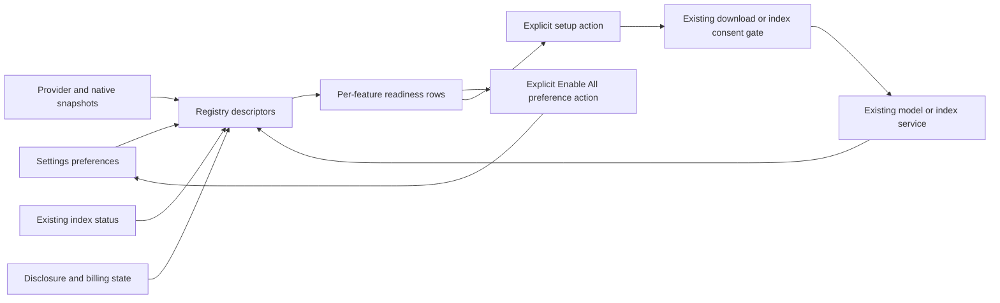

## Context

See proposal and [baseline audit](../../planning/ai-learning-completion-audit.md). Existing `useAiAvailability` answers a coarse prompt/image requirement; provider capabilities, native model panels and `AiIndexPanel` already own their domains. The new registry composes them and must not replace them.

## Goals / Non-Goals

**Goals:** one feature vocabulary, actionable dependency status, safe activation, accurate restart recovery. **Non-goals:** a second provider router, persistent readiness truth, background setup caused by flags, or changes to scheduler/review semantics.

## Decisions

### Registry and state ownership

Proposed `src/lib/ai/features/types.ts`, `registry.ts`, `useFeatureReadiness.ts` expose the [program contracts](../../planning/ai-learning-completion-program.md#shared-contracts-and-ownership). F0 is task 1.1. A descriptor has `{id, flagKeys, operations, dependencyChecks, recoveryTargets}`. It reads Zustand preferences and existing provider/index/model services. An operation can be ready while another is degraded. No duplicate flags/readiness store; mounted consumers share one bounded read-only probe cache keyed by provider/settings/native/index revision.

Dependency priority for displayed state: disabled preference → no permitted platform route → unresolved setup/consent → explicit downloadable model → index-building when required → typed error → ready. Preserve all blockers in `dependencies[]` even when one state is primary. Probe-in-flight renders “Checking” in the view while retaining the last checked timestamp, never a green optimistic state. Index not present is a lexical degradation for RAG/relationships, not automatic total unavailability. A required citation/anchor capability can still block a particular operation.

| Feature ID | Flags / dependencies and honest degradation |
|---|---|
| learn-this | `aiLearnThis`; generation + source + validation + learning writers; no embeddings required |
| library-rag | `aiLibraryRag`; retrieval + generation; lexical fallback labeled; indexing recovery optional |
| socratic-tutor | `aiSocraticTutor`; generation, reasoning/full fallback, grounded source; retrieval refresh may degrade |
| occlusion-assist | `aiOcclusionAssist`; OCR + generation + composer; freeform vision separately checks `aiOcclusionFreeform` |
| semantic-index | `aiSemanticIndex`; source chunking, selected embedding backend/model and paid-embedding consent; lexical cache is not semantic readiness |
| answer-assessment | `aiAnswerAssessment`; generation, validator, assessment recording; no scheduler write dependency |
| knowledge-relationships | independent `aiPrerequisites` / `aiConceptLinks`; prerequisite inference, evidence retrieval, concepts/link commands; show suboperation readiness |
| extract-worthiness | `aiExtractWorthiness`; supported passage adapter, fast generation/cache and separate background authorization |
| learning-agent | `aiAgent`; generation, scoped read tools, existing preview/writers; concept-link tool optional until adapter exists |
| active-recall | `aiActiveRecall` plus `ai.activeRecallMode`; eligibility policy, generation/history; preserve intentional mode=off |

Provider/backend readiness is detected independently for generation, embeddings and OCR. Resolve the actual selected endpoint with the existing registry and destination helpers, not `kind === cloud`. Linux Ollama, conditional Android models, Windows API/package/LAF states and Apple generation/embedding availability must each remain distinct. Native unsupported status does not make a feature platform-unavailable if an explicitly authorized configured provider can serve it.

F0 owns a shared classification adapter over existing URL/provider helpers: `keyless`, `billable` and `sendsOffDevice` are separate values. Only a verified process-local/native or loopback destination can be automatically treated as on-device; a remote Ollama URL or LAN `.local` name requires off-device disclosure even when keyless/free. Keep existing authentication behavior intact while correcting privacy decisions at the new feature boundary. Tests must include keyless remote and same-provider changed-endpoint cases.

### Execution flow and side-effect boundary

Mount/probe/Enable All cannot infer, download or enqueue. Enable All changes supported main feature preferences in one settings update, returns per-feature enabled/needs-setup/unsupported outcomes, and displays “N ready; M need setup” rather than success by count of booleans. The deliberate Enable All click may change the listed main feature flags; it cannot alter provider selection, cloud fallback, freeform vision, active-recall mode, paid embeddings, charging preferences or consent. Unsupported flags retain their old preference and show a limitation. Expose prerequisites and links separately so toggling one no longer silently changes the other.

Setup recovery actions are typed routes to existing controls, not stored closures. Model downloads require a new explicit click and existing native confirmation; bulk indexing uses `AiIndexPanel` preflight/estimate/charging controls. Setting navigation alone never runs either. Probe APIs must be inspected for lazy runtime registration/download side effects; wrap with a read-only status path if needed, never treat “probe” as authorization for provisioning.

### Persistence and migrations

`settingsStore.ts` remains authoritative. Merge missing keys through its current migration pattern, preserve explicit false values with presence checks (never `old || default`). Keep the current default flags for compatibility, while separating them from workload authorization. No persisted computed-ready value. Existing index/model services own resumable state; on restart re-query them, detect incomplete/failed setup and offer resume. Authorization is scoped to existing disclosure/billing stores and operation scope, never serialized in the readiness cache.

### Concurrency, cancellation and errors

One shared probe per dependency revision, no polling inference. Coalesce status requests and use the existing index polling cadence only while visible. Discard superseded results after provider/settings changes and unsubscribe on unmount. Setup actions are single-flight with explicit progress/cancel from owning services. Errors map to safe dependency/recovery codes; unavailable status is not an exception storm. Resolve again before execution so revoked consent or a replaced provider cannot use stale readiness.

### Settings search and accessibility

Reuse `ai.learningFeatures`, existing feature target IDs, and `embeddings.index`. Proposed new targets: `ai.enableAll`, `ai.featureReadiness`, `ai.conceptLinks`; diagnostics owner coordinates `ai.diagnostics`. Register rows/groups and reveal targets in `settingsSearchCatalog.ts` / `settingsSearchCoverage.ts`. Follow `docs/settings-search.md`: reveal only opens UI, never setup, and indexes no endpoints/keys/library content. Localize status/recovery copy and announce activation summary without relying on badge color.

## Risks / Trade-offs

- Broad defaults may look active → dependency status and workload authorization are separate visible concepts.
- A native snapshot is stale quickly → short-lived revision-bound cache and execution preflight.
- Existing observers might enqueue on flag changes → audit all `aiSemanticIndex` consumers and remove that implicit activation side effect only where required, retaining explicit authorized index lifecycle.
- A required library-wide setup can be costly → offer optional degraded mode and exact explicit setup route.

## Migration Plan

Land F0/types first, adapt feature consumers incrementally, then activation UI and search. Add presence-aware settings migration tests before touching defaults. Rollback UI wiring without deleting user settings or index/model data; ignore additive derived metadata. No database migration is planned.

## Alternatives considered and rejected

A second provider/readiness store would drift from existing routing, so descriptors derive from current stores/services. Auto-downloading or backfilling on Enable All would conflate preference and authorization, so setup remains explicit. Resetting all legacy flags to false would overwrite user intent, so retain defaults and make readiness/workload consent independent. A platform name whitelist cannot replace live model/API status.

## Validation strategy

Unit: every dependency/status combination, independent subflags, absent vs false settings. Component: fresh/upgraded/unsupported/partial activation, keyboard recovery, restart state. Integration: real registry consuming fake platform probes and existing index/model APIs; assert mounting/Enable All makes zero inference/download/enqueue calls. Privacy: denial/revocation and remote endpoint changes. E2E: partial activation → explicit setup → progress → ready → restart re-probe. Platform: snapshot fixtures for all five OS families plus actual setup in cross-platform qualification. Backend index behavior is reused and regression-tested, not reimplemented.
