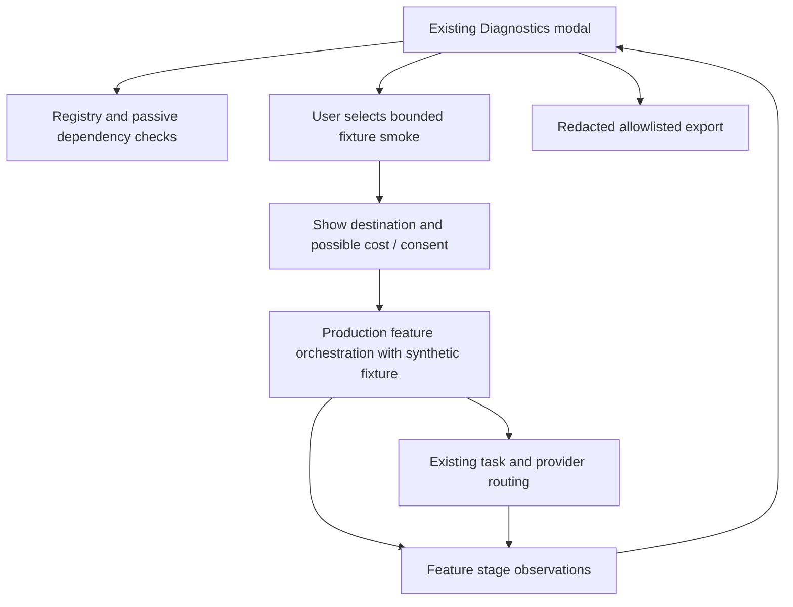

## Context

Extend `AIDiagnosticsModal`, `diagnostics.ts`, existing task diagnostics and `agent/trace.ts`. The current 50-entry task ring is privacy-conscious but not feature completion evidence. The Android hardware cards and compiled-output badge cannot stand in for model execution.

## Goals / Non-Goals

**Goals:** per-feature dependency/recovery explanation; explicit evidence level; safe bounded production-path smoke tests; useful redacted reports. **Non-goals:** another logging stack, permanent execution history, private-document diagnostics, implicit paid inference or in-app smoke writes to the user's learning collection.

## Decisions

### Shared observation and state ownership

Task 1.1 (D0) extends `src/lib/ai/diagnostics.ts` with the `FeatureObservation` contract from the program. Optional metadata flows through `tasks/types.ts` / `runTask.ts`; feature entry/handoff/save owners supply stages outside generation. Existing task fields remain backward compatible. Store a bounded summary for the ten registry features (last known success/error and last smoke result per capability revision) alongside the existing task ring. Do not create another general event store. Clear/reset clears these together. History is explicitly session-local; after restart show “No execution observed this session”.

Display all nine requested capability groups and active recall, even when disabled/unavailable: enabled preference, required dependencies, actual generation/OCR/embedding route, model readiness, readiness blockers, last known success/error/time, evidence level/freshness and recovery. Knowledge shows prerequisite/link substatus. Configuration/provider revision changes stale previous operational evidence. Success at generation does not mean preview, persistence or navigation succeeded; show stage outcomes independently and derive overall workflow success only when all applicable required stages finish.

Status hierarchy: **static** (adapter/configuration known), **dependency** (live required services available), **operational** (bounded real path observed), with `not-run`, `running`, `passed`, `failed`, `cancelled`, `stale`, `unsupported`, `consent-required` smoke states. Operational applies only to the exact stages/route/model revision exercised. Replace the current green compiled badge with clearly labeled static validation. Unknown last error is unknown, not “never failed”.

### Smoke adapters and safe execution

Proposed `src/lib/ai/diagnostics/featureSmoke.ts` (directory may coexist with existing `diagnostics.ts`) holds small adapters, not separate AI prompts/pipelines. Each adapter calls the production feature orchestrator/hook boundary with controlled fixtures and existing dependency injection. It declares `{featureId, stages, fixtureId, maxDurationMs, destinations, mutatesUserData:false}`. If a feature has no production adapter yet, report static/dependency only. Do not fake operational success with a helper-only schema test.

| Feature | Controlled smoke / scope of evidence |
|---|---|
| Learn this | Synthetic definition → real task/validation → static preview payload; no acceptance; persistence explicitly untested in app |
| Ask Library | Fixed synthetic retrieval fixture passed through production retrieval/answer orchestration → resolvable citations; real index read checks separately labeled; no personal search |
| Tutor | Synthetic concept → real session turn → one hint/explain policy transition; no private history |
| Occlusion assist | Bundled diagram bytes → existing OCR → validated label proposals and preview; no created regions/cards in library |
| Semantic indexing | In-app status/model availability only; real index/persistence smoke runs in dedicated synthetic-library test profile via existing harness, never auto-backfills user's library |
| Assessment | Fixed question/answer → real assessment validator/payload; never submits rating or changes review state |
| Knowledge | Fixed library evidence adapter → prerequisite/coverage/link draft; in-app verifies inference/coverage stages; actual Rust lifecycle tested separately in disposable fixture repository |
| Worthiness | Mounted controlled passage fixture → production scheduler/cache adapter → validated classification/indicator; fixture-only cache namespace, no private passage sampling |
| Agent | Existing Assistant run adapter with fixed scoped environment + real selected provider → progress and grounded drafts; no accept/write |
| Active recall | Fixed encountered passage and eligibility clock → production recall orchestration → prompt/answer fixture; no production history entry |

Fixture retrieval/record adapters must be prominently labeled fixture-backed, never proof that the real library/index backend worked. Real storage/citation navigation is qualified by integration and device tests in an isolated profile using the existing `ai_learning::test_support`/repository setup. In-app smoke does not swap a global repository or redirect ongoing user requests. If injection cannot be made safely at an existing boundary, do not implement a production alternate database; report that stage “requires isolated-profile test”.

Run one smoke at a time, with per-adapter timeout ≤60s (agent inherits its hard deadline), at most one inference repair as existing task policy permits; Stop aborts and suppresses late output. “Run selected” is explicit and displays finite maximum calls/cost uncertainty for the selected cases; no automatic “run all” on opening, refresh, enable or export. No model download/initialization during a check. Source fixtures are bundled, non-personal and excluded from user conversations/sync. Request disclosure/cost authorization even for fixtures when a remote/billable destination is selected; denial means skipped/consent-required, not passed. Never silently fallback to an unapproved destination.

### Privacy-safe recording and export

Keep actual draft/source text in ordinary feature UI state only. `recordTaskDiagnostic` continues to copy allowlisted fields; feature observations contain enum-like safe values and counts/durations. Export builds a new schema-versioned object, not `JSON.stringify` of stores. Allow: app/build/platform family, feature ID/enabled/status, normalized provider class (`android-nano`, `apple-native`, `windows-system`, `foundry-local`, `ollama-local`, `configured-external`), model class, capability hashes, stages/outcomes/error/recovery codes, aggregate durations/counts, evidence level/freshness and sanitized fixture IDs.

Exclude: source text/titles/IDs/paths, raw prompts/completions, user/provider display names, endpoint URLs, model paths or arbitrary configured model strings, API keys/auth/cookies, stack traces, raw exceptions, image bytes, data URLs and argument digests that could fingerprint private content. Existing task diagnostics may hold chunk IDs/model/provider strings; export omits or maps them through a finite allowlist. Error strings can contain source or credentials: normalize by category, never regex-redact and hope. A local preview of exported fields and explicit download action precede creating a report; no network upload. Export has ≤50 task entries plus bounded feature summaries; cap output size (proposed 256 KiB), truncate old detail with a visible note, never truncate secrets into accidental retention.

### Recovery and Settings search

Use F0 typed recovery routes to existing provider/model/OCR/index controls. Recovery navigation never starts inference/download/indexing; actual action retains existing confirmation. Proposed targets `ai.diagnostics`, `ai.diagnostics.smoke`, `ai.diagnostics.export` use reveal-only handlers, catalog/coverage and keyboard tests under Settings search conventions. Keep details accessible on narrow screens and label evidence levels in text, not green/red alone.

## Risks / Trade-offs

- Fixture success can overstate backend readiness → list exact exercised stages and fixture boundaries; storage evidence requires isolated profile.
- Instrumentation can leak values despite field allowlist → finite export value mapping and recursive canary tests.
- Old success remains green after model/provider change → capability revision invalidates current evidence, history remains labeled stale.
- Smoke test itself competes with user work → single-flight, foreground explicit request, finite timeout, cancellation and no background warm-up.

## Migration Plan

No database migration or persistent event history. Extend optional metadata with old callers supported. Land D0 first; add feature adapters as their production paths land; replace modal view last. Rollback disables smoke/export UI while existing task diagnostics remain valid. Diagnostic teardown must not cancel unrelated user feature runs.

## Platform variations and alternatives

Use actual platform provider/model/OCR/embedding snapshots, not Android labels for all devices. Desktop local endpoints, conditional Windows APIs and Apple native models have distinct dependency reasons; fixtures still require actual selected-model execution for operational evidence. Mobile backgrounding cancels smoke and teardown never resumes it automatically.

A separate diagnostic database/collector was rejected in favor of the current bounded rings. Personal-library smoke tests and automatic cloud probes were rejected for privacy/cost. Whole-store export with regex redaction was rejected because unknown fields/string values can leak; rebuild reports from finite allowlisted values instead.

## Validation strategy

Unit: feature-stage aggregation, revision invalidation, session reset, bounds, safe error/provider mapping. Component: all feature rows, dependency/recovery details, static vs dependency vs operational labels, explicit smoke/Stop/export. Integration: invoke adapters through actual production entry boundary with synthetic data, assert absent adapter cannot pass; observe preview/persistence errors after successful generation. Backend: isolated fixture profile storage and cleanup tests belong to feature/release suites; in-app smoke never writes learning objects. Security/privacy: recursive credential/content/path/endpoint canaries, HTML in error/model values, denied remote consent and no personal search. E2E: open idle → zero inference → explicitly run one case → show scope/result → export redacted report; restart unknown. Native: real selected routes on qualified hardware, not only fake providers.
