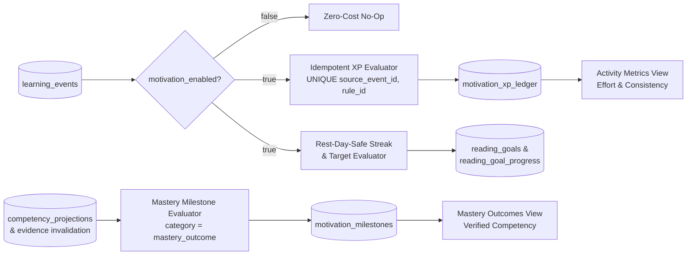

# Design: Optional Motivational Systems

## Context

Plethora's existing `src-tauri/src/commands/reading_goals.rs` contains unimplemented `TODO` stubs, and the current UI lacks a principled separation between **activity/effort** (time spent, cards reviewed, streaks, XP) and **mastery outcomes** (verified comprehension, retention, application, transfer). This design implements humane, opt-in, independently disableable motivational systems backed by SQLite migration `173_coach_and_motivation_systems`.

## Goals / Non-Goals

### Goals
- Persist daily/weekly targets, rest-day-safe streaks, idempotent XP ledger entries, and milestones in SQLite.
- Replace all `TODO` stubs in `src-tauri/src/commands/reading_goals.rs` while keeping existing frontend callers compatible.
- Enforce strict mathematical and UI separation between activity metrics (XP/streaks/minutes) and mastery outcomes (verified `competency_projections`).
- Allow every motivational component (targets, streaks, XP, milestones, celebrations) to be disabled independently or globally with zero background overhead.
- Register every motivation setting in Settings Search (`settingsSearchCatalog.ts` & `settingsSearchCoverage.ts`).

### Non-Goals
- Gamified coercion, punitive streak resets, leaderboards, or modifying FSRS/competency calculations from XP.

## Architecture Overview



## Data Model (Migration `173_coach_and_motivation_systems`)

Coordinated with `implement-personal-learning-coach` inside `173_coach_and_motivation_systems.sql`:

```sql
CREATE TABLE IF NOT EXISTS motivation_preferences (
    id TEXT PRIMARY KEY DEFAULT 'default',
    motivation_enabled INTEGER NOT NULL DEFAULT 1,
    targets_enabled INTEGER NOT NULL DEFAULT 1,
    streaks_enabled INTEGER NOT NULL DEFAULT 1,
    xp_enabled INTEGER NOT NULL DEFAULT 0, -- opt-in by default
    milestones_enabled INTEGER NOT NULL DEFAULT 1,
    celebrations_enabled INTEGER NOT NULL DEFAULT 0,
    daily_minutes_target INTEGER NOT NULL DEFAULT 20,
    weekly_minutes_target INTEGER NOT NULL DEFAULT 120,
    rest_days_mask INTEGER NOT NULL DEFAULT 0, -- bitmask: bit 0=Sun .. bit 6=Sat
    streak_grace_days_per_week INTEGER NOT NULL DEFAULT 1,
    updated_at TEXT NOT NULL
);

CREATE TABLE IF NOT EXISTS motivation_xp_ledger (
    id TEXT PRIMARY KEY,
    source_event_id TEXT NOT NULL,
    rule_id TEXT NOT NULL,
    xp_amount INTEGER NOT NULL CHECK (xp_amount >= 0),
    category TEXT NOT NULL CHECK (category IN ('reading', 'recall', 'practice', 'assessment', 'synthesis', 'consistency')),
    awarded_at TEXT NOT NULL,
    UNIQUE (source_event_id, rule_id)
);

CREATE INDEX IF NOT EXISTS idx_motivation_xp_awarded_at
    ON motivation_xp_ledger(awarded_at DESC);

CREATE TABLE IF NOT EXISTS motivation_milestones (
    id TEXT PRIMARY KEY,
    milestone_key TEXT NOT NULL UNIQUE,
    category TEXT NOT NULL CHECK (category IN ('consistency', 'activity', 'mastery_outcome')),
    title TEXT NOT NULL,
    description TEXT NOT NULL,
    evidence_ref_id TEXT,
    achieved_at TEXT NOT NULL,
    revoked_at TEXT
);

CREATE TABLE IF NOT EXISTS reading_goals (
    id TEXT PRIMARY KEY,
    goal_type TEXT NOT NULL CHECK (goal_type IN ('daily_minutes', 'daily_pages', 'weekly_minutes')),
    target_value INTEGER NOT NULL CHECK (target_value > 0),
    is_active INTEGER NOT NULL DEFAULT 1,
    created_at TEXT NOT NULL,
    modified_at TEXT NOT NULL
);

CREATE TABLE IF NOT EXISTS reading_goal_progress (
    id TEXT PRIMARY KEY,
    goal_id TEXT NOT NULL REFERENCES reading_goals(id) ON DELETE CASCADE,
    date TEXT NOT NULL, -- YYYY-MM-DD local
    current_value REAL NOT NULL DEFAULT 0.0,
    is_completed INTEGER NOT NULL DEFAULT 0,
    updated_at TEXT NOT NULL,
    UNIQUE (goal_id, date)
);
```

## Rest-Day-Safe Streak Algorithm

Streak evaluation iterates backward from the learner's local date over daily activity rollups (`learning_events` + `reading_goal_progress`):
1. **Active Day:** Meets daily threshold (at least 1 completed learning event or target progress > 0) → increments `current_streak`.
2. **Planned Rest Day:** Day-of-week bit is set in `rest_days_mask` → bridges streak without incrementing or breaking it.
3. **Grace Day:** Unplanned missed day within `streak_grace_days_per_week` budget for that ISO week → bridges streak without breaking it, with neutral supportive status ("Rest / grace day used").
4. **Reset:** Only breaks when an unplanned non-rest day exceeds the weekly grace budget. UI copy is strictly neutral ("Ready for a fresh start") — never guilt-inducing.

## Idempotent XP & Activity-vs-Outcome Separation

- **Strict Idempotency:** XP rules map canonical `learning_events` (`event_id`, `activity_type`, `duration_ms`, `completed`) to bounded XP awards inserted via `INSERT OR IGNORE INTO motivation_xp_ledger (...)`. Replaying events during crash recovery (Scenario K) or Sync v2 merge produces **zero** duplicate XP.
- **Hard Boundary Against Mastery Inflation:**
  - `motivation_xp_ledger` and `reading_goal_progress` are NEVER read by `competency_projections`, FSRS-7, or Study Plan mastery checks.
  - Milestones carry an explicit `category`: `activity` / `consistency` milestones vs `mastery_outcome` milestones.
  - When a `competency_evidence` record is invalidated or an exam is regraded downward (Scenario O), affected `mastery_outcome` milestones are marked with `revoked_at = now()` while historical `activity` XP entries remain intact (effort happened; mastery changed).
- **UI Presentation:** The Insights / Today motivation card renders **Effort & Consistency** (minutes, rest-day-safe streak, optional XP) in a clearly distinct visual band from **Verified Mastery Outcomes** (concepts mastered, exams passed).

## Settings Search Coverage

Every new Settings control under `Settings > Motivation & Targets` MUST expose a stable `searchId` and register in `settingsSearchCatalog.ts` & `settingsSearchCoverage.ts`:
- `motivation.section`
- `motivation.enabled` (master toggle)
- `motivation.targetsEnabled` & `motivation.dailyWeeklyTargets`
- `motivation.streaksEnabled` & `motivation.restDays` & `motivation.streakGraceDays`
- `motivation.xpEnabled`
- `motivation.milestonesEnabled`
- `motivation.celebrationsEnabled`

## Verification Strategy

- **Rust Unit Tests:** Rest-day bitmask & grace-day streak calculation, `UNIQUE(source_event_id, rule_id)` XP idempotency under replay, mastery milestone revocation on evidence invalidation, and real SQLite tests for all `reading_goals.rs` commands.
- **TypeScript Tests:** Independent toggle hiding (`motivation_enabled`, `xp_enabled`, `streaks_enabled`), zero-overhead disabled mode, activity-vs-outcome UI separation, and Settings Search coverage verification.
