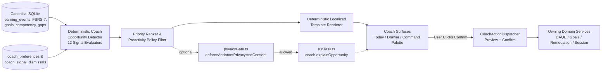

# Design: Personal Learning Coach

## Context

Plethora aggregates rich longitudinal learning telemetry locally in SQLite (`learning_events`, `review_results`, `learning_goals`, `study_plans`, `competency_projections`, `learning_gaps`, `learning_remediations`, `learning_sessions`). Today, learners must manually synthesize these signals across multiple views. This design defines a deterministic, local-first **Personal Learning Coach** that turns those signals into transparent, non-coercive, user-confirmed advisories while keeping AI strictly optional and privacy-gated.

## Goals / Non-Goals

### Goals
- Detect 12 canonical coaching opportunities deterministically with reproducible scoring, evidence citations, and zero AI requirement.
- Support 5 explicit proactivity levels (`disabled`, `on_demand`, `minimal`, `balanced`, `proactive`) with quiet hours, cooldowns, and per-signal dismissal/snooze.
- Optionally generate natural-language explanations via `src/lib/ai/tasks/runTask.ts` gated by `enforceAssistantPrivacyAndConsent`.
- Enforce a strict non-mutating architectural boundary: recommendations propose typed actions that require explicit user confirmation and delegate execution to owning domain services.
- Register every coaching setting in Plethora's Settings Search catalog and coverage inventory.

### Non-Goals
- Direct database writes to FSRS schedules, Study Plans, Learning Goals, or Competency Evidence from within the Coach module.
- Background polling loops when `proactivity_level === 'disabled'`.
- Reading raw records from the isolated Health Vault (`health/health.db`).

## Architecture Overview



## Deterministic Opportunity Detector (12 Signal Types)

Each signal evaluator is a pure function `(CoachSignalSnapshot, CoachPreferences) -> Option<CoachSignalCandidate>` returning a deterministic `signalType`, `severity` (`info` | `advisory` | `urgent`), `confidence` (`0.0..=1.0`), `dedupeKey`, `evidenceRefs` (IDs of goals, concepts, items, or sessions), deterministic template parameters, and a typed `CoachProposedAction`.

| # | Signal Type | Trigger Condition (Deterministic) | Default Severity | Proposed Action |
|---|---|---|---|---|
| 1 | `review_backlog_overload` | Overdue FSRS-7 items exceed `2.0x` rolling 14-day daily throughput (or configured cap) | `urgent` | `open_session_profile("backlog_triage")` |
| 2 | `deadline_slippage_risk` | Active goal with `target_date` has remaining estimated effort > `1.25x` available time at recent pace | `urgent` | `adjust_goal_pace` or `launch_goal_focus_session` |
| 3 | `mastery_gap_detected` | Unresolved `learning_gaps` row on a core/prerequisite concept after failed assessment | `advisory` | `schedule_remediation` |
| 4 | `leech_or_high_lapse_cluster` | >= 3 items sharing a concept/document exceed lapse threshold (`lapses >= 5`) within 14 days | `advisory` | `open_study_mode_conceptual_review` |
| 5 | `passive_reading_imbalance` | High reading exposure (`>= 120 min` over 7 days) with `< 5%` active extraction/formative/review events | `info` | `launch_active_recall_check` |
| 6 | `prerequisite_readiness_block` | Learner queued/started a curriculum node whose typed prerequisite has unverified or failing competency | `advisory` | `review_prerequisite_node` |
| 7 | `stale_goal_momentum` | Active non-paused goal has zero `learning_events` for `>= 7` days (excluding planned rest days) | `info` | `launch_short_restart_session` |
| 8 | `remediation_loop_stall` | Concept has `>= 2` completed remediation attempts without measurable dimension improvement | `urgent` | `switch_remediation_modality` |
| 9 | `cross_dimension_mismatch` | Concept has strong `exposure`/`retention` (`>= 0.75`) but weak `application` or `transfer` (`< 0.45`) | `info` | `launch_application_activity` |
| 10 | `session_fatigue_or_fragmentation` | `>= 3` consecutive sessions abandoned within `< 20%` of target budget, or single block `> 90 min` with falling accuracy | `info` | `suggest_shorter_timebox` |
| 11 | `exploration_ready_for_structure` | `>= 4` exploratory reading / Smart Feed events clustered on one topic tag/concept within 14 days without an active goal | `info` | `promote_topic_to_goal` |
| 12 | `prior_evidence_skip_opportunity` | Newly added/active Study Plan contains nodes whose concepts already meet mastery threshold from prior evidence | `info` | `offer_fast_track_skip` |

### Scoring & Deduplication
- `rankScore = severityWeight * 0.5 + confidence * 0.3 + recencyUrgency * 0.2`.
- Candidates whose `(signal_type, dedupe_key)` are currently snoozed, dismissed, or within per-signal cooldown are filtered out deterministically.
- Evaluation is keyed to the monotonic `learning_events` max sequence ID + `coach_preferences.updated_at` so unchanged snapshots return cached results in `< 1 ms`.

## 5 Proactivity Levels

| Level | Auto-Detection | Surfaces Shown | Max Active Cards | Cooldown Multiplier |
|---|---|---|---|---|
| `disabled` | Never (zero queries, zero AI) | None (hidden everywhere) | 0 | N/A |
| `on_demand` | Only on explicit user invocation | Coach Drawer / Command Palette | Up to 5 on request | 1.0x |
| `minimal` | On Today load / session end | Today workspace (`urgent` only) | 1 | 2.0x |
| `balanced` | On Today load / session end | Today workspace + post-session summary (`urgent` + `advisory`) | 2 | 1.0x |
| `proactive` | Today, Queue, Study Mode transitions | Today, Queue banner, post-session, Study Mode footer (all severities) | 3 (respecting quiet hours) | 0.5x |

Quiet hours (`quiet_hours_start`, `quiet_hours_end`, local timezone) suppress non-`on_demand` banners during the configured window.

## AI-Optional Explanation Layer

- **Zero-AI Baseline:** Every signal ships with localized i18n copy templates (`src/locales/*/coach.json`) that interpolate concrete deterministic metrics (e.g., overdue count, goal days remaining, concept name, lapse count). The Coach is 100% functional with no AI provider configured.
- **Optional AI Enrichment:** When `ai_explanations_enabled` is true and a provider is available, the user (or `balanced`/`proactive` card expansion) may request an AI explanation via a registered `AITaskDefinition` (`coach.explainOpportunity`) executed through `src/lib/ai/tasks/runTask.ts` (`modelClass: "fast"`).
- **Privacy Gate:** Before calling `runTask`, `enforceAssistantPrivacyAndConsent` (`src/lib/ai/assistant/privacyGate.ts`) is invoked with all referenced documents (`isLocalOnly`, `isAiExcluded`). If blocked or declined, the UI silently uses the deterministic template and displays a non-intrusive badge ("Local deterministic summary").
- **Structured Output:** AI explanations return strict JSON (`{ rationale: string, suggestedNextStep: string, caveats?: string }`) validated by `runTask`'s schema pipeline; the AI cannot alter `proposedAction` parameters or `evidenceRefs`.

## Non-Mutating Architectural Boundary

The Coach owns **zero** write access to canonical learning domain tables:
- Allowed writes: `coach_preferences`, `coach_recommendations`, `coach_signal_dismissals`.
- Forbidden writes: `review_results`, `learning_items`, `learning_events`, `learning_goals`, `study_plans`, `competency_evidence`, `learning_remediations`.
- When the user clicks a recommendation CTA, `CoachActionDispatcher` displays an inline or modal preview describing the exact effect (e.g., "Launch a 15-minute Backlog Triage session with DAQE profile `backlog_triage`") and only upon explicit confirmation invokes the owning service API (e.g., `sessionRuntime.startSession(...)`, `goalService.promoteTopic(...)`).

## Data Model (Migration `173_coach_and_motivation_systems`)

Migration `173_coach_and_motivation_systems.sql` (shared with `implement-optional-motivational-systems`) adds:

```sql
CREATE TABLE IF NOT EXISTS coach_preferences (
    id TEXT PRIMARY KEY DEFAULT 'default',
    proactivity_level TEXT NOT NULL DEFAULT 'balanced'
        CHECK (proactivity_level IN ('disabled', 'on_demand', 'minimal', 'balanced', 'proactive')),
    ai_explanations_enabled INTEGER NOT NULL DEFAULT 0,
    quiet_hours_enabled INTEGER NOT NULL DEFAULT 0,
    quiet_hours_start TEXT, -- HH:MM local
    quiet_hours_end TEXT,   -- HH:MM local
    disabled_signals_json TEXT NOT NULL DEFAULT '[]',
    updated_at TEXT NOT NULL
);

CREATE TABLE IF NOT EXISTS coach_recommendations (
    id TEXT PRIMARY KEY,
    signal_type TEXT NOT NULL,
    dedupe_key TEXT NOT NULL,
    severity TEXT NOT NULL CHECK (severity IN ('info', 'advisory', 'urgent')),
    confidence REAL NOT NULL,
    evidence_refs_json TEXT NOT NULL,
    proposed_action_json TEXT NOT NULL,
    deterministic_summary_json TEXT NOT NULL,
    ai_explanation_json TEXT,
    status TEXT NOT NULL DEFAULT 'active'
        CHECK (status IN ('active', 'accepted', 'dismissed', 'snoozed', 'expired')),
    snooze_until TEXT,
    created_at TEXT NOT NULL,
    updated_at TEXT NOT NULL
);

CREATE INDEX IF NOT EXISTS idx_coach_recs_status_created
    ON coach_recommendations(status, created_at DESC);

CREATE TABLE IF NOT EXISTS coach_signal_dismissals (
    signal_type TEXT NOT NULL,
    dedupe_key TEXT NOT NULL,
    dismissed_at TEXT NOT NULL,
    cooldown_until TEXT,
    reason TEXT,
    PRIMARY KEY (signal_type, dedupe_key)
);
```

## Settings Search Coverage

Every new Settings control under `Settings > Learning Coach` MUST have:
- Stable `searchId` targets: `coach.section`, `coach.proactivityLevel`, `coach.aiExplanations`, `coach.quietHours`, `coach.signalToggles`.
- Entries in `src/components/settings/search/settingsSearchCatalog.ts` using localized translation keys and concise aliases (`coach`, `proactivity`, `nudges`, `quiet hours`, `learning advisor`).
- Inventory rows in `src/components/settings/search/settingsSearchCoverage.ts` and verification in `settingsSearchCoverage.test.ts`.

## Verification Strategy

- **Rust Unit Tests:** Determinism tests for all 12 signal evaluators, cooldown/dismissal filtering, quiet-hours suppression, and migration `173` schema/constraint tests.
- **TypeScript Unit & Integration Tests:** `CoachActionDispatcher` non-mutating confirmation tests, `privacyGate` fallback tests for `isLocalOnly`/`isAiExcluded` documents, zero-AI rendering tests, and `disabled` mode zero-query/zero-AI tests.
- **Performance Benchmark:** `src/lib/coach/detector.bench.ts` using `seededRandom(seed)` from `src/test/bench-support.ts` verifying `< 50 ms` on 10,000 items / 50,000 events.
