# Technical Design: Local-First Podcast Ad Removal, Chapter Navigation & Integrated Transcripts

## Context

See `proposal.md` for motivation and `research.md` for codebase audit findings and Podly comparative analysis. Plethora requires an on-device, non-destructive advertisement detection and skip architecture integrated with its existing unified speech-to-text pipeline, global audio controller, and learning ecosystem.

---

## Goals / Non-Goals

### Goals
- **Eliminate Audible Ad Leakage**: Automatically bypass detected podcast advertisements before decoded audio frames reach output hardware.
- **Respect User's STT Engine**: Use the user's configured STT engine (Cactus Whistle with Needle, Parakeet with sherpa-onnx, Whisper with whisper.cpp, Android on-device STT, or explicit cloud provider) without hardcoding or duplicate transcription.
- **First-Class Chapters**: Parse, persist, and navigate Podcasting 2.0, Podlove, ID3 `CHAP`, and description chapters.
- **Permanent Transcript Ownership**: Associate every generated transcript permanently with its episode, enabling synchronized karaoke highlighting, in-transcript searching, and Incremental Reading extracts.
- **Mobile Energy Stewardship**: Replace mobile battery placeholders with real Android and iOS power, thermal, and task-scheduling signals, defaulting to zero heavy background compute on battery.
- **Non-Destructive Playback**: Keep original audio intact. All skips, overrides, and chapter divisions operate on original media coordinates.

### Non-Goals
- **No Audio Re-encoding / Transcoding**: Plethora will not cut and re-encode podcast media with FFmpeg as Podly does.
- **No Mandatory Cloud Backend or Subscription**: All core functionality functions entirely offline on supported local models.
- **No Automatic Ad Re-Classification on Redundant Triggers**: Completed transcripts and skip maps are reused without reprocessing unless media hash changes.

---

## System Architecture

```mermaid
graph TD
    subgraph "1. Feed & Ingestion"
        RSS[Podcast RSS Feed] --> Parser[src-tauri podcast/parser.rs]
        Parser --> EpisodesDB[(SQLite: podcast_episodes)]
        Parser --> ExtChapters[External JSON / Podlove]
        ExtChapters --> ChapterRepo[(SQLite: podcast_chapters)]
    end

    subgraph "2. Multi-Stage Ad Pipeline"
        MetadataCheck[Stage A: Metadata & Chapter Classifier] -->|Ad Chapters Found| SkipGen[Skip Interval Generator]
        MetadataCheck -->|Need Semantic Analysis| PolicyGate{Policy & Mobile Battery Gate}
        PolicyGate -->|AC Power / Allowed| STTResolver[Unified STT Resolver]
        STTResolver --> STTEngine[Whistle / Parakeet / Whisper / Android STT]
        STTEngine --> TranscriptsDB[(SQLite: podcast_transcript_segments)]
        TranscriptsDB --> SemanticClassifier[Stage D: Local Instruct Classifier]
        SemanticClassifier --> Refiner[Stage F: Silence & Word Boundary Refiner]
        Refiner --> Merger[Stage G: Interval Merger & Validator]
        Merger --> SkipDB[(SQLite: podcast_ad_intervals)]
    end

    subgraph "3. Playback & Controller"
        SkipDB --> Resolver[audioSourceResolver.ts]
        Resolver --> GlobalAudio[GlobalAudioController]
        GlobalAudio --> PreemptiveSeek[Preemptive Lookahead & Mute Guard]
        PreemptiveSeek --> AudioEngine[HtmlAudioEngine / Media Session]
    end

    subgraph "4. User Experience & Study"
        ChapterRepo --> ChapterSheet[Adaptive Chapter Drawer]
        TranscriptsDB --> TranscriptView[TranscriptSync View]
        TranscriptView --> FilterToggle[Clean / Verbatim View Toggle]
        TranscriptView --> Extracts[Extracts & Flashcards]
        GlobalAudio --> UndoToast[Undo / Replay Ad Toast]
        UndoToast --> CorrectionDB[(SQLite: podcast_ad_corrections)]
    end
```



---

## Database Architecture & SQLite Migrations

A new migration (`138_podcast_chapters_and_ad_intervals`) extends the database schema.

### SQL Migration Definition

```sql
-- Migration 138: Podcast chapters, ad intervals, processing jobs, and policies

-- 1. Podcast Chapters
CREATE TABLE IF NOT EXISTS podcast_chapters (
    id TEXT PRIMARY KEY,
    episode_id TEXT NOT NULL REFERENCES podcast_episodes(id) ON DELETE CASCADE,
    chapter_index INTEGER NOT NULL,
    title TEXT NOT NULL,
    start_ms INTEGER NOT NULL,
    end_ms INTEGER NOT NULL,
    image_url TEXT,
    link_url TEXT,
    source TEXT NOT NULL CHECK (source IN ('podcast20_json', 'podlove_xml', 'id3_chap', 'description_timestamp', 'generated')),
    is_advertisement INTEGER NOT NULL DEFAULT 0,
    created_at TEXT NOT NULL DEFAULT (datetime('now')),
    UNIQUE(episode_id, chapter_index)
);

CREATE INDEX IF NOT EXISTS idx_podcast_chapters_episode_start 
    ON podcast_chapters(episode_id, start_ms);

-- 2. Detected Advertisement Intervals
CREATE TABLE IF NOT EXISTS podcast_ad_intervals (
    id TEXT PRIMARY KEY,
    episode_id TEXT NOT NULL REFERENCES podcast_episodes(id) ON DELETE CASCADE,
    media_revision TEXT NOT NULL,
    start_ms INTEGER NOT NULL,
    end_ms INTEGER NOT NULL,
    category TEXT NOT NULL CHECK (category IN ('external_ad', 'podcast_cross_promo', 'host_self_promo', 'bumper', 'uncertain')),
    confidence REAL NOT NULL,
    origin TEXT NOT NULL CHECK (origin IN ('metadata_chapter', 'classifier_llm', 'manual_user')),
    metadata_json TEXT,
    created_at TEXT NOT NULL DEFAULT (datetime('now'))
);

CREATE INDEX IF NOT EXISTS idx_podcast_ad_intervals_episode 
    ON podcast_ad_intervals(episode_id, start_ms);

-- 3. Podcast Ad Corrections & Manual Overrides
CREATE TABLE IF NOT EXISTS podcast_ad_corrections (
    id TEXT PRIMARY KEY,
    episode_id TEXT NOT NULL REFERENCES podcast_episodes(id) ON DELETE CASCADE,
    correction_type TEXT NOT NULL CHECK (correction_type IN ('restore_content', 'mark_ad', 'adjust_boundary')),
    start_ms INTEGER NOT NULL,
    end_ms INTEGER NOT NULL,
    user_note TEXT,
    created_at TEXT NOT NULL DEFAULT (datetime('now'))
);

CREATE INDEX IF NOT EXISTS idx_podcast_ad_corrections_episode 
    ON podcast_ad_corrections(episode_id);

-- 4. Podcast Processing Policies (Global & Per-Feed)
CREATE TABLE IF NOT EXISTS podcast_processing_policies (
    feed_id TEXT PRIMARY KEY REFERENCES podcast_feeds(id) ON DELETE CASCADE,
    auto_detect_ads INTEGER NOT NULL DEFAULT 1,
    skip_external_ads INTEGER NOT NULL DEFAULT 1,
    skip_cross_promo INTEGER NOT NULL DEFAULT 1,
    skip_self_promo INTEGER NOT NULL DEFAULT 0,
    min_confidence REAL NOT NULL DEFAULT 0.85,
    processing_mode TEXT NOT NULL DEFAULT 'smart' CHECK (processing_mode IN ('battery_saver', 'smart', 'always', 'manual')),
    require_ad_free INTEGER NOT NULL DEFAULT 0,
    updated_at TEXT NOT NULL DEFAULT (datetime('now'))
);

-- 5. Podcast Preparation Jobs Queue & Lifecycle
CREATE TABLE IF NOT EXISTS podcast_processing_jobs (
    id TEXT PRIMARY KEY,
    episode_id TEXT NOT NULL UNIQUE REFERENCES podcast_episodes(id) ON DELETE CASCADE,
    status TEXT NOT NULL CHECK (status IN ('queued', 'inspecting_metadata', 'transcribing', 'classifying', 'refining_boundaries', 'ready', 'failed', 'cancelled', 'deferred')),
    stage_progress INTEGER NOT NULL DEFAULT 0,
    overall_progress INTEGER NOT NULL DEFAULT 0,
    error_message TEXT,
    deferral_reason TEXT CHECK (deferral_reason IN ('on_battery', 'low_power_mode', 'thermal_pressure', 'metered_network', 'missing_model', null)),
    created_at TEXT NOT NULL DEFAULT (datetime('now')),
    updated_at TEXT NOT NULL DEFAULT (datetime('now'))
);

CREATE INDEX IF NOT EXISTS idx_podcast_processing_jobs_status 
    ON podcast_processing_jobs(status, updated_at);
```

---

## Data Models & API Contracts

### Rust Structs (`src-tauri/src/models/podcast.rs`)

```rust
#[derive(Debug, Clone, Serialize, Deserialize)]
#[serde(rename_all = "camelCase")]
pub struct PodcastChapter {
    pub id: String,
    pub episode_id: String,
    pub chapter_index: i32,
    pub title: String,
    pub start_ms: i64,
    pub end_ms: i64,
    pub image_url: Option<String>,
    pub link_url: Option<String>,
    pub source: String,
    pub is_advertisement: bool,
}

#[derive(Debug, Clone, Serialize, Deserialize)]
#[serde(rename_all = "camelCase")]
pub struct PodcastAdInterval {
    pub id: String,
    pub episode_id: String,
    pub media_revision: String,
    pub start_ms: i64,
    pub end_ms: i64,
    pub category: String, // "external_ad" | "podcast_cross_promo" | "host_self_promo" | "bumper"
    pub confidence: f32,
    pub origin: String, // "metadata_chapter" | "classifier_llm" | "manual_user"
    pub metadata_json: Option<String>,
}

#[derive(Debug, Clone, Serialize, Deserialize)]
#[serde(rename_all = "camelCase")]
pub struct PodcastProcessingJob {
    pub id: String,
    pub episode_id: String,
    pub status: String,
    pub stage_progress: i32,
    pub overall_progress: i32,
    pub error_message: Option<String>,
    pub deferral_reason: Option<String>,
    pub updated_at: String,
}
```

### TypeScript Interfaces (`src/api/podcast.ts`)

```typescript
export interface PodcastChapter {
  id: string;
  episodeId: string;
  chapterIndex: number;
  title: string;
  startMs: number;
  endMs: number;
  imageUrl?: string | null;
  linkUrl?: string | null;
  source: "podcast20_json" | "podlove_xml" | "id3_chap" | "description_timestamp" | "generated";
  isAdvertisement: boolean;
}

export interface PodcastAdInterval {
  id: string;
  episodeId: string;
  mediaRevision: string;
  startMs: number;
  endMs: number;
  category: "external_ad" | "podcast_cross_promo" | "host_self_promo" | "bumper" | "uncertain";
  confidence: number;
  origin: "metadata_chapter" | "classifier_llm" | "manual_user";
}

export interface PodcastProcessingPolicy {
  feedId?: string; // undefined = global default
  autoDetectAds: boolean;
  skipExternalAds: boolean;
  skipCrossPromo: boolean;
  skipSelfPromo: boolean;
  minConfidence: number;
  processingMode: "battery_saver" | "smart" | "always" | "manual";
  requireAdFree: boolean;
}
```

---

## Multi-Stage Detection Pipeline Architecture

### Stage A: Publisher Metadata & Chapter Parsing
1. **Podcasting 2.0 Chapters**: Parse `<podcast:chapters url="..." type="application/json+chapters">`. Fetch and validate external JSON chapter payload using safe HTTP client with SSRF protection.
2. **Podlove XML Chapters**: Parse `<psc:chapters>` within RSS channel or item.
3. **ID3 CHAP Frames**: When local file exists, read ID3 `CHAP` frames and `TIT2` title sub-frames using Rust `id3` crate.
4. **Description Timestamps**: Apply regex `(?<!\d)(?P<ts>(?:\d{1,2}:)?\d{1,2}:\d{2})(?!\d)` on description lines. Enforce monotonic order and reject if exceeding audio duration.
5. **Ad Chapter Keyword Matching**: Match chapter titles against normalized keywords: `/\b(sponsors?|advertisements?|ad break|commercial break|promotions?)\b/i`. Candidate ad chapters are logged.

### Stage B: Transcript Resolution
1. Check `resolve_podcast_transcript(episodeId)`. If complete segments exist, reuse immediately without re-transcribing.
2. If missing, check device processing eligibility via `check_processing_eligibility()`.
3. If allowed, execute transcription through `resolveTranscription()`:
   - Whistle model -> Cactus Needle runtime (`needle` CLI or Android native engine).
   - Parakeet model -> `sherpa-onnx` runtime.
   - Whisper model -> `whisper-cli` or Groq.
   - Apple Speech -> macOS / iOS native speech recognizer.
4. Persist resulting segments to `podcast_transcript_segments` and `podcast_episodes`.

### Stage C: Candidate Cue Detection
Run pre-filter regex analysis across transcript segments:
- URL / Domain: `\b([a-z0-9\-\.]+\.(?:com|net|org|io|co|fm|ai))\b`
- Promo Codes: `\b(code|promo|save|discount)\s+([A-Z0-9]{3,15})\b`
- Phone Numbers: `\b(?:\+?1[ -]?)?\d{3}[ -]?\d{3}[ -]?\d{4}\b`
- Commercial Calls to Action: `\b(visit|go to|check out|head over|sign up|start today|start now|use code|free trial|money[- ]back)\b`
- Break Transitions: `\b(back to the show|after the break|stay tuned|we'll be right back|word from our sponsor)\b`
- Self-Promotion: `\b(my|our)\s+(book|course|newsletter|patreon|substack|merch)\b`

### Stage D: Semantic Classification with Local Language Model
1. **Windowing**: Segment transcript into overlapping blocks of ~40 segments (roughly 4–6 minutes of audio) with a 6-segment (~30s) overlap.
2. **Model Selection**:
   - Desktop: Local GGUF instruct model (e.g., Qwen 2.5 1.5B/3B Instruct or Llama 3.2 1B/3B Instruct via loopback llama.cpp / `LocalDecisionEngineProvider`).
   - Android: On-device Gemini Nano via `plethora-android-genai` (where AICore is available).
   - iOS: Foundation Models bridge via `plethora-apple-intelligence`.
   - Cloud Fallback: Only when explicitly authorized by user settings.
3. **Structured System Prompt & Contract**:
   ```json
   {
     "ad_segments": [
       { "segment_offset": 124.5, "confidence": 0.96 }
     ],
     "content_type": "promotional_external",
     "confidence": 0.95
   }
   ```
4. **Taxonomy & Confidence**:
   - `promotional_external` (confidence >= policy threshold, default 0.85): Marked for skipping.
   - `host_self_promo`: Marked for skipping only if `skipSelfPromo` is enabled.
   - `podcast_cross_promo`: Marked for skipping if `skipCrossPromo` is enabled.
   - `technical_discussion`: Kept as content.

### Stage E: Boundary Refinement
1. Inexpensive silence pass: Compute root-mean-square (RMS) energy around candidate transition segments to detect natural 150ms–500ms speech pauses between content and commercial.
2. Word timestamp alignment: When word timings exist (Needle / Groq), snap interval start to the exact timestamp of the first ad word, and interval end to the final word of the outro bumper.
3. Fallback: If word timestamps are unavailable, snap to segment boundaries with silence detection without fabricating artificial word offsets.

### Stage F: Interval Merging & Validation
1. Sort candidate segments chronologically.
2. If `start[i+1] - end[i] <= 8.0` seconds: merge into contiguous interval.
3. If duration exceeds 180 seconds without repeated commercial cues: downgrade confidence to require manual review.
4. Filter out isolated detections (< 10 seconds, confidence < 0.85, zero cues).
5. Apply user corrections from `podcast_ad_corrections` with overriding priority.
6. Commit final intervals to `podcast_ad_intervals`.

---

## Playback Controller & Preemptive Seeking

### Eliminating Audible Leakage in `GlobalAudioController`

To prevent the 250ms audio leakage identified during the audit:

1. **Preemptive Lookahead Guard**:
   In `GlobalAudioController`:
   ```typescript
   private readonly GUARD_WINDOW_SEC = 0.12; // 120ms lookahead
   
   private checkPreemptiveSkip(currentPosition: number): number | null {
     for (const interval of this.policyIntervals) {
       // Lookahead: trigger seek before audio enters the ad interval
       if (currentPosition + this.GUARD_WINDOW_SEC >= interval.startSec && currentPosition < interval.endSec) {
         if (!this.skippedPolicy.has(interval.id)) {
           return interval.endSec;
         }
       }
     }
     return null;
   }
   ```

2. **Load & Resume Boundary Suppression**:
   In `loadPart(index, local, generation)`:
   Before calling `this.playEngine(generation)`:
   - Check if `local` falls inside any `policyInterval`.
   - If inside, adjust initial seek position to `interval.endSec` immediately.
   - Mute audio element (`engine.setVolume(0)`) until the engine's `seeked` event confirms the position is established past `interval.endSec`.
   - Restore effective volume once safe playback position is verified.

3. **Replay / Undo Support**:
   - When an ad is skipped, publish `policySkip` with interval ID and timestamps.
   - UI renders a subtle toast: "Skipped 45s ad [Replay]".
   - If user taps Replay, controller adds `interval.id` to `temporaryReplayOverrides`, seeks to `interval.startSec`, and allows uninhibited playback through that interval.

---

## Mobile Native Platform Architecture

### Android Native Bridge (`src-tauri/src/battery.rs` / `plethora-android-battery`)
- Query `BatteryManager.EXTRA_STATUS` via JNI:
  - `BATTERY_STATUS_CHARGING` or `BATTERY_STATUS_FULL` -> `is_charging = true`.
- Query `PowerManager.isPowerSaveMode()`:
  - If true, signal `low_power_mode = true`.
- Listen to `PowerManager.OnThermalStatusChangedListener` (API 29+):
  - Values `>= THERMAL_STATUS_SEVERE` trigger immediate job deferral.
- Background Scheduling:
  - Register `OneTimeWorkRequest` via Android `WorkManager` with `Constraints.Builder().setRequiresCharging(true).setRequiredNetworkType(NetworkType.UNMETERED).build()`.

### iOS Native Bridge (`plethora-apple-intelligence` / Swift bridge)
- Enable `UIDevice.current.isBatteryMonitoringEnabled = true`:
  - `batteryLevel` (0.0–1.0) and `batteryState` (`.charging`, `.full`).
- Query `ProcessInfo.processInfo.isLowPowerModeEnabled`:
  - If true, signal `low_power_mode = true`.
- Query `ProcessInfo.processInfo.thermalState`:
  - `.serious` or `.critical` triggers compute suspension.
- Background Scheduling:
  - Register task identifier `com.plethora.podcast.prepare` with `BGTaskScheduler.shared.register(forTaskWithIdentifier:using:launchHandler:)`.
  - Handle task expiration callback by checkpointing current segment index to SQLite and terminating cleanly within 5 seconds.

---

## Decisions, Rationale & Alternatives Considered

| Decision | Chosen Approach | Alternatives Considered | Rationale |
| :--- | :--- | :--- | :--- |
| **Media Preservation** | Original audio + persistent SQLite skip map. | Audio cutting and re-encoding with FFmpeg (Podly approach). | Re-encoding takes high CPU/battery, degrades audio, destroys original timestamps, and breaks streaming playback. Non-destructive skip maps are instant, lossless, and reversible. |
| **Chapter Architecture** | Dedicated `podcast_chapters` table; reuse `AudiobookViewer` adaptive sheet. | Overloading `documents` or `localStorage`. | Podcasts need relational foreign keys, feed synchronization, and clean cascading deletions. `AudiobookViewer` already has a battle-tested adaptive chapter sheet. |
| **Ad Classifier Runtime** | Local small instruct LLM (1B–3B GGUF on desktop, Gemini Nano / Apple Foundation Models on mobile). | DistilBERT text classification head or pure regex. | Host-read ads blend seamlessly into discussions; regex produces high false positives. DistilBERT lacks contextual boundary comprehension. Small instruct models excel at JSON schema extraction. |
| **Audible Leakage Defense** | Preemptive lookahead guard (120ms) + start-of-track pre-seek + temporary mute. | Relying on HTML5 `timeupdate` (status quo). | `timeupdate` fires every 250ms, guaranteeing audible leakage. Preemptive lookahead and mute ensure ads are never heard. |
| **Mobile Battery Policy** | Conservative defaults: no heavy background inference on battery by default. | Run STT on battery with user warning. | Phone battery health is paramount. Transcription can drain 10–20% battery per episode. Charging-only smart processing prevents negative user surprises. |
