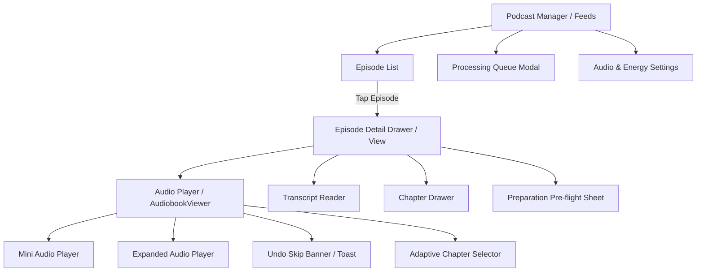

# User Experience Specification: Podcast Ad Removal, Chapters & Transcripts

## Executive UX Philosophy

Listening to podcasts in Plethora must feel calm, intelligent, and seamless. Advertisement avoidance is not an intrusive feature full of technical jargon; it operates quietly in the background, keeping listeners immersed in their audio content while providing transparent, instant control when desired.

---

## Screen Hierarchy & Information Architecture



---

## 1. Episode List States & Badges

The episode list displays clean, high-signal badges only when an episode is in an active or actionable state. When an episode is clean or unanalyzed under normal settings, visual clutter is minimized.

| State | Badge Visual | Tooltip / Subtext | Tap Action |
| :--- | :--- | :--- | :--- |
| **Unprocessed** (Normal) | None (clean date/duration only) | "Ready to play" | Opens detail / starts playback |
| **Ad Removal Ready** | Compact green shield icon `✓ Ad-Free` | "3 ads detected and removed (saved 3m 45s)" | Shows ad breakdown sheet |
| **Transcript Ready** | Small document icon `Transcript` | "Full transcript available" | Opens transcript viewer |
| **Preparing (Active)** | Animated circular spinner with percentage (`Preparing 42%`) | "Transcribing episode on-device..." | Opens processing queue sheet |
| **Processing Deferred** | Amber pause icon `Paused (On Battery)` | "Waiting for external power connection" | Opens pre-flight sheet with "Process Now" override |
| **Needs Model** | Neutral badge `Needs Model` | "Requires local model download in Settings" | Navigates to Settings > Audio Transcription |
| **Analysis Failed** | Red warning dot `Analysis Error` | "Failed to classify ads. Tap to retry" | Opens error details with one-tap retry |

---

## 2. Audio Player UI & Progress Bar Integration

The audio player integrates chapter divisions, ad skip regions, and skip undo without making the scrubber visually noisy.

### Player Wireframe

```
+-----------------------------------------------------------------------+
|  [Podcast Cover]   Title of the Podcast Episode                       |
|                    The Daily News • Episode 142                       |
|                                                                       |
|  Current Chapter: [ Introduction to Microchips                  ▼ ]   |
|                                                                       |
|  12:45 / 45:10 (-32:25 clean)                         [ 1.5x ] [ 💤 ] |
|  [======================|======░░░░░░======|========================] |
|  ^ Chapter 1            ^ Ad 1 (Striated)  ^ Chapter 2                |
|                                                                       |
|         [ ⏪ 15s ]     [ ◀◀ ]    [ ▶ / ⏸ ]    [ ▶▶ ]     [ ⏩ 30s ]    |
|                                                                       |
|     [ 📑 Chapters (8) ]     [ 📝 Transcript ]     [ 🛡️ Ad-Free: On ]   |
+-----------------------------------------------------------------------+
|  🔔 Skipped 1m 30s Sponsor Read (Acme Cloud)               [ ↩️ Replay ] |
+-----------------------------------------------------------------------+
```

### Key Interactive Elements
1. **Chapter Chip**: Positioned directly above the progress bar. Shows current chapter title with a chevron (`▼`). Tapping opens the adaptive chapter drawer.
2. **Scrubber Ad Visuals**: Detected skip intervals appear as subtle, diagonal-striated or translucent markers along the scrubber track. The playhead jumps smoothly across them without pausing.
3. **Clean vs. Total Duration**: When ad removal is enabled, the player displays the remaining clean duration in parentheses (e.g., `-32:25 clean`), calculating total duration minus skipped ad intervals.
4. **Undo / Replay Ad Toast**: When an advertisement is automatically skipped, an unobtrusive banner appears at the bottom of the player for 10 seconds:
   - Text: `"Skipped 1m 30s Sponsor Read (Acme Cloud)"`
   - Actions: `[ ↩️ Replay ]` and `[ ✕ ]`
   - Tapping `[ ↩️ Replay ]` immediately rewinds to the ad start and plays through without re-skipping.

---

## 3. Adaptive Chapter Selector

The chapter selector adapts responsively across devices:
- **Desktop**: Collapsible right sidebar integrated with the playback window.
- **Mobile**: Touch-friendly bottom sheet with one-handed thumb reachability, respecting bottom safe areas.

### Mobile Chapter Bottom Sheet Wireframe

```
+-------------------------------------------------------------+
|                        ==== (Drag Handle)                   |
|  Chapters (7)                                          [ ✕ ] |
|  Search chapters... [ 🔍                              ]     |
|-------------------------------------------------------------|
|  [ ▶ Now ] 1. Introduction & Headlines             00:00    |
|            Overview of today's key developments             |
|-------------------------------------------------------------|
|  [ 🛡️ Skip] 2. Sponsor: SecureCloud Backup          04:12    |
|            Auto-skipped (01:15)                 [ Unskip ]  |
|-------------------------------------------------------------|
|  [      ] 3. Deep Dive: Semiconductor Shortages     05:27    |
|            Interview with Chief Analyst                     |
|-------------------------------------------------------------|
|  [      ] 4. Q&A and Listener Letters              22:40    |
+-------------------------------------------------------------+
```

### Chapter Sheet Capabilities
- **Direct Tap to Seek**: Tapping any chapter immediately seeks audio to that chapter's start timestamp.
- **Visual Sponsor Chapter Indicators**: Chapters marked as advertisements feature a distinct shield badge (`🛡️`) and show their auto-skipped status.
- **Manual Per-Chapter Skip Toggle**: Listeners can tap `[ Skip ]` on any chapter (e.g. an unwanted outro or recurring segment) to have it automatically bypassed.
- **Search within Chapters**: Rapid filtering for episodes with 20+ chapter markers.

---

## 4. Transcript Reading & Study View

The transcript reader in Plethora integrates interactive playback, full-text search, study extraction, and ad-filtering modes.

```
+-------------------------------------------------------------+
|  Transcript: The Daily News #142                       [ ✕ ] |
|  [ 🔍 Search transcript...               ] [ Full / Clean 🔀 ]|
|-------------------------------------------------------------|
|  [00:15] Good morning, today is Wednesday, November 8th.    |
|  We begin with breaking developments in consumer AI...      |
|                                                             |
|  +-------------------------------------------------------+  |
|  | 🛡️ 02:30 - 04:00 (90s Sponsor Break: Acme Hosting)     |  |
|  | [ Click to expand hidden advertisement transcript ]   |  |
|  +-------------------------------------------------------+  |
|                                                             |
|  [04:01] Welcome back. Joining us now is Dr. Jane Smith...  |
|  The primary bottleneck in local on-device inference has    |
|  consistently been memory bandwidth rather than compute.    |
|                                                             |
|  [ Highlighted Active Spoken Word: "bandwidth" (Karaoke) ]  |
|                                                             |
|  [ 📝 Create Extract ]  [ 🗂️ Make Flashcard ]  [ 🤖 Ask AI ] |
+-------------------------------------------------------------+
```

### Dual Reading Modes
1. **Clean Reading View (Default when Ad-Free is on)**:
   - Advertisement segments are collapsed into a compact, neutral banner indicating sponsor name and duration.
   - Text can be expanded with one tap if the listener wishes to inspect the promo code or URL.
2. **Verbatim Reading View**:
   - All spoken text is rendered continuously with full word timestamps.
   - Advertisement blocks feature a subtle tinted background with a small `Sponsor` tag.
3. **Interactive Study Tools**:
   - Selecting any passage opens Plethora's standard contextual action menu: **Create Extract**, **Add Flashcard**, **Copy with Timestamp**, or **Ask AI**.

---

## 5. Mobile Energy & Processing Pre-Flight Sheet

When on battery or under conservative policies, tapping "Prepare Ad-Free Playback" opens a transparent, reassuring confirmation sheet.

```
+-------------------------------------------------------------+
|                        ==== (Drag Handle)                   |
|  Prepare Ad-Free Playback                              [ ✕ ] |
|-------------------------------------------------------------|
|  Episode: "The Architecture of Modern Operating Systems"    |
|  Duration: 52 minutes                                       |
|                                                             |
|  ⚙️ Processing Plan:                                        |
|  • Speech Engine: Cactus Whistle (On-Device, Offline)       |
|  • Ad Classifier: Local Semantic Model (Gemini Nano)        |
|  • Network Use: 0 KB (Fully Private & Local)                |
|  • Est. Battery: ~2% (Device is currently on battery at 68%)|
|                                                             |
|  💡 Tip: You can plug in your charger to enable automatic   |
|     overnight preparation for future episodes.              |
|                                                             |
|  [ ⚡ Start On-Device Processing Now ]                      |
|  [ ⏳ Defer Until Charging ]                                |
+-------------------------------------------------------------+
```

---

## 6. Accessibility & Inclusivity

- **Screen Readers (VoiceOver & TalkBack)**:
  - Scrubber announces: `"Progress 14 minutes 20 seconds of 45 minutes. Next advertisement skipped at 18 minutes."`
  - Chapter buttons announce: `"Chapter 2: Deep Dive into Semiconductors, starts at 5 minutes 27 seconds, double tap to jump."`
  - Skipped toast announces: `"Skipped 90 second advertisement. Double tap to replay."`
- **Touch Targets**: All mobile buttons and chapter row hit-targets meet WCAG AAA requirements with a minimum size of 48×48 dp.
- **Motion & Vestibular Safety**: `prefers-reduced-motion` suppresses auto-scroll animations in the transcript viewer and replaces smooth seeking animations with instantaneous cuts.
- **Contrast & Theming**: All badges and striated skip markers adhere to a minimum 4.5:1 contrast ratio against both light and dark theme surfaces.
