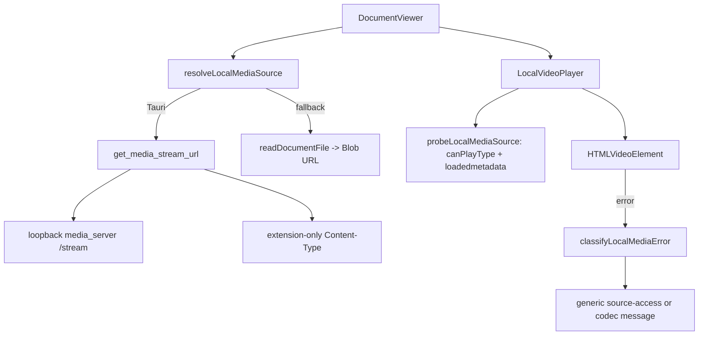
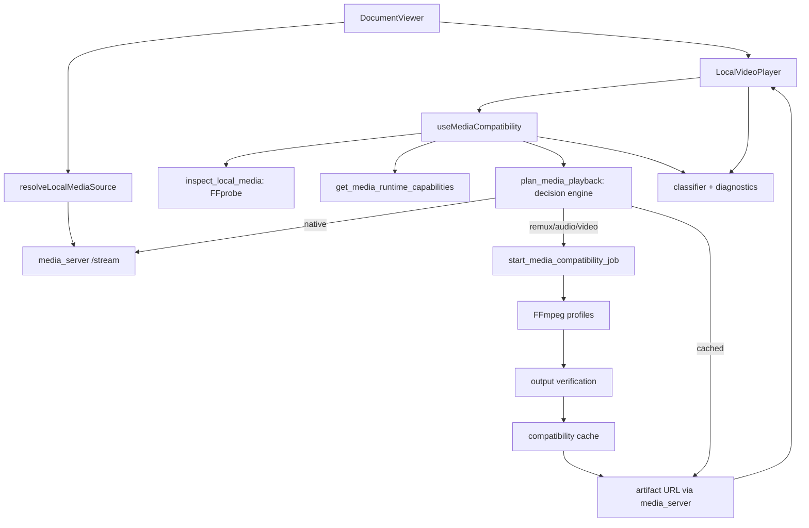
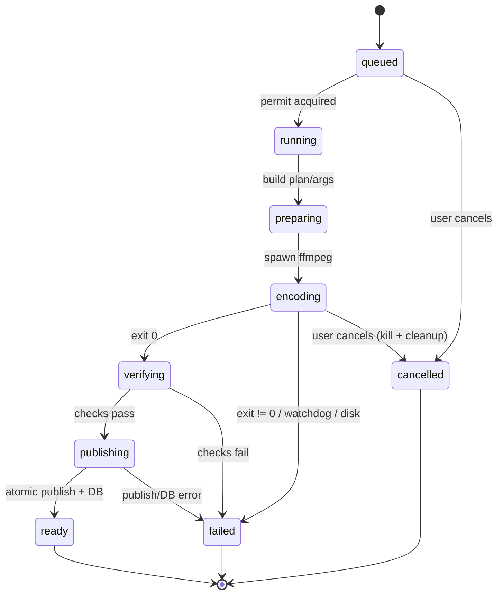

# Design: Reliable local video playback, codec compatibility, and media recovery

## Context

### Verified starting point

Audit performed on 2026-11-02 at commit `4ee2cb44` (OpenSpec CLI 1.13.0, schema
`spec-driven`) on the same Omarchy/Arch machine that reported the failure.

The reported file was inspected read-only with FFprobe. It is a valid Matroska
file, not a corrupt or unreadable source:

```
container      matroska,webm
size           24,818,294,739 bytes
duration       6762.500 s
video  #0      hevc, Main 10, 3840x2076, 24 fps, yuv420p10le,
               bt2020nc / smpte2084 / bt2020, DOVI profile 8 (BL+RPU)
audio  #1      dts, DTS-HD MA, 5.1(side), 48 kHz, 24-bit, eng, no default flag
subtitle #2-6  hdmv_pgs_subtitle (5 bitmap tracks; #2 eng default)
video  #7      mjpeg, attached_pic (cover art; must be ignored)
```

The filename's HEVC/DTS-HD/4K/DV claims are therefore accurate, but the
recovery-critical fact is not in the filename: five bitmap PGS subtitle tracks.

### Reproduction

A Range-capable local HTTP server served the file to WebKitGTK 2.54.1 in a
minimal `<video>` page. Two 60-second remuxes of the same streams were compared:

| Fixture | Result |
| --- | --- |
| 4K HEVC Main 10 + DTS-HD MA 5.1, **no subtitles** | `loadedmetadata`, `canplay`, `playing`; 4K video dimensions; seekable |
| Same streams + one PGS track | metadata/canplay/playing, then `MediaError 4`; GStreamer: `caps subpicture/x-pgs not accepted` → `matroskademux: not-negotiated` |
| Tiny HEVC + DTS + **SubRip** subtitles | plays; text subtitles do not trigger the failure |
| Tiny HEVC + DTS, Content-Type `application/octet-stream` | plays; MIME is not the WebKitGTK trigger |

The application's current behavior follows directly:

1. `probeLocalMediaSource()` resolves on `loadedmetadata`/`canplay`, both of
   which fire before the PGS pipeline failure.
2. The player attaches the source and play begins.
3. The media element emits `MediaError.code === 4`.
4. `classifyLocalMediaError()` calls `canPlayType('video/x-matroska')`, gets
   `"maybe"`, and returns `source-access` because "maybe" is treated as evidence
   that the source must be readable but was rejected.
5. Separately, `play()` rejects with `NotSupportedError`; `buildPlayErrorMessage()`
   writes "This video codec is not supported. Please convert to MP4 (H.264/AAC)".
6. The overlay and toast can show different causes because the two error paths
   are independent.

The verified root cause is therefore **subtitle-stream incompatibility plus
evidence-free classification**, not missing HEVC/DTS decoders on this machine.
The same machine has `matroskademux`, `avdec_h265`/`libde265dec`, and
`avdec_dca`/`dtsdec`, and the no-subtitle remux plays at 4K.

### Current architecture



Relevant current code:

- `src-tauri/src/media_server.rs:211` `media_content_type()`: mp4/webm + audio
  extensions only; `.mkv` → `application/octet-stream`.
- `src-tauri/src/media_server.rs:272` `parse_range()`: single ranges, suffix
  ranges, open-ended ranges; invalid/multi ranges → 416.
- `src-tauri/src/media_server.rs:451` `get_media_stream_url()`: starts the
  singleton loopback server and returns `http://127.0.0.1:<port>/stream?path=…`.
- `src-tauri/src/media_server.rs:477` `authorize_media_file()`: app data/cache
  roots or a path registered as a document's `file_path`; grants out-of-root
  paths for the process lifetime (bounded set).
- `src/components/viewer/localMediaSource.ts:80` `probeMediaSource()`: waits for
  `playing` but is only used for the blob fallback; the server path is not probed.
- `src/components/viewer/localMediaSource.ts:149` `resolveLocalMediaSource()`:
  Tauri always uses the loopback server; on failure desktop falls back to
  `readDocumentFile` → Blob (whole video in JS memory).
- `src/components/viewer/localMediaSources.ts:103` `classifyLocalMediaError()`:
  code 4 + `"maybe"`/`"probably"`/asset protocol → `source-access`.
- `src/components/viewer/localMediaSources.ts:166` `probeLocalMediaSource()`:
  `loadedmetadata` or `canplay` → success.
- `src/components/viewer/LocalVideoPlayer.tsx:542` source-resolution effect;
  `:768` `buildPlayErrorMessage()`; `:1223` media error handler; `:1403`
  error overlay.
- `src/components/viewer/DocumentViewer.tsx:3500` resolves the video source;
  `:8560` mounts `LocalVideoPlayer`.
- `src-tauri/src/commands/video.rs:52` `import_video_file()` copies the file to
  `dirs::data_dir()/incrementum/videos` (outside Tauri's app data root but
  registered as the document's file path).
- `src-tauri/src/utils/ffmpeg.rs` resolves a system `ffmpeg` from Homebrew/PATH;
  no `ffprobe` helper.
- `PKGBUILD:9` depends on `gst-plugins-base`/`gst-plugins-good` only.
- `scripts/ci-build-appimage.sh:144` bundles selected GStreamer plugins; no
  Matroska/audioparsers/soup/volume.
- `src-tauri/src/linux_runtime.rs:44` stages bundled plugins into a private
  cache, sets `GST_PLUGIN_PATH`/`GST_REGISTRY`, and appends host plugin paths.

### Design principles

1. **Inspect what exists.** Container extension is a hint, never evidence of
   codecs.
2. **Prefer the least expensive reliable strategy.** Native first; lossless
   remux before re-encoding; audio-only before video; full transcode only when
   necessary.
3. **Do not fabricate causes.** Every failure code must be supported by
   evidence. When evidence is insufficient, say so.
4. **Never degrade silently.** HDR, Dolby Vision, channel layout, and
   resolution changes require disclosure and, for full transcodes, consent.
5. **Keep the original sacred.** Derived media is separate, disposable, and
   never a document.
6. **Keep the UI responsive.** All expensive work is Rust-owned, asynchronous,
   bounded, and cancellable.
7. **Reuse the existing server and player.** No second media server; no player
   rewrite.

## Goals / Non-Goals

**Goals**

- Correctly identify the actual container, video/audio/subtitle codecs, HDR/DV
  metadata, and track layout of local videos.
- Detect what the runtime can play with explicit positive/negative/indeterminate
  evidence and a documented refresh/invalidation policy.
- Select native, remux, audio-only, video-transcode, or unavailable with a
  deterministic decision table.
- Recover the reported HEVC/DTS-HD/PGS MKV by lossless remux where possible.
- Distinguish source-access failures from media compatibility failures using
  transport evidence.
- Process asynchronously with progress, cancellation, concurrency limits,
  storage checks, and crash recovery.
- Cache derived artifacts by content/plan identity, with atomic publication and
  LRU eviction.
- Preserve document identity, position, speed, transcripts, extracts, audio
  focus, and learning integrations.
- Fix MIME/range/authorization correctness and Linux/AppImage packaging.
- Provide accurate, actionable UX and a small coherent settings surface.

**Non-Goals**

- Replacing the player, the loopback server, or the document model.
- Online/cloud transcoding.
- Converting every import or forcing H.264/AAC.
- Bundling FFmpeg in P1 (system tool only; packaging docs and deps instead).
- Progressive/segmented playback during conversion (P2; see D19).
- Subtitle rendering or OCR in P1 (P2; see D6).
- Mobile conversion (P1 native only; see D14).
- Dolby Vision profile 5 conversion (P1 refuses with a precise limitation).

---

## Decisions

### D1 — Extend the existing loopback server and player; add a compatibility service beside them

**Decision.** Keep `media_server.rs` as the only local media HTTP server.
Extend it in place. Keep `LocalVideoPlayer` as the only local video element.
Add a new Rust module `src-tauri/src/media_compat/` for inspection, capability,
decision, jobs, cache, and commands. Add a React hook/panel that orchestrates
compatibility *around* the existing player rather than replacing it.

**Rationale.** The server already has the correct authorization model,
Range streaming, and the mobile audiobook contract. A second server would
duplicate authorization and range semantics and create two ports/registries.
The player already owns progress, transcripts, extracts, speed, SponsorBlock,
audio focus, and keyboard behavior; replacing it would risk all of them.

**Boundary rules.**

- `media_server.rs` owns bytes, MIME, ranges, authorization, and HTTP errors.
- `media_compat` owns metadata, capability, planning, conversion, cache, and
  job state. It never serves bytes directly; finished artifacts are streamed by
  `media_server`.
- `LocalVideoPlayer` owns the `<video>` element and learning integrations. It
  asks the compatibility hook for a playable source and a preparation/failure
  state; it never runs FFmpeg or reads whole files.
- `DocumentViewer` keeps resolving the original source and keeps passing the
  original `documentId`/`filePath`.



### D2 — Evidence-based error model and classification

**Decision.** Introduce one shared failure taxonomy and one classifier. Remove
the two independent error producers in `LocalVideoPlayer`.

`source-access` is only produced when a **transport probe** has evidence:

- connection refused/timeout → `source_server_unavailable` or
  `source_transport_failed`
- HTTP 401/403 → `source_permission_denied`
- HTTP 404/410 → `source_not_found`
- HTTP 416 → `source_range_invalid`
- HTTP 5xx → `source_transport_failed`
- HTTP 200/206 with zero bytes → `source_empty`
- HTTP 403 with server code `media_permission_denied` → `source_permission_denied`
  (a file that canonicalizes but cannot be opened)

A reachable `200`/`206` source plus `MediaError 4` is **not** source-access. It
is classified from inspection/capability evidence:

1. Bitmap subtitle incompatibility on Linux/WebKitGTK → `bitmap_subtitle_unsupported`
2. Container demuxer confirmed unavailable → `container_unsupported`
3. Video decoder confirmed unavailable → `video_decoder_unavailable`
4. Audio decoder confirmed unavailable → `audio_decoder_unavailable`
5. Probe says corrupt/protected → `media_corrupt` / `unsupported_protected_media`
6. All streams declared supported but the engine still refuses →
   `decoder_initialization_failed` if decoders exist, otherwise
   `media_compatibility_indeterminate`
7. No inspection and no capability evidence → `media_compatibility_indeterminate`

`play()` rejection and the media element `error` event both feed the same
classifier with the same evidence. The classifier is pure and table-tested; the
UI renders exactly one primary message per failure.

**Why not just fix `canPlayType` usage?** Because the actual failure is not
visible to `canPlayType` at all: `video/x-matroska` is "maybe" whether or not a
PGS track will kill the pipeline. `canPlayType` can inform container guesses but
cannot replace inspection.

### D3 — FFprobe-backed inspection with a cheap source fingerprint

**Decision.** Use the system `ffprobe` executable (not a new Rust media
library) for authoritative metadata. Reuse the existing FFmpeg discovery
strategy, adding `ffprobe` resolution and version detection.

**Why FFprobe?** It is already shipped with FFmpeg, which Plethora already
requires for transcription, audiobook preparation, and Groq chunking. It
understands Matroska/MP4/WebM/TS/AVI and exposes HDR/DV side data, dispositions,
attached pictures, and subtitle codecs. A Rust demuxer library would add a large
dependency and still need FFmpeg for conversion.

**Invocation contract.**

```
ffprobe -v error -print_format json -show_format -show_streams -show_chapters -show_error -i <canonical-path>
```

- Spawn with `tokio::process::Command`, fixed argument vector, no shell.
- 30 s timeout; stdout capped at 8 MiB; stderr capped at 64 KiB tail.
- Non-zero exit or invalid JSON → `media_inspection_unavailable` with a detail;
  do not guess.
- `attached_pic` video streams are retained in the inspection but excluded from
  the selectable video stream.
- `start_time`, `duration`, `codec_tag_string`, `color_*`, `side_data_list`,
  `disposition`, `tags.language`, and `channels`/`channel_layout` are parsed.
- Unknown codec names are retained as strings and mapped to `unknown`; the
  decision engine then falls back to runtime evidence.

**Source fingerprint.** Read size, mtime (nanoseconds), first 64 KiB, and last
64 KiB; hash with SHA-256. This is ~128 KiB of I/O and detects almost all
content changes without hashing a 24 GB file. The fingerprint is stored with
the inspection and in every cache key. If the file changes during inspection
(size/mtime differ before/after), retry once; then fail
`media_inspection_unavailable` with detail `source_changed_during_inspection`.

**Caching.**

- In-memory `HashMap<(document_id, fingerprint), MediaInspection>` for the
  session.
- SQLite `media_inspections` row keyed by `(document_id, source_fingerprint)`
  for restarts.
- On open, validate the row's schema version and fingerprint; otherwise re-probe.
- No eager library-wide probing. Inspection runs only when a video is opened.

### D4 — Runtime capability detection with explicit uncertainty

**Decision.** A capability report combines four evidence sources, in order of
strength:

| Source | Platform | Meaning |
| --- | --- | --- |
| Real playback confirmation | all | Strongest positive: `canplay`/`playing` observed for the exact source |
| GStreamer registry (`gst-inspect-1.0`) | Linux | Factory presence for named demuxers/decoders; strong positive/negative, not proof of successful negotiation |
| Exact-codec `canPlayType()` | all webviews | `"probably"` = declared supported; `"maybe"` for a bare container = container only; `""` = declared unsupported; absence = unknown |
| FFmpeg tool/encoder/filter discovery | desktop | What the conversion side can do; never proof the webview can decode |

**Result type.** `CapabilityLevel = supported | unsupported | unknown`. A
capability report never collapses `unknown` into `unsupported`.

**Linux detection.** Run `gst-inspect-1.0` once (lazily) with the environment
already prepared by `linux_runtime::initialize()`. Parse the
`plugin: element: description` listing into a set. If the binary is missing or
fails, return `unknown` and a warning; do not fail playback.

Element mapping (any listed element counts as supported):

| Capability | Linux element names |
| --- | --- |
| Matroska demux | `matroskademux` |
| MP4 demux | `qtdemux` |
| WebM demux | `matroskademux` (WebM is a Matroska subset) |
| Ogg demux | `oggdemux` |
| AVI demux | `avidemux` |
| MPEG-TS demux | `tsdemux` |
| H.264 decode | `avdec_h264`, `openh264dec`, `vah264dec`, `vaapih264dec`, `vulkanh264dec`, `nvh264dec` |
| HEVC decode | `avdec_h265`, `libde265dec`, `vah265dec`, `vaapih265dec`, `vulkanh265dec`, `nvh265dec` |
| AV1 decode | `avdec_av1`, `dav1ddec`, `vaav1dec`, `vulkanav1dec`, `nvav1dec` |
| VP9 decode | `avdec_vp9`, `vp9dec`, `vavp9dec`, `vaapivp9dec` |
| MPEG-2 / VC-1 / WMV3 / MPEG-4 Part 2 decode | `avdec_mpeg2video`, `mpeg2dec`, `avdec_vc1`, `avdec_wmv3`, `avdec_mpeg4` |
| Theora/ProRes/H.263 decode | `theoradec`, `avdec_prores`, `avdec_h263` |
| AAC decode | `avdec_aac`, `faad`, `fdkaacdec` |
| AC-3 decode | `avdec_ac3`, `a52dec` |
| E-AC-3 decode | `avdec_eac3` |
| DTS decode | `avdec_dca`, `dtsdec` |
| TrueHD decode | `avdec_truehd`, `avdec_mlp` |
| Opus decode | `opusdec`, `avdec_opus` |
| FLAC decode | `flacdec`, `avdec_flac` |
| MP3 decode | `mpg123audiodec`, `avdec_mp3`, `mad` |
| MP2 decode | `avdec_mp2`, `mpg123audiodec` |
| Vorbis decode | `vorbisdec`, `avdec_vorbis` |
| Text subtitles | `subparse`, `textrender` (declaration only; not required for playback) |
| Bitmap subtitles | Do **not** treat decoder/overlay elements as player support; WebKitGTK's HTML pipeline rejects `subpicture/x-pgs` even with the relevant GStreamer elements installed |

The bitmap-subtitle row is deliberately not a "supported" signal. The verified
WebKitGTK behavior is modeled explicitly: bitmap subtitles are incompatible with
the HTML media element on Linux regardless of decoder presence.

**Exact-codec `canPlayType` matrix (frontend).** Query and retain the raw
strings for diagnostics:

```
video/mp4; codecs="avc1.42E01E"          -> h264
video/mp4; codecs="hvc1.1.6.L120.90"     -> hevc
video/mp4; codecs="hvc1.2.4.L153.B0"     -> hevc Main10/4K
video/mp4; codecs="av01.0.05M.08"        -> av1
video/webm; codecs="vp9"                 -> vp9
video/webm; codecs="vp09.00.10.08"       -> vp9
audio/mp4; codecs="mp4a.40.2"            -> aac
audio/mp4; codecs="ac-3"                 -> ac3
audio/mp4; codecs="ec-3"              -> eac3
audio/mp4; codecs="flac"              -> flac
audio/ogg; codecs="flac"              -> flac
audio/mpeg                            -> mp3
audio/mp4; codecs="mp3"               -> mp3
audio/webm; codecs="vorbis"           -> vorbis
audio/webm; codecs="opus"             -> opus
audio/ogg; codecs="opus"              -> opus
```

Container-only queries (`video/mp4`, `video/webm`, `video/x-matroska`,
`video/quicktime`, `video/x-msvideo`) are recorded as `container_declared`
only; `"maybe"` is not codec support. DTS has no reliable `canPlayType` MIME in
WebKitGTK (`audio/mp4; codecs="dtsc"` returned `""` even though DTS-in-MKV
plays), so DTS relies on the GStreamer registry or real playback evidence.

**Merge policy.**

- `supported` if any strong positive exists: real playback, a GStreamer factory,
  or exact-codec `"probably"`.
- `unsupported` if a strong negative exists: GStreamer registry available with
  no factory **and** exact codec query `""`, or exact codec `""` on a platform
  with no registry. A bare container `""` only marks the container unsupported.
- `unknown` otherwise. Unknown is never converted to unsupported.

**Caching and refresh.**

- Registry report: in-memory, 10 minutes TTL; refresh via settings button.
- Exact `canPlayType`: cheap; recompute per inspection.
- Real playback positives: in-memory for the session, keyed by
  `(runtime_fingerprint, source_fingerprint, stream signature)`; a persisted
  diagnostic record may be kept for 7 days but is never authoritative.
- Negative playback evidence: session-only; installing a codec package must not
  require restarting the app, but a refresh button clears it.
- `runtime_fingerprint` = SHA-256 of platform + engine + app version + FFmpeg
  version + GStreamer plugin-set id (when known) + registry path. A change
  invalidates positives.

### D5 — Compatibility decision matrix

The planner is a pure Rust function:

```
plan(inspection, runtime_caps, declared_caps, playback_evidence, policy)
  -> MediaPlaybackPlan
```

**Stream selection.**

- Video: the first stream with `attached_pic == false` and `disposition.default == 1`;
  if none, the first non-attached video; if none, unavailable for a video
  document. Cover art (`attached_pic`) is never selected or mapped.
- Audio: the first audio stream with `disposition.default == 1`; if none, the
  first audio stream in index order. This preserves the native player's
  least-surprising choice. Language/title are shown in details. P1 has no track
  picker; P2 adds one.
- Subtitles: P1 never renders embedded subtitles. Bitmap tracks are
  incompatible with WebKitGTK and trigger a remux; text tracks are compatible
  but unrendered. The artifact policy is `strip_all` (see D6).

**Support evaluation.**

```
container_ok = support(container) != unsupported   // unknown is optimistic for a native attempt
video_ok     = support(video.codec) != unsupported
audio_ok     = audio absent or support(audio.codec) != unsupported
subtitle_ok  = !(platform == linux && contains_bitmap_subtitles(inspection))
```

Unknown codec/container evidence is optimistic for the first native attempt, not
a claim of support. The plan's `confidence` is `indeterminate` when a decisive
value is unknown; a native failure then produces a recovery plan (D5). Known
`unsupported` evidence still selects conversion directly.

Bitmap subtitles are a verified WebKitGTK incompatibility, not a universal
one. On Android/iOS, a bitmap track must not preempt a native attempt; those
platforms have no conversion fallback anyway. On Windows/macOS, MKV is normally
unsupported by the container rule; MP4 cannot carry PGS.

`unknown` is treated optimistically for the **native attempt** (so real
playback can decide), but a plan whose only basis is unknown is marked
`confidence = indeterminate` and must offer "Try original anyway" plus
conversion when possible.

**Strategy rules (ordered).**

1. `container_ok && video_ok && audio_ok && subtitle_ok` → `native`.
2. `video_ok && audio_ok && (!container_ok || !subtitle_ok)` → `remux`
   (copy both streams; strip subtitles; change container only if needed).
3. `video_ok && !audio_ok` → `audio_transcode` (copy video; convert audio;
   change container only if needed).
4. `!video_ok` → `video_transcode` (convert video; copy audio if the target
   container supports it, otherwise convert audio too).
5. No conversion tool/encoder/filter or policy `never` → `unavailable` with a
   reason.

**No-conversion fallback.** A non-native plan whose `can_convert` is false MUST
still allow one native attempt before the UI declares failure. The hook attaches
the original; if it plays, native wins and the plan is discarded. If it fails,
the failure panel combines the playback failure with the plan's
`unavailable_reason` (e.g. bitmap subtitles + FFmpeg missing). This is essential
on Android/iOS and on desktop without FFmpeg, where blocking a possibly-playable
file would be a regression.

`remux` is the preferred recovery for the reported file: HEVC and DTS-HD MA are
copied bit-for-bit; only the five PGS tracks are omitted. On the reference
machine this is a same-container MKV remux.

**Output container selection.**

```
target_video = copy | h264 | hevc | av1 | vp9
target_audio = copy | aac | opus | none

if source_container is supported
   and container_can_hold(source_container, target_video, target_audio):
       target_container = source_container
else if target_video in {h264, hevc, av1} and target_audio in {aac, mp3, ac3, eac3}:
       target_container = mp4
else if target_video in {vp8, vp9, av1} and target_audio in {opus, vorbis}:
       target_container = webm
else if source_container is supported and target_video in {h264, hevc, av1, vp9}
        and target_audio in {aac, opus, flac, dts, ac3}:
       target_container = source_container   // MKV
else:
       target_container = mp4
       target_audio = aac (if audio exists)
```

`container_can_hold`:

| Container | Video | Audio |
| --- | --- | --- |
| MKV | H.264, HEVC, AV1, VP9, VP8 | AAC, AC3, EAC3, DTS, TrueHD, FLAC, Opus, Vorbis, MP3 |
| MP4 | H.264, HEVC (`hvc1`), AV1 | AAC, MP3, AC3, EAC3, ALAC (not targeted) |
| WebM | VP8, VP9, AV1 | Opus, Vorbis |

If no supported container can hold `target_video = copy` plus the converted
audio (for example VP9 video + unsupported Opus audio and no `libopus`), the
planner SHALL promote the plan to `video_transcode` rather than emit an invalid
container. A remux SHALL never target the same container that was just found
unsupported; choose another supported container or escalate. This keeps the
"least expensive" rule while preventing unplayable output.

DTS is deliberately **not** considered MP4-compatible: WebKitGTK's
`canPlayType('audio/mp4; codecs="dtsc"')` returned `""` even where DTS-in-MKV
plays, and MP4 DTS is not a reliable web format.

**Representative decision table.**

| Input | Runtime assumption | Strategy | Output |
| --- | --- | --- | --- |
| MP4 H.264/AAC, no bitmap subs | H.264/AAC supported | native | original |
| WebM VP9/Opus | VP9/Opus supported | native | original |
| MKV H.264/AAC, no PGS | Matroska supported | native | original |
| MKV H.264/AAC, no PGS | Matroska unsupported | remux | MP4 (copy video/audio) |
| MKV H.264/AAC + PGS | Matroska supported, H.264/AAC supported | remux | MKV (copy both, strip subs) |
| MKV HEVC/AAC, HEVC supported | Matroska supported | native | original |
| MKV HEVC/AAC, HEVC supported | Matroska unsupported | remux | MP4 (`hvc1` + AAC copy) |
| MKV HEVC/DTS + PGS (reported file) | HEVC/DTS/Matroska supported | remux | MKV (copy both, strip PGS) |
| MKV HEVC/TrueHD, HEVC supported, TrueHD unsupported | Matroska supported | audio_transcode | MKV (copy HEVC, AAC audio) |
| MKV HEVC/DTS, HEVC supported, DTS unsupported | Matroska supported | audio_transcode | MKV (copy HEVC, AAC audio) |
| MKV HEVC/DTS, HEVC supported, DTS unsupported | Matroska unsupported | audio_transcode | MP4 (copy HEVC `hvc1`, AAC) |
| MKV HEVC/AAC, HEVC unsupported, AAC supported | Matroska supported | video_transcode | MKV (H.264 + AAC copy) |
| MKV HEVC/AAC, HEVC unsupported | MP4 target only | video_transcode | MP4 (H.264 + AAC copy) |
| MKV AV1/Opus, AV1/Opus supported | Matroska unsupported, WebM supported | remux | WebM (copy both) |
| MKV AV1/Opus, AV1 supported, Opus unsupported | MP4 target | audio_transcode | MP4 (AV1 copy, AAC) |
| MKV H.264/DTS, video supported, DTS unsupported | Matroska supported | audio_transcode | MKV (H.264 copy, AAC) |
| MP4 HEVC/AAC, HEVC unsupported | H.264/AAC available | video_transcode | MP4 (H.264/AAC) |
| 4K HDR10/DV8 HEVC/DTS + PGS, HEVC/DTS supported | reference Linux | remux | MKV (copy, strip PGS; HDR10 base preserved; DV signalling not claimed) |
| Same, HEVC unsupported | H.264 + tone map available | video_transcode + consent | MP4 1080p SDR H.264/AAC |
| DV profile 5, no DV runtime | any | unavailable | original, `dolby_vision_profile5_unsupported` |
| Any, ffmpeg missing | no conversion | native or unavailable | original / dependency message |
| Corrupt/protected | any | unavailable | precise error; no conversion loop |

**Confidence.** `certain` if inspection succeeded and the decisive capability is
strong (registry or exact `"probably"`); `probable` if a positive is only
declared or a negative is only declared; `indeterminate` if the decisive
capability is unknown or the probe is unavailable. Confidence is shown in
advanced details and drives whether the UI offers "Try original anyway".

**Consent.** `requires_consent` is true when:

- `hdr_tone_mapping` is required (any HDR→SDR conversion), or
- the plan is `video_transcode` and it is *expensive*: source duration >
  10 minutes, source height > 1080, or mode is `ask`, or
- mode is `ask` and the strategy is any non-native.

`automatic-inexpensive` therefore auto-runs remuxes, audio-only conversions, and
short/SD SDR video transcodes with progress/cancel; it asks before a 4K, HDR, or
long full transcode. `never` disables conversion. `consent_reasons` records the
exact trigger(s).

**Reason and limitation strings.** Use these machine-readable values; the UI
maps them to i18n keys and never displays the raw string.

Reasons: `container_unsupported`, `video_decoder_unavailable`,
`audio_decoder_unavailable`, `bitmap_subtitles_present`,
`text_subtitles_present`, `attached_picture_ignored`,
`multi_audio_default_selected`, `no_audio_stream`, `no_video_stream`,
`unknown_capability`, `native_failed`, `policy_never`, `ffmpeg_missing`,
`ffprobe_missing`, `encoder_missing`, `filter_missing`,
`cache_limit_too_small`, `insufficient_storage`, `dolby_vision_profile5`,
`hdr_tone_map_required`, `platform_unsupported`, `protected_media`,
`media_corrupt`, `source_unreadable`.

Limitations: `subtitles_not_rendered`, `hdr_converted_to_sdr`,
`dolby_vision_signalling_not_preserved`, `hdr10_plus_metadata_not_preserved`,
`dolby_vision_display_unverified`, `resolution_reduced`,
`audio_downmixed_to_5_1`, `bit_depth_reduced_to_8`,
`hardware_encoder_fallback`, `original_file_missing` (cache diagnostics only).

**Recovery from wrong predictions.** A plan is not a commitment:

- The user can always choose **Try original anyway** for a non-native plan.
- If original playback succeeds, the plan is discarded, any running job is
  cancelled, and a positive playback fact is recorded for the session.
- If original playback fails after a positive prediction, the failure evidence
  downgrades the capability for the session and the conversion path is offered.
- A native first attempt is always allowed when the decision is
  `indeterminate`, because a wrong "unsupported" would be worse than a short
  failed attempt.

**Recovery planning after a native failure.** `plan_media_playback` accepts an
optional `recovery` context:

```rust
PlaybackRecoveryContext {
  trigger: "native_failed",
  failure_code: Option<MediaFailureCode>,
  media_error_code: Option<u16>,
}
```

When present, the planner overrides the decisive capability for that attempt:

| Failure evidence | Recovery plan |
| --- | --- |
| `bitmap_subtitle_unsupported` | `remux` with `strip_all` (no re-encode) |
| `container_unsupported` | `remux` to a supported container if streams are copyable; otherwise transcode |
| `audio_decoder_unavailable` | `audio_transcode` |
| `video_decoder_unavailable` / `decoder_initialization_failed` | `video_transcode` (with consent for HDR/large outputs) |
| `media_corrupt` / protected | `unavailable`; no conversion |
| `media_compatibility_indeterminate` | first `remux` to a different known-good container with stream copy (cheap, often fixes engine/container quirks); if inspection is unavailable, use `-map 0:v:0? -map 0:a:0? -sn` and rely on output verification; if the source is already MP4/WebM and no different compatible container exists, go to `video_transcode` with consent; if that artifact also fails, the next request may select `video_transcode` with consent |

The frontend never fabricates this context from a guessed codec; it passes the
code from the unified classifier. The planner re-validates inspection and
policy. This guarantees that a native failure has a deterministic next step
instead of a dead end.

### D6 — Subtitle, track, HDR, and Dolby Vision policy

**Subtitles.**

- P1 does not render embedded subtitles. This is an existing Plethora
  limitation, not a new one.
- Bitmap subtitle codecs (`hdmv_pgs_subtitle`, `dvd_subtitle`, `dvb_subtitle`,
  `xsub`) are treated as incompatible with the WebKitGTK HTML media pipeline.
  PGS was verified (`subpicture/x-pgs` not accepted); DVD/DVB are the same
  bitmap-caps class and are covered by the same remux policy pending platform
  tests. Their presence forces a `remux` that maps only the selected video and
  audio streams (`-sn`). No video/audio re-encode is performed.
- Text subtitle codecs (`subrip`, `ass`, `ssa`, `webvtt`, `mov_text`) do not
  trigger the failure (verified with SubRip). They are still omitted from the
  compatibility artifact in P1 for determinism and to avoid container-specific
  text conversion; the original keeps them.
- The artifact manifest and advanced details record:
  `subtitleTracksPresent`, `bitmapSubtitleTracks`, `subtitlePolicy: "strip_all"`,
  and a limitation `subtitles_not_rendered`.
- P2: extract text subtitles to WebVTT and render via a sidecar `<track>`;
  bitmap OCR is out of scope. The original document remains the source for
  subtitle work.

**Audio tracks.**

- Select exactly one audio stream (default, else first).
- Do not silently select a commentary/descriptive track. A default disposition
  is the user's authored intent; language/title are shown.
- Preserve channel layout up to 5.1. AAC target bitrate: mono 128 kbps, stereo
  192 kbps, 5.1 384 kbps. Do not force stereo.
- Downmix only when the source has more than 6 channels, and disclose it
  (`audio_downmixed_to_5_1`). P1 does not support 7.1 AAC.
- Preserve language/title stream metadata in the output.
- P2: a track picker. P1 advanced details show which track was selected.

**HDR / Dolby Vision.**

Detection from FFprobe:

| Signal | Meaning |
| --- | --- |
| `color_transfer=smpte2084` + `color_primaries=bt2020` | HDR10/PQ |
| `color_transfer=arib-std-b67` | HLG |
| `side_data_type` contains `DOVI configuration record` | Dolby Vision; parse profile/level/RPU/EL/BL/compatibility id |
| `codec_tag_string` `dvh1`/`dvhe` | Dolby Vision container signalling |
| `side_data_type` contains `HDR10+`/dynamic metadata | HDR10+ (best-effort; FFmpeg may not expose) |

Policy:

- **Native and remux copy the video bitstream unchanged.** HDR10/HLG metadata
  is preserved. Do not tone-map merely because the source is HDR.
- **Same-container remux (MKV→MKV)** is expected to preserve the Dolby Vision
  configuration record because the video bitstream is copied unchanged, but
  this **must be verified** by probing the output for the DOVI side data. If it
  is absent, add `dolby_vision_signalling_not_preserved` and do not claim
  preservation. **MKV→MP4 remux was verified to lose the DOVI configuration
  record** (the HDR10 base layer remains). If a container change is required and
  DV is present, add limitation `dolby_vision_signalling_not_preserved`; never
  claim DV preservation.
- **DV profile 8** has an HDR10-compatible base layer. Native playback may
  render as HDR10 on hardware without DV support; this is acceptable and
  disclosed in details, not as a blocking error.
- **DV profile 5** has no HDR10-compatible base layer. P1 does not convert it
  automatically: `unavailable`, code `dolby_vision_unsupported`, with guidance
  to use a DV-capable player. Native attempt is still allowed if the user
  chooses; if it renders incorrectly, the limitation is explained.
- **Any HDR→SDR conversion** (only when video transcoding is unavoidable)
  requires consent (`hdr_tone_mapping`), requires verified `zscale` + `tonemap`
  filters, and uses:
  `zscale=t=linear:npl=100,format=gbrpf32le,zscale=p=bt709,tonemap=tonemap=hable:desat=0,zscale=t=bt709:m=bt709:r=tv,format=yuv420p`
  (then optional scale). Output is BT.709 SDR; limitation
  `hdr_converted_to_sdr`.
- If `zscale`/`tonemap` is unavailable, refuse the conversion
  (`conversion_dependency_missing`) rather than producing washed-out output.
- HDR10+ dynamic metadata is not preserved by the P1 tone map; disclose
  `hdr10_plus_metadata_not_preserved`.

**Quality profiles.**

| Profile | Full video transcode | Remux/audio |
| --- | --- | --- |
| `balanced` (default) | max height 1080p if source > 1080p; H.264 CRF 20, preset `veryfast`; AAC | Always copy video; audio AAC as needed |
| `quality` | preserve source resolution; H.264 CRF 18, preset `medium`; AAC | Always copy video; audio AAC as needed |

Remuxes and audio-only conversions never change video quality, even in
`balanced`. The quality setting only affects full video transcodes.

**Dolby Vision statement in UI.** Never say "Dolby Vision preserved" for a
derived artifact. Say "The original video stream is kept unchanged" for remux,
and "Dolby Vision signalling may not survive conversion" when the container
changes.

### D7 — FFmpeg discovery and command profiles

**Tool policy.** Use a system-installed `ffmpeg` and `ffprobe`. Do not bundle,
download, or install either in P1. Reuse and extend
`src-tauri/src/utils/ffmpeg.rs`.

Resolution order:

1. `PLEthora_FFMPEG_PATH` / `PLETHORA_FFPROBE_PATH` environment overrides
   (developer/diagnostic only; never set by the app).
2. On macOS: `/opt/homebrew/bin`, `/usr/local/bin`, then `PATH`.
3. On Windows: `PATH`, then `%LOCALAPPDATA%\Microsoft\WinGet\Links`,
   `C:\ProgramData\chocolatey\bin`, `%USERPROFILE%\scoop\shims`.
4. On Linux: `PATH`, then `/usr/bin`, `/usr/local/bin`, `/snap/bin`.
5. Otherwise: missing.

Requirements:

- `ffprobe` and `ffmpeg` must be resolved independently; a machine may have
  one without the other.
- Parse `ffmpeg -version` / `ffprobe -version` into a version number. Minimum
  supported is FFmpeg 4.4 (Ubuntu 22.04). Warn below 5.0.
- Detect required encoders/filters: `libx264` (software H.264), native `aac`,
  `zscale` and `tonemap` (HDR), and hardware encoders.
- `-fps_mode passthrough` exists in newer FFmpeg; `-vsync 0` is the fallback for
  4.4–5.0. FFmpeg 9 removed `-vsync`. Choose by version, not by trial-and-error
  on the real job.
- Missing tool/encoder/filter produces a typed `unavailable` reason; native
  playback remains available. If `ffprobe` is missing, conversion is
  unavailable even when `ffmpeg` exists, because output cannot be verified;
  return `ffprobe_missing`.

**FFmpeg invocation rules.**

- `tokio::process::Command`, never `std::process::Command` on an async path.
- `kill_on_drop(true)`, `-nostdin`, `-hide_banner`, `-loglevel error`,
  `-progress pipe:1 -nostats`.
- No shell; every argument is a separate `OsString`.
- Input is the authorized canonical original path; output is a generated path
  under the cache staging directory. Never use a user filename as an output path.
- `-map` uses absolute input stream indices (`-map 0:<index>`), never
  type-relative indices. This avoids selecting the wrong ordinal when cover art
  or multiple audio tracks exist.
- Always pass `-sn -dn -map_chapters -1` for P1 compatibility outputs. Subtitles
  are intentionally omitted; data streams are not needed.
- Always pass `-map_metadata 0` to preserve language/title tags for the selected
  streams.
- Never write to the source. Verify mtime/size unchanged after every job.

**Version-adaptive frame handling.**

```rust
if ffmpeg_version >= (5, 1) {
    args.push("-fps_mode"); args.push("passthrough");
} else {
    args.push("-vsync"); args.push("0");
}
```

This preserves source timestamps and avoids duplicating/dropping frames when
transcoding variable-frame-rate sources.

**Profile A — lossless remux (container/subtitle fix).**

```
ffmpeg -nostdin -hide_banner -loglevel error -y
  -i <source>
  -map 0:<video_index> -map 0:<audio_index>
  -sn -dn -map_chapters -1
  -c:v copy -c:a copy
  -map_metadata 0
  -movflags +faststart            # MP4 only
  -copyts -start_at_zero
  -f <mp4|matroska|webm> <output.part>
```

- For HEVC in MP4, add `-tag:v hvc1`.
- For DV in MP4, set `-tag:v dvh1` only when the probe says DV; still disclose
  that the DOVI configuration record is not preserved by FFmpeg's MP4 muxer.
- For MKV/WebM, no `-movflags`.
- If the source has no audio, omit `-map 0:<audio>` and `-c:a`.
- If the source has chapters and the target supports them, `-map_chapters 0`
  may be used; otherwise `-1`. P1 uses `-1` for determinism.

**Profile B — audio-only conversion (video copied).**

```
  -map 0:<video_index> -map 0:<audio_index>
  -sn -dn -map_chapters -1
  -c:v copy
  -c:a aac -b:a <128|192|384>k -ac <min(channels,6)> -ar 48000
  -map_metadata 0
  <container flags>
  -copyts -start_at_zero
```

- If the target is WebM, use `-c:a libopus -b:a 160k` only when `libopus` is
  available; otherwise choose MP4/MKV + AAC.
- Preserve 5.1; downmix >6 channels to 5.1 and disclose.

**Profile C — video transcode (H.264 + AAC).**

```
  -map 0:<video_index> -map 0:<audio_index>
  -sn -dn -map_chapters -1
  -c:v libx264 -preset <veryfast|medium> -crf <20|18>
  -threads <max(1, min(4, cores - 2))>
  -pix_fmt yuv420p
  [ -vf <tone_map[,scale]> ]
  -c:a aac -b:a <...>k -ac <...> -ar 48000
  -map_metadata 0
  -movflags +faststart
  -copyts -start_at_zero
  <fps mode>
```

- `balanced`: if source height > 1080, append `scale=-2:1080` after tone map.
- `quality`: no scale.
- If the source is HDR/DV and a tone map is required, use the D6 chain; if the
  filters are missing, fail with `conversion_dependency_missing`.
- If the selected audio codec is already supported by the target container
  (e.g. AAC in MP4, DTS in MKV), copy it instead of re-encoding. Video
  transcoding is the expensive part; do not add an unnecessary audio generation.
- 10-bit SDR sources: output `yuv420p` (8-bit) for broad compatibility; disclose
  `bit_depth_reduced_to_8`. HDR sources are tone-mapped to SDR anyway.

**Hardware encoding.**

- `hardwareAcceleration = "auto"`: on first use per session, inspect
  `ffmpeg -encoders` and run a 1-second 320×180 `testsrc2` canary encode to a
  temp file. Candidates, in order:
  - macOS: `h264_videotoolbox`
  - Windows: `h264_nvenc`, `h264_qsv`, `h264_amf`
  - Linux: `h264_nvenc`, `h264_qsv` (VAAPI/AMF deferred to P2)
- Canary must exit 0, produce a decodable H.264 stream, and finish within 15 s.
  Cache the result in memory for the session.
- Encoder argument table (use the canary and the job with the same table):

  | Encoder | Arguments (balanced; quality raises bitrate/quality) |
  | --- | --- |
  | `h264_videotoolbox` | `-c:v h264_videotoolbox -b:v 6M -maxrate 9M -bufsize 18M` (1080p) |
  | `h264_nvenc` | `-c:v h264_nvenc -preset p4 -tune hq -rc vbr -cq 23 -b:v 0 -maxrate 9M -bufsize 18M` |
  | `h264_qsv` | `-c:v h264_qsv -global_quality 23 -look_ahead 0` |
  | `h264_amf` | `-c:v h264_amf -quality balanced -rc cqp -qp_i 20 -qp_p 23` |

  For 4K quality mode, raise the bitrate/quality targets (e.g. 20 Mbps
  VideoToolbox, `-cq 20` NVENC). If a candidate rejects an argument, try a
  minimal fallback (`-c:v <encoder> -b:v 6M`) once; if that fails, software.
- Hardware bitrate targets: 1080p 6 Mbps, 4K 20 Mbps (`balanced`); 10/35 Mbps
  (`quality`); use the encoder's constant-quality mode where supported
  (`-cq 23` for NVENC, `-global_quality 23` for QSV, `-qp_i/-qp_p` for AMF) plus
  `-maxrate`/`-bufsize`.
- If hardware encode fails or output verification fails, delete the partial
  output and retry **once** in software. Disclose the fallback in diagnostics.
- `hardwareAcceleration = "off"`: always `libx264`.
- Do not infer hardware support from the GPU model; only from the canary.

**Output verification (mandatory before publish).**

1. `ffprobe` the output: exactly one selected video stream (if source had
   video), exactly one audio (if source had audio), zero subtitles/data.
2. Expected codecs/tags: video `h264`/`hevc` with `hvc1` when MP4, audio `aac`
   or copied codec; container matches the plan.
3. `format.start_time` within `[-0.05, 0.05]`.
4. Duration within `max(0.5 s, 2 / source_fps)` of the source duration.
5. Video/audio first-PTS delta within 0.25 s of the source delta.
6. For copied HDR video, `color_transfer`/`color_primaries` still present.
7. Decode check: `ffmpeg -v error -xerror -ss 0 -t 2 -i <output> -map 0:v:0?
   -map 0:a:0? -f null -` exits 0.
8. Any failure → delete output, no publish, `conversion_verification_failed`
   with expected/actual detail.

**Timestamp guarantee.** Published artifacts have a zero-based timeline
(`timeline_offset_seconds = 0.0`). If verification cannot establish that,
the job fails closed. This is what keeps transcript segments, extracts, and
saved positions in the same coordinate system as the original. P1 does not
publish an artifact with a nonzero offset; the field exists for future
migrations.

### D8 — Asynchronous job lifecycle

**Ownership.** A Tauri-managed `MediaCompatState` owns jobs in a
`Mutex<HashMap<JobId, JobRecord>>`. A job is an async task holding:

- `document_id`, `cache_key`, `plan`
- `watch::Sender<bool>` cancellation
- `AtomicU64` sequence
- `AppHandle` for events and path resolution
- `Repository` clone for DB state
- optional `Child` handle while FFmpeg runs

**State machine.**



**Commands.**

```rust
#[tauri::command]
async fn inspect_local_media(app, repo, document_id: Option<String>, file_path: String)
  -> Result<MediaInspection, MediaCompatError>;

#[tauri::command]
async fn get_media_runtime_capabilities(refresh: Option<bool>)
  -> Result<MediaRuntimeCapabilities, MediaCompatError>;

#[tauri::command]
async fn plan_media_playback(app, repo, request: MediaPlaybackPlanRequest)
  -> Result<MediaPlaybackPlan, MediaCompatError>;

#[tauri::command]
async fn start_media_compatibility_job(app, repo, state, request: StartMediaCompatibilityJobRequest)
  -> Result<MediaCompatibilityJobEvent, MediaCompatError>;

#[tauri::command]
async fn cancel_media_compatibility_job(state, job_id: String)
  -> Result<MediaCompatibilityJobEvent, MediaCompatError>;

#[tauri::command]
async fn list_media_compatibility_jobs(state, document_id: Option<String>)
  -> Result<Vec<MediaCompatibilityJobEvent>, MediaCompatError>;

#[tauri::command]
async fn get_media_compatibility_artifact_url(app, repo, document_id: String, cache_key: String)
  -> Result<String, MediaCompatError>;

#[tauri::command]
async fn get_media_compatibility_cache_usage(app, repo)
  -> Result<MediaCacheUsage, MediaCompatError>;

#[tauri::command]
async fn prune_media_compatibility_cache(app, repo, limit_gb: u32)
  -> Result<MediaCacheUsage, MediaCompatError>;

#[tauri::command]
async fn clear_media_compatibility_cache(app, repo, state, document_id: Option<String>)
  -> Result<MediaCacheUsage, MediaCompatError>;

#[tauri::command]
async fn probe_media_transport(url: String)
  -> Result<MediaTransportProbe, MediaCompatError>;
```

`StartMediaCompatibilityJobRequest`:

```rust
{
  document_id, file_path, inspection_fingerprint,
  policy: MediaProcessingPolicy,
  consent_granted: bool,
  recovery: Option<PlaybackRecoveryContext>,
}
```

`MediaPlaybackPlanRequest` has the same identity/fingerprint/policy fields plus
`client_support: DeclaredCodecSupport` and `recovery: Option<PlaybackRecoveryContext>`.
The backend re-plans; it does not trust a client-supplied plan. If the plan is
native or `can_convert == false`, return a typed error. If
`requires_consent && !consent_granted`, return `conversion_requires_consent`.
If a cached artifact is valid, return a `ready` event immediately without
spawning FFmpeg.

**Progress events.** Emit `media-compat:job` with the full event payload. The
frontend ignores lower `sequence` values. Throttle to 4 events/s. Fields:

```rust
MediaCompatibilityJobEvent {
  schema_version: 1,
  job_id, document_id, cache_key, sequence,
  state: queued|running|finalizing|ready|failed|cancelled,
  phase: queued|probing|preparing|encoding|verifying|publishing|done|failed,
  progress: { percent: Option<f64>, processed_seconds, duration_seconds,
              speed: Option<f64>, output_bytes },
  output: Option<{ cache_key, output_container, duration_seconds, size_bytes,
                   timeline_offset_seconds }>,
  error: Option<MediaCompatError>,
  created_at, updated_at,
}
```

`percent` is `processed_seconds / duration_seconds * 100`, clamped to 99 until
verification succeeds. If duration is unknown, `percent = None` (indeterminate
progress). Do not invent ETA; show processed/duration and speed.

**Concurrency and limits.**

- Video transcode: 1 concurrent global permit.
- Remux/audio transcode: 2 concurrent global permits.
- At most 1 active job per document; a second different plan returns
  `conversion_in_progress` with the existing job id in `detail`.
- Queue depth cap 8; beyond that `conversion_queue_full`.
- Deduplicate by `cache_key`: a second request returns the same job/event.
- Threads: video transcode passes `-threads <max(1, min(4, cores-2))>`; remux
  copy uses `-threads 1`. Leave one or two cores for UI/WebKit.
- No automatic job starts on app launch or import. Jobs start only when the user
  opens a video and policy permits.

**Cancellation.**

- `cancel` sets the watch flag and, if a child exists, calls `start_kill()`.
- The task selects on `child.wait()` and the watch. After kill, wait up to 2 s;
  then drop the child (`kill_on_drop`).
- Delete the staging directory; mark DB `cancelled`; emit a final event.
- Cancellation is idempotent; a second call returns the terminal event.
- UI must acknowledge within 250 ms and state the cancel is in progress.

**Watchdogs and storage.**

- Probe timeout 30 s; conversion no-progress watchdog 120 s. "Progress" means
  either a new `-progress` line or output-file growth (stat the `.part` every
  30 s); kill only if neither occurs for 120 s. `conversion_failed`, detail
  `no_progress`.
- Max job duration 6 h; kill with `conversion_failed` detail `max_duration`.
- Every 5 s during encoding, check free disk on the cache volume; if
  < 512 MiB, kill with `insufficient_storage`.
- Cap stderr ring buffer at 64 KiB tail; never unbounded.
- Cap output file count in staging at 4 (output + manifest + temp).

**Crash recovery.**

- On app startup (after DB is ready), run:
  - `UPDATE media_compatibility_artifacts SET state='failed', error_code='conversion_cancelled' WHERE state IN ('building')`
  - delete `cache_root/.staging/*` older than 24 h.
- Do not resume automatically. The user can retry from the failure panel.
- A `ready` artifact is valid only if its `manifest.json` and output file both
  exist and pass the reuse check.

### D9 — Compatibility cache

**Location.** `<app_cache_dir>/media_compat/`. The app cache root is already
authorized by `media_server`, so artifacts stream without a new grant. Never
store artifacts under the document directory or beside the original.

**Layout.**

```
media_compat/
  <cache_key>/
    manifest.json
    output.<mkv|mp4|webm|m4a>
  .staging/<job_id>/
  .trash/<uuid>/
```

**Cache key.** SHA-256 over a fixed struct:

```rust
struct CacheKeyInput {
  key_version: u32,              // 1
  pipeline_version: u32,         // COMPAT_PIPELINE_VERSION
  document_id: String,
  canonical_source_path: String,
  source_fingerprint: String,
  inspection_hash: String,       // stable hash of probe-relevant fields
  strategy: PlaybackStrategy,
  selected_video_index: Option<i32>,
  selected_audio_index: Option<i32>,
  subtitle_policy: SubtitlePolicy,
  output: OutputProfile,         // container/codecs/scale/tone map/crf/bitrates
  hardware_encoder: Option<String>,
  ffmpeg_version: String,
  ffprobe_version: String,
}
```

- Include the source path so two different documents with identical bytes do
  not share an artifact unexpectedly.
- Include `inspection_hash` so a probe change (different codecs/tracks) cannot
  reuse an incompatible artifact. Compute it as SHA-256 of the canonical JSON of
  `{schemaVersion, container, durationSeconds, videoStreams, audioStreams,
  subtitleStreams, hdr}` with path/timestamps/probe-time fields removed and
  streams sorted by index. This makes it stable across sessions.
- Do not include title, filename, user settings unrelated to output, or the
  current time.
- The key is hex; it is the directory name. No user text in paths.

**Manifest.**

```json
{
  "schemaVersion": 1,
  "cacheKey": "...",
  "documentId": "...",
  "sourceFingerprint": "...",
  "inspectionHash": "...",
  "plan": { "...": "..." },
  "output": {
    "fileName": "output.mkv",
    "container": "mkv",
    "sizeBytes": 0,
    "durationSeconds": 0,
    "videoCodec": "hevc",
    "audioCodec": "dts",
    "timelineOffsetSeconds": 0,
    "hdrKind": "dolby_vision"
  },
  "verification": { "startTimeSeconds": 0, "durationDeltaSeconds": 0,
                    "decodedSeconds": 2, "checks": ["..."] },
  "tool": { "ffmpegVersion": "...", "ffprobeVersion": "..." },
  "createdAt": "..."
}
```

**Atomic publication.**

1. Create `.staging/<job_id>` with mode 0700 (Unix).
2. Write `output.part.<ext>` in staging.
3. Verify output (D7).
4. `File::sync_all` the output; rename to `output.<ext>` within staging.
5. Write `manifest.json.tmp`, sync, rename to `manifest.json`.
6. If `<cache_key>` does not exist, `rename(staging, <cache_key>)`.
7. If it exists and validates, delete staging and reuse.
8. If it exists but is invalid, move it to `.trash/<uuid>`, rename staging into
   place, then best-effort delete trash. On Windows, handle rename-over-existing
   by the same move-aside step.
9. Upsert DB row `state='ready'`; emit ready.

A crash at any point leaves either a complete `<cache_key>` or a staging
directory that startup recovery removes. A manifest without its output is
invalid and is not reused.

**Reuse validation.** Reuse only when all hold:

- manifest schema/pipeline/key match
- source fingerprint still matches
- inspection hash still matches
- output file exists, is a regular file, size matches manifest
- `state='ready'`
- ffmpeg/ffprobe version matches the manifest **when the tool is currently
  available**; a missing tool does not invalidate an artifact that was already
  verified and published
- plan output profile matches the current plan

**Eviction and limits.**

- Default limit 25 GB (settings 5–500 GB). Rationale: a 24 GB 4K remux is
  ~21–24 GB; 25 GB fits one such artifact. Smaller defaults would make the
  reported file uncacheable.
- Output floor:
  - remux/audio-only: `source_bytes` (copy or smaller; conservative)
  - video transcode: `duration_seconds * target_bitrate_bps / 8 * 1.15 + 256 MiB`
  - required free space: `output_floor + 1 GiB`
- Usage = sum of ready artifact `sizeBytes`; staging and trash are excluded
  from the user-facing limit but cleaned aggressively.
- After publish, if usage > limit, delete artifacts by `last_accessed_at`
  ascending until usage <= 90% of limit. Skip `building` rows and artifacts
  accessed within the last 10 minutes. If a file cannot be deleted (Windows
  open handle), skip and continue.
- On startup, only clean staging/interrupted jobs; do **not** enforce a cache
  limit from a hard-coded default. Rust receives the user's limit in the job
  policy and in the explicit `prune_media_compatibility_cache(limit_gb)`
  command. The settings panel calls prune on mount/after a limit change so the
  persisted setting is authoritative.
- If a planned output floor exceeds the cache limit, `can_convert=false` with
  reason `cache_limit_too_small`; the UI offers "Manage cache" / "Increase
  limit". Do not start a job that cannot be stored.
- Clear cache: refuse with `conversion_in_progress` if a job is active; otherwise
  delete ready artifacts (optionally only for one document) and DB rows. Staging
  directories for terminal jobs are removed too.
- Original media is never counted, moved, or deleted by cache GC.

**DB.** See D10. The manifest is the durable truth; the DB is an index for
listing/LRU. If the DB row is missing but the manifest validates, the plan may
re-register it (best-effort).

### D10 — Data contracts, database, and ownership

#### Shared Rust types (`src-tauri/src/media_compat/types.rs`)

All serialized structs use `#[serde(rename_all = "camelCase")]`; enums use
`#[serde(rename_all = "snake_case")]`. `schemaVersion` is `1`.

```rust
pub enum MediaFailureCode {
  SourceNotFound, SourcePermissionDenied, SourceTransportFailed,
  SourceServerUnavailable, SourceRangeInvalid, SourceEmpty,
  ContainerUnsupported, VideoDecoderUnavailable, AudioDecoderUnavailable,
  BitmapSubtitleUnsupported, DecoderInitializationFailed, MediaCorrupt,
  UnsupportedProtectedMedia, MediaInspectionUnavailable,
  MediaCompatibilityIndeterminate, ConversionDependencyMissing,
  ConversionEncoderMissing, ConversionFilterMissing, ConversionPlatformUnsupported,
  ConversionFailed,
  ConversionVerificationFailed, ConversionCancelled, ConversionRequiresConsent,
  ConversionInProgress, ConversionQueueFull, InsufficientStorage,
  DolbyVisionUnsupported, PlaybackInterrupted, Unknown,
}
```

`MediaCompatError { type: "media_compat", code, message, detail: Option<String>,
retryable: bool }`. `type` is a stable discriminator for the existing
`coerceError` path; `code` is the taxonomy value. `message` is a short English
fallback for logs; UI uses `code` + i18n.

```rust
pub struct MediaInspection {
  pub schema_version: u32,
  pub document_id: Option<String>,
  pub source: MediaSourceInfo,          // label, hash, size, mtime, fingerprint
  pub probe_status: ProbeStatus,        // ok | unavailable | failed
  pub probe_error: Option<String>,
  pub container: Option<String>,        // normalized: matroska|mp4|webm|ogg|avi|mpegts|other
  pub container_raw: Option<String>,    // ffprobe format_name
  pub duration_seconds: Option<f64>,
  pub start_time_seconds: Option<f64>,
  pub bit_rate: Option<u64>,
  pub size_bytes: Option<u64>,
  pub video_streams: Vec<VideoStreamInfo>,
  pub audio_streams: Vec<AudioStreamInfo>,
  pub subtitle_streams: Vec<SubtitleStreamInfo>,
  pub chapters: Vec<ChapterInfo>,
  pub is_protected: bool,               // best-effort DRM/encryption signal
  pub warnings: Vec<String>,
  pub tool: MediaToolReport,
}
```

`VideoStreamInfo` fields: `index`, `codec`, `codec_long_name`, `profile`,
`level`, `width`, `height`, `coded_width`, `coded_height`, `pixel_format`,
`bit_depth`, `frame_rate` (f64), `avg_frame_rate` (f64), `codec_tag`,
`is_attached_pic`, `is_default`, `language`, `title`, `color_space`,
`color_transfer`, `color_primaries`, `color_range`, `hdr` (HdrInfo),
`start_time_seconds`, `duration_seconds`, `bit_rate`.

`HdrInfo { kind: sdr|hdr10|hlg|dolby_vision|unknown, bt2020: bool,
dolby_vision: Option<DolbyVisionInfo>, hdr10_plus: bool }`.
`DolbyVisionInfo { profile, level, rpu_present, el_present, bl_present,
compatibility_id: Option<u8>, hdr10_compatible: bool }`.

`AudioStreamInfo`: `index`, `codec`, `profile`, `channels`, `channel_layout`,
`sample_rate`, `bit_depth`, `bit_rate`, `language`, `title`, `is_default`,
`is_commentary` (from disposition.commentary).

`SubtitleStreamInfo`: `index`, `codec`, `kind` (`text|bitmap|unknown`),
`language`, `title`, `is_default`, `is_forced`.

`MediaRuntimeCapabilities`:

```rust
{
  schema_version: 1,
  platform: linux|macos|windows|android|ios|web,
  engine: webkitgtk|wkwebview|webview2|android_webview|browser|unknown,
  engine_version: Option<String>,
  evidence: Vec<String>, // gstreamer_registry, webview_declaration, ffmpeg_tools, real_playback, none
  runtime_fingerprint: String,
  checked_at: String,
  decoders: HashMap<String, CapabilityLevel>,
  demuxers: HashMap<String, CapabilityLevel>,
  subtitle_support: HashMap<String, CapabilityLevel>,
  encoders: HashMap<String, EncoderCapability>,
  ffmpeg: FfmpegCapabilities,
  gstreamer: Option<GStreamerReport>,
  warnings: Vec<String>,
}
```

`CapabilityLevel` is `supported|unsupported|unknown`.
`EncoderCapability { level, factory: Option<String>, hardware: bool,
canary: Option<bool> }`.
`FfmpegCapabilities { available, ffprobe_available, version, version_tuple,
has_libx264, has_aac, has_zscale, has_tonemap, hardware_encoders }`.
`GStreamerReport { inspect_available, plugin_dirs, registry,
plugin_set_id: Option<String>, found_elements: Vec<String> }` — send only the
relevant found elements plus warnings, not the full 500-element list.

`DeclaredCodecSupport` (frontend → backend):

```rust
{
  h264, hevc, av1, vp9, aac, ac3, eac3, dts, truehd, opus, flac, mp3, vorbis:
    CapabilityLevel,
  bitmap_subtitles, text_subtitles: CapabilityLevel,
  containers: HashMap<String, CapabilityLevel>, // matroska, mp4, webm, ogg, avi, mpegts
  evidence: Vec<String>, // e.g. "video/mp4; codecs=\"hvc1...\" => probably"
}
```

`MediaProcessingPolicy { mode, quality, hardware_acceleration, cache_limit_gb }`.

`MediaPlaybackPlan`:

```rust
{
  schema_version, plan_id, document_id, source_fingerprint, inspection_hash,
  strategy: native|remux|audio_transcode|video_transcode|unavailable,
  confidence: certain|probable|indeterminate,
  reasons: Vec<String>,          // machine codes, e.g. bitmap_subtitles_present
  selected_video_index: Option<i32>,
  selected_audio_index: Option<i32>,
  subtitle_policy: keep|strip_all,
  output: Option<OutputProfile>,
  requires_consent: bool,
  consent_reasons: Vec<String>,  // video_transcode|hdr_tone_mapping
  limitations: Vec<String>,      // subtitles_not_rendered|hdr_converted_to_sdr|...
  cached_artifact: Option<CachedArtifact>,
  can_convert: bool,
  unavailable_reason: Option<String>, // ffmpeg_missing|encoder_missing|policy_never|...
  estimated: ConversionEstimate,
}
```

`OutputProfile { container, video, audio, scale, tone_map, video_crf,
video_preset, audio_bitrate_kbps, audio_channels, hardware }`.

`CachedArtifact { cache_key, output_container, duration_seconds, size_bytes,
timeline_offset_seconds }` — no filesystem path.

`ConversionEstimate { source_bytes, duration_seconds, output_bytes_floor,
free_space_required_bytes, cache_limit_bytes, cache_fits }`.

`MediaTransportProbe { url_kind, reachable, status, content_type,
content_length, accept_ranges, content_range, elapsed_ms, error }`.

`MediaFailureAction = "retry" | "convert" | "try_original" | "cancel" |
"reimport" | "manage_cache" | "install_help" | "recheck" |
"resume" | "show_details"`.

`MediaCacheUsage { artifact_count, total_bytes, cache_root_label,
artifacts: Vec<{ cache_key, document_id, size_bytes, output_container,
last_accessed_at }> }`. The frontend combines `total_bytes` with the current
`cacheLimitGb` setting for display; Rust receives the limit in the processing
policy for eviction/preflight.

#### TypeScript types (`src/lib/media/types.ts`)

Mirror the Rust serialization exactly. Use string literal unions for codes,
strategies, capabilities, plan reasons, limitations, and job states. Keep pure
types free of React/Tauri imports.

#### Database migration `137_media_compatibility`

```sql
CREATE TABLE IF NOT EXISTS media_inspections (
  document_id TEXT NOT NULL,
  source_fingerprint TEXT NOT NULL,
  source_path TEXT NOT NULL,
  inspection_json TEXT NOT NULL,
  schema_version INTEGER NOT NULL,
  probed_at TEXT NOT NULL,
  PRIMARY KEY (document_id, source_fingerprint)
);

CREATE TABLE IF NOT EXISTS media_compatibility_artifacts (
  cache_key TEXT PRIMARY KEY,
  document_id TEXT NOT NULL,
  source_path TEXT NOT NULL,
  source_fingerprint TEXT NOT NULL,
  inspection_hash TEXT NOT NULL,
  plan_json TEXT NOT NULL,
  output_path TEXT NOT NULL,
  output_container TEXT NOT NULL,
  output_size INTEGER NOT NULL,
  duration_seconds REAL,
  timeline_offset_seconds REAL NOT NULL DEFAULT 0,
  state TEXT NOT NULL CHECK (state IN ('building','ready','failed')),
  error_code TEXT,
  created_at TEXT NOT NULL,
  last_accessed_at TEXT NOT NULL
);

CREATE INDEX IF NOT EXISTS idx_media_artifacts_document
  ON media_compatibility_artifacts(document_id, last_accessed_at);
CREATE INDEX IF NOT EXISTS idx_media_artifacts_state
  ON media_compatibility_artifacts(state, last_accessed_at);
```

Repository methods in `src-tauri/src/database/media_compat_repository.rs`:

- `get_inspection(document_id, fingerprint)`
- `upsert_inspection(...)`
- `get_artifact(cache_key)`
- `list_artifacts(document_id: Option<&str>)`
- `upsert_artifact(...)`, `touch_artifact(cache_key, now)`
- `delete_artifact(cache_key)`
- `mark_interrupted_artifacts(now)`
- `sum_ready_artifact_bytes()`

Register `media_compat_repository` in `database/mod.rs`; add migration
`137_media_compatibility` after `136_video_extract_queue_membership`.

#### Ownership summary

| Concern | Owner |
| --- | --- |
| File bytes, MIME, Range, auth | `media_server.rs` |
| Probe/capability/plan | `media_compat::{probe,capabilities,decision}` |
| FFmpeg process | `media_compat::ffmpeg` + `jobs` |
| Cache/manifest/GC | `media_compat::cache` |
| Job state/events | `media_compat::jobs` + Tauri state |
| Player element, progress, transcripts, extracts | `LocalVideoPlayer` |
| Preparation/consent/failure UI | `MediaCompatibilityPanel` + hook |
| Settings | `MediaPlaybackSettings` + settings store |

### D11 — Frontend orchestration and player integration

#### Source model

`DocumentViewer` continues to resolve the **original** source:

```ts
const resolved = await resolveLocalMediaSource(doc.filePath, "video");
// -> { src, mimeType, strategy: "local-media-server", originalPath, ... }
```

`DocumentViewer` passes to `LocalVideoPlayer`:

```tsx
<LocalVideoPlayer
  src={localVideoSource}
  documentId={currentDocument.id}
  filePath={currentDocument.filePath}   // new explicit prop
  ...
/>
```

The original source is always the fallback and the source used by
transcription/keyframes/AI (they read `document.filePath`, never the artifact).

`resolveLocalMediaSource` changes:

- Tauri always uses `get_media_stream_url` (unchanged).
- **Remove the `backend-blob` fallback for `mediaType === "video"` on every
  platform.** A video must never be read into JS memory.
- Keep the existing Tauri audio `backend-blob` fallback unchanged in this
  change. Audio ownership/whole-file behavior is owned by the separate
  memory-growth change; do not regress audiobook/podcast playback here.
- Keep `backend-blob` for non-Tauri web/PWA audio when no browser `File` exists
  and `readDocumentFile` is available. Never for video.
- `probeMediaSource` (blob-only) changes `loadedmetadata` from success to
  `indeterminate`; only `playing`/`canplay` is `ok`. It is no longer used on the
  primary path.

#### Hook state machine

`src/hooks/useMediaCompatibility.ts`:

```ts
type MediaCompatibilityState =
  | { kind: "idle" }
  | { kind: "inspecting" }
  | { kind: "native"; inspection?: MediaInspection; plan?: MediaPlaybackPlan }
  | { kind: "preparing"; inspection: MediaInspection; plan: MediaPlaybackPlan;
      job: MediaCompatibilityJobEvent }
  | { kind: "consent"; inspection: MediaInspection; plan: MediaPlaybackPlan }
  | { kind: "ready"; inspection: MediaInspection; plan: MediaPlaybackPlan;
      artifactUrl: string }
  | { kind: "failed"; failure: MediaPlaybackFailure;
      inspection?: MediaInspection; plan?: MediaPlaybackPlan;
      job?: MediaCompatibilityJobEvent };
```

Lifecycle:

1. If `!isTauri() || mediaType !== "video" || !documentId || !filePath` →
   `idle` (native only).
2. On key change (`documentId|filePath|mediaType`), set `inspecting` and start:
   `inspect_local_media` and `get_media_runtime_capabilities` in parallel.
3. If inspection fails or `probeStatus != ok`, go to `native` with no plan and
   let the player/classifier handle errors (do not block playback).
4. Build `DeclaredCodecSupport` from exact `canPlayType` queries.
5. Call `plan_media_playback` with the policy from settings.
6. Dispatch:
   - `native` → `native`
   - `cached_artifact` → `get_media_compatibility_artifact_url` → `ready`
   - `can_convert == false` → `native` with the plan retained; attach the
     original for one attempt. If it fails, go `failed` and combine the failure
     with `unavailable_reason` (e.g. bitmap subtitles + FFmpeg missing). This is
     not a conversion state and never starts a job.
   - `requires_consent` → `consent`
   - else → `start_media_compatibility_job` → `preparing`
7. Subscribe to `media-compat:job` for the job's document; apply events with a
   higher `sequence`. On `ready`, resolve the artifact URL and go `ready`. On
   `failed`/`cancelled`, go `failed`.
8. Expose actions: `confirmConsent`, `cancelJob`, `retry`, `tryOriginal`,
   `refreshCapabilities`, `dismiss`.

**No duplicate work.** The hook is keyed on `documentId + filePath`; React
re-renders do not re-inspect or re-plan. The plan call is idempotent and cheap
on cache hit. `LocalVideoPlayer` no longer runs `probeLocalMediaSource` for the
primary source.

**When to wait for inspection.** For containers `matroska`, `avi`, `mpegts`,
`wmv`, `flv`, or an unknown extension, wait for inspection before attaching the
original (typically < 100 ms; FFprobe on the 24 GB report took 56 ms). For
`mp4`, `m4v`, and `webm`, attach the original immediately and inspect in the
background; if the plan later says a known-incompatible stream exists, switch
to preparation. This preserves native-start latency for the common compatible
case while avoiding a visible failure flash for MKV/PGS.

**Native success wins over a late conservative plan.** If the original source
has already reached `playing` (or `canplay` followed by no error) when a
non-native plan arrives, the hook MUST NOT interrupt playback or show a
preparation/consent panel. It records the positive playback fact, discards the
plan for this session, and lets the user continue. A non-native plan is only
acted on before playback succeeds or after an actual failure. This is the
recovery path for a wrong "unsupported" prediction.

#### Player integration

- `activeSrc` becomes `compatibilityArtifactUrl ?? originalActiveSrc`.
- When `state.kind === "ready"`:
  1. Capture `resumeTime = video.currentTime || startTimeRef.current`.
  2. Capture `wasPlaying = !video.paused`.
  3. Set the artifact override; keep the element mounted.
  4. On `loadedmetadata`: seek to `resumeTime`; apply `playbackRate`; if
     `wasPlaying`, `attemptPlay("compatibility-resume")`.
  5. Do not reset `currentTime` state to 0; keep the displayed position until
     the seek completes.
  6. Preserve the audio-focus lease across the switch; do not acquire a second
     lease.
- When `state.kind === "preparing"` or `"consent"`, keep the player mounted but
  do not attach a second source. Suppress media-element error classification
  while the panel is in control (the native element may still be failing behind
  it). Show the panel over the player area.
- When `state.kind === "native"` and the user chose **Try original anyway** from
  a non-native plan, attach the original, cancel any job, and treat a successful
  `playing` as a positive capability override.
- If the artifact fails:
  - Classify with the artifact's strategy and transport probe.
  - Offer `retry_conversion` (new job nonce) and `try_original`.
  - Never loop between artifact and original more than once automatically.
- Existing multi-candidate fallback (`tryRuntimeFallback`) remains for
  descriptor arrays (e.g. tests/other callers), but the compatibility artifact
  takes precedence and is not part of `normalizedSources`.

#### Unified error handling

Delete `buildPlayErrorMessage` and `formatSourceFailureMessage` as independent
producers. Both `attemptPlay` catch and `onError` call:

```ts
const failure = classifyPlaybackFailure({
  mediaErrorCode, playErrorName, playErrorMessage,
  transport: await probeTransportIfLoopback(activeSrc),
  inspection, capabilities, clientSupport, plan,
  strategy: activeStrategy,
});
setFailure(failure);
```

Only one `setFailure` per error burst. `probeTransportIfLoopback`:

- Rust `probe_media_transport` for `http://127.0.0.1:<port>/stream?...`.
- JS `fetch(url, { headers: { Range: "bytes=0-1" } })` for `blob:` URLs (read
  the first 2 bytes and abort); never for remote URLs.
- `null` for `asset:`/`file:`/`data:`/remote; those produce
  `media_compatibility_indeterminate` or the appropriate transport failure
  without a probe.

`classifyPlaybackFailure` order:

1. Explicit conversion job error → map its code.
2. User abort → `playback_interrupted` (not retryable).
3. `play()` `NotAllowedError` → do not enter the failure pipeline; show the
   existing "Playback was blocked. Click play." affordance. `AbortError` caused
   by a pause/source switch is ignored.
4. Transport probe → source codes (above).
5. Inspection `probeStatus=failed` → `media_corrupt` unless detail says
   permission/protected.
6. `MediaError 1` → `playback_interrupted`; `2` → transport/`source_transport_failed`;
   `3` → `decoder_initialization_failed` or decoder-unavailable if evidence;
   `4`/`NotSupportedError` → subtitle/container/video/audio/indeterminate rules.
7. Timeout with no error → `media_compatibility_indeterminate` with
   `probe_timeout`.
8. Else `unknown`.

Retry policy:

- Transient transport/server errors: automatic retry at most 2 times (500 ms,
  2 s), then manual.
- 4xx, corrupt, protected, decoder unavailable, bitmap subtitle (when no remux),
  conversion verification failure: no automatic retry.
- Conversion failed: manual retry only; one automatic software retry after a
  hardware failure (inside the same job).
- Log dedupe: same `(documentId, code, sourceFingerprint)` at most once per
  60 s.

#### i18n and accessibility

- All user copy uses `t()` keys; add to `en`, `zh`, `es`, `de`, `fr`, `ja`.
- Error panel: `role="alert"`; progress: `role="progressbar"` +
  `aria-valuenow`; live region announces phase changes, not every percent.
- Consent dialog: focus trap, Escape cancels, buttons reachable by keyboard,
  ≥44 px touch targets.
- Preserve the existing dark player overlay and design tokens; do not hardcode
  new colors.
- Advanced details: `<details>`/`<summary>` or an equivalent disclosure with
  `aria-expanded`; never hide the primary action behind it.

#### Required i18n keys

Use these exact key shapes (add all to the six locale files):

- `mediaCompatibility.checking.title`, `.body`
- `mediaCompatibility.preparing.title`, `.remux`, `.audio`, `.video`,
  `.progress`, `.background`, `.cancel`
- `mediaCompatibility.consent.title`, `.remuxBody`, `.audioBody`, `.videoBody`,
  `.hdrBody`, `.storage`, `.quality`, `.convert`, `.cancel`, `.tryOriginal`
- `mediaCompatibility.failure.title`, `.details`, `.copyDiagnostics`, `.retry`,
  `.dismiss`, `.manageCache`, `.installFfmpeg`, `.recheck`, `.reimport`,
  `.resume`, `.showDetails`, `.tryOriginal`, `.convert`
- `mediaCompatibility.failure.<code>` for every `MediaFailureCode` in D10.
  Example English: `source_not_found` = "This video file is no longer at its
  original location."; `bitmap_subtitle_unsupported` = "This video contains
  bitmap subtitles that the system player cannot handle.";
  `media_compatibility_indeterminate` = "Plethora could not determine why this
  video would not play."
- `mediaCompatibility.action.<action>` for `retry`, `convert`, `tryOriginal`,
  `cancel`, `reimport`, `manageCache`, `installHelp`, `recheck`,
  `resume`, `showDetails`.
- `mediaCompatibility.limitation.subtitles_not_rendered`, `.hdr_converted_to_sdr`,
  `.dolby_vision_signalling_not_preserved`, `.hdr10_plus_metadata_not_preserved`,
  `.resolution_reduced`, `.audio_downmixed_to_5_1`, `.bit_depth_reduced_to_8`.
- Settings: `settings.mediaPlayback`, `settings.mediaPlaybackDesc`,
  `settings.mediaCompatibilityMode`, `.automatic`, `.automaticDesc`, `.ask`,
  `.askDesc`, `.never`, `.neverDesc`, `settings.mediaConversionQuality`,
  `.balanced`, `.balancedDesc`, `.quality`, `.qualityDesc`,
  `settings.mediaHardwareAcceleration`, `.auto`, `.autoDesc`, `.off`,
  `.offDesc`, `settings.mediaCache`, `.usage`, `.limit`, `.clear`,
  `.clearConfirm`, `settings.mediaDiagnostics`, `.check`, `.recheck`,
  `.supported`, `.unsupported`, `.unknown`, `.ffmpegMissing`,
  `.gstreamerMissing`, `.desktopOnly`, `.mobileOnly`, `.copy`.

A test must assert every code has a `mediaCompatibility.failure.<code>` key in
`en` and that all six locale modules parse. Missing keys fall back to English,
but primary UI copy must not be hardcoded English in the component.

### D12 — Settings and user control

Add a new top-level Settings section **Media & Playback**
(`SettingsTab.MediaPlayback = "media-playback"`).

Settings type:

```ts
interface MediaPlaybackSettings {
  compatibilityMode: "automatic-inexpensive" | "ask" | "never";
  conversionQuality: "balanced" | "quality";
  hardwareAcceleration: "auto" | "off";
  cacheLimitGb: number; // 5..500, default 25
}
```

Defaults:

```ts
mediaPlayback: {
  compatibilityMode: "automatic-inexpensive",
  conversionQuality: "balanced",
  hardwareAcceleration: "auto",
  cacheLimitGb: 25,
}
```

Merge/clamp on hydration:

- Unknown/missing values fall back to defaults.
- `cacheLimitGb` is clamped to 5–500; non-finite → 25.
- The merge is explicit (`mergeMediaPlaybackSettings`) so a partial persisted
  object cannot drop fields.

UI:

| Control | Copy | Behavior |
| --- | --- | --- |
| Compatibility processing | "Automatic when inexpensive (recommended)" / "Ask before converting" / "Never convert" | Maps to `mode`; `automatic-inexpensive` auto-runs remux/audio/short SDR video; 4K/HDR/long video asks |
| Conversion quality | "Balanced" / "Preserve quality" | Only affects full video transcodes; remux always copy |
| Hardware acceleration | "Automatic" / "Off" | Auto uses only a canary-verified encoder, falls back to software |
| Compatibility cache | usage + limit slider + clear button | Shows `get_media_compatibility_cache_usage`; clear with confirm |
| Media support | "Check media support" + decoder rows | Calls `get_media_runtime_capabilities({refresh:true})`; shows supported/unavailable/unknown + FFmpeg status |

- No FFmpeg flags or codec strings are exposed to normal users.
- Platform gating: register `media_compatibility_conversion` as desktop-only in
  `platformCapabilities.ts`; on mobile/web hide mode/quality/hardware and show
  "Video conversion is available on desktop only." Diagnostics remain visible
  where meaningful.
- Settings search: add `section.media-playback` plus targets
  `mediaPlayback.compatibilityMode`, `mediaPlayback.quality`,
  `mediaPlayback.hardwareAcceleration`, `mediaPlayback.cacheLimit`,
  `mediaPlayback.clearCache`, `mediaPlayback.diagnostics`; add a coverage row
  and tests. Do not expose the cache path in search copy.

### D13 — Learning-feature and timestamp preservation

**Document identity.** The artifact is never inserted into `documents`, never
gets a title/ID, and never appears in the library. `document.filePath` remains
the original. `LocalVideoPlayer` keeps `documentId`.

**Position.** Saved position is seconds (`current_page`/`position_json` time).
Because published artifacts have a verified zero-based timeline and matching
duration, the same seconds address the same content. Resume uses the existing
`startTimeRef`/`handleLoadedMetadata` path; artifact switching seeks to the
captured position before play.

**Playback speed.** `playbackRate` is stored per document in localStorage and
reapplied on `loadedmetadata` after a switch.

**Audio focus.** The existing lease is retained across a source switch; no
second lease. If the user was playing, the switch pauses, swaps, seeks, and
resumes; if paused, it stays paused.

**Transcripts.** Transcripts are generated from the original file (unchanged
path) and stored by document ID. `TranscriptSync` uses `currentTime`; no offset
math is added. If a future artifact has a nonzero offset, it must not be
published until a mapping is implemented.

**Extracts.** `video_extracts.start_time/end_time` are seconds; unchanged.
Armed extract playback loops the same range after a switch. Thumbnails are
generated from the original path.

**AI/keyframes.** `src-tauri/src/ai/video_keyframes.rs` and learning-agent
paths continue to read `document.filePath` (the original). The stub keyframe
generator is out of scope and is not made dependent on the artifact.

**Verification.** Tests assert document count, position, speed, transcript
segment times, extract times, and `VideoFeatures.filePath` after a switch.
They also assert that `LanguageVideoHost`'s `sourceFingerprint` does not change
because an artifact duration differs by a few frames; derive it from the
document/source identity and a stable transcript signature (or round duration to
whole seconds), not the raw artifact duration.

### D14 — Cross-platform behavior

| Platform | Engine | Native playback | Conversion | Notes |
| --- | --- | --- | --- | --- |
| Linux (Arch/Omarchy, Ubuntu, Debian, Fedora AppImage) | WebKitGTK + GStreamer | Matroska/MP4/WebM/Ogg; codecs depend on GStreamer plugins; bitmap PGS breaks native | Full, system FFmpeg | Reference platform; GStreamer registry detection; AppImage plugin bundle |
| Windows | WebView2/Chromium | MP4/WebM; MKV not native; H.264/VP9/AV1/AAC/Opus; HEVC only with OS codec | Full, system FFmpeg | Exact `canPlayType`; no OS decoder enumeration in P1; common FFmpeg paths |
| macOS | WKWebView/AVFoundation | MP4/MOV; some WebM/VP9/AV1; HEVC hardware; DTS not native | Full, system FFmpeg | VideoToolbox canary; Homebrew path; DV/HDR display unverified |
| Android | Android WebView/MediaCodec | MP4/WebM; HEVC device-dependent; MKV unreliable; DTS rare | **None** | Native-only; precise limitation; no FFmpeg sidecar |
| iOS | WKWebView/AVFoundation | MP4/MOV; HEVC device-dependent; MKV no | **None** | Native-only; no arbitrary external tools |
| Browser/PWA | Browser | Depends on browser | **None** | Object URL only; no file paths/Rust; precise indeterminate classification |

Rules:

- Do not claim identical codec support. The capability report includes the
  platform/engine and `evidence`; the UI says "this system" not "Plethora".
- On Android/iOS, a non-native file gets `unavailable` with
  `conversion_platform_unsupported` and guidance; never show a Convert button.
- On browser/PWA, no inspection is available; `canPlayType` + media events +
  optional blob transport probe only. Code 4 without evidence →
  `media_compatibility_indeterminate`.
- The NotebookLM artifact viewer and other ad-hoc media players remain
  native-only in P1; they may reuse the resolver/classifier but do not get the
  compatibility job/consent UI. This is a documented P2 integration boundary.
- Audiobook/podcast audio never enters this pipeline in P1; their existing
  preparation and error paths remain.
- Release validation must run the platform matrix in D18. Linux is verified by
  the authoring environment; Windows/macOS/Android/iOS are required before
  claiming support.

### D15 — Packaging and runtime dependencies

**Critical distinction.** FFmpeg's codecs and WebKitGTK/GStreamer's codecs are
independent. Installing FFmpeg does not make `<video>` play HEVC; installing
`gst-libav` does not give the app an FFmpeg CLI. Diagnostics must report both.

**Arch Linux (`PKGBUILD`).**

```diff
-depends=('webkit2gtk-4.1' 'gtk3' 'libappindicator-gtk3' 'librsvg' 'xdotool' 'gstreamer' 'gst-plugins-base' 'gst-plugins-good')
+depends=('webkit2gtk-4.1' 'gtk3' 'libappindicator-gtk3' 'librsvg' 'xdotool' 'gstreamer'
+         'gst-plugins-base' 'gst-plugins-good' 'gst-plugins-bad' 'gst-libav' 'ffmpeg')
+optdepends=('gst-plugins-ugly: additional legacy audio/video codecs')
```

Rationale: `gst-plugins-good` provides `matroskademux`; `gst-plugins-bad`
provides `libde265dec`/`dtsdec`; `gst-libav` provides `avdec_h265`/`avdec_dca`;
`ffmpeg` provides `ffmpeg`/`ffprobe` for recovery. `gst-plugins-ugly` is
patent/legacy-oriented and not required for the reported formats, so it is an
optdepend.

**Debian/Ubuntu.** `src-tauri/tauri.conf.json` already declares
`ffmpeg`, `gstreamer1.0-plugins-base`, `-good`, `-bad`, `-ugly`, `-libav`.
Keep it. Add a packaging test that parses the JSON and asserts those entries.
`gstreamer1.0-tools` (for `gst-inspect-1.0`) is optional; capability detection
falls back to `unknown` without it. Document the optional install for
diagnostics rather than making it a hard dependency.

**Fedora.** No native RPM bundle is configured in this repository. AppImage is
the supported distribution path; document:
`gstreamer1-plugins-good`, `gstreamer1-plugins-bad-free`, `gstreamer1-libav`,
`ffmpeg` (RPM Fusion where required). Do not claim a Fedora package.

**AppImage (`scripts/ci-build-appimage.sh`).**

Add to the copy list:

- required: `libgstmatroska.so`, `libgstaudioparsers.so`, `libgstsoup.so`,
  `libgstvolume.so`
- recommended: `libgstogg.so`, `libgstvorbis.so`, `libgstde265.so`,
  `libgstdtsdec.so` (if present)
- keep: `libgstlibav.so`, `libgstisomp4.so`, `libgsttypefindfunctions.so`,
  `libgstplayback.so`, `libgstcoreelements.so`, `libgstvideoconvertscale.so`,
  `libgstaudioconvert.so`, `libgstaudioresample.so`, `libgstapp.so`,
  `libgstautodetect.so`, `libgstgl.so`/`libgstopengl.so`, `libgstvpx.so`,
  `libgstaom.so`, `libgstsvtav1.so`, `libgstva.so`, pulse/pipewire/alsa sinks

Extend the dependency-copy `case` with `libde265*` and `libdca*` if the optional
plugins are bundled, plus `libogg*`, `libvorbis*`, and `libopus*` so the
Ogg/Vorbis/Opus plugins do not depend on host sonames. `libsoup*` is provided by
the host WebKitGTK stack; do not bundle it unless an ABI-isolated verification
passes. Keep the existing rule that GStreamer **core** libraries come from the
host (do not bundle `libgstreamer-1.0.so*`/`libgst*.so.*` core).

Add a build-time verification function after copying and `ldd` dependency
copying:

```bash
verify_bundled_gstreamer() {
  local gst_dest="$APPDIR/usr/lib/gstreamer-1.0"
  local inspect
  inspect="$(command -v gst-inspect-1.0 || true)"
  [[ -n "$inspect" ]] || { echo "gst-inspect-1.0 unavailable; cannot verify bundle"; return 1; }
  local found
  found="$(LD_LIBRARY_PATH="$APPDIR/usr/lib:${LD_LIBRARY_PATH:-}" \
    GST_PLUGIN_SYSTEM_PATH_1_0=/nonexistent GST_PLUGIN_PATH="$gst_dest" \
    GST_REGISTRY="/tmp/plethora-gst-verify-registry-$$.bin" \
    "$inspect" 2>/dev/null)"
  for element in matroskademux qtdemux souphttpsrc volume avdec_h265; do
    grep -q "  $element:" <<<"$found" || { echo "bundled GStreamer missing $element"; return 1; }
  done
}
```

- `GST_PLUGIN_SYSTEM_PATH_1_0=` isolates the check from host plugins.
- The AppImage CI job must install `gstreamer1.0-tools` (for
  `gst-inspect-1.0`) in addition to the existing plugin packages; otherwise the
  verification cannot run. Add it to `.github/workflows/build.yml` in the
  `build-appimage` job.
- `avdec_h265` may be absent if the build environment's `gst-libav` lacks HEVC;
  in that case accept `libde265dec` as the HEVC proof. Fail only if neither is
  present.
- DTS: fail only if neither `avdec_dca` nor `dtsdec` is present.
- Write the result into the build log and keep the plugin-set manifest.
- Bundled plugins retain their upstream licenses (LGPL/GPL as shipped by the
  build distribution). Do not add a plugin whose license is incompatible with
  AppImage redistribution; update third-party notices when the bundle list
  changes.
- Update `scripts/__tests__/appimagePackaging.test.mjs` to assert the new
  required plugin names and the verification function exists.

**Native FFmpeg policy.** System FFmpeg only. No download, no silent install,
no bundling in P1. If missing, native playback remains; conversion actions show
platform-specific install guidance. The AppImage is not self-contained for
conversion; document this explicitly. P2 may evaluate an LGPL FFmpeg sidecar
with per-platform licensing review, but that is not part of this change.

**Docs.**

- Update `docs/LINUX_WEBKITGTK.md`: exact Arch/Ubuntu/Fedora commands, the
  FFmpeg-vs-GStreamer distinction, `gst-inspect-1.0` diagnostics, PGS
  limitation, and AppImage vs native package differences.
- Add `docs/media-compatibility.md`: what Plethora inspects, the strategy
  matrix, cache location/limits, privacy, how to read diagnostics, and the
  platform support table.

### D16 — Security analysis

Threat model and controls:

| Threat | Control |
| --- | --- |
| Arbitrary file read via `/stream` | Canonicalize; allow only app data/cache, managed media subdirs, or a registered document path; grant set bounded; symlinks resolved before the prefix check |
| Path traversal (`..`, encoded separators) | `std::fs::canonicalize` + `starts_with(canonical_root)`; reject non-files; tests for traversal/symlink/encoded paths |
| Unauthorized artifact streaming | `get_media_compatibility_artifact_url` accepts only `(document_id, cache_key)` with a DB `ready` row whose `output_path` is under the cache root; no client path |
| Command injection | Fixed binary path + argument vector; no shell; source path passed after `-i`; output path generated; stream indices validated integers |
| Malicious media parsing | FFprobe/FFmpeg are the parsers; 30 s probe timeout; 8 MiB stdout cap; invalid JSON fails closed; conversion runs in a subprocess with `kill_on_drop` |
| Resource exhaustion | Concurrency semaphores; queue cap; thread cap; no-progress watchdog; 6 h max; disk monitor; 64 KiB stderr cap; cache limit |
| Temp-file symlink attack | Staging under app cache with 0700; generated names; `create_new` where applicable; verify canonical output is under cache root before publish |
| Cache poisoning | Cache key includes source fingerprint + inspection + plan + tool versions; manifest validates; no reuse if any check fails |
| Network exfiltration | No network in the compatibility pipeline; `probe_media_transport` is loopback-only and rejects non-loopback hosts/ports; FFmpeg has no URL input |
| Log leakage | Log basename + 12-char path hash + document ID; never full transcript/content; no media bytes; diagnostics copy is local |
| Privilege escalation via external tools | Only `ffmpeg`/`ffprobe`/`gst-inspect-1.0`; resolved absolute paths; environment inherited but not user-controlled from the frontend |
| Stale/forged job IDs | Job IDs are UUIDs owned by the backend; commands validate ownership/document ID; events are scoped by document |
| Malicious frontend input | All plan/job requests re-authorized and re-planned in Rust; `consent_granted` cannot bypass `requires_consent` |

**Explicit non-weakening.** Do not remove the existing document-registration
check, grant bound, canonicalization, or loopback binding. Adding the legacy
managed media roots (`~/.local/share/incrementum/videos`,
`~/.local/share/incrementum/audio`) only authorizes app-created media
directories; tests must prove an arbitrary sibling file is still refused.

**Transport probe.** `probe_media_transport` accepts only
`http://127.0.0.1:<media_server::port()>/stream?path=...` (or `localhost`,
`[::1]` if the server ever binds there), `GET`, `Range: bytes=0-1`, 3 s timeout,
redirects disabled, response body read at most 2 bytes. Any other URL returns
`source_transport_failed` with detail `probe_unsupported_url`. This prevents the
command from becoming an SSRF primitive.

### D17 — Observability and diagnostics

**Frontend events.** `src/lib/media/diagnostics.ts` records a bounded ring
buffer (50 entries, localStorage key `plethora.media.diagnostics.v1`, 7-day
TTL) with:

```ts
{
  at, event, documentId, sourceHash, pathLabel,
  container, videoCodec, audioCodec, subtitleCodecs,
  strategy, confidence, failureCode, httpStatus, mediaErrorCode,
  jobId, phase, exitCode, elapsedMs
}
```

- No transcript text, media bytes, full path, or file content.
- `copyDiagnostics()` produces a JSON blob for the user; never uploaded.
- Console logs use one prefix `[media.compat]` and dedupe repeated failures.

**Rust events.** `tracing` target `media.compat`:

- `inspect` → `{document_id, source_hash, container, video_codec, audio_codec,
  subtitle_codecs, hdr, elapsed_ms, probe_status}`
- `plan` → `{document_id, strategy, confidence, reasons, selected_audio_index,
  requires_consent, can_convert, elapsed_ms}`
- `job` → `{job_id, document_id, cache_key, state, phase, exit_code,
  elapsed_ms, output_bytes}`
- `transport` → `{url_kind, status, content_type, elapsed_ms}` (no full URL;
  loopback path label)
- `server` → existing `[audiobook.media_request]` fields plus a machine error
  code and request ID.

**Consistency.** The failure code in the UI comes from the same classifier that
writes the diagnostic entry. The server status, media error code, probe result,
plan, and conversion exit status are all attached to the entry so a future
report can answer "was it MIME, HTTP, container, video, audio, subtitle,
decoder, or conversion?" without guessing.

**No false precision.** If the probe is unavailable and the transport is
healthy, the code is `media_compatibility_indeterminate`, not
`video_decoder_unavailable`.

### D18 — Performance and resource budgets

Measured evidence on the reference machine:

| Operation | Measurement |
| --- | --- |
| FFprobe the 24 GB Matroska report | 56 ms wall |
| Fingerprint (size/mtime + 128 KiB read) | < 10 ms typical local SSD |
| WebKitGTK PGS-free 4K segment first metadata | ~0.56 s including HTTP/WebKit startup |
| HDR10 4K → 1080p SDR H.264, 2 s segment | 7.3 s wall, 89 s CPU (software x264) |
| `h264_nvenc` 1 s canary | < 1 s |

Design targets (acceptance gates, measured with the instrumentation above; not
invented benchmark promises for every machine):

| Area | Target |
| --- | --- |
| Native playback overhead | ≤ 150 ms p50 added vs. pre-change on an already-compatible MP4; no duplicate media-element load |
| MKV inspection wait | ≤ 300 ms p50, ≤ 2 s p95 for local files up to 30 GB |
| Cache-hit reopen | ≤ 200 ms to artifact URL; zero FFmpeg invocations |
| Probe cache | One probe per `(document, fingerprint)` per session and across restarts |
| Capability detection | One `gst-inspect-1.0` run per 10 min max; no per-open registry scan |
| Conversion concurrency | 1 video transcode + 2 light jobs; no same-cache-key duplicates |
| Cancellation | UI acknowledges ≤ 250 ms; process terminated ≤ 2 s |
| Seek | Existing Range path; 206 response; no full-file buffering |
| Memory | No whole-file JS buffer for video; FFmpeg peak not app-controlled but app RSS increase from inspection < 10 MB; logs ≤ 64 KiB |
| UI responsiveness | All FFmpeg/probe work off the React thread; progress events ≤ 4/s |
| Startup | No media probing or cache scan blocking app startup; staging cleanup is deferred off the critical path |
| Cache | Default 25 GB; eviction to ≤ 90% of limit; staging cleaned |

Explicitly avoid: eager library probing, converting on import, multiple
simultaneous transcodes, unbounded output/stderr buffers, unbounded cache,
reading whole videos in JS, re-probing on every React render, and transcoding
when remux suffices.

### D19 — Alternatives considered

| Alternative | Why rejected |
| --- | --- |
| New dedicated transcoding HTTP server | Duplicates authorization/range/MIME logic; two ports; harder mobile story. Extend the existing server. |
| Replace the player with a native media component (mpv/libmpv) | Large rewrite; loses transcript/extract/progress/focus/keyboard integrations; platform-specific; overkill for codec/container recovery. |
| Bundle FFmpeg in P1 | 70–100+ MB per platform, licensing/update burden, architecture-specific builds; system FFmpeg is already the established dependency. Revisit P2 with an LGPL sidecar review. |
| Use GStreamer Rust bindings for inspection | Adds build-time GStreamer dev deps and version coupling; FFprobe already exists and reports HDR/DV/dispositions reliably. |
| Rely on `canPlayType` only | Verified insufficient: `"maybe"` for Matroska does not reveal PGS, and DTS has no reliable MIME. |
| Always remux to MP4 | Loses DTS/Opus/FLAC compatibility, can lose DV signalling, forces container changes that are not needed on Linux/Matroska. |
| Always transcode at import | Destroys quality, consumes hours/disk, converts files that already play; violates "native first". |
| Fix only the MIME type | Verified not sufficient on WebKitGTK; PGS still fails with `video/x-matroska`. |
| Treat every `MediaError 4` as codec | Can be transport; use transport evidence. |
| Progressive HLS/segmented playback during conversion | Segmenter + playlist + cleanup + seek mapping complexity; remux of a 24 GB file is minutes, not hours; defer P2. |
| Store artifacts beside the original | Pollutes the user's media directory, breaks authorization assumptions, risks overwriting originals. Use app cache. |
| Use the document's `content_hash` as the cache key | Videos do not have a content hash and hashing 24 GB is expensive. Use size/mtime + 128 KiB sample fingerprint. |

### D20 — Rollout, migration, and rollback

**Rollout order.**

1. **P0 server/diagnostics:** MIME, range/error headers, transport probe,
   unified classifier, inspection service, capability report. This alone fixes
   the misleading diagnosis and identifies PGS.
2. **P0/P1 recovery:** decision engine, lossless remux (including PGS strip),
   audio-only conversion, job manager, cache. This makes the reported file
   playable on Linux.
3. **P1 full transcode, settings, packaging, platform validation.**
4. **P2:** subtitle sidecar, progressive playback, hardware expansion, mobile
   conversion if ever justified.

**Migration.**

- Additive SQLite migration `137_media_compatibility`; no existing table/column
  changes.
- Additive settings defaults; hydration merges/clamps.
- No document, position, transcript, or extract migration.
- No re-import; existing documents keep their original paths.
- Old artifacts from a future/pre-release build with a different
  `pipeline_version` are ignored/evicted, never reused.

**Rollback.**

- Set `compatibilityMode = "never"` to disable conversion without a code
  rollback. Native playback and diagnostics remain.
- Clear the cache to reclaim all derived space.
- Removing the feature code leaves original documents untouched.
- The server changes are backward-compatible with the mobile/audiobook
  contracts and can ship independently.

**Feature flag.** No hidden build flag. The settings mode is the user-facing
kill switch; platform capability gating prevents conversion UI on mobile/web.
This keeps behavior observable and testable in production.

---

## Failure taxonomy and UI mapping

| Code | Meaning | Retryable | Primary action |
| --- | --- | --- | --- |
| `source_not_found` | File missing/moved after import | yes (after re-import) | Re-import / details |
| `source_permission_denied` | OS permission denied | yes | Retry / details |
| `source_transport_failed` | Stream interrupted / 5xx | yes | Retry |
| `source_server_unavailable` | Loopback server not reachable | yes | Retry |
| `source_range_invalid` | 416 / invalid range | yes | Retry / details |
| `source_empty` | Zero-length file/response | no | Re-import |
| `container_unsupported` | Demuxer unavailable | yes | Convert / try original |
| `video_decoder_unavailable` | No video decoder | yes | Convert / try original |
| `audio_decoder_unavailable` | No audio decoder | yes | Convert / try original |
| `bitmap_subtitle_unsupported` | PGS/DVD/DVB track breaks player | yes | Prepare (strip subs) |
| `decoder_initialization_failed` | Decoder present but failed to start | yes | Retry / convert |
| `media_corrupt` | Probe/decode says invalid | no | Re-import / details |
| `unsupported_protected_media` | DRM/protected | no | Details |
| `media_inspection_unavailable` | ffprobe missing/failed | yes | Try original / details |
| `media_compatibility_indeterminate` | Evidence insufficient | yes | Try original / convert / details |
| `conversion_dependency_missing` | FFmpeg/ffprobe missing | yes | Install guidance / recheck |
| `conversion_platform_unsupported` | Conversion is not available on this platform | no | Details / desktop guidance |
| `conversion_encoder_missing` | No usable video encoder | yes | Details |
| `conversion_filter_missing` | Tone-map filters missing | yes | Details |
| `conversion_failed` | FFmpeg failed | yes | Retry conversion |
| `conversion_verification_failed` | Output failed checks | yes | Retry conversion |
| `conversion_cancelled` | User/exit cancelled | yes | Retry conversion |
| `conversion_requires_consent` | Consent needed | yes | Confirm |
| `conversion_in_progress` | Same document already preparing | yes | Show job |
| `conversion_queue_full` | Too many jobs | yes | Retry shortly |
| `insufficient_storage` | Free/cache space too low | yes | Manage cache |
| `dolby_vision_unsupported` | DV profile 5 auto-conversion refused | no | Details / original |
| `playback_interrupted` | Abort/interruption | yes | Resume |
| `unknown` | Fallback | yes | Details |

Rules:

- `source-access` is not a code; it is a UI grouping over the `source_*` codes.
- No code is produced without evidence. `media_compatibility_indeterminate` is
  the correct result when the evidence is insufficient.
- Every code has an i18n message and at most three actions.
- The advanced details view shows source strategy, container, codecs,
  subtitle types, plan strategy/confidence, failure code, HTTP status,
  `MediaError` code, job phase, and a short cache key.

## Required test matrix

### Unit and table tests

| Input | Expected behavior |
| --- | --- |
| MP4 H.264/AAC | native |
| WebM VP9/Opus | native where supported |
| MKV H.264/AAC, no bitmap subs | native if Matroska supported; else remux MP4 |
| MKV HEVC/AAC, HEVC supported | native if Matroska supported; else remux MP4 `hvc1` |
| MKV HEVC/DTS, HEVC/DTS supported, no PGS | native/remux; no re-encode |
| MKV HEVC/TrueHD, HEVC supported, TrueHD unsupported | audio_transcode; video copy |
| MKV HEVC/DTS + PGS (reported shape) | remux same container, video/audio copy, `-sn` |
| MKV HEVC/DTS, HEVC supported, DTS unsupported | audio_transcode; video copy |
| MKV HEVC/DTS, HEVC unsupported | video_transcode; consent; HDR policy |
| MKV AV1/Opus | native/WebM remux where supported; MP4 AV1+AAC otherwise |
| MKV H.264 + unsupported audio | audio-only conversion |
| MKV multiple audio tracks | default track selected; others omitted; language preserved |
| MKV `attached_pic` cover | never selected as video |
| MKV text subtitles | no forced remux; still not rendered |
| MKV bitmap subtitles | remux strip; limitation recorded |
| 4K HDR10 / DV8 | no silent SDR conversion; remux copies; transcode consent |
| DV profile 5 | unavailable; no auto-convert |
| Known-corrupt media | `media_corrupt`; no retry loop |
| Missing source | `source_not_found` |
| Permission denied | `source_permission_denied` |
| HTTP 403 | `source_permission_denied` |
| HTTP 404 | `source_not_found` |
| HTTP 416 | `source_range_invalid` |
| HTTP 206 | seekable partial content |
| HTTP 200 with zero bytes | `source_empty` |
| Missing FFmpeg | `conversion_dependency_missing`, native still attempted |
| Missing encoder | `conversion_encoder_missing` |
| Missing zscale/tonemap on HDR | `conversion_filter_missing` |
| Full disk | `insufficient_storage`; no published artifact |
| Cancelled conversion | `conversion_cancelled`; staging removed |
| Reopened converted movie | cache hit; zero FFmpeg calls |
| Modified original | fingerprint mismatch; no reuse |
| App terminated mid-conversion | startup marks failed; staging cleaned |
| Existing transcript | segment times unchanged after artifact switch |
| Saved position | resume time unchanged |
| Existing extracts | start/end times unchanged |
| Audio focus | one lease retained across switch |
| Playback speed | re-applied after switch |

### Rust integration tests

- Real `media_server` router: MIME map, 200/206/416/403/404, HEAD, suffix/open
  ranges, large sparse file lazy body, symlink/traversal refusal, managed root
  authorization, grant-set bound.
- FFprobe parser: golden JSON for MP4/WebM/MKV HEVC+DTS/HDR10/DV8/PGS/multi-
  audio/attached_pic; malformed/truncated JSON.
- Decision engine: table-driven all rows, including PGS, DV5, missing tools,
  cache limits.
- FFmpeg arg builder: exact vectors for remux/audio/video, FFmpeg 4.4 vs 9,
  hardware vs software, no-shell/paths with spaces/unicode.
- Job manager: dedupe, queue cap, cancel, watchdog, disk monitor, startup
  recovery, event sequence.
- Cache: key stability, atomic publish, Windows move-aside path (unit-level),
  reuse validation, LRU/limit, clear, original untouched.
- Probe/transport: loopback-only enforcement, timeout, 403/404/416 mapping.

### Frontend tests

- `classifyPlaybackFailure` table: transport × media error × inspection ×
  capability × plan, including the exact reported combination (healthy 206 +
  code 4 + PGS + `canPlayType=maybe` → `bitmap_subtitle_unsupported`, never
  `source_access`).
- `detectDeclaredSupport` exact MIME matrix, including DTS `""`.
- Hook state machine: native, preparing, consent, ready, failed, cancel, retry,
  try-original, capability refresh.
- Player: artifact switch resumes position, keeps rate, keeps focus, preserves
  transcript/extract times; no duplicate probe; no error flash for PGS.
- Panel: messages/actions per code, progress accessibility, consent focus trap,
  advanced details.
- Settings: defaults, clamp, search catalog/coverage, platform gating.
- Regression: `LocalVideoPlayer.sourceResolution.test.tsx`, audiobook tests,
  `localMediaSource.test.ts` updated for no video blob.

### Packaging tests

- `scripts/__tests__/appimagePackaging.test.mjs` asserts required plugins and
  verification function.
- A build-time `gst-inspect-1.0` isolated check succeeds in the AppImage job.
- `PKGBUILD` contains the new depends; `tauri.conf.json` deb deps unchanged.
- Optional CI job builds a minimal AppImage and verifies `matroskademux`,
  `qtdemux`, `souphttpsrc`, `volume`, and an HEVC decoder.

### Real media fixtures

Do **not** commit movie content or multi-gigabyte files. Define
`scripts/media-fixtures/generate.sh` and `verify.sh`:

- Always generated (tiny, < 1 MB): MP4 H.264/AAC, WebM VP9/Opus, MKV H.264/AAC,
  MKV with SubRip, MKV with multiple AAC tracks, MKV with attached cover.
- Generated when encoders exist: MKV HEVC/AAC (`libx265`), MKV HEVC/DTS
  (`libx265` + `dca`), MKV AV1/Opus (`libsvtav1`/`libaom-av1` + `libopus`),
  HDR10 HEVC (x265 params).
- Bitmap subtitle fixture: no PGS encoder is available in FFmpeg. Provide
  `PLETHORA_PGS_FIXTURE=/path/to/file.mkv` for an optional integration test;
  generate a PGS MKV externally with `mkvmerge`/`tsMuxeR` if available. Unit
  tests use golden FFprobe JSON for PGS. The reproduction is documented with
  the verified real file; no copyrighted bytes enter the repository.
- Optional tests are `#[ignore]`/skipped with an explicit message when a tool is
  missing; CI must not fail merely because an encoder is unavailable.
- Fixtures are synthetic (`testsrc2`, `sine`), redistributable, and never
  shipped in app bundles.

### Platform validation

| Platform | Required evidence |
| --- | --- |
| Arch native package | Build/install, `gst-inspect` report, MKV HEVC+DTS+PGS remux plays, cache reuse |
| Arch AppImage | Bundled plugin verification, same playback, no host-plugin-only false pass |
| Ubuntu/Debian AppImage or deb | Build, GStreamer plugin presence, H.264/AAC and HEVC/DTS behavior |
| Windows release | WebView2 MP4 native; MKV H.264/AAC remux; HEVC capability probe; FFmpeg missing guidance |
| macOS release | WKWebView MP4/HEVC native; MKV remux; VideoToolbox canary/fallback; FFmpeg Homebrew path |
| Android | Native MP4/WebM; MKV/DTS limitation message; no conversion UI; no OOM |
| iOS | Native MP4/HEVC; MKV limitation; no conversion UI |
| Browser/PWA | Object URL playback; no Rust calls; indeterminate classification |

Each platform run records: source metadata, strategy, whether FFmpeg was
present, playback result, seek, resume, transcript, extract, and memory/UI
responsiveness.

## Risks and mitigations

| Risk | Mitigation |
| --- | --- |
| GStreamer plugin absence on user machines | Accurate diagnostics + Arch/AppImage deps; conversion path; docs |
| PGS handling only verified on WebKitGTK | Model bitmap subtitles as unsupported on Linux; on other platforms remux due to MKV container; add platform tests |
| FFmpeg missing on AppImage/Windows/macOS | Native-only fallback + install guidance; PKGBUILD/deb deps; no silent install |
| HDR conversion quality/time | Prefer remux; consent; tone-map chain; no silent conversion; measured evidence |
| DV signalling loss | Never claim preservation; limitation; same-container remux preferred |
| Long conversion blocks UX | Rust async jobs; progress/cancel; concurrency caps; UI remains responsive |
| Disk exhaustion | Preflight floor, live monitor, cache limit, staging cleanup |
| Cache grows unbounded | LRU after publish, default 25 GB, settings-driven prune, clear action |
| Artifact/original divergence | Source fingerprint + inspection hash + tool version in key; reuse validation |
| Timestamp drift breaks transcripts/extracts | Zero-based verification; fail closed; tests |
| Wrong capability prediction | "Try original anyway"; session positive/negative evidence; refresh |
| Audiobook regression | Do not route audio through the new pipeline; keep server contract; existing tests |
| Security regression | Canonical paths, loopback-only probe, generated outputs, fixed args, tests |
| Cross-platform claims unsupported by evidence | Matrix states verified vs expected; release gates per platform |

## Definition of implementation-ready

A task in `tasks.md` is complete only when:

1. The named file/module exists or is modified as specified.
2. The behavior matches the corresponding requirement/scenario.
3. The listed unit/integration test exists and passes.
4. Error paths and edge cases named in the task are handled.
5. The previous phase's dependency is satisfied.
6. No original media is modified and no new user-visible document is created.

If an implementing agent finds a conflict between this design and the source,
the source wins only for *current behavior*; the design wins for *intended
behavior*. Record the conflict in the change and resolve it before deviating.
