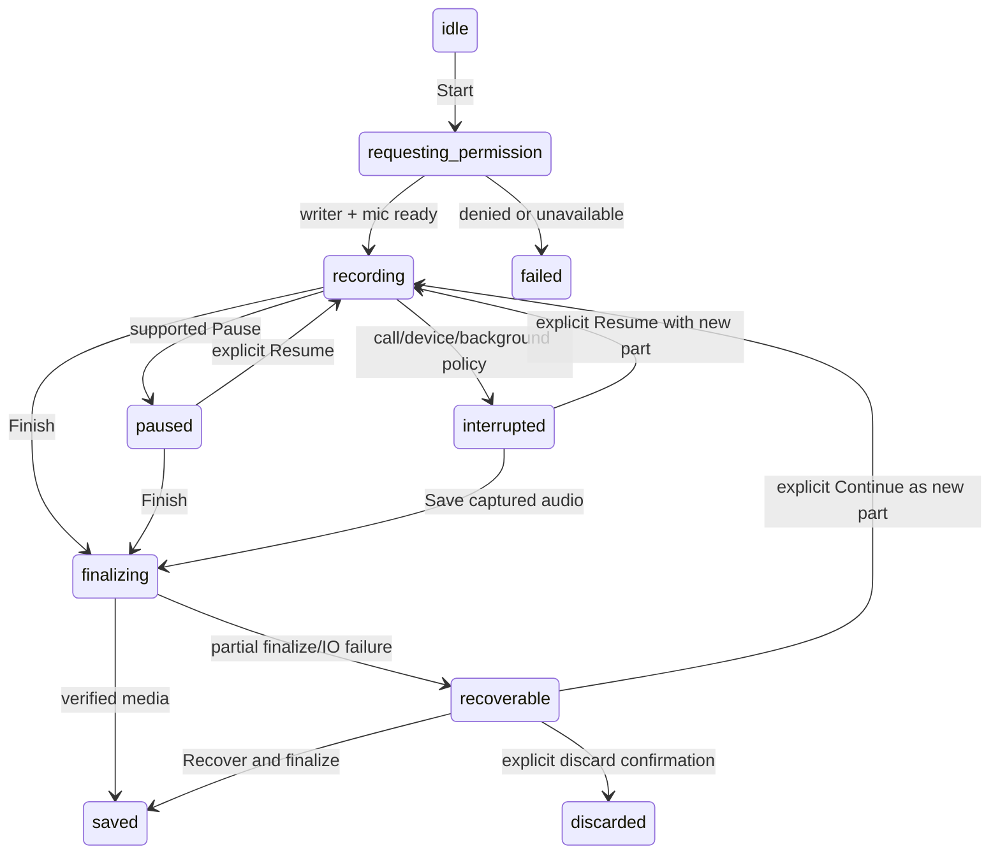

## Context

See proposal.md for motivation and audit.md for source evidence. React/Zustand owns presentation and existing task execution; Tauri/Rust/SQLite owns local durable records; Android/iOS plugins provide native capture/decoding. Today there are three transcript representations and several job dispatch paths. This design establishes a canonical contract **for recording sessions** and compatibility adapters for existing consumers, rather than migrating all media products at once.

## Goals / Non-Goals

Goals: save audio before inference; support recorded/imported/transcript-only sources identically downstream; preserve real evidence; isolate proposed learning objects from active review; keep bounded work restartable; make every phase independently useful.

Design boundaries: no scheduler changes, new billing/provider catalog, second Assistant, new semantic index, replacement audiobook player or fake TTS edition. First-party native builds are the release target. Browser/PWA must reject unavailable durable capture explicitly; existing browser imports/review remain compatible. This is a proposal, so all interfaces below are **proposed**, not claims of existing exports.

## Decisions

### D1. One document, one recording session, independently optional assets

Create `recording_sessions` with unique `document_id`; the ordinary document is the source identity throughout. Audio/video session documents use existing `audio`/`video` fileType; transcript-only uses `markdown`. `documents.content` is the readable canonical-transcript projection, never the AI summary. Course/project uses collectionId, category and tags; “course/project” labels do not create new container tables.

Do not force `listening_sessions` to represent ingestion: its nonnullable edition FK and playback analytics have different semantics. Reuse capture/marker/result types and triage presentation through a session adapter. A later playback session can reference the recording's document naturally. One durable `recording_session_markers` ledger handles recording-time markers; no fabricated `audio_editions` row.

Repeated selection of the same source returns the existing session after a stream-computed SHA-256 lookup within the user's collection, with explicit “Create separate session” available. Cross-collection duplicates offer opening/moving the existing document without reupload/retranscribe; explicitly separate sessions own separate private copies. Similar filenames and matching transcript text alone do not imply media identity. Record and import share `finalizeIngestion(sessionId)` and every subsequent contract. Format/content profile affects metadata and output preferences only.

### D2. Ownership and incremental media storage

Extend the existing unique private media staging helpers. Proposed managed root: `<app_data>/incrementum/recordings/<session UUID>/`; UUID paths never contain user titles. Files are owner-private under the existing application sandbox; this is not a promise of encryption at rest. Media access goes through the existing local media-server/asset URL infrastructure, never persisted Blob URLs. Store relative managed paths; canonicalize/check containment natively and refuse symlink escape. Native plugins receive a validated session token and resolved destination, not arbitrary caller paths.

`media_assets` owns the immutable original or capture stream, checksum, mime, bytes, actual duration, and `staging|ready|partial|missing|deleting` state. `recording_parts` records ordered committed ranges and hashes. V1 does not share physical asset paths between sessions: exact reuse opens the existing session and separate-session creation copies privately. Check existing references before deletion and never remove a path owned by another source; future physical sharing requires an explicit association/refcount migration. A derived 16kHz decode is disposable and separately identified. Neither successful STT nor cancellation deletes the original. App cleanup/staging sweep must exclude active and recoverable recording roots.

Write protocol:

1. Create session/document/asset and a private manifest before requesting capture; permission denial leaves an explicit empty/retryable session, not a “saved” success.
2. Write a fragment to `.partial`, flush/sync, rename atomically, then append sequence, bytes/hash, sample range and writer epoch to an atomically replaced manifest. On desktop also commit the DB acknowledgement before saying **Saved**.
3. Native background writers use the same versioned manifest protocol while WebView/SQLite dispatch is suspended. On reentry, Rust reconciles verified files/manifest to SQLite idempotently. File durability is authoritative for recovery; UI never uses an unverified event as a save acknowledgement.
4. Crash between file rename and DB commit leaves an orphan part that recovery validates and adopts. DB ahead of missing/corrupt part marks a gap and preserves other parts. Never advance acknowledged duration past a failed write.
5. Finalize only after draining bounded writes. Keep original parts until a verified playable asset exists. A playlist is a valid partial asset: do not discard audio because remux fails.

Capture adapters implement a single contract:

```ts
type RecordingState = 'idle'|'requesting-permission'|'recording'|'paused'|
  'interrupted'|'finalizing'|'saved'|'recoverable'|'failed'|'discarded';
interface CaptureCapabilities {
  available: boolean; pause: boolean; background: boolean;
  liveCaptions: boolean; reason?: string;
}
interface CaptureHandle {
  sessionId: string; writerEpoch: string;
  pause(): Promise<void>; resume(): Promise<void>;
  finish(): Promise<{assetId: string; incomplete: boolean}>;
}
// Snapshot is read from durable/native state, not a component-local boolean.
interface RecordingHealth {
  acknowledgedMs: number; pendingBytes: number;
  lastCommitAt?: string; state: RecordingState; errorCode?: string;
}
```

Desktop: retain MediaRecorder only as the platform capture adapter, using supported MIME probing (WebM/Opus preferred when available; MP4 only after capability/recovery test), `start(1000)` and a serialized binary append bridge. No whole-session PCM tap. Persist timeslice fragments with initial container header and stream ordering; they are **not** assumed independently decodable. Reconstruct the contiguous byte stream and remux with the existing desktop ffmpeg resolver. Recovery must demonstrate playable committed prefixes, including a truncated final cluster. If MIME/recovery support fails, disable Record with a supported import alternative until that adapter passes; never call a Blob URL durable. Native macOS file capture is a follow-up only if WKWebView MediaRecorder fails the explicit gate, not a speculative cpal dependency.

Android: extend `plethora-android-speech` with recording commands and `RecordingCaptureService`; use AudioRecord → bounded worker → rolling 5-second PCM WAV parts. Use actual device sample rate/channel format, with capture sample counts defining time. Pause releases capture input and resumes as a new part. The existing `plethora-android-stt` decoder/service remains the **file transcription** implementation. A second STT/model subsystem is forbidden. Live captions may tap the same captured PCM if supported; never acquire a second microphone recognizer. Until shared-input ML Kit is verified, omit captions and transcribe after save.

iOS: extend the existing Apple plugin with `RecordingBridge.swift`; one AVAudioEngine input tap copies into a bounded serial writer, rolling 5-second PCM WAV parts (write/fix headers off the realtime callback). Reuse the audio session and microphone arbitration with composer speech. Start in foreground; initially stop and commit on background/interruption. Continuous background capture is a separately tested capability flag requiring appropriate configuration; its absence never prevents saving a foreground recording. Do not present live recognition as an audio recording. Speech output is independent of capture-file success.

Backpressure: at most 4 MiB pending audio and 2 outstanding IPC writes; native PCM ring at most 2 seconds. If the oldest pending data is >3 seconds behind, request a supported pause; otherwise stop capture as `recoverable` and show storage failure. Flush committed prefix and retain all durable parts. No dropping a middle part to “catch up.” These are implementation limits, tested with fake clocks; on-device envelopes may be lowered, never unbounded.

### D3. Recording lifecycle and time

Allowed transitions:



No automatic microphone restart after crash, incoming call or grant change. Recovery offers **Review recovered recording**, **Continue recording** (new part, permission/capability checked), **Export audio**, and explicit **Discard**. Continuing after downtime does not claim to reconstruct missed audio. Store wall-clock start/end and monotonic active sample durations separately; pauses/downtime are excluded from media time and shown as discontinuities when relevant. Device format changes roll a new part; assembly/transcription uses the part timeline map.

Extend `captureOwner.ts` to identify purpose/session and release idempotently; native plugins also enforce owner/epoch because JS can disappear. Late callbacks with old epoch are ignored. Finish and interruption drain exactly once; navigate-away retains the root controller; Close minimizes the screen, not stops/discards capture. Explicit delete is a separate action. Browser captions are disabled by default until their network behavior is known/disclosed. Temporary live text never supplies “final” transcript evidence or exact quotes.

### D4. Concrete persistence contract

Add migrations at the next available `MIGRATIONS` position; do not preassign a numeric prefix that can collide with concurrent changes. SQLite foreign keys remain enabled outside a transaction; all rebuild verification is transactional and tested. Proposed tables/columns (TEXT IDs are UUIDs; time values below are integer ms unless `_at`):

| Table | Required fields and indexes |
|---|---|
| `recording_sessions` | `id PK`, `document_id UNIQUE FK documents`, `origin(recorded/file/transcript/url)`, `content_type`, `profile_json`, `capture_state`, `ingestion_state`, `transcript_id FK transcripts nullable`, `media_asset_id nullable`, `transcript_revision DEFAULT 0`, `overview_json nullable`, `overview_revision nullable`, `created_at`, `updated_at`, `version DEFAULT 1`. Index updated_at. Document title/privacy/collection remain on documents. |
| `media_assets` | `id PK`, `session_id FK`, `kind(original/capture/derived)`, `relative_path`, `mime`, `byte_length`, `sha256 nullable until final`, `duration_ms nullable`, `state`, `source_url nullable`, `source_adapter nullable`, `created_at`. Index `(sha256,kind)` for reuse; store credential-free URL only. |
| `recording_parts` | `asset_id FK`, `writer_epoch`, `sequence`, `relative_path`, `byte_length`, `sha256`, `start_ms`, `duration_ms`, `format_json`, `committed_at`; PK `(asset_id,sequence)`; unique writer epoch/sequence request key. Part times are measured, not transcript alignment. |
| `recording_session_markers` | `id PK`, `session_id FK`, `kind(interesting/confusing/recent-extract/card-candidate/bookmark)`, `media_ms`, `window_ms`, `part_sequence nullable`, `note nullable`, `evidence_json nullable`, `state(pending/resolved/needs-confirmation)`, `created_at`. Index `(session_id,media_ms,id)`. |
| `session_analysis_runs` | `id PK`, `session_id FK`, `transcript_revision`, `profile_hash`, `task_version`, `generation_epoch`, `status`, `blocked_reason nullable`, `completed_units`, `total_units`, `lease_owner nullable`, `lease_expires_at nullable`, `created_at`, `updated_at`; unique `(session_id,transcript_revision,profile_hash,task_version,generation_epoch)`. |
| `session_analysis_units` | `run_id FK`, `unit_key`, `input_hash`, `segment_keys_json`, `status`, `result_json nullable`, `attempts`, `error_code nullable`; PK `(run_id,unit_key)`. The bounded coordinator uses these checkpoints, not an independent general job system. |
| `session_learning_drafts` | `id PK`, `session_id FK`, `run_id nullable` (manual drafts allowed), `kind(card/extract)`, `status(proposed/rejected/accepted/superseded)`, `revision`, `payload_json`, `evidence_json`, `content_hash`, `concept_key nullable`, `duplicate_json nullable`, `accepted_target_id nullable`, `created_at`, `updated_at`; unique `(session_id,run_id,content_hash,kind)` where run_id is nonnull; index `(session_id,status,created_at,id)`. |
| `learning_object_sources` | `id PK`, `target_kind(card/extract)`, `target_id`, `session_id nullable`, `document_id`, `evidence_json`, `evidence_hash`; unique `(target_kind,target_id,evidence_hash)`. No cascading deletion of an accepted card when a session/source is deleted: retain its snapshot with source unavailable. Explicit session-data erasure removes retained sensitive snapshots if requested. |

`SessionContentType = lecture|meeting|seminar|interview|presentation|podcast|voice-note|other`. Unknown future type values load as `other`, preserving the raw metadata. Pipeline stage states are independent: ingestion `staging|saved|partial|failed|cancelled`; STT uses existing queue statuses plus nullable blocked reason; analysis `idle|queued|running|blocked|partial|completed|failed|cancelled`. There is no single misleading “session completed” boolean.

Extend `transcripts` with nullable session linkage/revision metadata. **Reuse `transcript_segments` as canonical**, adding `segment_key TEXT`, `ordinal INTEGER`, `speaker_id TEXT nullable`, `timing_kind(measured/imported/none)`, `revision INTEGER`, `metadata_json TEXT nullable`. Rebuild only this table to make start/end nullable. Copy all IDs, timing/text/confidence/words and indexes unchanged; existing rows get deterministic `legacy:<id>`, ordered ordinal and measured timing. Unique `(transcript_id,segment_key)` prevents retries duplicating; preserve the old checkpoint index for legacy workers. Null times are valid only when timing_kind=none; paired nonnegative ordered times otherwise. Do not infer missing confidence=1.0 in the new mapper.

For a session use `book_id = chapter_id = document_id`, matching existing native imported-media keys. A stable segment key is `<transcript-id>:<source-unit-key>:<segment ordinal within committed unit>`; source unit is a fixed part/decode window, not an unstable provider timestamp/text hash. Repeated text is valid. Retries reuse committed unit keys; deliberate model retranscription creates a new transcript revision, not silent replacement of accepted evidence. Editing text keeps segment_key and increments revision; splitting records old→new mapping in metadata, with old evidence snapshots retained.

Legacy timed readers use explicitly timed queries/mappers for these session rows; generic session readers consume nullable timing. Do not change legacy return types to nullable indiscriminately. Replace session callers of destructive `save_transcript` and video JSON writes with incremental canonical upsert. `video_transcripts` remains a compatibility projection for existing consumers, never a second session writer. Untimed paragraphs are excluded from time-based views, not assigned zero or a made-up end.

### D5. API and source contract

Proposed `src/types/recordingSession.ts` and `src/api/recordingSessions.ts` expose camelCase DTOs; Rust uses serde `rename_all = "camelCase"`. Existing command naming is retained. Rust internal segment IDs may remain integers; only `segmentKey` is the stable public session identifier.

```ts
interface SessionTranscriptSegment {
  segmentKey: string; transcriptId: number; ordinal: number; revision: number;
  text: string; timing: {kind:'measured'|'imported';startMs:number;endMs:number}
    | {kind:'none'};
  speakerId?: string; confidence?: number;
  words?: {text:string;startMs:number;endMs:number;source:'measured'|'imported'}[];
}
interface SessionSourceEvidence {
  version: 1; documentId: string; sessionId: string; assetId?: string;
  transcriptId: number; transcriptRevision: number; segmentKeys: string[];
  quote: string; // exact immutable source snapshot, bounded to 8k characters
  ranges: {segmentKey:string;startUtf16:number;endUtf16:number}[];
  time?: {startMs:number;endMs:number;kind:'measured'|'imported'};
  section?: {id:string;label:string}; speakerId?: string;
  markerIds: string[]; precision:'segment'|'section'|'document';
  fingerprint: string;
  generation?: {taskId:string;taskVersion:string;provider:string;model?:string;
    createdAt:string;inputHash:string};
}
interface SessionLearningDraft {
  id:string; sessionId:string; revision:number;
  kind:'card'|'extract'; status:'proposed'|'rejected'|'accepted'|'superseded';
  payload: {kind:'card';candidate:LearningCardCandidate}
    | {kind:'extract';verbatimText:string;summaryNote?:string};
  evidence:SessionSourceEvidence[];
  duplicate?: {cardId:string;similarity:number;method:string}[];
  acceptedTargetId?:string;
}
```

Evidence validation reads the canonical persisted revision and checks segment ownership, exact code-unit ranges, quote reconstruction and timing containment. Normalize transport line endings once at transcript import, then hash canonical text. Equations/technical case/Unicode are not stripped; offsets are UTF-16 at the frontend boundary and converted explicitly in Rust with surrogate-pair tests. AI never supplies trusted timestamps: derive time from validated segments. Evidence may reference multiple segments, but never unrelated segments to pad a hallucinated answer. Speaker is omitted if unavailable. “Provenance confidence” uses categorical precision/alignment source, not an invented probability.

Command surface (all new, implemented in `commands/recording_sessions.rs` and a repository module):

| Command | Inputs / output and rule |
|---|---|
| `create_recording_session` | origin/content type/collection/title/privacy → session and document IDs; no mic/AI side effects. |
| `stage_session_media` | sessionId + native picked/staged source token → owned asset; stream copy/hash, no whole binary JSON. |
| `append_recording_part` | sessionId/epoch/sequence + bounded binary attachment → verified commit acknowledgement; native writers can commit manifest directly under same protocol. |
| `finalize_recording_session` / `recover_recording_session` | sessionId + expectedVersion → verified asset or explicit partial state; idempotent. |
| `import_session_transcript` | native staged path/encoding policy → canonical segments and projection; parse before replacing any current revision. |
| `get_recording_session` / `list_recording_sessions` | id or collection + opaque cursor/limit (default 50, max100); source document authorization applies. |
| `get_session_segments` | sessionId + cursor/limit (default200,max500) or segment-key range → ordered page/revision; optional timed range. |
| `upsert_session_transcript_unit` | trusted worker jobId/lease/unitKey/expectedRevision + normalized segments → committed checkpoint and keys, one transaction. |
| `correct_session_segment` | sessionId/key/expectedRevision/text → updated revision; conflicting edit returns conflict, not last-write loss. |
| `add_session_marker` | client-generated markerId/sessionId/epoch/mediaMs/kind/window → durable marker ID; retrying the same markerId returns it unchanged. |
| `request_session_analysis` | sessionId/profile/expectedRevision/authorized selection → runId; does not activate items. |
| `update_session_draft` / `reject_session_drafts` | IDs/expected draft revisions/edits → updated drafts. |
| `accept_session_drafts` | acceptanceId + IDs/expected revisions + duplicate decisions → per-ID accepted/existing/failed result; each item atomic, batch resumable. |
| `get_session_sources` | target kind/ID → rich source associations for navigation. |
| `delete_session_media` / `delete_recording_session` | explicit retention mode + expectedVersion → deletion result; tombstone and filesystem cleanup journal prevent orphaned success. |

`src/services/recording/SessionController.ts` is a thin orchestration facade over these APIs and existing STT/task services. It is not a new provider/queue layer. Register commands/permissions through existing Tauri patterns and `invokeCommand`; nonnative backend responds with typed unsupported state until a tested persistence adapter exists. UI store caches summaries and active selection only; DB/manifest owns durable state.

Use a single typed error envelope `{code,stage,sessionId?,retryable,recoverableAssetId?,messageKey}`. Codes: `PermissionDenied`, `CaptureBusy`, `UnsupportedCapture`, `UnsupportedCodec`, `StorageFull`, `StorageUnavailable`, `InvalidTranscript`, `InputTooLarge`, `StaleRevision`, `SourceUnavailable`, `ConsentRequired`, `ProviderUnavailable`, `ThermalPaused`, `Cancelled`. Map existing provider/native errors at the adapter boundary; error details in UI are localized and content-free. Cancelled never triggers fallback, StaleRevision reloads rather than overwrites, storage errors retain recoverableAssetId, and provider/consent blockers leave ingestion saved. Binary append uses a dedicated bounded Tauri raw-body command (`tauri::ipc::Request`/Uint8Array) with session/epoch/sequence metadata in validated headers, at most1MiB per call split under the existing4MiB pending limit; never encode media into JSON/base64. Native background writers bypass this frontend transport and use the same manifest protocol.

### D6. Unified transcription dispatch, privacy and restart

Extend `TranscriptionJobManager` with `startSessionJob({sessionId,assetId,transcriptRevision})`. This is the only session start route. Use `resolveTranscription`, readiness hooks and `TranscriptionService` to build one concrete execution plan; fix session integration to honor provider/model settings and offline/privacy policy before dispatch. Resolve configured IDs against **actual executable adapters**, not model labels. Existing cloud/premium providers are eligible only if configured, capability-ready and already supported; never invent a provider or endpoint.

Persist session job metadata in existing `transcription_queue`: add nullable `session_id`, `asset_id`, `transcript_revision`, `executor`, `plan_json`, `lease_owner`, `lease_expires_at`, `cancel_epoch`, `blocked_reason`, `authorization_json`. Unique active target for session/revision. `plan_json` freezes actual provider/model/language/source revision and privacy category; it contains no API keys. Check current credentials at execution.

Executors: `rust-local`, `native-android`, `native-apple`, `frontend-service`. Existing AutoQueue claims only executable local work; add the executor predicate to its dequeue query. Native workers claim the same table before delegating to existing JobQueue/Android STT. The root controller claims frontend-service jobs using an atomic compare/update, renews a 30s lease every 10s and stops when its lease/epoch changes. Restart recovers expired claims; **never** two executors for one job. Existing non-session jobs keep their current dispatch until separately migrated. No extra persistent STT queue.

Local worker checkpoint must commit **segment batch + finished unit + durable processed position** together; DB failure fails/pauses job, leaves replayable input, and emits no successful commit event. Replace unbounded channels/segment lists with bounded delivery and acknowledgement; Android only discards acknowledged native pages. Use an explicit per-worker cancellation token and child-process termination support, not only an actor command. Cancellation increments epoch; late writes/completion CAS are rejected. Retain completed units and media; status remains cancelled until user Retry.

Decode windows are real slices: reuse Android `PcmDecoder`, use bounded AVAssetReader time-range export to temporary WAV units for Apple file recognition, and desktop ffmpeg `-ss/-t` file windows. Native recorded WAV parts can be consumed directly through a bounded reader. Initial STT unit maximum60s, 1s overlap if recognizer needs it; provider size/duration caps lower it. Commit each unit, offset all measured word times, deterministic boundary reconciliation with stable unit identity. Never call the same full file N times with a duration hint. Never collect all PCM in Rust or JS (`engine.rs` whole-WAV reads must be bypassed/replaced on session paths). Provider without time ranges can produce untimed text, marked `none`; do not synthesize measured timing. AI/recognizer failure leaves audio usable.

Cloud execution: reuse `ensureCloudAiDisclosure`, endpoint-aware privacy gates and existing paid-operation consent. Additionally require a durable session authorization scoped to endpoint/provider class, audio versus text, source revision, and user processing selection. No presenter/authorization means `blocked_reason=consent-required`, even in headless workers. Recheck `isLocalOnly`, `isAiExcluded`, offline state and policy at dispatch and before every chunk/retry; cancel revokes in-flight authority. Local-only allows verified local STT, not remote fallback. AI-excluded prevents AI generation/indexing and automatic STT; user can explicitly change the flag before inference. Manual import/playback/extract remain available. A configured Apple/system speech service is not assumed local: require explicit on-device recognition support, or disclose it as remote. Automatic fallback cannot cross privacy/cost tiers without authorization.

UI stages are independent of percentages. Byte copy/actual decoded duration/committed analysis units can be determinate when denominator is known. Preparation/provider waiting/overview reconciliation use text or indeterminate progress. Queue events include jobId, sessionId, revision, stage and committed counters; the current global `activeProgress` is insufficient for simultaneous sessions. Navigation unmount does not cancel work. Desktop process exit checkpoints; mobile suspend checkpoints or native service continues only as permitted. Root frontend cloud/AI work pauses on suspend and restarts from committed units on foreground; do not promise execution with a killed WebView.

### D7. Transcript imports, correction and playback

SRT/VTT parsers are pure functions with fixtures: UTF-8 BOM, CRLF, multiline cue, cue ID/settings, overlaps, Unicode and invalid timing. Preserve cue times as `imported`, validate nonnegative end≥start, retain overlapping speech in source order (no assumption of monotone ends). Strip VTT cue markup safely for canonical text, retaining source snapshot. File size default20MiB for transcript parser, with explicit error or native streaming parser for larger files; no silent truncation. TXT imports paragraph boundaries and `timing:none`; no speaker identity is inferred. SRT timestamps without media can navigate the transcript cue, but show no playable audio link. Association with later media is explicit and timing validity rechecked against actual duration; never auto-match by basename alone.

Playback uses existing media server and player primitives, with an adapter for recording-part playlist seeks. No embedded rewrite of the 4,000-line AudiobookViewer. Virtualized segment list, 200-row pages, indexed timed lookups and binary search on loaded ranges keep long transcripts usable. Selected exact text/ranges survive toolbar dismissal; existing selection controller handles mobile. Transcript corrections update canonical text and debounced document projection/FTS (bounded500ms, flush on blur), invalidate affected index/analysis units and label previously generated overview/drafts stale. Editing while STT is active first pauses it at a committed unit boundary; the correction increments revision and explicit continuation adopts the new expected revision without rewriting corrected segment keys. Unaffected draft IDs survive. Accepted extracts/cards retain their immutable evidence snapshot and show “Transcript changed” when reanchoring cannot be verified. No automatic edits to learning history.

### D8. Hierarchical analysis without redundant inference

Add structured `session-section-analysis` and `session-overview` task definitions using `runTask`, containment, provider routing and output validation. Reuse `LearningCardCandidate`, Learn This validation, card quality and duplicate helpers. Section analysis returns outline/topic hints, concepts, evidence refs, proposed verbatim extracts, optional cards and profile-specific observations in **one request**, avoiding separate classify/summarize/extract/card calls for the same passage. Register task versions; use existing schema support/fallback JSON repair, not a native-only schema dependency.

Budget algorithm: `available = min(model.contextTokens - systemTokens - outputReserve - 256, 6000)`, `outputReserve = min(1500, floor(contextTokens/3))`; refuse/offer manual action if available<512. Form units of ≤min(2000, available) source tokens using sentence/segment boundaries; ≤128-token previous-unit overlap, attributed as context-only. Split oversize single segments into deterministic code-unit ranges with the same segment key. At most8 cards and2 per concept per section, max3 verbatim extract proposals. Quote lengths≤8k chars. One run defaults to maximum40 proposed cards and40 extracts; once reached, later units may yield concepts/outline only. User explicitly requests more; label coverage incomplete when budget/cap stops learning suggestions. Transcript access never waits on analysis.

Topic grouping uses pauses/known chapters and prior unit's validated short topic summary; no required separate LLM segmentation pass. Reconcile concepts lexically/canonical IDs first, then optional existing embeddings; hierarchy groups≤8 section summaries, ≤300 tokens each, into bounded overview requests until a single overview fits. Model receives only validated summaries with source keys, never unbounded original transcript. Persist each unit/overview result and its input hash. Cache key includes revision, profile, task version and provider/model; runTask coalescing alone is not a durable cache.

Concurrency: one heavy task on mobile; desktop at most2 analysis units only when not competing with recording/local STT. Pause analysis during recording by default, on thermal pressure and on suspend; follow existing charging preferences. Initial run estimate shows source units and expected calls, not invented currency. Reuse known provider pricing where available; if unknown show “Provider may charge”. Default run cap64 section requests; beyond that mark remainder deferred and require explicit continuation with updated estimate. Summary tree calls are counted in the displayed run budget as well (maximum16 by default); no silent expansion. Transport retries at most2 with 1s/4s backoff; `runTask`'s one JSON repair counts as an additional request in that budget. Validation failure after repair yields a failed unit; successful units stay available. Retry unit only; Regenerate creates a new epoch and supersedes unaccepted predecessor drafts after new results validate. Cancellation is never a trigger for fallback.

Evidence must quote canonical text exactly and cite owned keys/ranges. Grounding/quality failures are blocked, editable suggestions with explicit reasons or omitted; accepting an edited card revalidates evidence. Presence of evidence does not mathematically prove an inference: unsupported new facts remain blocked. Do not use lexical overlap as proof of semantic correctness. Math/technical notation copied unchanged; if ASR garbles an equation, request correction instead of reconstructing it. “Emphasized” requires explicit verbal/user-marker evidence; no fabricated acoustic emphasis classifier. Summaries render as **AI summary**, never quotations or canonical transcript. No automatic indexing of summaries/drafts as source knowledge.

### D9. Profiles and duplicate policy

| Profile | Default authorized outputs when enrichment selected |
|---|---|
| Lecture | concepts/definitions/explanations/examples, study outline, extract proposals, card drafts |
| Meeting | decisions/actions/questions/commitments with quoted evidence; **cards off** |
| Interview | questions/answers/insights/notable verbatim passages; cards off |
| Seminar/presentation | arguments/evidence/key takeaways; cards off until selected |
| Podcast | concepts/outline/extract proposals; cards optional |
| Voice note/other | concise outline/extract proposals; cards optional |

Profile is versioned preferences JSON, not a separate pipeline. Default enrichment is off until the user selects “Prepare study suggestions” on Capture & Import (or a preserved applicable global preference); selected choice authorizes generation subject to endpoint/privacy gates, not card activation. Users can override outputs before or after ingestion. This explicit per-session selection is the intended refinement to Apple's existing optional-processing spec.

Compare within a run and against cards in the selected collection/course using paginated/indexed queries, not all library items in JS. Exact canonical content/source identity suppresses repeated proposals; lexical detector uses existing0.75 default, server create guard0.85 remains respected. Embedding similarity is advisory only when an existing index/model is ready. Record method/score/card ID; do not require embeddings for offline draft review. Compare side by side, then **Use existing** (append a source association only), **Skip**, or explicit **Keep both**. No automatic merge, rewrite, reschedule or review-count change. P2 concept relationships can use existing knowledge API; P1 already avoids silent duplicates across overlapping sessions through card/source fingerprints.

### D10. Approval and Flashcard Studio reuse

Session drafts reside only in `session_learning_drafts`, not suspended FSRS rows or capped localStorage. Extract reusable DraftCard editor/list/presentation from FlashcardStudioModal into `src/components/review/studio/`; retain current props/behavior for legacy mode. Add `sessionDraftSource:{sessionId}` to the Studio seed/adapter; use stable durable draft IDs, paginated DB data, revision checks and backend acceptance. Opening a session draft must never populate `extractId` (which triggers the legacy eager generator); use `linkedExtractId` only for an existing extract and explicit draft payload. Existing extract picker can keep its historical API semantics; session entry never calls it. Fix Inbox “Make Flashcard” to open an editable source-seeded Studio draft, replacing generic automatic question creation, with a regression for ordinary listening sessions.

`accept_session_drafts` composes transaction-aware **existing domain creation** helpers: LearningItem::new/type mapping, repository insert/tree/count maintenance, extract creation, cloze normalization and provenance insert. Refactor shared internals to accept one SQLite transaction; do not call public Tauri command functions from other commands or duplicate insert/scheduler logic. Reuse existing cloze format conversion with verified markers and UTF-16→Rust offset mapping. Definition/comparison/cause/process are authoring flavors of existing qa/flashcard; cloze remains cloze, not new scheduler types.

For each accepted draft, transaction: compare expected revision/status; validate source/privacy/duplicate decision; if already accepted return target; construct normal domain item; insert source association and AI provenance; set accepted_target_id/status; commit. Any failure rolls back that item's card/extract/provenance. A batch returns per-item outcomes and retries failed items safely; accepted IDs never re-create. Acceptance ID and draft uniqueness plus compare-and-swap cover double clicks, lost replies and concurrent windows. Do not claim whole-batch atomicity: each item is atomic and batch progress is explicit. Required domain metadata commits first; daily-note append/search/sync notifications run after commit with retryable outbox semantics and cannot cause a duplicate card on response loss. No media automatically uploads through accepted card sync; privacy flags remain binding.

Reject changes only draft status; it never creates or deletes a review item. Accepted objects survive deleting their Studio workspace or rejecting different drafts. Generated extract acceptance uses actual quote as extract.content; rewritten user notes go to notes and are labeled. AI summary text cannot be relabeled as a verbatim extract. Editing already accepted objects follows existing content versioning, not draft replacement.

### D11. One navigation and retrieval contract

Extend `cardSourceNavigation` and `audioCaptureNavigation` to query/resolve rich session source associations lazily. Keep `CardSourceReference` version1 and its legacy fallback for other cards. For direct session cards write a compatible bounded envelope (audio locator if media+valid timing, Markdown quote locator otherwise) **and** full `learning_object_sources`. Extract-backed cards continue to prefer extract linkage; extract selection_context carries a versioned `session_transcript` evidence locator supported by the shared resolver. Rich evidence is not silently squeezed into the 300-char envelope.

Resolution: validate document → locate current segment keys/revision/ranges → match immutable quote uniquely if revision changed → exact segment/cue; seek only if associated asset exists and validated timing maps to it. Otherwise section/document fallback with “Exact passage unavailable” or “Audio unavailable.” SRT-only sessions open cue; untimed text opens paragraph, never a player at0. New session route is reached through the existing `openDocumentAtLocation` decision: if document has session metadata, resolve to LearningStudio; older clients still open ordinary media/Markdown. Preserve review-return context and selected workspace area.

Update `ai_learning/indexer.rs` to prefer canonical session segments before YouTube/video compatibility paths. Chunk text with stable segment-key range and optional actual timestamps; untimed sources use text locators. Extend existing chunk location JSON additively. Index after committed units/corrections, respecting exclusions; no parallel vector store. FTS continues using documents.content triggers. Session/course Ask uses existing Assistant/document/library context and explicit document IDs from the chosen collection. Validate returned citation IDs against retrieved passages and source keys; unavailable index reports “Indexing” and can use a bounded canonical excerpt, never whole hours in prompt. The unrelated Learning Agent integration is optional.

### D12. Platform capability matrix and rollout

| Platform | Existing verified reuse | Proposed capture/background default | Media decode/import rule |
|---|---|---|---|
| Linux/Windows/macOS desktop | native file picker, private copies, sidecar/media server, JS capture host | disk-backed MediaRecorder with startup/recovery probe; root lifetime across navigation; process exit recovers committed prefix | ffmpeg when installed/bundled and executable; player codecs probed separately; no false format promise |
| Android | SAF/native share copy, MediaCodec long-form STT and media-processing service | native rolling file recorder, foreground microphone service started by visible user action, permission/notification handling | private copy avoids reliance on share URI grant; persist SAF grant only when supported/needed; no all-files permission |
| iOS | scoped native file/folder copy, Apple plugin, generated target | native rolling writer, foreground safe-stop on background/calls; resume explicit | AVFoundation/system decoder capability probe; unsupported codec keeps file and explains conversion/import alternative |
| Browser/PWA | existing browser imports/cards and media APIs | no claim of native durability; feature unavailable until browser writer/restore tests pass | respect browser codec/storage/eviction capabilities; no silent fallback to Blob-only session storage |

Android microphone recording requires `FOREGROUND_SERVICE_MICROPHONE`, `RECORD_AUDIO` and an eligible visible start; file processing uses a different service type. The existing STT service does not confer recording permission. Android may time-limit media processing; checkpoint and offer continuation on timeout. See [Android service types](https://developer.android.com/develop/background-work/services/fgs/service-types). SAF long-lived access depends on the granted flags and document provider; staging a private copy avoids relying on it. See [Android document access](https://developer.android.com/training/data-storage/shared/documents-files).

iOS background recording needs the appropriate audio session/background configuration; audio interruption handling is required and background capability does not authorize indefinite AI work. First rollout intentionally safe-stops and persists if that capability is not certified. See [Apple recording category](https://developer.apple.com/documentation/avfaudio/avaudiosession/category-swift.struct/record) and [audio interruptions](https://developer.apple.com/documentation/avfaudio/handling-audio-interruptions). These are proposed compliance requirements verified against official documentation on2026-10-20, not evidence of current device behavior.

## Risks / Trade-offs

- **Container fragment recovery** → keep original bytes, probe supported MIME/remux and test killed-process prefixes before enabling desktop Record. Native rolling WAV is larger but recoverable and dependency-free.
- **Nullable timing alters an established table** → single transactional rebuild, seeded migration tests, timed adapters and rollback compatibility tests. No fake0 timestamps.
- **Multiple worker families** → one persistent job row, executor filter, leased claims/cancellation epochs and atomic unit commit; existing legacy jobs retain behavior until intentionally migrated.
- **Media growth** → duration/bytes display, low-storage safe-stop, explicit export/retention controls; no auto-deletion after AI. Default original retention is indefinite until user action.
- **Source correction versus accepted learning** → versioned transcript/evidence snapshots and explicit stale state; never silent propagation to accepted content/history.
- **Model cost/quality** → bounded units/calls, stored results, output caps, actionable partial success and evidence/quality blocks. No guaranteed transcript/LLM accuracy.
- **Startup/battery** → lazy Studio route, small pending-manifest scan only under recording roots, no library-wide inference on boot; prioritize recording and cap analysis work.

## Migration Plan

1. Add schema and transaction helpers with flags off. Backup/restore includes new session/source tables and manifest/parts; local media is not silently enrolled in cloud sync. Old documents/Studio keys untouched.
2. Add durable writers/recovery and gated capture adapters. Legacy Blob recordings can only be rescued while their process URL still resolves; copy bytes immediately on explicit migration. Dead legacy URLs show media unavailable and retain text; never invent recoverability.
3. Add session manager/canonical transcript read-write/queue executor adapters, then import and manual Studio; dual-read legacy transcript tables through a read adapter, with no dual writing for sessions.
4. Introduce analysis then approval; no hidden learning item creation on upgrade, mount or hydration. Backfill older media into sessions only via explicit “Open in Learning Studio”; reuse actual existing transcript when valid.
5. Enable per platform after validation.md gates. Add `features.recordingSessions` and `features.sessionLearningSuggestions` following existing settings migrations, defaults false until release certification, preserving explicit false. If exposed in Settings, add stable search targets/catalog/coverage/tests in the same implementation task.
6. Rollback disables entry/generation flags and stops new claims, drains/commits capture safely, keeps recovery/export reachable and leaves database intact. Do not down-migrate or delete assets. Older binaries ignore additive tables; legacy timed reads filter session-untimed rows by contract before any release permits binary downgrade. If that binary is incompatible, supported rollback is flag-off in the new binary, not an unsafe executable downgrade.

## Open Questions

Only empirical release details remain: which desktop WebView MIME/ffmpeg combinations pass recovery, which device codecs/local speech modes pass, and which iOS versions can enable continuous background recording. Defaults and failure behavior are already decided: gate unsupported capability, retain media, pause/checkpoint restricted work and show an import/manual alternative. No schema, provider or approval decision is deferred to the implementation agent.


## Approved implementation amendment — authoritative document privacy (2026-10-20)

The user approved `design-amendment.md` after implementation verified that the
frontend flags did not persist in the native document model. Task 0.3a is a
prerequisite for 0.4, 0.10, 0.11, 4.4 and 4.6. Native document columns are the
source of truth, with a policy version for intentional restriction changes.
Ordinary edits and incoming sync only add restrictions; absent/stale false flags
never clear a durable true flag. Legacy metadata/cache restrictions are promoted
and reconciled conservatively. An explicit compare-and-set command lowers a
restriction after reading its current version. New sessions start local-only.

Sync journaling and dispatch consult current document ownership, including
extracts, cards, review results and referenced images. Restriction revokes pending
source/derived outbox payloads. Already dispatched remote material is not claimed
to be erased. AI exclusion blocks canonical indexing; each inference batch checks
current source policy. Only verified on-device execution qualifies as local for
a local-only source: an arbitrary Ollama URL is not proof of local execution.
Local backup/export retains policy. Later session workers and acceptance commands
must call these shared guards, rather than inventing per-session policy fields.

Restricted source ownership retains ID-only bindings when source links are
removed, so deleting an extract/document cannot silently enroll derived private
text in sync. A live source's explicit policy relaxation clears its bindings.
Orphaned private objects remain local; phase 4.6 must include these bindings in
portable session/collection exports as well as the full local database backup.
