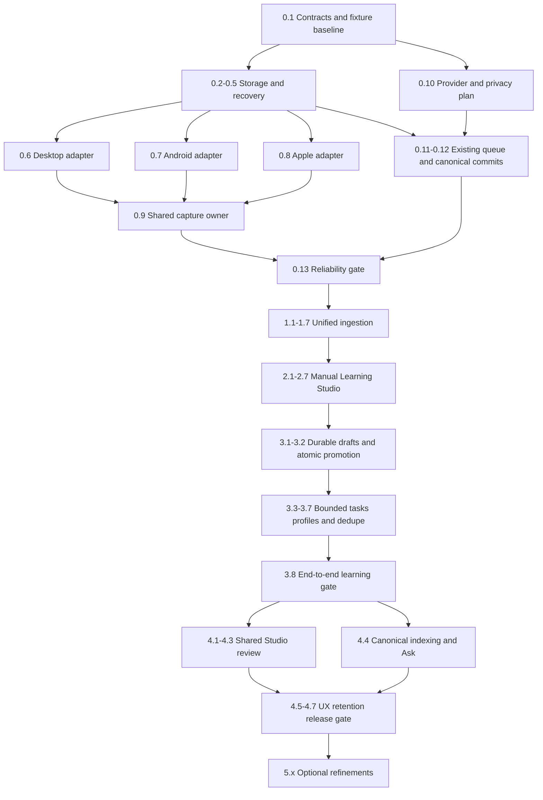

# Implementation handoff

This is a blueprint at `615570ff0301b97db7a27beec3d63db3fd04de89`, not completed software. No production files were changed to produce it. Read audit.md before interpreting archived claims; several baseline implementations contradict their specs. Treat interfaces in design.md as the agreed target, and existing APIs as reuse boundaries rather than automatic proof of compatibility.

## Start here and follow this order

**First task: tasks.md 0.1.** Freeze `src/types/recordingSession.ts`, deterministic fixtures and the measured baseline before changing capture or persistence. Do not begin with a large Learning Studio component or AI prompt. Then execute 0.2–0.5 storage, 0.6–0.9 capture and 0.10–0.13 transcription safety. Save a short real recording and reopen it after killing the app before expanding the UI.

Once foundations pass: Phase1 creates the shared four-origin ingestion journey; Phase2 provides playback/transcript/manual extracts/corrections/source navigation; Phase3 adds bounded analysis/drafts and transaction-safe acceptance; Phase4 exposes polished review/Ask/organization and certifies release. Phase5 is optional advancement, separately gated. Do not expose generation before 3.2 acceptance is safe. Each checked task needs its stated evidence; a source comment, compile success or mock alone does not certify a device capability.



Parallel labels in tasks.md are advisory file boundaries after dependencies, not a requirement to use multiple agents. Shared migrations, command registration and monolithic Studio edits must serialize. Git policy is commit on main if asked to commit; this request does not ask for a commit/push.

## Ownership and module boundaries

| Owner/boundary | Exact intended files | Responsibility / forbidden overlap |
|---|---|---|
| Durable source contract | `src/types/recordingSession.ts`, `src-tauri/src/models/recording_session.rs`, `src/api/recordingSessions.ts` | DTOs, tagged optional timing, expected revisions, typed errors; no provider selection or React rendering. |
| Local persistence | `src-tauri/src/database/migrations.rs`, new `recording_session_repository.rs`, new session commands | Session/assets/parts/markers/drafts/source association, indexed paging/CAS. Allocate next migration number at implementation; preserve established migration order and IDs. |
| Media writer | new `src-tauri/src/recording/`, existing unique staging/media-server helpers | Validate session roots; sync/rename/manifest/recovery; no inference; no arbitrary file path capability. |
| Capture adapters | new `src/services/recording/*Capture.ts`, Android speech plugin recording files, Apple RecordingBridge | Produce durable parts/health, obey native ownership/lifecycle. Native STT plugin stays file STT; no duplicate recorder hidden in Studio. |
| Capture controller | `captureOwner.ts`, new captureController/store, root host | State transitions, owner epochs, late-callback fencing, minimal shell strip; no component-local audio ownership. |
| Transcription | existing JobManager/TranscriptionService/Router/resolver/native STT/queues | Resolve actual plan, one durable queue row/claim, real bounded decode units, atomic checkpoints, metadata. No third provider resolver or parallel STT queue. |
| Analysis | new `services/recording/analysis`, two task definitions/schema | Unit planning, capped requests, validated proposals, overview tree and cache/checkpoint coordination; no direct learning-item mutations. |
| Domain approval | existing learning/extract/provenance repositories + session promotion | Shared transaction-aware domain helpers, per-item atomicity and stable target; no raw scheduler insert clone or nonfatal required provenance. |
| Studio UI | new recording workspace and extracted `review/studio` parts | Shared editor adapter, durable paginated drafts, exact sources and responsive views; preserve legacy localStorage sessions and eager API compatibility. |
| Navigation/index/Ask | existing source resolvers/openDocumentAtLocation/indexer/Assistant | Rich evidence association plus legacy fallback; canonical segment chunking and existing conversation/retrieval; no second chat/vector store. |

New directories proposed above do not authorize stubbing entire duplicate subsystems. Start with the named smallest file in the active task. Search current HEAD again for newly landed equivalents before creating a file; adapt imports if another change has already supplied the same helper.

## Contracts the next agent must preserve

1. **Identity:** session.documentId identifies one ordinary document. Recorded/file/transcript/URL converge after durable save. Existing imported transcripts may satisfy STT; no unnecessary retranscription.
2. **Durability:** verified files/manifest precede Saved health; DB catches up idempotently; event delivery is not a commit. Capture remains independent of speech/generation.
3. **Time:** sample/media time excludes pause; actual transcript timing is measured/imported/none. Source segment order is independent of overlapping cue end times. Transcript-only timed cues are navigable but not playable.
4. **Storage:** canonical session source is existing transcripts/segments with stable keys/revisions. Document content is a projection, video JSON compatibility only. Rich accepted evidence lives in `learning_object_sources`; version1 card envelopes remain compatible.
5. **Jobs:** existing transcription_queue owns durable work. Session executor filters/leases prevent duplicate dispatch; cancellation epochs fence stale writes. Save segments and unit checkpoint together. AI run checkpoints are bounded task progress, not a general agent/queue framework.
6. **Approval:** drafts are outside learning_items. Each promotion atomically persists normal domain object + source + AI provenance + draft status. Batch is per-item atomic with explicit partial outcomes; acceptance retries return existing targets. No surprise suspended “draft” review rows.
7. **Privacy:** local-only/offline/excluded/current consent is checked before every operation. Existing no-presenter disclosure bypass is insufficient for session workers. Provider category/name never proves a local endpoint. Media does not silently join sync.
8. **Corrections/dedup:** accepted content/history stays intact. Updating source version marks stale objects; matching quote must be unique before exact navigation. Use existing adds evidence only, not scheduling changes.

Use `SessionTranscriptSegment`, `SessionSourceEvidence`, `SessionLearningDraft` and `CaptureHandle` in design.md as exact interface starting points. `LearningCardCandidate` is the existing AI schema, not a new scheduler type. Serialize TypeScript UTF-16 offsets intentionally at Rust boundaries. Neither fnv1a IDs nor generated quote hashes are evidence of media byte identity; source/media checksums use the existing SHA-256 dependency.

## Reuse map and traps

- `src-tauri/src/commands/document.rs:63` unique staging is useful; `import_document` also creates documents and may auto-route, so do not call it blindly after creating a session document. Audio already copies privately; video needs the same ownership guarantee.
- `src/api/documents.ts:647` and the folder-import plugin avoid large JS base64 copies; do not replace with FileReader or import_document_from_bytes for long media. Android tree permissions and temporary share permissions differ.
- `src/services/transcription/jobs/TranscriptionJobManager.ts:87` is not a functioning chunk slicer. `auto_queue.rs` is local-only; sending cloud metadata there is not orchestration. Preserve existing local resume helpers and fix session dispatch at the public boundary.
- `transcription/engine.rs` includes whole-WAV reads despite chunk-oriented comments. Session jobs must supply real bounded files/streams. Native Android bounded PCM decode is available; the native segment result list also needs bounded acknowledgement.
- `SpeechProvider` segment metadata is broader than the lecture save path; normalize it, do not flatten to Markdown. Inspected Apple iOS code uses SFSpeech, so enforce local eligibility explicitly rather than citing SpeechAnalyzer spec text as proof.
- `FlashcardStudioSeed.extractId` triggers eager generation; session mode must use a durable draft source, not that seed. Keep legacy `alreadyPersisted` semantics isolated, not transferred to session drafts.
- `acceptLearnThis.ts` is a useful authoring/type/validation reference; its separate nonfatal provenance write does not satisfy session atomicity. Cloze marker conversion needs canonical tests; do not copy a known format ambiguity.
- Existing `CardSourceReference` parser drops unknown properties and clamps300 characters. Store full evidence separately; do not silently rely on arbitrary JSON surviving it.
- Existing listening sessions require an audio edition; recording sessions must not fabricate one. Keep listening analytics separate from recording duration.
- Indexer currently uses YouTube/video JSON; merely updating documents.content gives text search, not stable segment-level semantic citations. Extend that indexer once, subject to exclusions.
- No global background AI starts when flags hydrate. Capture has priority over local analysis. Stop/recover native work according to platform policy; a foreground file-processing service is not a microphone recording service.

## Verified commands and how to use them

The commands below were checked against package.json, Cargo.toml, Playwright config and available test paths. Only commands explicitly listed as executed in validation.md have been run for this proposal. Native/full builds are future implementation checks and may require toolchains/assets unavailable on this host.

```bash
# This documentation change: executed.
openspec validate unified-recording-ingestion-and-learning-studio --strict
openspec status --change unified-recording-ingestion-and-learning-studio

# Audited baseline: executed, 116 pass / 1 existing failure.
npm run test:run -- src/components/common/__tests__/LectureCaptureHost.test.tsx src/services/transcription/__tests__/persist.test.ts src/services/transcription/__tests__/reconciliation.test.ts src/lib/__tests__/transcriptionProvider.test.ts src/utils/__tests__/cardSourceNavigation.test.ts src/lib/ai/__tests__/learnThisValidation.test.ts src/components/review/__tests__/flashcardStudioSessions.test.ts

# Focused implementation TypeScript checks (include newly added session tests).
npm run test:run -- src/services/transcription/__tests__ src/lib/__tests__/transcriptionProvider.test.ts src/lib/__tests__/transcriptionRouting.test.ts
npm run test:run -- src/lib/ai/__tests__/learnThisTask.test.ts src/lib/ai/__tests__/learnThisValidation.test.ts src/lib/ai/__tests__/learnThis.eval.test.ts src/utils/__tests__/cardSourceNavigation.test.ts
npm run test:run -- src/components/review/__tests__/flashcardStudioSessions.test.ts src/components/review/__tests__/flashcardStudioSessions.integration.test.ts src/hooks/__tests__/useShareTarget.test.ts src/hooks/__tests__/useShareTargetDedupe.test.ts
npm run test:wave5:regression
npx tsc --noEmit
# Replace paths with actual touched source files; do not run --fix for a check.
npx eslint src/types/recordingSession.ts src/api/recordingSessions.ts src/services/recording

# Rust focused units. Tests with 'recording' are new tasks' required names.
cargo test --manifest-path src-tauri/Cargo.toml --lib recording
cargo test --manifest-path src-tauri/Cargo.toml --lib transcription
cargo test --manifest-path src-tauri/Cargo.toml --lib database::migrations
cargo fmt --manifest-path src-tauri/Cargo.toml -- --check
cargo check --manifest-path src-tauri/Cargo.toml --lib

# Native import integration already has an actual package script.
npm run test:ios:imports
# Android Gradle module name is resolved from generated settings, not guessed.
cd src-tauri/gen/android
./gradlew projects
# Then run the existing plugin module's testDebugUnitTest task for
# plethora-android-stt / plethora-android-speech using listed project paths.
```

For Swift, use the project's actual Xcode target/scheme on macOS and pure mapper/writer tests; do not prescribe a nonexistent `swift test` target as a substitute. Check `xcodebuild -list` on that host and record the resolved test invocation. Existing iOS smoke scripts are `npm run test:ios:smoke` and `npm run test:ios:e2e`; select them only after bootstrap/device prerequisites are met. These names are verified scripts, not claimed passes.

```bash
# From repo root after UI/tests exist; Playwright config serves port5199.
npm run test:visual -- src/visual/recording-session.visual.spec.ts
npm run test:scripts
npm run docs:validate
npm run lint
npm run bench:check
npm run check:bundle
# Memory driver is a separate existing gate where applicable.
npm run bench:memory:check
```

`recording-session.visual.spec.ts` is proposed and must be authored before invoking it. Add deterministic seeded unit-planning/dedup/locator benchmarks using `seededRandom` and a consumed result; no timing-dependent fixtures/network/native runtime in benches. Intentional performance baseline changes require rationale in the implementation change notes and matching budget updates. `npm run build:check` includes docs generation, TypeScript, Vite build and bundle check; reserve it for actual implementation integration, not this proposal. `npm run test:scripts` actually uses `scripts/__tests__/*.test.mjs`, despite the AGENTS prose saying `.test.ts`.

## Phase checkpoint meanings

| Phase | Complete means | Must still work if next phase never ships |
|---|---|---|
| 0 | Certified adapters save/recover committed audio; canonical metadata, bounded STT and privacy-safe dispatch pass | Capture/playback/export, local provider errors and legacy imports/review |
| 1 | Four supported entry routes create owned sessions; batches/duplicates/organization and no-provider path work | Record/import/reopen/retry without manual cross-view processing |
| 2 | Usable overview/processing/transcript/player, manual extracts/cards/correction/source return | Manual learning without generative AI |
| 3 | Bounded analysis produces durable validated drafts; atomic acceptance/rejection/dedupe pass | Safe small end-to-end lecture/import learning through API/shared editor |
| 4 | All seven screens, polished approval, existing Ask/index/library/FSRS, retention/backup and A01–A18 certified | P0/P1 release with optional capabilities honestly gated |
| 5 | Each chosen refinement independently passes its tests/device prerequisites | P0/P1 remains usable with every P2 feature disabled |

## Concurrent proposals and landing discipline

Re-read current versions of active proposals listed in audit.md before touching their shared files. Provider-routing and Android STT adapters are reused as implemented at baseline; GPU runtime policy is outside scope. Initialization/diagnostics adapters can be consumed if landed, but their Settings UIs cannot block recording. Learning Agent is optional; direct bounded session tasks and existing Assistant handoff work without it. Knowledge relationships are a hard dependency only for5.4. Reader selection/source-return changes own their shared contracts; session work extends the chosen version with fixture coverage, not a parallel implementation.

Do not change another proposal's tasks/specs to make this one look complete. If a shared acceptance helper lands elsewhere, use that helper and record the dependency instead of cloning it. New migration identifiers and command registration must be reconciled on current main. Feature rollout waits for contract tests and real device gates; “all checkboxes done” is insufficient when platform evidence is missing.

## Changes that must not be made

No production feature implementation during this proposal task. During implementation: no new scheduler/card types for authoring flavors; no reset or automatic rewrite of reviewed cards; no drafts in review tables; no immediate-persist API used as staging; no whole-session PCM/base64/Blob persistence; no silently deleted original; no automatic microphone resume; no undocumented remote speech fallback; no arbitrary URL/DRM acquisition; no fake speakers/timestamps; no competing STT/LLM/RAG/Assistant/organization system; no full desktop release build merely to check Markdown. Settings search and performance gates remain repository requirements.
