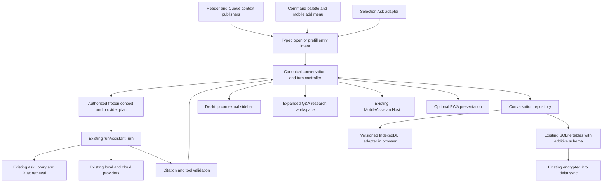
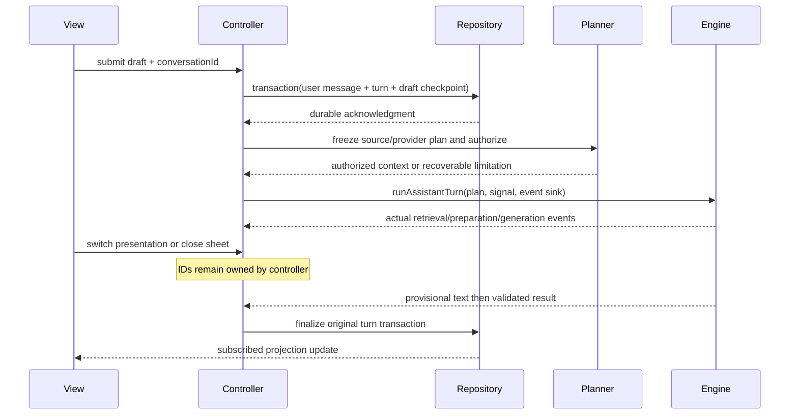

## Context

See [proposal.md](proposal.md) for outcomes and [audit.md](audit.md) for HEAD evidence, defects A1–A10 and predecessor ownership. The shared orchestrator, Rust retrieval, transcript planner, viewer locators, overlay stack, speech adapters and encrypted delta transport are retained. Shared invocation has not produced shared conversation ownership. This design adds the smallest durable domain boundary that all surfaces can use.

The interaction remains within Plethora's incumbent Material design: semantic surface/text roles, existing MD3 controls, tonal layering, reading typography, visible focus, reduced motion, 40px desktop and 48px coarse-pointer effective targets. No PRODUCT/DESIGN rewrite, new visual theme, dependency, backend, index or separate mobile host is required.

## Goals / Non-Goals

**Goals:** Make conversation identity independent of source/view; make each submitted request reproducible from an authorized immutable plan; preserve evidence end to end; retain recoverable user work under migration, navigation, failure and concurrent devices.

**Non-Goals:** Shared React component identity across all layouts, universal streaming, automatic internet access, unconstrained agent actions, exhaustive answers from top-k retrieval, or synchronization of private data/credentials/device paths. Research editor sessions remain distinct domain artifacts linked to a conversation, not silently merged into chat messages.

## Decisions

### D1. One repository and controller; responsive adapters

Add a domain package under `src/lib/ai/assistant/conversations/` containing types, repository contract, legacy import, turn controller and entry intents. A narrow selector-based store under `src/stores/` projects repository changes. No component owns durable messages or provider invocation. Move logic incrementally out of `AssistantPanel` and `DocumentQATab`; preserve their presentation-specific actions.



`ConversationRepository` exposes list/read/create/update metadata, commit draft, append user+pending turn transaction, finalize attempt, subscribe, export and import-checkpoint operations. Every mutation includes account/local-profile partition and expected revision; every response identifies conversationId. A repository acknowledgment is the only basis for a Saved indicator. In-memory working drafts remain editable after a quota/disk error; navigating away from an unsaved draft is deferred with retry/export recovery.

Native methods extend `database/repository.rs` (or a focused child module) and a registered conversation command module. Browser uses IndexedDB transactions behind the same contract; native and browser stores are platform adapters, not competing domain models. Browser native-sync availability is false until an existing supported transport is exposed there; the UI says “Saved on this device.”

### D2. Canonical data and ownership

The conceptual version-2 records are:

```typescript
type Conversation = {
  version: 2; id: string; ownerProfileId: string; collectionId?: string;
  title: string; createdAt: number; updatedAt: number; revision: number;
  contextPolicy: ContextPolicy; activeAttachments: SourceAttachment[];
  sourceHistory: SourceReference[];
  syncPolicy: "eligible" | "device-local";
  deletedAt?: number; legacyAliases: string[];
};
type Draft = {
  conversationId: string; deviceId: string; revision: number;
  text: string; attachments: SourceAttachment[]; mentionTokens: MentionToken[];
  selection?: SelectionSnapshot; updatedAt: number;
};
type Turn = {
  id: string; conversationId: string; parentTurnId?: string;
  userMessageId: string; requestPlan: FrozenTurnPlan;
  status: "queued" | "resolving" | "retrieving" | "preparing" |
    "generating" | "validating" | "complete" | "failed" |
    "cancelled" | "interrupted";
  attempts: Attempt[]; acceptedAttemptId?: string;
};
type Message = {
  id: string; conversationId: string; turnId: string;
  role: "user" | "assistant" | "system"; createdAt: number;
  orderKey: string; content: string; thinking?: string;
  sourceSnapshot: SourceReference[]; citations: Citation[];
  evidence: EvidenceStatus; provider?: ProviderProvenance;
  toolResults: ToolResultReference[]; artifactIds: string[];
  legacyPayload?: unknown;
};
```

These are design contracts, not new production declarations in this task. `EvidenceStatus` separates `origin` (library/active-source/web/model/mixed), `level` (supported/weak/conflicting/none/unverified), retrieval mode, source coverage, candidate/cited counts, index freshness and limitations. A context excerpt being present never sets `supported` on its own. No numeric similarity is exposed as truth confidence. Provider provenance stores stable configuration ID, resolved kind/model, capability snapshot and actual fallback, never keys/base URL credentials or raw transport logs.

Native schema is additive: retain IDs, existing columns and foreign keys of `ai_conversations`/`ai_messages`; add version/payload/owner/revision columns and indexes, plus `ai_conversation_turns`, `ai_conversation_drafts`, `ai_conversation_sources` and an import journal. `payload_json` holds typed context/citations/artifact metadata while source-edge rows support reauthorization. Existing non-null provider/model columns use an explicit unassigned sentinel for new pre-generation conversations; actual metadata belongs to each attempt. Old messages receive safe defaults without fabricated citations. Timestamp conversion preserves original precision/value in legacy payloads. Large image attachments use existing local asset/blob facilities where suitable, with durable references and transactional import acknowledgment, never base64 in sync records.

Conversation IDs are UUIDs independent of document ID. Reader tabs keep a local pointer to their last conversation; the same ID can be expanded into Q&A or reopened from history. Changing source never implicitly changes identity. Distinct legacy keys are distinct imported threads; do not deduplicate merely because text matches. Account changes close the controller subscription, cancel/detach active requests and isolate repository projections. Anonymous histories remain in their local profile until an explicit import into an account.

Drafts are durable per conversation and device, avoiding silent cross-device LWW loss. They are local by default. Explicit “Continue draft on another device” can sync an immutable draft snapshot through conversation events; incoming drafts are selectable alternatives and never overwrite dirty local input. This is a secondary action, not a prerequisite for conversation sync.

### D3. Visible attachments and deterministic routing

`ContextPolicy` distinguishes `mode:auto|chat|document|library`, origin `explicit|entry|inferred`, strictness, allowed document IDs, collection, source-type restrictions and web permission. Existing three `AssistantScope` values remain engine policies. Auto is a UI/routing policy, not a fourth prompt mode.

`SourceAttachment` includes stable attachment ID, source kind, validated library ID or ephemeral viewer identity, content version, title, locator, origin (`active-view`, `selection`, `mention`, `picker`, `history`), optional/required/strict role and removed marker. Show “Current: Title · page 12”, selection quote, “Chapter 4”, collection or “My library” chips. Show “Only these sources” for a strict restriction. Available context and evidence actually used are separate: submitted source summary lists only material included in the finalized plan, with truncation/coverage notices.

The resolver is a versioned pure function of user intent, attachments, current viewer snapshot, prior typed references, explicit policy, permissions and provider capability. Its ordering is fixed:

| Priority | Input | Route and visible behavior |
|---|---|---|
| 1 | Authorization, exclusions, local/collection constraints | Intersect all allowed sets. Missing required identity or an empty strict set blocks with draft retained; never interpret empty IDs as unrestricted |
| 2 | Explicit strict choice or strict document/library entry | Use its frozen allowed set. An out-of-set mention prompts a visible “Include this source” restriction change; no request is sent until resolved. Question wording/model output cannot silently widen the lock |
| 3 | Explicit document/section mentions or picker attachments | In Auto, union explicit documents, then intersect collection/permissions; section evidence remains owned by its document. One source → Document policy; multiple → Library policy filtered to those IDs. Preserve base attachments underneath overrides |
| 4 | Explicit library request, My library entry or collection chip | Library policy within the displayed collection. A “Where else?”/“in my library” action authorizes this expansion in Auto. In strict mode offer the restriction-change action instead |
| 5 | Explicit general-knowledge action/question | Chat policy; no required source extraction/retrieval. Optional contextual material only when needed to resolve the topic and authorized; label model knowledge. Active unavailable/excluded sources do not block a source-free general question |
| 6 | Selection or typed follow-up reference, source-directed question | Capture pinned selection first; resolve “this paragraph/page/chapter/video” from the active source and locator. “That paper” uses a unique prior typed reference; multiple candidates show a picker, not a model-chosen authorization change |
| 7 | No source-directed intent or unresolved ordinary wording | Chat with authorized optional active context; do not search the library or web implicitly. Label actual context use. A deictic question without a resolvable source asks a short clarification while preserving the draft |

The client intent recognizer is deliberately bounded: explicit UI actions/mentions first, then localized tested patterns for source deictics, library requests and general questions; unmatched wording takes the documented fallback. A model can suggest clarification but cannot decide allowed IDs or issue retrieval beyond this plan. “Explain eigenvectors” is general even while a PDF is open; “explain this equation” is source-directed; “only this PDF” sets a strict document restriction after its visible chip is prepared. “What else?” alone continues the current target and does not authorize web/library access. General knowledge outside strict evidence is a user-initiated mode change, not an automatic failure fallback.

Removing optional current context suppresses reattachment for that source identity/version in this conversation. Removing selection changes future primary context but not historical source records. Clearing an explicit section override reveals the prior base policy. A document change replaces only inferred current context, announces the new title/page, and preserves explicit/pinned attachments. If a strict source differs, keep it visibly locked and offer “Use current document”; never retarget silently. New selection Ask resumes the same request/thread by captured handoff ID; a genuinely different selection prepares a new thread unless the user explicitly adds it to this conversation.

### D4. Context resolution, retrieval and privacy

Freeze at submit: conversation/turn/attempt IDs, raw mention tokens, user text, selected excerpt and complete original selection snapshot, source IDs/versions/locators, resolved scope/collection, history source edges, actual provider configuration and all network destinations (query embedding, retrieval augmentation, generation, web and fallback). Re-check current authorization after awaited resolution and immediately before each dispatch. Request controls remain responsive; extraction is asynchronous and cached by ID/version/location/planner-policy, not keystroke.

The whole selection is retained in the draft/history. Prompt selection initially uses the existing 2,000-character formatter plus explicit truncation marker, further bounded by the provider budget; display the sent portion and coverage honestly. Edited selection text keeps the original separately, is labeled “Edited passage,” and is not cited as a verbatim source until matched back to its authorized origin. Removed or unavailable origins are never legitimized by retaining raw text.

Source-type planning extends existing facilities:

| Source/question | Evidence plan |
|---|---|
| PDF current page / equation | Snapshot page and viewer text; selection first; OCR only when needed/available under existing consent. Text-only models disclose missing mathematical/visual information; optional image uses existing vision capability gates |
| PDF/article/Markdown local explanation | Nearby bounded passage/section + document-filtered relevant chunks; do not blindly paste full document |
| EPUB chapter / previous chapter | Stable section ID/CFI/heading, explicit chapter boundaries; retrieve within requested sections, compare both requested chapters within budget |
| Whole-document / read-so-far summary | Full text only if it fits. Otherwise cached section summaries plus selected original passages, with read-so-far upper bound from actual reader position; disclose unknown position or missing sections. Summaries are derived context, not primary citation evidence |
| YouTube/video | Reuse canonical full transcript and `planVideoContext`; existing map/reduce for long whole-video requests. Preserve transcript acquisition status separately from selected coverage; partial transcript never becomes “full” merely because its available text fits |
| Library / metadata questions | Existing semantic+FTS retrieval filtered to authorized IDs; collection/date-read/tag filters use real document/reading metadata through existing domain APIs. If needed history metadata is absent, say so. List/count claims need an actual bounded metadata query with coverage, not a top-k chunk claim |

The shared authorized plan wraps every RAG executor: `configuredTurn`, sidebar, `askQaKnowledge`, `useAskLibrary`, selection, PWA and specialized chapter/tool/web paths. Both native and TS postfilters check IDs; exact document restrictions survive semantic and lexical fallback, Spotlight and optional AppSearch. Custom retrievers cannot ignore allowed IDs. Missing library metadata denies the hit. Legitimate ephemeral RSS/web context needs a live viewer capability token with explicit owner/source/type, no fabricated library ID or database lookup; it is device-local until imported as an authorized document.

Privacy authorization uses actual transport locality, not provider-name guesses. A remote Ollama/custom endpoint cannot inherit on-device guarantees solely from its label. Resolve effective embedder and generator independently; Strict Local-Only disables network embedding, web, cloud suggestions/repair/fallback as well as generation. `isAiExcluded` denies source processing on all providers. Local-only blocks off-device AI and replication. Cloud consent binds to the resolved destination and source plan; changing provider or paid fallback requires re-evaluation. Pass the chosen provider/composition explicitly to `askLibrary`/`runTask` so privacy labels and execution cannot diverge.

Reauthorize not only selected documents but historical messages, summaries, tool results and answer-derived suggestions. If provenance contains a restricted/deleted source, omit its source text and derived content from outgoing history/summaries, retain a local unavailable placeholder, and explain the limitation. If that source is required for a strict follow-up, stop before dispatch. Do not use a prior answer as new evidence. Locally visible historical text is retained only where still authorized; no retrieval score becomes confidence.

### D5. Turn lifecycle, races and request control



One active attempt per conversation, independent conversations allowed subject to provider limits. New input remains editable during generation; send is disabled for that thread until completion or explicit stop, avoiding implicit parallel follow-ups. Each response/event must match `(profileId, conversationId, turnId, attemptId, requestEpoch)`. View identity is separately checked for viewer side effects. A document switch freezes the previous turn's target; it cannot mutate the pending plan or redirect a response to the next source. View unmount unsubscribes but does not become the lifetime of the job.

Opening another thread is allowed after draft flush; results persist to their origin. A source-bound viewer resolver detaches/cancels unfinished resolution when its owning view disappears; already-frozen generation can continue. Account switch cancels; revocation cancels before further source dispatch. Backgrounding checkpoints partial output; on process death an unfinished attempt becomes `interrupted`, never silently resumes a tool or bills another model call. Resume is explicit Retry.

Retry retains the user message/turn ID, appends a new attempt ID and initially selects the saved plan. If source permissions/versions or provider capability changed, show the difference and require a reviewed re-send rather than pretend the same evidence was used. Transport cancellation aborts where supported; otherwise detach with “Stopped displaying; provider may still finish.” Late detached completion cannot overwrite accepted output, execute tools or change active views. Request timeout is typed separately from cancellation/validation failure. Non-idempotent tool outcomes are recorded before completion; retry never replays a successful side effect. Crash-uncertain tool execution is “Check saved result” pending reconciliation, not auto-retry. Capture an allowed-action set from explicit user creation intent or a UI action; model-emitted text/tool syntax alone cannot grant it. Apply existing tool schema, source ownership, permission and confirmation checks before execution, and record an idempotency key per accepted action.

### D6. Citation contract and navigation

Reuse `AskLibraryCitedSource`, `quoteIsGroundedIn`, `ExactSearchHitLocation`, `resolveCitationLocation`, `openDocumentAtLocation` and `AssistantResponseContent` as the shared evidence path, replacing lossy `RagHit` conversions with a versioned adapter. A `Citation` has stable ID, original display number, refId/chunkId or selection ID, answer claim/segment bindings, validated supporting quote, document/source ID/title/type, content version/hash, heading path, exact locator, origin (`library`, `selection`, `web`) and validation/resolution status. Web citations carry the real retrieved URL/title and a separately verified snippet; general-model segments carry no invented reference.

Construct the prompt reference table before generation and retain it after source filtering. Structured results map `[N]` to this original table; filter invalid refs without compacting numbers. Validate both directions: every rendered marker maps to a surviving ref; dangling markers are disabled/removed with an evidence warning; every ref quote belongs to the authorized supplied source. Preserve ref quotes rather than replacing them with the beginning of an entire chunk. If all support disappears, show a no-verified-evidence state; do not retain a “supported” badge. Validation is quote/reference integrity, not a guarantee the model reasoned correctly.

The shared renderer makes inline markers keyboard/touch buttons associated with claim segments. Opening one reveals title, page/section/time, exact supporting quote, origin and Open source. Expand longer quotes on demand; existing source footer and copy-with-sources use the same table. Legacy answers without structural evidence stay readable and labeled legacy; never parse arbitrary old `[N]` text into verified sources.

Prefer the stored locator if its version/quote validates. For old citations, quote recovery must match a unique passage, using source boundaries and full available quote; repeated or mismatching text is unresolved. No shorter-prefix first match or same-title substitution establishes source identity. A sibling/reimport can be offered only with verified content identity and unique quote match, with the changed target disclosed. Cache key includes source ID/version, quote digest and locator; bound cache size and resolve on expansion/activation to avoid scanning whole documents for hidden footers.

PDF uses page and quote/rectangle when present; EPUB uses CFI/section and quote; HTML/Markdown use stable anchor/text quote offsets; media uses timestamp plus transcript segment/version. Unknown indexed types retain origin but cannot offer exact jump without a supported locator. Unavailable sources show why and optionally “Open document” as a separate non-exact action, never a claimed passage jump.

Before source navigation push a return record: conversation/turn/presentation/detent, transcript scroll, draft revision/focus, reader tab/source and reading locator. Open the target through current tab/navigation helpers; mark the jump as temporary exploration so it does not immediately overwrite the original reading position. Explicit “Continue reading here” commits it. “Back to conversation” restores the same thread and reader location when available; Android system Back retains existing overlay-first/navigation behavior. If the origin disappeared, reopen the saved thread without inventing a scroll target.

### D7. Mobile and desktop presentation

Desktop preserves the existing resize bounds and reader minimum; sidebar can open/close/resize without clearing state. Expand into the existing Q&A tab by conversationId; collapsing returns to the reader and its last layout. Workspace history, source picker and advanced mentions remain keyboard/click accessible. Preserve NotebookLM research/inline editing and study artifacts as linked workspace tools, rather than forcing them into the sidebar. Use a bounded readable answer measure, stable composer, virtualized/windowed history as needed and no eager mount of the entire research editor in the mobile sheet.

Palette handoff extends existing nonce acknowledgment with `conversationId?`, `sourceAttachments`, `restriction?`, `selectionSnapshot?`, `question`, `intent:open|prefill`, and an origin return record. Preserve raw document/section tokens, exactly-once delivery and no submission until explicit Ask. Opening an existing conversation explicitly targets it; a new library question preserves the outgoing draft before creating/reusing a clean thread. Registry navigation and product-help namespace behavior are unchanged.

Mobile reuses `MobileAssistantHost`, context registry, pill, gesture and feedback machinery. `AskSheet` becomes an entry/presentation adapter into the same controller. After parity validation, Queue/reader stop mounting a competing modal. A selection answer is the selected turn's collapsed/partial presentation, with expand/copy/read-aloud/flashcard/follow-up actions, not an independent answer store. Maintain Ask+overflow selection actions and the compact add/dictate/send bar. No additional persistent row of modes or command chips.

Partial is deliberately nonmodal when enough reading area remains: sheet has its own focus region and controls, no whole-shell inert or global reading scroll lock, and pointer input above its bounds belongs to the reader. Expanded is modal with existing focus trap/inert/overlay Back dismissal. Transition between them transfers overlay ownership atomically; do not use aria-modal=true while allowing background interaction. On small viewport/large text/keyboard the supported fallback is expanded only. Opening does not force keyboard; explicit composer focus can expand and restores prior detent when keyboard closes. Keep handle-only dragging, pill-only upward activation and accessible tap alternatives; never add screen-edge gesture capture. Haptic feedback remains deduplicated through current semantic events and physical acceptance.

Dictation stays in `useComposerDictation` and existing native bridges. Active presentation/context changes cancel ephemeral recognition with generation guards. Stop inserts once at saved caret only if the draft is unchanged and never submits. Show recording/stop, permission/capability failure and privacy status; keep typing/native keyboard speech available. PWA adopts this adapter where supported rather than maintaining its own speech lifecycle.

### D8. Streaming, progress and performance

Add typed `TurnEvent` variants for phase-start/end, text-delta, evidence-ready, tool-state and terminal outcome. Events have actual request IDs and timestamps; no timer-driven progress or made-up percentages. `runTask` streaming and `streamChatWithLLM`/`llmCancelStream` are existing foundations, not proof all providers support source-aware streaming. Extend the provider adapter with a context-bearing streamed request only where its existing backend prompt/privacy contract can be maintained; never drop context to reuse a plain-chat stream.

Plain text answers can stream provisional sanitized text. Grounded structured responses initially retain the proven non-streaming JSON path; display actual preparation/generation/validation phases. A later capability-gated adapter can stream provisional answer text into a marked draft region, but no live citation buttons, trusted evidence status or tool effects appear until complete schema, reference and authorization validation. Buffer/strip untrusted tool payloads, sanitize Markdown/HTML and bind citations through the validated table. Provider unsupported, native structured or repair paths use the honest non-streaming fallback. Cancellation semantics remain accurate in either path.

Measure spans for invoke→interactive, submit→context, retrieval, source preparation, provider first event/first visible text, generation, citation validation, persistence acknowledgment and citation open/return. Record only durations/counts/platform/provider capability and anonymous error codes, no questions, quotes, keys, file paths or raw model output. Use existing caches for source versions/section indexes/transcript windows; avoid full extraction on open/typing and avoid retokenizing on playback ticks. Use narrow React selectors, batched text updates and bounded message DOM; separate composer from transcript updates.

[validation.md](validation.md) defines proposed budgets and baseline protocol. `npm run bench:check` and bundle budgets remain required for implementation. Intentional performance changes must explain and update repository baselines in the same change; do not loosen tolerances to hide regressions.

### D9. Sync extends the existing encrypted domain

Add registered entity families for conversation metadata and immutable conversation events/messages, with existing account/enrollment/encryption/collection-key gates. Metadata title/policy uses field HLC; completed user/answer/attempt records merge as ID-deduplicated events with causal parentTurnId and deterministic `(HLC, deviceId, eventId)` tie breaking. Concurrent children of one turn stay visible as branches; never LWW an entire transcript or discard one device's turn. The UI can choose a continuation branch; no automatic synthesis or model call occurs during merge. Separate local projections from the immutable event wire shape.

Source-linked transcripts are encrypted under their owning collection domain. Cross-collection conversation is device-local unless all referenced sources share an explicitly authorized synchronization domain; require a sanitized copy to share it. Any local-only source or ephemeral private viewer content makes the conversation device-local, including source-derived answers/tool text. This restriction is sticky to avoid source removal accidentally exporting old content. AI-excluded sources are not processed; their legacy dependent content is blocked from new outbound replication. Credentials, model keys, raw local file paths, device drafts and inline image data never enter payloads. Binary artifacts use existing opt-in encrypted blob handling or remain local with honest unavailable references.

Publish finalized records and metadata in the same domain transaction as the local write/outbox enqueue, not from React effects; retries, imports, renames, deletes and remote apply all follow origin-aware publication. Mark Synced only after ack; separate local save from pending/offline/quota/revoked/unsupported state. Server allowlist and receiver capability are deployed before producers. Unsupported record families must be preserved/quarantined without losing cursors or claiming success; mixed-version clients must not emit these records without negotiated support. Test this through the existing server and merge harnesses before enabling the flag.

Conversation tombstones win over late messages/imports; source deletion does not delete conversation history but makes locators unavailable and blocks dependent outgoing context. A privacy change purges unsent source-derived outbox entries and emits authorized invalidation/redaction metadata where supported; it cannot promise erasure of content already delivered to an offline device or cloud model. Re-check permissions at continuation and display. Incoming tool records describe completed effects; hydration/merge never executes tools.

### Alternatives rejected

- One universal chat component: imposes workspace density on mobile and tangles reader behavior. Share state/controller/evidence, retain presentations.
- Keep localStorage stores and mirror them: preserves races, quotas, retention caps and competing ownership. Keep them only as read-only migration/compatibility material.
- Restore Yjs or add a chat service: neither is needed; current runtime has SQLite and encrypted Pro sync. Extend the existing domain instead.
- Autonomous model scope router: unpredictable authorization and hard-to-reproduce broadening. Use deterministic source plans with user-visible corrections.
- Stream raw structured JSON/citations/tools: loses trust and side-effect control. Validate before promoting evidence or executing actions.
- Whole-document context on every invocation: expensive and inaccurate for long/partial material. Use source-aware bounded planners and original-passage citations.

## Risks / Trade-offs

- [Migration quota/disk errors or old malformed records] → Raw backups/import manifests, resumable transactions, user-visible local recovery/export and no write-owner cutover until verification.
- [Old UI caps already destroyed data] → Preserve all recoverable bytes; explicitly report that prior truncation/closed ephemeral state cannot be reconstructed. Never advertise impossible recovery.
- [Mixed-version sync or collection keys] → Server-first capability rollout, device-local defaults where needed, quarantine incompatible records and retain old schemas/readers.
- [Privacy revocation after content was shared] → Reauthorize current and historical context, purge pending exports, disclose offline limitations; no automatic cloud re-send.
- [Nonmodal partial sheet accessibility/gesture collisions] → Atomic modal ownership, handle/pill-local gestures, screen-reader/tap controls, native device gate; expanded-only fallback until validated.
- [Provider and structured streaming variance] → Capability snapshot per attempt, verified non-streaming path, accurate stop status.
- [Long documents and source churn] → Versioned bounded caches, original locators, lazy resolution, unique quote verification and honest unavailable states.
- [Spec drift] → Explicit predecessor archive/rebase matrix in audit; validate against actual merged bases before archive. No broad cleanup of historical specs in this task.

## Migration Plan

1. **Reconcile prerequisites.** Archive/reconcile implemented video/conversation and composer changes first; coordinate remaining gesture/device requirements and unrelated dock changes. Capture golden exports of all legacy storage shapes, including unknown fields/images and existing SQLite rows. Record schema/hash/count/byte manifests locally.
2. **Add repository behind `assistantCanonicalConversations`.** Default off. Additive tables/columns and IndexedDB adapter; legacy readers remain active. Import raw JSON directly, bypass `readStoredConversations`, `loadSessions`, `createSession` and their caps. Deterministic IDs use profile + origin + original legacy ID/key; messages use original IDs within origin namespace. Journal each record checksum, assigned ID, status and counts. Retain malformed/unknown data in local quarantine export with a visible reason, never call it successfully migrated.
3. **Handle changes during import.** Snapshot per-origin raw revision/hash; serialize cutover per profile. If legacy writers advance, import the new revision idempotently before switching ownership; do not delete/reimport a newer canonical message. Native import is transactional and resumable; browser transaction includes durable asset references. Existing DB rows are an additional origin, never dropped because UI localStorage exists. Capture live AskSheet/PWA state via their adapters before unmount; no recovery claim for already-discarded ephemeral state.
4. **Verify and cut over.** Compare raw session/message/draft/attachment counts and content hashes, not capped UI counts. Only after durable read-back matches does the feature switch that profile to canonical writer ownership. Keep legacy originals byte-for-byte. Unknown fields persist in legacy payloads; old citations are legacy/unverified. Unsent selected sections and passage drafts survive. Unlimited retention is disk-bound with pagination; no silent 50/200 deletion rule.
5. **Introduce source plan + evidence parity.** Gate `assistantContextAttachments` and `assistantCitationParity` independently; all enabled surfaces read the canonical records before they can issue turns. Fix strict filters/privacy before enabling automatic context. Rollout may ship read-only history/import first, but no surface gets a second writable history.
6. **Consolidate mobile/desktop.** Gate `assistantUnifiedSelectionEntry`; preserve old selection path until controller, citation/actions, dictation and native navigation gates pass. Expand/collapse sidebar↔workspace with the same ID. Enable PWA adapter with clear local storage/sync capability.
7. **Enable controlled responsiveness and sync.** `assistantTurnStreaming` is capability-specific; `assistantConversationSync` stays off until compatible server/clients, encrypted migration and native convergence tests pass. Eligible finalized imported conversations enqueue once after validation and consent; device-local imports never do.
8. **Rollback.** Disabling presentation/streaming/sync flags keeps the canonical repository and a minimal compatible history reader available. Do not down-migrate or resume legacy write owners after canonical writes: old capped schemas cannot represent new data. Provide a canonical export plus legacy-compatible projection as a convenience, never replace originals. Stop new conversation sync publication while retaining already-received records/outbox recovery. A binary downgrade reads legacy originals only; show that post-cutover conversations require the compatible build/export. Remove old adapters only after release verification and an explicit retention policy, not as an automatic migration cleanup.

Each milestone in tasks.md has its own acceptance gate. The full feature is complete only when [validation.md](validation.md)'s automated and supported native-platform gates pass.

## Open Questions

- Which representative Android and iPhone hardware and provider models will be recorded as the release validation matrix? This affects measured baselines and evidence collection, not contracts or scope.
- Which exact existing server/client release versions will advertise the new conversation entity capability? Deployment sequencing is required; unsupported versions remain local-only until then.

All product/architecture choices above have defaults; neither question permits inventing measured numbers or advertising unsupported sync/streaming.
