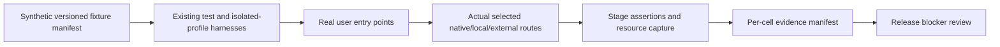

## Context

This change qualifies the combined implementation, not the currently incomplete baseline. Read the [audit](../../planning/ai-learning-completion-audit.md) and [program](../../planning/ai-learning-completion-program.md). Actual platform APIs and model availability remain authoritative. Existing TypeScript/Rust/Playwright/iOS harnesses are reused.

## Goals / Non-Goals

**Goals:** reproducible feature/provider evidence, truthful unsupported behavior, measurable resource qualification and release-blocking decisions. **Non-goals:** uniform native models, rewriting routing, claiming emulator inference as hardware evidence or replacing the local performance gate with GitHub Actions.

## Decisions

### Matrix scope and evidence states

Each matrix cell expands into the protocol below. **P** = intended candidate path, all required execution evidence **pending**; **L** = retrieval must disclose lexical/partial evidence; **O** = OCR-backed occlusion only with independently detected OCR backend; **—** = unavailable through this profile, test graceful degradation. These are requirements for eventual support, not claims of current passes. A P is advertised only after qualification; current missing agent/scoring/coverage integrations still require their changes.

| Profile | Learn | RAG | Tutor | Occlusion | Semantic index | Assessment | Relationships | Worthiness | Agent | Recall |
|---|---|---|---|---|---|---|---|---|---|---|
| Android Nano + downloaded LiteRT EmbeddingGemma + ML Kit OCR | P | P | P | P/O | P | P | P | P | P | P |
| Android Nano + missing embeddings + OCR | P | P/L | P/L | P/O | — | P | P/L | P | P/L | P/L |
| Android embeddings only, no generation route | — | — | — | — | P | — | P/L read-only existing links | — | — | — |
| Android incompatible native device, configured authorized external generation/embeddings + OCR | P | P | P | P/O | P | P | P | P, separately opted in | P | P |
| Linux configured Ollama generation + Ollama embeddings + local OCR | P | P | P | P/O | P | P | P | P | P | P |
| Linux Ollama generation, no embeddings | P | P/L | P/L | P/O | — | P | P/L | P | P/L | P/L |
| Windows API-ready system AI + configured authorized embeddings + detected OCR | P | P | P | P/O | P | P | P | P | P | P |
| Windows system AI unavailable, healthy configured Foundry + authorized embedding backend/OCR | P | P | P | P/O | P | P | P | P | P | P |
| macOS supported Apple generation + authorized configured embeddings + detected OCR | P | P | P | P/O | P | P | P | P | P | P |
| iOS supported Apple generation + live NaturalLanguage embedding bridge + Vision OCR | P | P | P | P/O | P | P | P | P | P | P |
| Any target OS, authorized external generation + embeddings + available OCR | P | P | P | P | P | P | P | P, separately opted in | P | P |
| Any target OS, no permitted generation or embedding route | — | — | — | — manual remains | — lexical/manual remains | — review remains | P/L read-only existing links | — | — | — |

Also expand each applicable native row into missing/downloading/downloading-failed/unsupported-language/model-too-small states; Windows package/LAF/hardware/OS denial; Apple unavailable/disabled model; and Android AICore incompatible/busy. Separate generation, embedding and OCR readiness. Generic external-profile P for occlusion requires actual declared vision or qualified OCR+text route; a text-only model cannot invent image geometry. Freeform occlusion remains an optional independently qualified flag.

macOS native embedding support is detected/tested independently; current Rust setup specifically proves iOS bridge installation, not identical macOS behavior. For iOS the existing bridge and Foundation task schema mappings need real-device execution; simulator pass cannot establish native AI support. Foundry does not imply an embedding backend. Models lacking a required structured envelope must use the existing strict-JSON/one-repair path or accurately report failure.

Verify actual embedding model identity, language, dimensions and version against persisted vectors. The generic on-device backend currently labels installed bridges with the EmbeddingGemma constant even though the iOS closure uses NaturalLanguage; record and resolve any identity mismatch before qualification. Also test explicit provider-preference precedence: current candidate ordering is not proof that disallowed fallback routes cannot run.

Each cell stores: feature/profile ID, commit/build hash, app/platform/runtime/model versions, capability revision, test level (`unit`, `mock-integration`, `emulator`, `physical-device`, `desktop-real-provider`), fixture hashes, outcome (`pending`, `pass`, `fail`, `unsupported`), exercised stages, redacted evidence path, owner and blocker IDs. A pass is invalidated by changes to the exercised routing/schema/persistence path until impacted tests rerun. No default “pass” values.

### Fixture and execution architecture

Proposed fixture manifest and tests live near existing `src/test/`, `src/visual/` and `src-tauri/src/ai_learning/test_support.rs`; platform protocols/evidence can later live in `docs/ai-learning-readiness/`. Fixtures: tiny PDF text page, scanned diagram/OCR image, reflow fixture, EPUB two-spine book, HTML/Markdown/plain text, saved and unsaved RSS, two conflicting source papers, definitions/clozes, malicious source directives, stale source revisions and known duplicate cards. Use synthetic content with deterministic expected IDs/locators; no personal library exports. Existing test-profile setup owns a disposable repository; never change global repository routing inside a live user session.

Automation uses existing fake providers and actual entry/handoff/persistence orchestration; it runs without network or native model. Mock integration success is tagged as such. Backend tests use existing in-memory repository setup and migration registry. Physical/device runs use the same fixtures in a separate profile through the actual Settings, Assistant, reader, review and composer. Route capture records safe selected provider/model class and capability revision, not private prompt data.

### Reproducible device/provider protocol

For each advertised profile and all applicable feature cells:

1. Record release commit, signed/release build identity, OS/device/SoC/RAM, WebView/runtime and native plugin versions, installed model/version, language/locale, screen scale, power/thermal state and network mode. Export only redacted diagnostics; keep local detailed machine inventory separate.
2. Create a disposable app profile; verify it contains only manifest fixtures. Test fresh defaults and import the previous stable version's settings/fixture library for an upgrade run. Preserve explicit false preferences and existing cards/links; record migration outcomes. Reset only the test profile between variants.
3. Capture initial capability/readiness rows before model setup. Missing model must offer explicit setup; Enable All must make zero downloads/indexing/inference requests. Explicitly authorize only the selected setup and destination, then record selected provider and model readiness. Never infer readiness from OS/device marketing.
4. Execute real entry points: Learn this preview/edit/subset save; Ask Library citations; tutor hint/explain/card promotion; composer OCR/assist approval; index enqueue/status/retrieve; assessment beside user-selected grade; prerequisites/coverage/link lifecycle; worthiness indicator/action; Assistant agent intents; recall promotion. Read back persisted objects and source links, then restart and navigate again.
5. For every structured task provide malformed/oversized/untrusted output through deterministic fault injection in automated runs, and execute valid real-model cases on hardware. Confirm validation and bounded repair; compare expected source references, not generated wording. Native schema and fallback results record which path actually ran.
6. Test offline with models already installed; provider timeout/denial/quota failure; embeddings absent; text-only/vision mismatch; cancel during retrieval/generation/validation/save; tab/source/conversation switches; app background/resume; model download completion/race; deleted/edited sources; duplicate approvals from two views. A commit during cancellation is reconciled, never blindly retried.
7. Deny then grant each applicable disclosure/paid/background-scoring consent; revoke mid-queue and replace endpoint. Observe network destinations/request counts to prove no unexpected remote calls. Private fixtures contain canaries to detect leakage into logs/export; network evidence must omit credentials/payloads.
8. Run cold and warm interaction/resource scenarios below with tracing: 30s idle baseline, 5min scripted reading with scoring off/on, one bounded agent run, index+reading contention, then 10 open/run/cancel/close cycles. Capture frame/input timing, process-tree CPU/RSS/model residency and queue/request counters. Separate model startup/residency from retained app leaks.
9. Repeat core success and denial/cancel cases at least three times per profile; any nondeterministic functional failure is a blocker until explained and fixed. Record every run, raw artifact location, units and device conditions; do not average away failures.
10. Export redacted report, remove disposable profile/fixtures and record cleanup. A native feature unavailable on that device gets `unsupported` plus negative-path evidence, not pass; test an actual compatible device before advertising the feature for supported hardware.

### Measurable performance budgets

Existing mandatory budgets: preserve `scripts/perf-baselines.json` anchor ratios (default 1.25×, per-case overrides), bundle budgets and `scripts/memory-baselines.json` ratchet on its reference Linux profile. Those memory numbers include interim targets, not validated mobile limits. Run local `npm run bench:check`; measure before/after on the same device/model/build class and document intentional budget changes in the implementation change.

The following are **proposed initial acceptance budgets**, not measurements or existing guarantees. Validate/calibrate with recorded reference runs before claiming support; if a target is infeasible, explicitly narrow/disable that profile or revise the reviewed budget with evidence, never silently mark pass.

| Metric | Proposed budget and measurement |
|---|---|
| Reader responsiveness | At 60Hz-capable display, p95 main-thread frame work ≤16.7ms during ordinary scripted reading; p95 pointer/key-to-visible response ≤100ms. E-ink uses input-event-to-DOM-update ≤100ms separately from panel refresh. Compare scoring off/on on same device. |
| Added scheduling work | Passage capture/queue/hash initiation slices ≤4ms; no scoring-attributable main-thread task >50ms. Trace mounted content roots, not full-document scans. |
| Layout stability | Zero source-content layout shift caused by scoring indicators; selection and source anchor remain unchanged across overlay appearance/resize. |
| Bounded workload | Reader concurrency 1, queue ≤8, local ≤12 new scores/visit and ≤60/hour, remote automatic default 0; agent ≤8 tools/20 proposals/60s and existing retrieval depth. Instrument counters and clock, not intuition. |
| Cancellation | New queue/tool/provider starts stop immediately on abort; UI stops showing active progress within 250ms. Native backend completion latency is measured separately; late output never saves or reappears. |
| Idle CPU | No inference in background/idle without an explicitly authorized workload; outside active model/index operations, scoring-on average process-tree CPU adds ≤5 percentage points over scoring-off in the same 5min scenario. Capture native inference utilization separately and enforce responsiveness throughout it. |
| Retained memory | After two warmups, 10 close/cancel cycles retain ≤32MiB above the warm fixture baseline on mobile, ≤64MiB on desktop, with ≤1MiB/cycle growth slope; separate documented intentionally resident model memory. No OOM/OS kill/low-memory-warning loop. Peak app+model footprint must fit the tested device's recorded sustainable memory envelope; no unsupported universal model-memory number. |
| Storage and leaks | In-memory score cache ≤128, persistent scores ≤10,000; task diagnostics ≤50, feature summary ≤10 feature groups; no growing listeners/timers/source DOM nodes after teardown. |
| Model/task latency | Existing task timeouts remain finite (passage 45s, prerequisites 60s, agent turns 30s inside total 60s). Record cold/warm p50/p95 and time to first progress for each model. A model that cannot reliably finish bounded fixtures is not qualified for that feature. |

Device classes to provision: compatible Android phone (Nano/LiteRT), Android without native generation including an e-ink/low-power reader where advertised, supported Apple iPhone/iPad, supported Apple Silicon Mac, Windows API-ready hardware and a Windows unavailable-native case with Foundry fallback, and Linux desktop with Ollama. Record actual inventory and RAM; no device is asserted connected/tested in this planning task. Test wide/narrow desktop plus portrait/landscape touch, font scaling and screen-reader/keyboard paths.

### Validation layers and commands

Use the exact repository commands in the program. Deterministic automated tests may run in CI, but no cloud/hardware job is required there and Actions is not the performance gate. Extend existing Playwright config/harnesses rather than introducing a second E2E runner. Existing iOS commands: `npm run test:ios:setup`, `test:ios:smoke`, `test:ios:e2e`, `test:ios:monkey`, `test:ios:soak`; simulator evidence remains simulator evidence. Use `npm run tauri:android:build`, `tauri:ios:build:sim` / `tauri:ios:build:device`, and platform packaging scripts on their supported hosts when preparing qualification builds. Inspect generated Gradle/Xcode schemes before selecting native-test commands; record exact commands/host in evidence rather than inventing a universal scheme.

## Release-blocking criteria

| Blocker | Scope | Explicit closure evidence |
|---|---|---|
| Unapproved private/cloud/paid operation or diagnostic leak | All releases | Denial/revocation/network-canary regressions and device reproduction pass; exported report has zero sensitive canaries |
| Silent object creation, duplicate retries, wrong source linkage or scheduler mutation | Affected feature on all profiles | Entry-to-readback tests, backend concurrent-save tests and real profile reproduction pass |
| Missing/failed advertised profile evidence | Advertised cell | Required test levels pass at release commit, or profile explicitly disabled with tested honest limitation |
| Native unsupported state misreported ready | Platform profile | API-authoritative dependency/negative-path test and device UI show accurate recovery |
| Cancellation/timeout leak, stale callback or unbounded work | Affected feature | Counter/clock tests plus native cancel/background trace meet limits |
| Responsive/memory/CPU/bundle/benchmark regression | Affected device/build class | Local gates and reproducible device resource runs pass reviewed budgets; intentional changes documented with evidence |
| Upgrade loses user preference/content/link origin | Upgrade path | Previous stable fixture profile upgrades and reads back without data loss or unauthorized workloads |
| Missing schema/citation/persistence proof | Affected feature | Structured validation, source navigation and actual storage/readback tests pass on required route |

## Risks / Trade-offs

- Hardware access may delay qualification → leave cells pending or narrow advertised support; never substitute mocks.
- Models are nondeterministic → structural/source/authority assertions plus repeated executions, not exact prose snapshots.
- Resource results vary → same-device paired runs with model/power state metadata; do not copy Linux budgets to phones.
- Evidence goes stale → record commit and dependency revision, rerun impacted cells after relevant changes.

## Migration Plan

No architecture/data migration is introduced by this verification change. Use disposable upgrade fixtures and existing migration code. Document failures against the owning implementation task; keep resulting fixes narrow. Update `docs/IMPLEMENTATION_STATUS.md` only when evidence supports the claim, with untested/degraded combinations explicit. Rollback a failing feature/profile through existing flags while preserving accepted learning content.

## Alternatives considered and rejected

A platform checklist based only on successful compilation was rejected because native models and hardware paths can still be absent. A universal model/device performance number was rejected because model residency and UI hardware vary. Mock-only release qualification was rejected in favor of separate automated, emulator and real-device evidence. Rewriting routing as part of verification was rejected; only reproduced failures receive targeted fixes.
