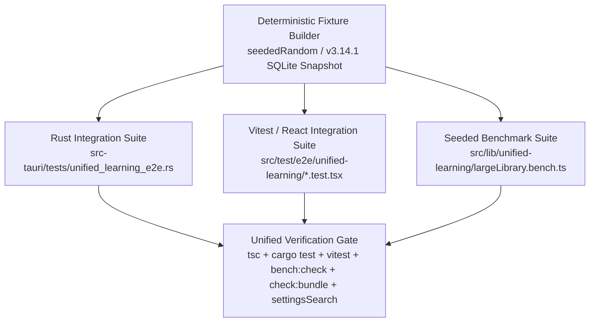

# Design: Validate Unified Learning Experience End-to-End

## Context

The Unified Personal Learning Operating System integrates 12+ coordinated capabilities across Rust/SQLite and React/TypeScript. To prevent cross-layer regressions, subtle state divergence, privacy leaks, or performance cliffs on large libraries, this design specifies a deterministic E2E test harness and benchmark architecture covering **Scenarios A through O**.

## Goals / Non-Goals

### Goals
- Provide automated, deterministic, network-free test coverage for every scenario A through O across both Rust SQLite integration tests and TypeScript/React/Playwright UI tests.
- Enforce quantitative performance and bundle budgets on large synthetic libraries (`10,000+` items, `50,000+` `learning_events`) via `npm run bench:check` and `npm run check:bundle`.
- Verify zero regressions to FSRS-7 scheduling, Study Mode single-surface reader (`study-canonical-reader-host`), privacy gates, and Settings Search coverage.

### Non-Goals
- Running flaky tests against live cloud LLM APIs.
- Replacing existing domain unit test suites (this harness complements them with cross-layer end-to-end assertions).

## Test Harness Architecture

## Scenario Coverage Matrix (Scenarios A through O)

| ID | Scenario | Primary Layer(s) | Key Assertions |
|---|---|---|---|
| **A** | **Casual reader** | UI + Store + Runtime | Opens document directly in Library/Reader without creating goals or SRS cards; zero forced coach/gamification clutter; reading emits optional exposure event only. |
| **B** | **SuperMemo incremental learner** | Rust FSRS-7 + DAQE + UI | Extract creation, cloze/Q&A generation, FSRS-7 scheduling parity (`StrictManual` vs `Adaptive`), zero regressions to existing `review_results` or intervals. |
| **C** | **Deadline student** | Goals + Study Plan + DAQE + Coach | Goal with imminent `target_date` prioritizes deadline-critical items in DAQE, triggers Coach `deadline_slippage_risk` deterministically when behind pace, and launches targeted exam-readiness session. |
| **D** | **Multiple simultaneous goals** | Goals + DAQE + Session Runtime | Two+ active goals (e.g., Mathematics + Languages) interleave cleanly in one time-boxed `LearningSession` honoring focus profile weights and subject templates without starving either goal. |
| **E** | **Exploration-to-mastery transition** | Smart Feeds + Coach + Goals | Repeated `exploratory_feed_digest` events on a topic trigger Coach `exploration_ready_for_structure`; only after explicit user confirmation does `CoachActionDispatcher` create a Learning Goal and structured activities. |
| **F** | **Failed assessment & remediation** | Exam + Evidence + Remediation + Coach | Failed `formal_examination` derives `learning_gaps`, routes dimension-targeted remediation (`comprehension`/`application`), enforces anti-loop cap (`remediation_loop_stall` after 2 stalled attempts), and records recovery on re-assessment. |
| **G** | **Cross-view review consistency** | `learning_events` + Review + Scroll + Queue + Session | Completing a flashcard review in Review, Scroll Mode, Queue, or Unified Session writes one canonical `learning_events` row and updates all open views immediately with zero stale due-list resurrection. |
| **H** | **Study Mode single-surface UX** | Activity Runtime + `DocumentViewerWrapper` | Launching Study Mode from any unified activity mounts exactly one canonical `BaseDocumentViewer` inside `study-canonical-reader-host` and restores exact reading scroll/selection/page state upon returning to reading. |
| **I** | **No AI provider configured** | Today + DAQE + Coach + Activity Registry + Motivation | With zero AI providers configured, Today, DAQE, Study Plans, deterministic 12-signal Coach templates, all 13 Activity types (including `socratic_dialogue` self-prompt fallback), and Motivation operate with zero unhandled errors or broken controls. |
| **J** | **Local-only & AI-excluded docs** | `privacyGate` + Coach + Activity Sandbox + Sync + Health Vault | `isLocalOnly`/`isAiExcluded`/`strictLocalOnly` block cloud AI explanations, block untrusted extension payloads, exclude local-only docs from Sync v2 outbox, and confirm zero queries against `health/health.db`. |
| **K** | **Interrupted session recovery** | Session Runtime + `learning_events` + FSRS-7 + XP Ledger | Simulated crash/reload mid-`LearningSession` restores exact step index, elapsed timer, and activity resume payload; replaying the in-flight completion event produces zero duplicate FSRS-7 reviews and zero duplicate `motivation_xp_ledger` rows. |
| **L** | **Existing user migration** | Rust SQLite Migrations (`<=170` → `173`) + Frontend Store Bridge | Upgrading a seeded v3.14.1 database preserves 100% of `review_results`, FSRS-7 states, `study_plans`, `exam_grades`, and migrates/bridges `localStorage` knowledge stores non-destructively. |
| **M** | **Large-library benchmark** | Vitest Bench + Rust Bench + Bundle Budget | 10,000 documents/extracts/cards + 50,000 `learning_events` seeded via `seededRandom(seed)`: DAQE top-10 `< 150 ms`, Coach 12-signal detector `< 50 ms`, Today hydration within budget; `npm run bench:check` and `npm run check:bundle` exit 0. |
| **N** | **Disabled gamification & coaching** | Coach + Motivation + Settings | Setting `proactivity_level = 'disabled'` and `motivation_enabled = false` hides all Coach & Motivation UI, executes zero background queries/AI/XP writes, and preserves historical rows non-destructively. |
| **O** | **Evidence correction & invalidation** | Evidence + Competency + Gaps + Milestones + XP Ledger | Regrading an exam or invalidating a `competency_evidence` record deterministically recomputes 5-dimension `competency_projections`, updates `learning_gaps`, revokes affected `mastery_outcome` milestones (`revoked_at`), and keeps `motivation_xp_ledger` untouched. |

## Large-Library Benchmark Plan (Scenario M)

Following `AGENTS.md` benchmark rules:
- Create `src/lib/unified-learning/largeLibrary.bench.ts` using `bench("name", fn)` from `vitest`.
- Generate all 10,000 items, 50,000 `learning_events`, 200 concepts, and 5 active goals deterministically with `seededRandom(seed)` from `src/test/bench-support.ts` (never `Math.random()`, never clock-sized, no network/fs/Tauri IPC).
- Fold benchmark outputs into a module-level `sink` variable and return `void`.
- Record dimensionless ratios (`anchorHz / benchHz`) in `scripts/perf-baselines.json` and gate via `npm run bench:check`.

## Release Verification Gate Commands

All of the following MUST pass before closing the Unified Learning OS initiative:
1. `npx tsc --noEmit`
2. `cd src-tauri && cargo test --test unified_learning_e2e`
3. `npx vitest run src/test/e2e/unified-learning src/components/settings`
4. `npm run bench:check`
5. `npm run check:bundle`
6. `openspec validate --strict --no-interactive` across all initiative changes.
