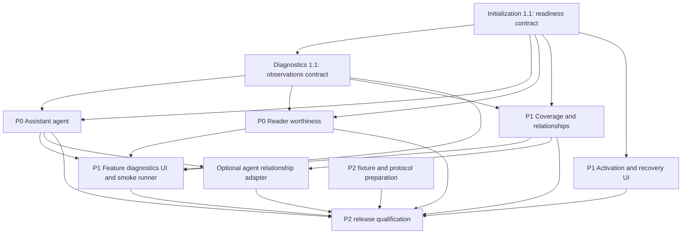

# AI Learning completion program

Planning only, 2026-10-20; source baseline `615570ff`. No proposed application change has been implemented. Start with the [verified audit](ai-learning-completion-audit.md). All six packages use the repository's `spec-driven` schema and leave implementation tasks unchecked.

## Change packages and handoff

Every directory below contains `proposal.md`, `design.md`, `tasks.md` and the listed delta spec. Designs explain contracts, persistence, failures and platform differences; tasks identify files, reuse, tests and acceptance. The [traceability matrix](ai-learning-completion-traceability.md) maps every changed requirement to tasks and tests.

| Priority / change directory under `openspec/changes/` | Delta capability | Complexity / risk | First task / prerequisite | Independent agent assignment |
|---|---|---|---|---|
| P0 `complete-ai-learning-agent-integration/` | `ai-learning-agent` | High / High | 1.1 freeze conversation/source context; F0 + D0 | Yes after contracts; strong reviewer for approval/provenance |
| P0 `complete-reader-extract-worthiness-integration/` | `ai-knowledge-relationships` (Passage extract-worthiness only) | High / High | 1.1 passage/anchor API; F0 + D0 | Yes; split adapter tasks by reader only after interface lands |
| P1 `complete-knowledge-relationships-and-coverage/` | `ai-knowledge-relationships` (other three requirements) | High / High | 1.1 thin concept command adapter; F0 + D0 | Yes, dedicated owner for backend invariants |
| P1 `harden-ai-learning-feature-initialization/` | new `ai-learning-feature-readiness` | Medium / Medium–High | 1.1 publish readiness registry contract (F0) | Yes; this owner integrates shared Settings edits |
| P1 `implement-ai-feature-operational-diagnostics/` | `ai-task-architecture` (additions) | Medium / Medium–High | 1.1 publish diagnostic observation contract (D0); F0 | Yes; this owner integrates task/diagnostics metadata |
| P2 `validate-ai-learning-cross-platform-readiness/` | new `ai-learning-release-readiness` | High / High release risk | 1.1 fixture/evidence manifest; no runtime dependency for planning fixtures | Yes for deterministic fixtures; native signoff needs platform expertise/hardware |

## Dependencies and implementation sequence

The P1 labels describe user-facing priority, not permission to defer foundational contracts until after P0 integration.



1. Land **F0** (initialization task 1.1) with feature identifiers/dependency and readiness types, using existing stores/provider probes. Land **D0** (diagnostics task 1.1) with the allowlisted feature-observation type and observer, consuming F0. These are small integration slices within the six changes, not a seventh change.
2. Implement agent and worthiness in parallel. Coverage can run concurrently if ownership boundaries below are honored; it is not a dependency of card-only agent functionality or scoring.
3. Finish activation UI/recovery and diagnostics adapters. Diagnostic contracts do not depend on feature implementations; missing adapters remain “not exercised”. Integrate optional relationship proposals only after the concept API is ready.
4. Qualify the combined release commit. Fixture/protocol work starts earlier; release success cannot precede native evidence. Keep unsupported combinations disabled and truthful.

## Shared contracts and ownership

New paths named in designs/tasks are **proposed**, not existing modules. Keep the existing router, index, conversation store and domain writers authoritative.

| Contract | Owner / storage | Required semantics |
|---|---|---|
| Feature readiness | Initialization; proposed `src/lib/ai/features/registry.ts` and `types.ts`; derived selector/hook | Stable IDs: `learn-this`, `library-rag`, `socratic-tutor`, `occlusion-assist`, `semantic-index`, `answer-assessment`, `knowledge-relationships`, `extract-worthiness`, `learning-agent`, plus `active-recall`. Relationships expose prerequisite/link substatus and both independent flags. Registry descriptors consume current settings; they do not own copies. |
| `FeatureReadiness` | Initialization F0 | `{ featureId, enabled, status, checkedAt, dependencyRevision, dependencies[], provider?, recoveryActions[], limitations[] }`; status `disabled | ready | setup-required | model-download-required | indexing | unavailable-platform | error`; dependencies each have code, state and safe reason. Include per-operation ability/degraded reason (e.g. lexical retrieval) instead of calling every missing embedding a total outage. `ready` means dependencies satisfied, not smoke passed. |
| Destination authorization | Reuse `provider.ts`, disclosure and billing utilities; initialization owns shared destination classification, feature caller owns preflight | Before private text/query/image leaves device, authorize actual selected endpoint, purpose, source scope, bounded work/cost. Provider kind and keyless access are insufficient: remote Ollama and LAN hosts are off-device. Resolve generation **and** embedding destinations. Do not silently fall through to a new destination if it differs from authorized snapshot. New background scoring authorization is separate from prior explicit Assistant use. |
| `FeatureObservation` | Diagnostics D0; extend `diagnostics.ts`, not a parallel logger | `{ featureId, runId, stage, level, outcome, durationMs, timestamp, capabilityRevision, providerClass?, modelClass?, errorCategory?, recoveryCode? }`; stage `preflight | retrieval | generation | validation | preview | persistence | navigation`; level `static | dependency | operational`; outcome `success | failed | cancelled | skipped`. No content, source titles, raw endpoint, credentials or arbitrary exception message. Correlate in memory, never infer end-to-end success from one generation event. |
| Operational evidence | Diagnostics; 50-entry task ring + bounded feature summary (10 features, last success/error only) | Session-local default, unknown after restart. Capability/model revision changes invalidate “current” evidence. Reports explicitly state observed stage and fixture-vs-user execution. Persistent execution history is out of scope; do not imply it exists. |
| Frozen sources | Agent uses existing `SourceReference`, `SelectionSnapshot`, `SourceLocator` in `assistant/conversations/types.ts`; reader uses a compatible local adapter | Bind owner/conversation/run/source revision at invocation. IDs/locators come from resolved library records or a live ephemeral capability, never the model. Reject stale/removed sources. Preserve original and edited selection independently. |
| Passage identity | Worthiness; proposed reader adapter type over existing locator forms | `{ ownerToken, documentId?, sourceRevision, passageId, contentHash, locator, text }`. Hash uses normalized text plus normalization/classifier/schema/provider-model revision; anchor identity remains source-specific. Geometry is ephemeral and reprojected, never persisted as current screen coordinates. |
| Concept coverage | Knowledge; proposed `src/lib/ai/concepts/coverage.ts` | Orthogonal `evidenceCoverage: unknown | not-covered | partial | supported`, `indexCompleteness`, validated evidence references and legacy activity `none | encountered | studied | reviewed`. No mastery field. Queries use shared retrieval and validated source records; the model cannot supply evidence IDs. |
| Proposal authority | Each feature reuses existing preview and domain APIs | Draft → validated preview → edited/revalidated → user-selected save → durable objects. Pending link suggestions may persist only after an explicit “Save suggestions” action; endorsement requires Accept. No model-triggered permanent objects. Retry ledger prevents duplication after partial failure. |

### Error and lifecycle policy

Use `AIError` categories from `src/lib/ai/errors.ts`; map stage-specific persistence/navigation failures to safe recovery codes without inventing a second provider error taxonomy. Missing model offers setup, empty/partial retrieval states its limitation, invalid structured output creates no candidate, consent denial causes no network work, cancellation never causes cloud fallback. Every owner has one AbortController and a revision token; late callbacks cannot update a replacement source/conversation. Where native work cannot abort immediately, discard output, suppress writes and block duplicate work until the request settles.

### Editing and integration ownership

| Shared files | Integration owner | Parallel rule |
|---|---|---|
| `features/*`, `AIProviderSettings.tsx`, `settingsStore.ts`, Settings search catalog/coverage and translations | Initialization | Other owners supply required feature metadata/reveal targets; no parallel rewrites of Settings. |
| `diagnostics.ts`, `tasks/types.ts`, `tasks/runTask.ts`, `AIDiagnosticsModal.tsx` | Diagnostics | Feature owners emit the agreed observations; submit narrow metadata additions through this owner. |
| `AssistantPanel.tsx`, conversations serialization, `agent/*`, palette registration | Agent | Knowledge supplies a link adapter; it does not independently edit Assistant chat lifecycle. |
| `DocumentViewer.tsx`, wrapper, reader passage adapters/geometry, passage cache | Worthiness | Knowledge owns only prerequisite result content in selection sheet; coordinate narrow callbacks in shared selection sheet. Preserve selection machine behavior. |
| Concept API/coverage/backend, graph detail integration | Knowledge | Add concept projection to existing graph representation; do not replace layout/renderer. |
| `ai-knowledge-relationships/spec.md` deltas | Reader + knowledge integrator | Reader modifies only Passage extract-worthiness; knowledge modifies coverage, typed links, related-content. Archive sequentially and rerun strict validation. |
| Tests, fixture manifest, native evidence | Verification | Feature owners own their production tests; verification reuses those and adds cross-platform evidence. |

Active changes such as `unify-assistant-experience`, `add-assistant-tool-calls`, `modernize-android-gemini-nano-provider`, `add-android-ondevice-llm-bridge`, `improve-settings-search`, `bound-runtime-memory-and-gate`, and `fix-windows-manifest-msix-identity` overlap by name/area. Some already have code in this baseline. Before implementation inspect current diffs/tasks and coordinate actual unlanded edits; their existence is neither a hard dependency nor proof of completion. Follow repository policy: no feature branches or PR requirement; commit to main only when committing is requested, and push when requested.

## Acceptance and production readiness

| Initiative | Required observable evidence | Cannot count as completion |
|---|---|---|
| Agent | Existing Assistant/palette → source-grounded candidates → edited subset accepted → exact saved objects and source links; denial/cancel/duplicate/limit/persistence tests | Loop unit tests alone; Assistant legacy write tool succeeding |
| Worthiness | Each supported reader → only encountered stable passages → cached score → non-shifting indicator → functioning explicit action; disabled produces zero work | Classifier schema or Rust cache tests alone |
| Knowledge | Passage → prerequisites → real indexed evidence/unknown → navigation → explicitly saved/accepted or dismissed links → restart/backlinks/dedup | Model-supplied evidence or documents treated as mastery |
| Activation | Fresh and upgraded settings preserve preferences, show partial readiness, independently authorize setup and recover after restart | All toggles green |
| Diagnostics | Every registry feature has scoped dependency evidence, actionable errors, opt-in fixture smoke and redacted report | A compiled badge or generation alone labeled end-to-end success |
| Platform readiness | Advertised matrix cells pass required automation plus device/provider runs at the release commit; unsupported cells pass graceful-degradation tests; measured resource gates pass | Emulator-only native model claims, pending hardware evidence or copied timing numbers |

No AI assessment changes scheduler inputs. No draft creates permanent learning objects. No unexpected off-device or paid request is acceptable. Blocking security/consent/provenance/persistence defects must be closed, not waived as “model quality”.

## Validation commands and evidence policy

Commands verified from `package.json`, repository test sources and installed OpenSpec help. These are an implementation checklist, **not claims of execution in this planning task**:

```sh
npx tsc --noEmit
npm run lint
npm run test:run
npm run test:scripts
npm run build
npm run build:check
npm run bench:check
npm run check:bundle
npm run bench:memory:check
npm run test:visual
cargo fmt --manifest-path src-tauri/Cargo.toml --all -- --check
cargo check --manifest-path src-tauri/Cargo.toml
cargo clippy --manifest-path src-tauri/Cargo.toml --all-targets -- -D warnings
cargo test --manifest-path src-tauri/Cargo.toml
```

`npm run build` is Vite only; `build:check` includes docs/help generation, TypeScript and bundle checks and can generate artifacts. No dedicated `typecheck` npm script was found: use `npx tsc --noEmit`. Script tests use `scripts/__tests__/*.test.mjs` in this baseline (the pasted AGENTS prose says `.ts`). For targeted backend tests use cargo test filters `concept_repository`, `passage_scores`, `ai_learning`; never substitute them for final required backend coverage. Native plugins also need target-host checks; a Linux cargo run cannot validate Swift/WinRT/Android APIs.

`bench:check` measures all benches, compares anchor-normalized ratios in `scripts/perf-baselines.json`, then checks bundle budgets. Default tolerance is 1.25 with per-benchmark overrides. New benches use `seededRandom`, no runtime/network/fs and a consumed result. Intentional baseline/bundle changes require a reason in the same change; do not relax baselines to make a regression disappear. `scripts/memory-baselines.json` contains interim Linux targets and a repeated-cycle ratchet; record actual device-specific evidence before qualifying other devices. GitHub Actions does not replace the local performance gate.

Use current Settings search gates in `docs/settings-search.md`, including `npx vitest run src/components/settings src/commandPalette`. New controls/groups require stable target IDs, catalog/coverage rows and reveal/navigation tests; search must never initiate setup or index private values.

For each of the six directories above run `openspec validate <change-name> --strict` and `openspec status --change <change-name> --json`; review combined delta requirement ownership before archive. The completion traceability document records planned test layers and actual specification-validation results. Baseline host tests: **145 passed / 10 files**; no physical device, production inference, backend suite or performance measurement was claimed here.

## Material decisions and recommended defaults

1. **Threshold:** use strict `> 0.75`, matching schema comment and archived D23 rather than the inconsistent ≥ archived task. Do not invent a separate confidence field absent from `PassageClassification`; worthiness is not calibrated confidence.
2. **Background privacy:** local automatic scoring only by default after the feature is enabled; remote automatic scoring requires separate scope/budget authorization. Prior manual cloud use or default-true feature flags never authorize it. Revocation stops queued work immediately.
3. **Coverage:** implement deterministic `unknown/not-covered/partial/supported` independently of historic activity labels. Exact evidence rules and bounded query limits are fixed in the knowledge design; do not pick a vector-similarity threshold and call it mastery.
4. **Proposal durability:** keep drafts in the existing conversation/local UI; explicit Save suggestions persists pending relationships. Accept endorses them. Cancelled/unaccepted drafts create no learning objects. Partial write recovery must reconcile actual saved IDs before retry.
5. **Diagnostic history:** session-local last success/error with explicit unknown after restart; no new persistent private execution history. Store only content-free setup preferences, never “ready forever”.
6. **Hardware gaps:** a cell without device/provider evidence remains pending and cannot be advertised ready. Ship a narrower accurately disabled combination if hardware cannot be obtained; no fabricated pass or silent alternative provider.

There are no unresolved architectural choices required to begin implementation. Model-specific latency/quality qualification and actual device inventory must be measured, not guessed; the cross-platform design defines how to resolve them before release.
