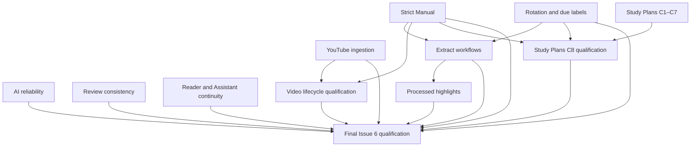

# Issue #6 final closure plan

Audit baseline `739802aeda8be7d1e5731c9402fcb7a06b57fd32` on `main`, verified against live `origin/main` on 2026-11-12 UTC. The starting tree was clean. This planning pass leaves the branch and production files untouched. The repo uses the OpenSpec `spec-driven` schema, React/TypeScript UI, Tauri IPC/Rust/SQLite on native and browser adapters/IndexedDB where supported. Existing native commands, stores, source locators, provider routing, migrations and receipts are the integration points.

## Current readiness

Issue #6 remains open. Strict Manual and the rotation interval have visible controls without production consumers. Same-day overdue labeling is source-confirmed in Deck Manager. YouTube health probing has no frontend consumer and the configured cookie path is not reapplied on startup. Current AI tools accept some synonyms, while conflicting arguments can be discarded silently and the generic card validator is disconnected from production. The native video extract lifecycle and C1–C7 Study Plans infrastructure are substantial. The Study Plans browser golden file is undiscovered by the existing Playwright config and only checks body visibility. Several related automated tests fail at this baseline. Native/device/provider acceptance is outstanding.

The [traceability matrix](issue-6-final-traceability.md) is the complete inventory and names a single implementation owner and release acceptance per concern. [Historical plan](issue-6-comprehensive-remediation-plan.md) is retained. The [live issue](https://github.com/melpomenex/Plethora/issues/6) was fetched via GitHub API with both paginated comments and timeline. The reporter follow-up reopened the issue. The timeline references [7642e177](https://github.com/melpomenex/Plethora/commit/7642e1771556501643f41215d0b524b6bc59a912), which adds the historical plan and eight draft changes. No linked PR appeared in the retrieved timeline. All 29 attachments downloaded and were visually surveyed. Attachments 13 and 15 have identical downloaded contents. The numbered evidence links in the matrix preserve both URLs. The restricted-video log is reporter evidence of three independent conditions (version, runtime, account access). The [LearnHarness reference](https://github.com/amosblomqvist/learnharness) informs the optional diagnostic and adaptive teaching journey within the existing Study Plans implementation.

Source-confirmed findings identify actual code paths or absent consumers. Partial means an implementation exists with a known gap. Missing means no operational workflow was identified. Unverified means a current implementation or historical report requires journey evidence. Regressed identifies a currently failing previously targeted behavior, without inferring which commit introduced it. Complete requires passing evidence at the applicable boundary. Browser visual qualification alone leaves native webview cases open. P1 blocks closure for advertised scope. P2/P3 still need acceptance or an explicitly agreed disposition. The audit found no P0 requiring emergency intervention.

## Ownership and implementation order

| Order | Change | Disposition and dependencies | Complexity |
| --- | --- | --- | --- |
| 1a | [Strict Manual](../changes/add-selectable-strict-manual-queue-ordering/) | Integrate existing enum/ranker/setting. Stabilize canonical priority and queue adapter first. | High |
| 1b | [Rotation and initial scheduling](../changes/clarify-document-rotation-and-new-item-scheduling/) | Classifier can start independently. Coordinate scheduling/eligibility with 1a before touching shared queue paths. | High |
| 1c | [AI reliability](../changes/harden-ai-learning-actions-and-card-quality/) | Reuse section resolver and receipts. Own generation and response semantics. Run parallel to 1a/1b, serialize shared Assistant/Scroll files with 2a/2b/2c. | High |
| 1d | [YouTube ingestion](../changes/improve-youtube-ingestion-and-playlist-reliability/) | Own playlist settings, tool diagnostics and authentication. Can start independently. | Medium |
| 2a | [Review consistency](../changes/fix-review-editing-and-session-consistency/) | Own persisted-card editing/rendering. Coordinate priority/cache and AI authoring metadata changes. | Medium |
| 2b | [Reader and Assistant continuity](../changes/restore-assistant-and-reader-ux-continuity/) | Own layout, semantic color and scroll qualification. Defer shared response-state changes to 1c. | Medium |
| 2c | [Extract workflows](../changes/enhance-incremental-reading-extract-workflows/) and [highlighting](../changes/fix-document-highlighting/) | Extract command follows 1a/1b contracts. Qualify and reuse shared locator/revision resolution, then integrate overlay. | High / medium |
| 2d | [Video extract lifecycle](../changes/fix-video-extract-queue-and-review-lifecycle/) | Existing functionality first. Qualify after 1a and after 1d for remote/restricted cases. | Medium |
| 2e | [Study Plans C8](../changes/validate-study-plans-and-examinations-end-to-end/) | Start isolated harness in parallel. C1–C7 own domain fixes surfaced by the run. Align provider provenance with 1c and run final scheduler isolation after 1a/1b. | High |
| 3 | [Issue #6 qualification](../changes/qualify-issue-6-remediation/) | Wait on applicable 1 and 2 acceptance evidence. Own consolidated regression and closure, with fixes routed back to their owners. | Medium |

Use a stronger implementation agent for canonical ranking and compatibility, atomic extraction/undo, provider and conversation identity, and the native Study Plans harness. Bounded fixture authoring, table/token repairs, localized copy, Settings Search, documentation and matrix execution can proceed in parallel where file ownership is independent. Serialize edits to `QueueScrollPage.tsx`, `AssistantPanel.tsx`, `DocumentViewer.tsx`, `browser-backend.ts`, and migration numbering. Each track owns its own verification report. Final qualification consumes those reports.

## Prior change reconciliation

| Existing change | Current disposition at this baseline |
| --- | --- |
| `fix-issue-6-scheduling-and-learning-workflows` | Partial historical umbrella. Canonical urgency, mutation and lifecycle seams exist. Current ranking parity, source-generation and priority shortcut tests fail. Preserve earlier evidence and apply residual work through the bounded owners above. |
| `add-selectable-strict-manual-queue-ordering` | Partial. Two-mode UI and Rust ranker exist, main paths omit mode. Older third-mode draft diverged from the shipped UI and issue request. |
| `clarify-document-rotation-and-new-item-scheduling` | Partial. Rotation rank semantics exist and some labels are already calendar-based. Interval has no scheduler consumer. |
| `fix-review-editing-and-session-consistency` | Implemented in parts and insufficiently qualified across real surfaces. Preserve current editors, tag UI, undo/advance. |
| `restore-assistant-and-reader-ux-continuity` | Partial. Scroll passed targeted Chromium, other platforms and visual fixtures remain. AI empty-response recovery belongs to AI owner. |
| `harden-ai-learning-actions-and-card-quality` | Partial alias/source/card acceptance implementations. Need shared validation, terminal states and boundary tests. |
| `improve-youtube-ingestion-and-playlist-reliability` | Partial. Cookie and playlist controls present. Runtime diagnostics, import path parity and authentic restart evidence still required. |
| `enhance-incremental-reading-extract-workflows` | Partial. Indent/outdent and selection actions exist. Atomic combined action missing. |
| `design-source-grounded-ai-curricula-and-assessments` | Superseded for implementation by C1–C8. Retain design history. |
| `fix-video-extract-queue-and-review-lifecycle` | Implemented at source and covered by existing repository/adapter tests. Full playback, lifecycle and device release verification outstanding. |
| `fix-assistant-scroll-mode-top-jump` | Implemented. Three Chromium cases pass on baseline. Extend platform/mode evidence under reader continuity owner if needed. |
| `fix-section-mention-content` | Resolver and artifact flow implemented. Actual generation-to-acceptance fails current test and native/provider qualification remains. Keep existing resolver and enforce through AI owner. |
| `fix-document-highlighting` | Partial as a solution for processed passage overlays. Existing persisted locator/rendering contract remains the owner. |
| C1 `establish-persistent-study-plans` | Native plan persistence and tab exist. Gate navigation and verify create/publish/reopen end to end. |
| C2 `generate-source-grounded-study-curricula` | Integrated through coordinator, exact-model preflight and evidence repositories. Recent indexing and generation fixes require full run. |
| C3 `generate-study-plan-examinations` | Builder/quotas/question revisions integrated. Blueprint and coordinator suites currently fail, ownership stays here. |
| C4 `implement-resumable-examination-sessions` | Attempt UI and command/repo path integrated. Prove physical restart, concurrency and official answer isolation. |
| C5 `implement-rubric-based-exam-grading` | Grading coordinator and native repository exist. Prove mixed score, refusal and retry on full attempt. |
| C6 `derive-study-gaps-from-exam-evidence` | Evidence/grouping/rules and progress UI exist. Prove persisted learner-visible gap and uncertainty after grading. |
| C7 `integrate-study-plans-with-adaptive-practice` | Diagnostic, scoped Tutor, practice, card proposals and reassessment integrated in parts. Exercise each reachable action. |
| C8 `validate-study-plans-and-examinations-end-to-end` | Fixture/helpers present. Automation and native/device/provider evidence outstanding. Current CLI accepts its `skip_specs` setting. |

Reconciliation sources include [prior Study Plans QA audit](study-plans-assessments-program/12-IMPLEMENTATION-QA-AUDIT.md), [C8 verification](../changes/validate-study-plans-and-examinations-end-to-end/verification.md), existing change verification reports, archived cloze/occlusion, saved queues and scroll-order specs, and source paths in the matrix. Recent Study Plans changes `0d82b1c6`, `b01c3733`, `d7a4416f) changed evidence retrieval, model failure recovery, and assessment generation after earlier verification. Treat the historical commands, counts and checkboxes as dated evidence.

## Cross-cutting contracts

- Preserve old rows, date/history and source IDs. Only introduce an additive manual-priority presence distinction if a persisted flag cannot already encode zero. Extraction writes need atomic create and scheduling plus durable operation identity, with a single IndexedDB transaction or honest unsupported behavior where the browser cannot provide it. Test upgrades from populated old profiles and backup/restore before release.
- Separate async operations by item/run identity and a generation/revision. Stale work must never overwrite a newer selection, queue, draft or review result. Use durable receipts or CAS where retries may race. Publish UI success after confirmed write and reconcile after uncertain acknowledgement.
- Keep cloud and embedding choices explicitly authorized and scoped. Pass synthetic material only for qualification. Preserve local-first offline actions. Keep raw source, prompts, secrets, cookie paths and credentials out of exported diagnostics.
- Verify keyboard, touch, tab order, accessible status, light/dark contrast, 200% zoom, narrow mobile, safe areas and reduced motion. Document Linux WebKitGTK, macOS WKWebView, Windows WebView2, Android and iOS observations per advertised route. Browser and native capability differences must be visible.

## Product defaults

Use the shipped Adaptive and Strict Manual choices, with Adaptive default. Keep immediate new-item availability for eligible records and explain the first revisit/review distinction. Use the existing seven-day default for the explicit standard document revisit. Use opt-in processed-passage display with exact locator resolution and no guess on ambiguous legacy rows. Preserve composition as an eligibility constraint and apply priority within the resulting session. When native-only Study Plans APIs are unavailable, gate navigation/actions and show explicit unsupported messaging where a deep link is opened. No open decision blocks application. A product owner may later choose broader overlay defaults, new-item deferral, or browser Study Plans persistence as separate work.

## Gates

The [qualification verification plan](../changes/qualify-issue-6-remediation/verification.md) holds current command results and release evidence rules. Every issue ID needs its accepted output or an explicitly agreed limitation. Any P0/P1 without evidence blocks Issue #6 closure for advertised scope. The workflow ends with an issue-facing draft and evidence review. Repository publication or issue closure requires separate authorization.

## Dependency graph

Arrows run from prerequisite to dependent. Initial source audits and fixture preparation may start independently.

