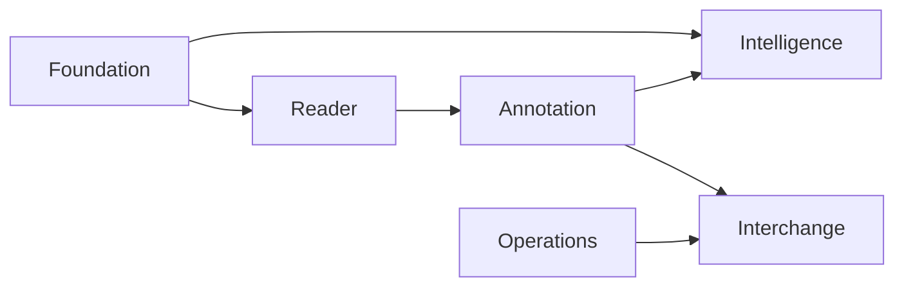

# PDF First-Class Document Platform

Baseline inspected at `190ecc9a`. See [capability audit](capability-audit.md), [implementation status](status.json), [verification results](verification.md) and [manual verification](manual-verification.md).

## Implemented slice

- The Rust processor keeps blank physical pages in its text sequence. Semantic refresh repairs same-ordinal locators, and Reading Trails preserve the original keys when using sparse indexed pages. Short, single-line pages remain indexable when the heading heuristic would otherwise discard all page text.
- The PDF.js reader routes destinations through the same navigation service as the outline. External web links require activation. The built-in native annotation layer displays sticky notes and keeps supported AcroForm values available while the PDF is open. PDF JavaScript actions are disabled. Search and TTS decorate literal text using DOM nodes.
- The reader explicitly selects canonical analysis in Tauri and the JavaScript reflow engine in browser builds. A PDF switch clears previous native and canonical evidence. Current-page requests use the active physical page or selection and surface missing text before model invocation.
- Native desktop rotation is available for PDFs opened through the range reader. The command checks the loaded source identity, limits the whole-file edit input to 128 MiB, verifies the new file and finalizes only to a new filename. Rotation export is currently scoped to unencrypted PDFs without signature fields. There is no new runtime dependency or schema migration.

The next implementation phase starts with identifying legacy derived locators that need reindexing and preserving duplicate-passage provenance. Qualify source navigation on native devices before extending undoable sidecar annotation editing. Independent work can extend validated copy plans to range export and reordering. Keep provider disclosure and original-file preservation as acceptance gates.

## Change sequence

1. [Foundations](../../changes/pdf-foundation-consolidation/proposal.md) owns physical page truth, derived-index repair and canonical lifecycle.
2. [Modern reader](../../changes/pdf-modern-reader-experience/proposal.md) uses the page contract for destinations, labels and reader navigation.
3. [Annotation platform](../../changes/pdf-annotation-platform/proposal.md) uses the reader's original geometry and existing annotation storage.
4. [Intelligence and learning](../../changes/pdf-intelligence-learning-integration/proposal.md) shares canonical pages and source resolution across Assistant, OCR and learning workflows. It can start after the physical-page contract is defined.
5. [Document operations](../../changes/pdf-document-operations/proposal.md) can start independently with export-only edits. Annotation interchange depends on the annotation geometry and export boundary.

## Invariants

Physical page numbers are one-based. Page labels belong to display. Stable source references carry document identity, physical page and the best available geometry and quote. Canonical page caches are derived and versioned. PDF originals and authored records retain their identities. Exported copies enter the library as separate documents so page edits cannot invalidate anchors on the source.

Render progressively on original pages using existing PDF.js lifecycles. Enhance pages with native text, canonical geometry and then OCR for deficient regions. Request optional provider-assisted analysis through the existing explicit routing and access checks. Keep unverified text and visual guesses distinguishable from direct evidence.

## Verification matrix

- Use existing synthetic fixtures for columns, figures, tables, rotation, sparse text, unusual fonts and malformed imports. Add synthetic fixtures for blank middle pages, duplicate text across pages, native links, widgets and export round trips.
- Exercise open, select, save and reopen in Original and Reflow. Return to source from extracts, cloze review, Reading Trail and assessment feedback. Verify OCR text with a blank or mixed scan and prompt context after a rapid page change.
- Inspect annotation and page export with an independent parser and reader. Cover crop boxes, inherited rotation, outlines, annotation objects, encrypted files and failed writes. Compare source hash across success and failure.
- Capture first-page timing, scroll memory/canvas count, context and search latency, cache reuse, OCR throughput and large-document behavior on desktop and phones. Run `npm run bench:check` against the existing normalized baselines. Record device evidence and keep rollout decisions tied to those results.
- Check keyboard traversal, focus restoration, screen reader names, mobile touch/keyboard, theme contrast, reduced motion and RTL. Validate the five changes individually with OpenSpec strict mode.

## Dependencies

The checkout resolves PDF.js 5.4.624 and Tesseract.js 7.0.0 (Apache-2.0), lopdf 0.34.0 and 0.38.0 and pdf-extract 0.10.0 (MIT). The latter already re-exports its lopdf and exposes page-specific text output. Keep PDF.js as the one renderer. The Rust parser can handle small, explicitly qualified edits without another runtime dependency. A PDFium integration would add a native ABI and GN-built artifacts with a separate update and licensing inventory for every target. QPDF has useful structural operations and independent verification, but some page operations retain document-level metadata from the primary file. It would add a C++ runtime or sidecar and separate Android and iOS packaging work. Revisit either library only against concrete interoperability fixtures and measured size and runtime costs. [PDFium build and license](https://pdfium.googlesource.com/pdfium/) [QPDF page operation limits](https://qpdf.readthedocs.io/en/stable/cli.html#limitations)
