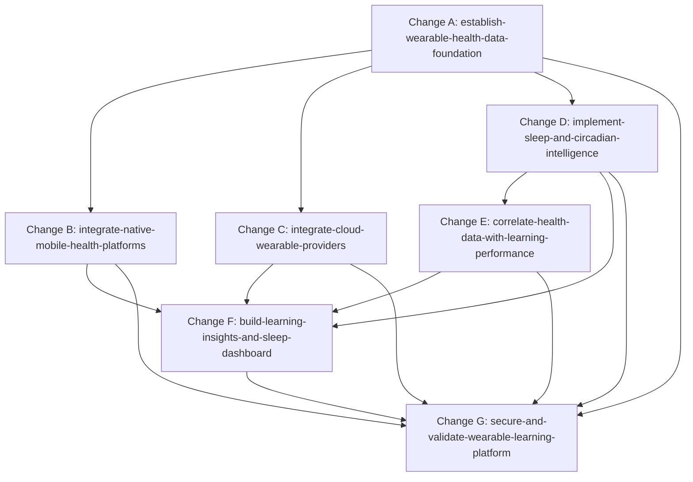

# Wearable Health, Sleep Intelligence & Learning Performance — Master Plan

**Status:** Active Implementation Program  
**Verified Baseline:** `main@c79f7473` (Plethora v3.11.0)  
**Verification Date:** 2026-11-20  
**Program Location:** `openspec/planning/wearable-health-sleep-program/`

## Implementation checkpoint

The Health Vault is registered in the native app. Local entry, file transfer, deletion, source preferences, and the sleep and learning queries have IPC entry points. The frontend has typed command wrappers and a session-only view store. Demo mode uses an in-memory vault and excludes real review history.

- **Native providers:** Both plugins are registered. HealthKit commits raw sleep sample changes and the query anchor together, then rebuilds affected sleep episodes. Health Connect uses bounded recovery for expired tokens. The Android Kotlin plugin compiles. iOS qualification still needs a signed build and device.
- **Cloud providers:** The client now handles OAuth callbacks, token exchange, refresh, and disconnect. The local private broker builds and passes its tests. Production sign-in requires a deployed broker, registered redirects, and approved credentials. Garmin's commercial contract still needs qualification.
- **Analysis and workspace:** Learning Insights includes sleep timelines, review comparisons, evidence, and source management. Settings Search and Study Plans include entry points. The seven change checklists and the release verification record track remaining gates.

---

## 1. Executive Overview & Product Objective

Plethora connects wearable sleep and physiological observations with Plethora's existing spaced-repetition (`review_results`, FSRS-7), Study Plans (`study_plans`), Assessments (`exam_attempts`, `exam_grades`), and Reading Sessions (`reading_sessions`) to answer one core question:

> **What can Plethora learn about an individual's study performance by observing their sleep, physiological trends, and learning history together — without assuming correlation equals causation or letting sensitive health data leak into cloud AI or backups?**

Inspired by SuperMemo's historical Sleep Chart, this platform modernizes the concept through:
1. Automated multi-source wearable ingestion (native iOS HealthKit, native Android Health Connect, and OAuth cloud providers where configured/approved) alongside zero-wearable **Manual Sleep Entry** and **Validated File Import** (JSON, CSV, Apple Health `export.xml`).
2. Strict local-first data isolation in a dedicated SQLite vault (`<app_data_dir>/health/health.db`), physically separated from `plethora.db`, cloud drive backups, E2EE library sync, semantic indexes, and AI/LLM prompt context.
3. Deterministic sleep-stage normalization, cross-source deduplication (preventing double counting across aggregators + direct APIs), UTC/timezone/DST biological anchor-date correctness, and transparent data-quality handling.
4. Conservative sleep & circadian analytics (circular timing statistics, Sleep Regularity Index proxy, and an exploratory Borbély Two-Process alertness curve clearly marked as non-clinical).
5. Zero-leakage FSRS-7 replay (`observed_recall - predicted_retrievability`), log-latency winsorization, confounder-adjusted within-person regression, day-clustered bootstrap CIs, Benjamini-Hochberg FDR control, temporal held-out predictive validation against baselines, and explainable Learning Windows that explicitly state when evidence is insufficient.
6. An integrated Material 3 **Learning Insights** destination, interactive multi-month Sleep Chart, progressive wearable onboarding in **Settings → Integrations → Health & Wearables**, and non-intrusive Study Plan insight panels.

---

## 2. Scope, Goals & Non-Goals

### Goals
- Provide full manual sleep tracking, file import/export, Sleep Chart, and analytics even when the user owns no wearable or has no cloud credentials.
- Implement real native Swift (HealthKit) and Kotlin (Health Connect) Tauri mobile plugins wired into `src-tauri/Cargo.toml`, `src-tauri/src/lib.rs`, and `src-tauri/capabilities/default.json`, gated appropriately on unsupported platforms and unapproved entitlements.
- Implement shared OAuth 2.0 + PKCE infrastructure, a minimal stateless server-side OAuth token-exchange/webhook broker (`server/src/routes/v1/healthOAuth.ts` — storing zero health data and shipping zero confidential secrets in client binaries), and provider connectors for Oura v2, WHOOP v2, Google Health API v4 (replacing retired Fitbit Web API), and Garmin Commercial Connect Developer Program.
- Enforce strict separation between wearable data and external LLM/AI pipelines by default.
- Protect statistical validity via sufficiency guardrails, confounder controls, and adversarial synthetic validation suites.

### Non-Goals
- Medical diagnosis (e.g., sleep apnea, clinical insomnia, arrhythmia), clinical treatment recommendations, or claiming laboratory-grade circadian phase measurement.
- Automatically rescheduling FSRS flashcards or blocking Study Plan / exam progression based on wearable estimates.
- Shipping hardcoded OAuth client secrets, calling undocumented private APIs, or silently syncing HealthKit data to Plethora Cloud or iCloud.
- Falsely marking unapproved external provider programs or untested physical-hardware binaries as production-ready.

---

## 3. Verified Existing Repository Architecture Findings

| Subsystem | Verified Location | Key Facts & Constraints |
|---|---|---|
| **Tauri Core & Commands** | `src-tauri/Cargo.toml`, `src-tauri/src/lib.rs`, `src-tauri/build.rs` | Tauri `=2.11.5`; 1,006 commands in `generate_handler!`; `build.rs` auto-generates `src-tauri/permissions/app-command-acl.toml` for `capabilities/default.json`. |
| **Primary SQLite DB** | `src-tauri/src/database/connection.rs`, `migrations.rs` | Plain SQLite via `sqlx 0.8` (no SQLCipher). Latest migration: `154_guided_study_trails`. `BackupManager::create_backup` exports the entire `plethora.db` to cloud drives (`src-tauri/src/backup/manager.rs:80`). |
| **Secret Storage** | `src-tauri/src/utils/keychain.rs`, `src-tauri/src/cloud/auth_store.rs` | OS `keyring` is opt-in (`PLETHORA_USE_KEYCHAIN=1`) to avoid startup prompts; all secret stores MUST use `KeyringIo` + AES-256-GCM encrypted file fallback (`salt(16)\|\|nonce(12)\|\|ciphertext`). |
| **FSRS-7 Scheduler** | `src-tauri/src/algorithms/fsrs7/mod.rs` | 34-param `DEFAULT_PARAMETERS`, `next_states_fractional()`, `current_retrievability(&ms, elapsed_days)`. |
| **Learning Telemetry** | `review_results`, `learning_items`, `exam_attempts`, `exam_grades`, `study_plans`, `reading_sessions`, `learning_evidence` | `review_results.time_taken` is in **seconds**; `rating` 1..4; `reviewed_at_ms` epoch ms. `exam_grades` distinguishes `deterministic`/`ai`/`manual` and `state='final'`. |
| **Cross-Device Sync** | `src-tauri/src/sync/*`, `server/src/routes/v1/sync.ts` | E2EE Sync v2 only accepts 9 allowlisted entity types (`sync/registry.rs`). Health tables remain excluded. |
| **AI Privacy Boundaries** | `src-tauri/src/ai_learning/*`, `src/lib/ai/assistant/*`, `src-tauri/src/commands/llm.rs` | `llm.rs` and `runTask.ts` are transports; feature boundaries enforce exclusion. Health Vault stays physically decoupled from `documents`, `semantic_chunks`, `MEMORY.md`, and agent tools. |
| **Mobile Plugins & Overrides** | `src-tauri/plugins/plethora-{storekit,playbilling}`, `scripts/apply-ios-project-overrides.js`, `scripts/check-android-integration.mjs` | Never hand-edit `gen/apple/project.pbxproj`; route iOS changes via `scripts/ios-overrides/`. Android uses `compileSdk=36`, `targetSdk=36`, `minSdk=26`, Kotlin `2.2.21`. |
| **Frontend Shell & Budgets** | `src/components/tabs/TabRegistry.tsx`, `src/navigation/tabDestinations.ts`, `DESIGN.md`, `scripts/bundle-budgets.json`, `docs/settings-search.md` | Entry budget `<= 3,000,000` bytes; total dist budget `31,450,000` bytes (~170 KB headroom). Lazy-load all new UI! MD3 tokens only (no hardcoded chrome colors/shadows). Settings Search & `docs/product/` validators must stay green. |

---

## 4. Major Technical Decisions

1. **Isolated Health Vault (`health.db`):** Storing health data in `<app_data_dir>/health/health.db` rather than `plethora.db` prevents accidental exfiltration through `BackupManager`, `.plethora` collection exports, or `plethora.db` file sync, enables clean single-command `wipe_all_health_data()` with `VACUUM`, and honors Apple Guideline 5.1.3(ii) (`NSURLIsExcludedFromBackupKey = true`). Plain SQLite storage (without SQLCipher) is honestly disclosed in all privacy documentation.
2. **Dual Native vs Cloud Connector Families:** `NativeHealthAdapter` (OS permission prompts, anchored/token queries, background observers) and `CloudHealthConnector` (OAuth2 + PKCE, broker token exchange, pagination, `429` Retry-After backoff, webhooks) are kept as separate adapter traits converging on a single normalized `RawSleepSession` / `PhysiologicalObservation` / `RecoveryObservation` pipeline.
3. **Stateless OAuth Broker on `server/`:** `server/src/routes/v1/healthOAuth.ts` holds confidential client secrets in server environment variables only, performs code-exchange/refresh/revocation and webhook HMAC verification, and **never** writes health observations to PostgreSQL or object storage.
4. **Compliance Gating Over Silent Failure:** HealthKit entitlement injection in `scripts/ios-overrides/healthkit.entitlements.json` defaults to `enabled: false` until App Review sign-off & provisioning profile configuration. Unconfigured/unapproved cloud providers expose `not_configured` / `requires_developer_approval` readiness states rather than fake connect buttons.
5. **Deterministic Zero-LLM Analytics:** All sleep modeling, FSRS-7 replay, confounder adjustment, bootstrap intervals, FDR correction, and insight prose templates execute deterministically in Rust without external LLM calls.

---

## 5. Proposal Dependency Graph & Implementation Order

| Order | Change Slug | Primary Scope | Depends On |
|---:|---|---|---|
| 1 | [`establish-wearable-health-data-foundation`](../../changes/establish-wearable-health-data-foundation/proposal.md) | `health.db`, migrations, domain models, timezone/anchor rules, deduplication, token store, manual entry, CSV/JSON/Apple XML import/export, demo fixtures | None |
| 2 | [`integrate-native-mobile-health-platforms`](../../changes/integrate-native-mobile-health-platforms/proposal.md) | `plethora-healthkit` (Swift), `plethora-healthconnect` (Kotlin), iOS override scripts, Rust native sync adapters | A |
| 3 | [`integrate-cloud-wearable-providers`](../../changes/integrate-cloud-wearable-providers/proposal.md) | PKCE OAuth manager, stateless `server/` broker, rate-limited HTTP client, Oura v2, WHOOP v2, Google Health v4, Garmin Commercial contract | A |
| 4 | [`implement-sleep-and-circadian-intelligence`](../../changes/implement-sleep-and-circadian-intelligence/proposal.md) | Nap classification, stage coverage rules, circular timing, SRI proxy, Borbély two-process exploratory alertness curve, Sleep Chart payload | A |
| 5 | [`correlate-health-data-with-learning-performance`](../../changes/correlate-health-data-with-learning-performance/proposal.md) | Read-only `plethora.db` telemetry join, zero-leakage FSRS-7 replay, confounder OLS, cluster bootstrap, BH-FDR, temporal baseline validation, insights | A, D |
| 6 | [`build-learning-insights-and-sleep-dashboard`](../../changes/build-learning-insights-and-sleep-dashboard/proposal.md) | Lazy `LearningInsightsTab`, high-DPI Sleep Chart, Learning Performance charts, Personal Patterns + Evidence modal, Onboarding/Settings + Search, Study Plan card | A, B, C, D, E |
| 7 | [`secure-and-validate-wearable-learning-platform`](../../changes/secure-and-validate-wearable-learning-platform/proposal.md) | Privacy registry, AI/backup/sync isolation tests, volume performance benchmarks, Playwright E2E, product & developer docs, release checklist | A–F |

---

## 6. Rollout & Feature-Flag Strategy

- **Available Immediately on Desktop & Web-safe Local Use:** Manual sleep logging, JSON/CSV/Apple Health `export.xml` import, passphrase-encrypted `.plethora-health.enc` transfer, Sleep Chart, Circadian analysis, Learning Performance correlation engine, Study Plan insight card, and isolated Synthetic Demo Mode.
- **Compiled & Wired Native Bridges (Awaiting Physical Hardware & Store Review):** `plethora-healthkit` (iOS) and `plethora-healthconnect` (Android). `scripts/ios-overrides/healthkit.entitlements.json` keeps `com.apple.developer.healthkit` gated (`enabled: false`) until Apple developer portal & App Review Guideline 5.1.3 sign-off.
- **Cloud Connectors (Credential & Approval Gated):** Oura v2, WHOOP v2, Google Health v4, and Garmin Commercial activate automatically only when `PLETHORA_HEALTH_OAUTH_BROKER_URL` reports valid server-side configuration and developer-approval status; otherwise UI exposes `not_configured` / `requires_developer_approval` honestly.

---

## 7. Definition of Done

1. All 7 OpenSpec changes validate cleanly via `openspec validate <slug> --type change --strict --no-interactive`.
2. Rust unit, contract, statistical-adversarial (15 scenarios), isolation/security, and 3-year volume performance tests pass (`cargo test`).
3. `server/` OAuth broker TypeScript compile & route/HMAC tests pass.
4. Frontend `tsc --noEmit`, `npm run lint`, Vitest unit/UI/Settings-Search/Privacy tests, `npm run docs:validate`, `npm run build:check`, `npm run bench:check`, and headless Playwright E2E tests pass.
5. Android integration check (`scripts/check-android-integration.mjs`) and iOS override tests pass; any hardware/Xcode/NDK or vendor-approval dependencies are explicitly documented in `05-EXTERNAL-DEPENDENCIES-AND-RELEASE.md` without conflating code completion with store release readiness.

---

## 8. Planning Document Index

- `00-MASTER-PLAN.md` — Program overview, architecture boundaries, change DAG, DoD
- `01-PROVIDER-CAPABILITY-MATRIX.md` — Verified API, rate-limit, licensing & feasibility matrix (Tier 1 & Tier 2)
- `02-ARCHITECTURE-AND-SHARED-CONTRACTS.md` — Data flow, Rust traits, normalized entities, deduplication, time rules, IPC contracts
- `03-THREAT-MODEL-AND-COMPLIANCE.md` — 17-threat security analysis + Apple/Google/GDPR/MHMDA/HIPAA review
- `04-STATISTICAL-METHODOLOGY.md` — Borbély model, FSRS-7 replay, confounder control, bootstrap, FDR, held-out baselines
- `05-EXTERNAL-DEPENDENCIES-AND-RELEASE.md` — External approvals, developer portals, entitlements, and physical device QA checklists
